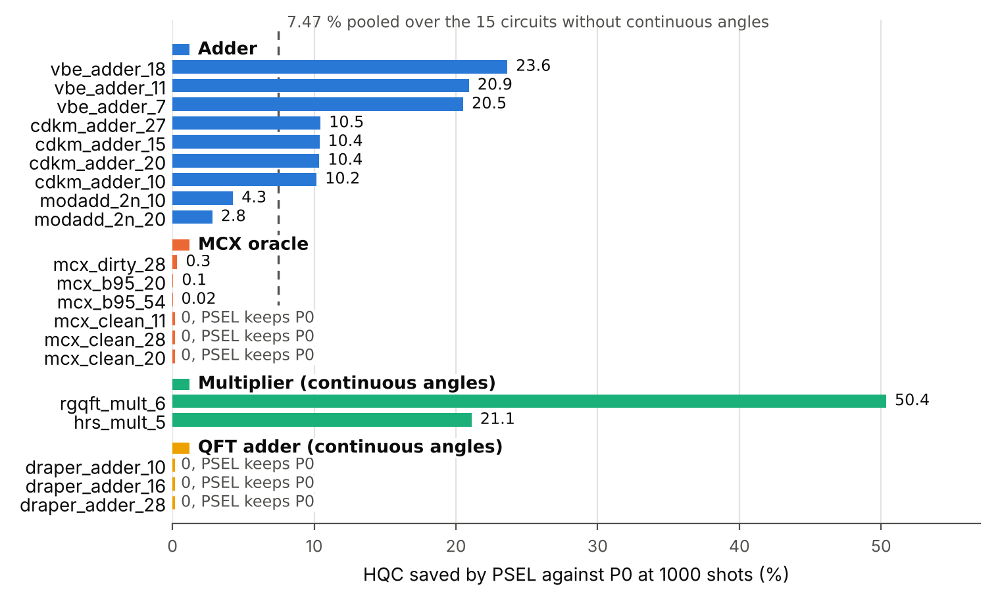

# PSEL4 keeps ZX rewriting only where it beats pytket level 3 on Quantinuum H2

**PSEL4 is a drop-in pytket pass selector. By construction it never costs more HQC than pytket level 2 or level 3 on a circuit where both pass its checks. On the 17 arithmetic and oracle circuits whose output is proven it saves 0.80 % against level 3.**

Team Learned ZX Rewriting: C.-F. Kam, A. Mahasinghe, D. De Silva, N. Karunarathne, F. Cadet, M. Bessafi, K. De Silva. Quantinuum Singapore Grand Challenge, submission 1. Main report `report.pdf`, technical appendix `report_full.pdf` (cited as "App."), source `code.zip` with `README.md`, emulator evidence `EVIDENCE.md`.

## Problem statement

A run on Quantinuum H2 is billed in HQC = 5 + C (N_1q + 10 N_2q + 5 N_SPAM) / 5000 (App. 1.2). The user is a team that runs arithmetic and oracle subroutines on H2 from a fixed HQC budget. [O] Its decision is whether a circuit should go through ZX rewriting before pytket. ZX rewriting can lower the HQC or raise it. Run blindly before pytket level 2, it costs 6.27 % more HQC on 180 Trotter circuits and 22.1 % more on 3 QFT adders.

## Approach

The baseline is pytket-quantinuum at optimisation level 3. On the 20 family C circuits level 3 alone costs 23.16 % less than the default level 2. PSEL4 compiles each circuit four ways. These are level 2, level 3, PyZX teleport_reduce before level 2 and teleport_reduce before level 3. It drops a candidate that fails its exactness check, which runs up to 20 qubits only, and keeps the one with the lower HQC. Level 2 and level 3 are always candidates. The guarantee above is therefore a design property. It is not a measured result. A PyZX miter proves the PSEL4 output equal to its input on 17 of the 20 family C circuits. PSEL4 is pytket's `PassSelector` pattern with HQC as the metric. The contribution is the measured cost ledger and the guard. [O]

## Key results

<small>Figure 1. Family C per circuit, two-candidate PSEL against level 2. A zero bar means PSEL keeps level 2. Data `value/family_C_selector.csv`, script `value/fig_hqc_saved.py`.</small>

- **Against level 3, proven outputs.** PSEL4 saves 0.80 % on the 17 family C circuits whose output is proven.
- **Against level 3, all of family C.** PSEL4 saves 3.50 % on all 20 circuits. 87.6 % of that saving comes from 3 picks whose output is not proven.
- **Against level 3, other families.** PSEL4 saves 0.73 % on 15 Clifford+T benchmarks (family B1) and 0.44 % on the Grover use case. On 180 Trotter circuits (family A) it saves 1.74 % by choosing between the two levels only.
- **Guard.** The same per-circuit choice removes the blind ZX losses of 6.27 % and 22.1 % stated above.
- **Learned gate.** A small classifier on input-circuit features skips 123 of 245 ZX compilations for 46.6 HQC of lost saving when a whole family is held out. It does not beat the constant choices in held-out accuracy (App. 3.8.2).
- **Emulator.** 20 H2-2E jobs and 3 H2-Emulator jobs ran, with job IDs in `EVIDENCE.md`.

**Limits.** No user interview. Family C is count-only apart from one emulator run. No hardware run. On the emulator P2 beats P0 on vbe_adder_3 in the repeats-only check (Holm p = 0.030 over two circuits, a check chosen after the pooled result). The pooled primary test over three circuits gives Holm p = 0.052. Inputs are all-zero.

## Relevance to quantum computing

The cited literature places adders in the modular arithmetic of Shor factoring (App. 1.4) and arithmetic in derivative pricing (App. 1.5, Chakrabarti et al., arXiv:2012.03819). On a surface code each T gate consumes one magic state (Litinski, arXiv:1808.02892). PSEL4 lowers the cost of these subroutines on H2 today. [O]

## Potential impact

Most of the cost gain over the default level 2 comes from level 3 itself. [O] A user who already runs level 3 gains a small exact saving and a guard against ZX losses. [O] PSEL4 costs three extra compilations. Learned ZX rewriting is the finals goal. A model will predict which ZX rewrites lower HQC, and the ledger rows are its training data. [O]

<small>Untagged statements are facts checkable in the repository. [O] marks a judgement.</small>
