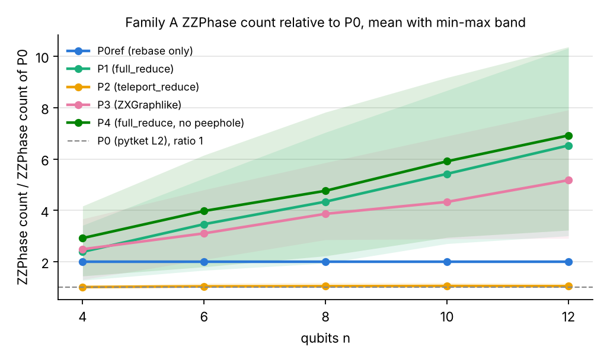
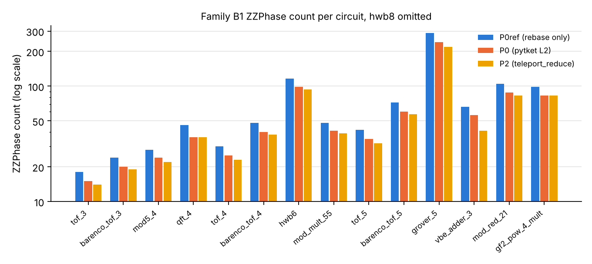

# A pass selector keeps ZX rewriting only where it lowers the cost of a circuit on Quantinuum H2

Team Learned ZX Rewriting: C.-F. Kam, A. Mahasinghe, D. De Silva, N. Karunarathne, F. Cadet, M. Bessafi and K. De Silva. Quantinuum Singapore Grand Challenge, submission 1, judge-facing report. The full report v5 is attached as the technical appendix `report_full.pdf` and is cited below as "Appendix" with its section numbers.

`[F]` Tags. `[F]` marks a statement that can be checked against a file in the repository or a cited source. `[O]` marks a judgement or a plan. Every number in this report appears in the full report or in the script outputs it names under `value/` and `results/`. `report/check_short_numbers.py` checks this.

| Rubric criterion | Weight | Section here | Appendix |
|---|---|---|---|
| Problem & Value | 30 % | 1 | 1, 1.1 to 1.5, 3.8, 3.9 |
| Technical Performance & Hardware Use | 30 % | 3, 6 | 2.2, 3, 3.6, 3.7, 3.7.1, 3.8, 3.9, 6 |
| Scientific Merit | 20 % | 2.5, 4 | 2.5, 3.4 |
| Engineering & Reproducibility | 20 % | 5 | 5 |

## Summary

`[F]` We deliver PSEL, a pass selector in `pipelines/pass_select.py`. For each circuit it compiles once with P0 and once with P2 and keeps the result with the lower H2 cost in HQC. P0 is the Quantinuum default pass of pytket at optimisation level 2. P2 runs PyZX teleport_reduce before P0. Our P0 and P2 give the same counts as the official pytket-quantinuum pass on all 445 compiled rows of families A, B1, B1x and B2. Family C was not compiled with the official pass. PSEL cannot cost more than P0 where P0 passes the exactness check. On 15 application-scale circuits of 20 to 56 qubits without continuous rotation angles it saves 748.4 of 10,019.6 HQC or 7.47 % against P0. Over all 20 application-scale circuits it saves 4104.4 HQC or 16.7 %. The saving is 12.9 % on adders and 34.5 % on multipliers. The 34.5 % comes from two multipliers with continuous rotation angles. It is 0.1 % on multi-controlled Toffolis and 0 on QFT adders. These 20 circuits are count-only and 14 of them are spot-checked on 64 random basis inputs. On two exact Grover search instances PSEL saves 5.42 % and 4.96 % of the HQC. On the H2-2E emulator P2 raises the Hellinger fidelity of vbe_adder_3 by 0.0108 at 4000 shots per pipeline with z = +2.38. The Holm-adjusted p over the three H2-2E circuits is 0.052 and grover_5 shows no gain. A certified T-count floor from the team's exactness-barrier theorem bounds what any exact rewrite can still remove on 24 circuits with at most 5 qubits. `[O]` PSEL tells an H2 user per circuit whether ZX rewriting pays, and it never answers at a loss against P0.

## 1. Problem and value

### 1.1 User, decision and tool

- `[O]` User. A team that runs Clifford+T subroutines on Quantinuum H2 from a fixed HQC budget and will later price the same subroutines on a fault-tolerant machine.
- `[O]` Decision. Should this circuit go through ZX rewriting before pytket's Quantinuum pass?
- `[F]` Tool. PSEL takes this decision per circuit from the HQC of both compilations. An HQC tie goes to the lower two-qubit count n_2q. A further tie goes to P0. A candidate that fails the exactness check is dropped (Appendix 2.2).
- `[F]` Guarantee. P0 is always one of the two candidates. PSEL therefore cannot cost more HQC than P0 on a circuit where P0 passes the check. This holds by construction and is not a measured result.
- `[F]` Need for a selector. Running P2 on every circuit is not safe. On the 180 Trotter circuits of family A P2 alone would cost 1,030.4 HQC or 6.27 % more than P0. On the 60 XXZ circuits it would raise the total by 12.33 %. PSEL keeps P0 on all 60 of them.
- `[F]` User validation. No user interview or survey is part of this submission. `[O]` The need rests on the H2 cost formula and on the algorithm literature cited in Appendix 1.4.

### 1.2 Savings by application on H2

`[F]` Table 1. HQC at 1000 shots of P0 and PSEL. Family C is count-only above 20 qubits and is reported per application (`value/family_C_selector.md`, Appendix Table 1.1b). B1 is the checked Clifford+T benchmark set with n <= 12 (`value/selector_ledger.md`, Appendix Table 1.1a). The two multipliers and the three QFT adders carry continuous rotation angles. The row without continuous angles holds the 9 adders and the 6 MCX oracles.

| Application | Family | Circuits | Qubits | PSEL picks P2 | HQC P0 | HQC PSEL | Saved | Saved % |
|---|---|---|---|---|---|---|---|---|
| Adder | C | 9 | 20-56 | 9 | 5777.0 | 5031.4 | 745.6 | 12.9 |
| Grover oracle (MCX) | C | 6 | 21-56 | 3 | 4242.6 | 4239.8 | 2.8 | 0.1 |
| Family C without continuous angles | C | 15 | 20-56 | 12 | 10019.6 | 9271.2 | 748.4 | 7.47 |
| Multiplier, continuous angles | C | 2 | 21-24 | 2 | 9737.0 | 6381.0 | 3356.0 | 34.5 |
| QFT adder, continuous angles | C | 3 | 20-56 | 0 | 4778.4 | 4778.4 | 0.0 | 0.0 |
| All of family C | C | 20 | 20-56 | 14 | 24535.0 | 20430.6 | 4104.4 | 16.7 |
| Clifford+T benchmarks | B1 | 15 | 5-12 | 14 | 15,516.0 | 14,772.4 | 743.6 | 4.79 |

`[F]` Shots. On family C PSEL affords between 0 and 7,159 more shots per circuit with one 10,000 HQC budget per circuit. The H2 hardware guide limits a job to 10,000 shots and each job pays 5 HQC. On family C vbe_adder_7 gains the most. Shot gains belong to single circuits and are not summed.

`[F]` Table 1b. P2 against P0 on the checked B1 circuits by application area (Appendix Table 1.1, `value/value_by_application.md`). PSEL equals P2 on every B1 circuit except qft_4, where P2 costs 0.4 HQC more and PSEL keeps P0.

| Area | Circuits | HQC P0 | HQC P2 | Saved % | Median per-circuit % |
|---|---|---|---|---|---|
| Integer factoring (Shor) | 4 | 592.2 | 545.6 | 7.9 | 4.2 |
| Elliptic-curve discrete log | 1 | 216.2 | 215.2 | 0.5 | 0.5 |
| Unstructured search (Grover) | 8 | 1,183.6 | 1,127.0 | 4.8 | 3.0 |
| Reversible logic, no sourced algorithm | 2 | 13,524.0 | 12,885.0 | 4.7 | 4.5 |

- `[F]` Multipliers. rgqft_mult_6 drops from 4445.6 to 2206.6 HQC, a saving of 50.4 %. Its two-qubit count falls from 1994 to 990. Both multipliers carry continuous rotation angles and supply 3356.0 of the 4104.4 HQC saved on family C.
- `[F]` Adders. PSEL picks P2 on all 9 adders. The three VBE adders save 20.5 %, 20.9 % and 23.6 %. The four CDKM adders save 10.2 % to 10.5 %.
- `[F]` Where ZX does not pay. On the three QFT adders P2 is dearer than P0 and PSEL keeps P0. On the MCX oracles the saving is 2.8 HQC in total. A fixed choice of P2 would cost 21487.8 HQC on family C against 20430.6 for PSEL. `[O]` These rows show the selector at work.
- `[F]` hwb8 caveat. On B1 the circuit hwb8 alone accounts for 84.5 % of the PSEL saving and serves no sourced quantum algorithm. Without hwb8 the B1 saving is 115.0 HQC. The median per-circuit saving on B1 is 3.94 %. `[O]` The median is the better guide for a single small circuit.

### 1.3 Use case: Grover search within the 10,000 HQC budget

`[F]` Two complete Grover searches with one marked item were built from Grover 1996 and the multi-controlled gate of Barenco et al. 1995 (`value/usecase.md`, Appendix 3.9 and Table U1). They are small enough for an exact check. Both pass it under P0 and P2 with a deviation of at most 2.7e-14 in magnitude.

| Instance | Qubits | Ideal success | HQC P0 | HQC PSEL | Saving % | Shots in 10,000 HQC, P0 | Shots, PSEL | Extra shots |
|---|---|---|---|---|---|---|---|---|
| grover_d5 | 7 | 0.999182 | 734.2 | 694.4 | 5.42 | 13699 | 14490 | 791 |
| grover_d6 | 9 | 0.996586 | 1629.4 | 1548.6 | 4.96 | 6153 | 6475 | 322 |

- `[F]` The shot counts respect the H2 limit of 10,000 shots per job and charge 5 HQC per job. PSEL buys 5.77 % more shots on grover_d5 and 5.23 % more on grover_d6.
- `[F]` The expected number of marked-item hits within the budget rises from 13687.8 to 14478.2 on grover_d5 at the ideal success probability.
- `[O]` A slope model fitted on B1 proxy data predicts a fidelity ratio of 1.0287 and 1.0583 in favour of PSEL as a model prediction. No platform job ran these instances.

### 1.4 Magic states on a fault-tolerant machine

- `[F]` Each T gate of a surface-code machine consumes one magic state (Litinski 2019). On H2 a T gate is a free Rz and changes no HQC.
- `[F]` On B1 the ZX stage removes 2,862 of 7,048 T gates of the written circuits, or 40.6 %. On family C the ZX stage removes 1110 T gates from the 9 adders and 30 from the 3 MCX oracles where PSEL picks P2. The two multipliers lose 1,408 more but keep 600 and 507 rotations outside the pi/4 grid, so T-count is not their non-Clifford cost. On the Grover instances the T-count falls from 448 to 210 and from 1008 to 436. `[O]` This T-count drop comes from Toffolis that the Barenco construction repeats on the same qubits. It is not a general ZX gain.

`[F]` Table 1c. T-count as written and after the ZX stage of P2 by application area (Appendix Table 1.2). Each saved T gate is one magic state.

| Area | Family | T written | T after ZX | Saved % |
|---|---|---|---|---|
| Integer factoring (Shor) | B1 | 307 | 199 | 35.2 |
| Elliptic-curve discrete log | B1 | 112 | 68 | 39.3 |
| Unstructured search (Grover) | B1 | 637 | 327 | 48.7 |
| Reversible logic, no sourced algorithm | B1 | 5,992 | 3,592 | 40.1 |
| All areas | B1 | 7,048 | 4,186 | 40.6 |
| All B1x circuits, count-only | B1x | 1,652 | 854 | 48.3 |

- `[F]` These savings are against the written circuits. Against six published optimisers our T-count after ZX equals the best ancilla-free value on 14 of 22 comparable circuits (Section 4).
- `[F]` Scope of the certificate. The certified floor covers only the 24 circuits of `results/certificates.csv`, all with n at most 5. It covers no circuit of family C and no Grover instance.
- `[F]` No conversion of magic states into Helios time or cost is made. Quantinuum has not published the factory and logical-cycle figures in any source we found.

## 2. Method

### 2.1 Pipelines and selector

`[F]` All pipelines are in `pipelines/compile.py` and target the H2 gate set of Rz, PhasedX, ZZPhase, ZZMax, Measure and Reset with all-to-all connectivity (Appendix 2.2).

| Name | Stages |
|---|---|
| P0ref | Rebase to the native set with no optimisation. Reference for the exactness check. |
| P0 | pytket-quantinuum 0.59.3 default pass at optimisation level 2. The baseline. |
| P2 | PyZX teleport_reduce, then P0. |
| P1, P3, P4 | ZX extraction variants, then P0. Kept as controls. |
| PSEL | Selector over P0 and P2. Adds no compilation stage. |

`[F]` Figure 1. Family A. ZZPhase count of each pipeline divided by the P0 count on the same circuit, mean over the 36 circuits at each n with the min-max band shaded. Data: Appendix Table A2 and `results/family_A_counts.csv`.

`[F]` P1, P3 and P4 are above P0 in ZZPhase count on all 180 family A circuits. On B1 they are above P0 on 14, 14 and 15 of the 15 circuits. `[O]` Only teleport reduction keeps the circuit skeleton and helps on H2. PSEL therefore selects between P0 and P2 only.

### 2.2 Official baseline check

`[F]` Our P0 reproduces the pass from the pytket-quantinuum source. `results/official_baseline.md` compares it with `QuantinuumBackend("H2-1").get_compiled_circuit(circ, optimisation_level=2)` built offline from the device list in the package. The two passes have the same stages in the same order. The one parameter difference is a set of classical op types that no benchmark input contains. On all 445 compiled rows of families A, B1, B1x and B2 the official pass gives the same n_2q, n_1q, two-qubit depth and HQC as our P0 and P2. The PSEL savings against the official P0 are therefore identical to ours. This holds on families A, B1, B1x and B2. Family C was not compiled with the official pass.

| Family | Official P0 rows identical | Official P2 rows identical | Exactness of official output |
|---|---|---|---|
| A | 180 of 180 | 180 of 180 | 180 and 180 checked, all ok |
| B1 | 15 of 15 | 14 of 14 | 15 and 14 checked, all ok |
| B1x | 8 of 8 | 8 of 8 | unchecked |
| B2 | 20 of 20 | 20 of 20 | 20 and 20 checked, all ok |
 The one missing row is hwb8 under the official P2, which timed out at 565 s.

### 2.3 HQC formula

`[F]` The organisers' sample code prices an H2 program as HQC = 5 + N_shots (N_1q + 10 N_2q + 5 N_SPAM) / 5000. N_1q counts PhasedX gates. N_2q counts ZZPhase and ZZMax gates. N_SPAM counts initialisations, measurements and resets. `estimate_cost` starts N_SPAM at the number of qubits and adds one per measurement and reset. A circuit with every qubit measured once has N_SPAM = 2n. Rz gates are free. `pipelines/compile.py:hqc` reproduces the function `estimate_cost` of `Quantinuum/sg_grand_challenge` (Appendix 1.2). All HQC figures are at 1000 shots unless a row states otherwise.

### 2.4 Exactness checks

- `[F]` Families A, B1 and B2. Every compiled circuit is checked against P0ref. The check is the unitary deviation for n <= 8 and the statevector infidelity beyond, with tolerance 1e-8. All 1260 family A rows, all 105 B1 rows and all 100 B2 rows pass (Appendix 2.4).
- `[F]` Family C. The compiled circuit is spot-checked on 64 random basis inputs and must agree with the input up to one global phase. 14 of the 20 circuits pass under P0 and P2. The other 6 exceed 2^20 amplitudes in the sparse simulation and are unchecked. Four of them are P2 picks, namely modadd_2n_10, modadd_2n_20, mcx_dirty_28 and mcx_b95_54. A pass covers 64 of 2^n inputs and is not a proof of equivalence (Appendix 2.4). PSEL itself runs no exactness check above 20 qubits. The 64-input spot check is a separate offline run.
- `[F]` Continuous angles. The Draper adders and the two multipliers carry rotation angles off the pi/4 grid (`bench/family_C/manifest.csv`). PyZX rounds angles to fractions. On draper_adder_28 this changes the P2 input by at most 1.50e-06 rad per angle. PSEL keeps P0 on that circuit.
- `[F]` Family B1x has 8 circuits with 14 to 19 qubits and is count-only. Its rows carry no exactness check and are never merged with B1.

### 2.5 The certificate

`[F]` Corollary cert and Theorem C(c) of the exactness-barrier manuscript of Kam et al. give a per-instance floor (arXiv:2608.22801). Let C be a Clifford+T circuit. Its exact Pauli channel is a 4^n x 4^n matrix over Z[sqrt 2]. The least denominator exponent of that matrix bounds from below the T-count of every rewrite that preserves C exactly. `barrier/certificate.py` computes it in exact integer arithmetic. `barrier/test_certificate.py` reproduces the finite checks of the manuscript with 69 of 69 checks passed (Appendix 2.5).

## 3. Results on Quantinuum platforms

### 3.1 Count results by family

`[F]` Table 2. PSEL against P0 and P2 per family at 1000 shots (`value/selector_ledger.md`, `value/family_C_selector.md`, Appendix Tables 1.1a and 1.1b). The PSEL column never exceeds the P0 column. On family C the 15 circuits without continuous angles save 7.47 %.

| Family | Content | Circuits | Qubits | Check | Picks P2 | HQC P0 | HQC P2 | HQC PSEL | Saved vs P0 % |
|---|---|---|---|---|---|---|---|---|---|
| A | Trotter TFIM, XXZ, ladder | 180 | 4-12 | exact | 57 | 16,422.6 | 17,453.0 | 16,376.6 | 0.28 |
| B1 | Clifford+T benchmarks | 15 | 5-12 | exact | 14 | 15,516.0 | 14,772.8 | 14,772.4 | 4.79 |
| B1x | Clifford+T benchmarks | 8 | 14-19 | none | 7 | 3,288.8 | 3,141.0 | 3,141.0 | 4.49 |
| B2 | Synthesised Haar unitaries | 20 | 2-3 | exact | 0 | 730.0 | 731.6 | 730.0 | 0.00 |
| C | Arithmetic and oracles | 20 | 20-56 | spot check on 14 | 14 | 24535.0 | 21487.8 | 20430.6 | 16.7 |

`[F]` Table 2b. Family C per circuit (`value/family_C_selector.md`, Appendix Section 3.8 and Table C3). Check "pass" means agreement on 64 random basis inputs under both P0 and P2. "none" means the sparse simulation exceeded 2^20 amplitudes.

| Circuit | Qubits | Application | HQC P0 | HQC PSEL | Pick | Saved % | n_2q P0 | n_2q PSEL | Check |
|---|---|---|---|---|---|---|---|---|---|
| mcx_clean_11 | 21 | Grover oracle (MCX) | 180.8 | 180.8 | P0 | 0.0 | 59 | 59 | pass |
| mcx_b95_20 | 22 | Grover oracle (MCX) | 693.4 | 693.0 | P2 | 0.1 | 292 | 292 | pass |
| mcx_clean_20 | 39 | Grover oracle (MCX) | 339.2 | 339.2 | P0 | 0.0 | 113 | 113 | pass |
| mcx_clean_28 | 55 | Grover oracle (MCX) | 480.0 | 480.0 | P0 | 0.0 | 161 | 161 | pass |
| mcx_dirty_28 | 55 | Grover oracle (MCX) | 591.0 | 589.0 | P2 | 0.3 | 216 | 215 | none |
| mcx_b95_54 | 56 | Grover oracle (MCX) | 1958.2 | 1957.8 | P2 | 0.0 | 836 | 836 | none |
| draper_adder_10 | 20 | QFT adder | 370.4 | 370.4 | P0 | 0.0 | 145 | 145 | pass |
| draper_adder_16 | 32 | QFT adder | 906.8 | 906.8 | P0 | 0.0 | 376 | 376 | none |
| draper_adder_28 | 56 | QFT adder | 3501.2 | 3501.2 | P0 | 0.0 | 1483 | 1483 | none |
| modadd_2n_10 | 20 | adder | 388.2 | 371.6 | P2 | 4.3 | 147 | 142 | none |
| cdkm_adder_10 | 22 | adder | 371.6 | 333.8 | P2 | 10.2 | 141 | 121 | pass |
| vbe_adder_7 | 22 | adder | 370.4 | 294.4 | P2 | 20.5 | 142 | 107 | pass |
| cdkm_adder_15 | 32 | adder | 551.6 | 494.4 | P2 | 10.4 | 211 | 181 | pass |
| vbe_adder_11 | 34 | adder | 593.6 | 469.4 | P2 | 20.9 | 230 | 173 | pass |
| modadd_2n_20 | 40 | adder | 802.2 | 779.6 | P2 | 2.8 | 307 | 302 | none |
| cdkm_adder_20 | 42 | adder | 731.6 | 655.8 | P2 | 10.4 | 281 | 241 | pass |
| vbe_adder_18 | 55 | adder | 984.2 | 751.6 | P2 | 23.6 | 384 | 279 | pass |
| cdkm_adder_27 | 56 | adder | 983.6 | 880.8 | P2 | 10.5 | 379 | 325 | pass |
| hrs_mult_5 | 21 | multiplier | 5291.4 | 4174.4 | P2 | 21.1 | 2335 | 1807 | pass |
| rgqft_mult_6 | 24 | multiplier | 4445.6 | 2206.6 | P2 | 50.4 | 1994 | 990 | pass |

- `[F]` On family A PSEL avoids 1,076.4 HQC against always running P2 and still saves 46.0 HQC against P0. This avoided loss is what PSEL adds over P2 on Trotter circuits.
- `[F]` PSEL never raises n_2q against P0 on any of the 223 circuits of families A, B1, B1x and B2. On family C it lowers n_2q by 1884 in total.
- `[F]` Family A by model. PSEL picks P2 on 32 of the 60 TFIM circuits and saves 0.62 % against P0. On the 60 ladder circuits it picks P2 on 25 and saves 0.52 %. On the 60 XXZ circuits it keeps P0 throughout.

`[F]` Figure 2. Family B1. ZZPhase count per circuit for P0ref, P0 and P2 on a log scale, ordered by qubit number and then by T-count. hwb8 is omitted. Data: Appendix Table B1.

- `[F]` The best single B1 circuit is vbe_adder_3. P2 cuts its ZZPhase count from 56 to 41, a reduction of 26.8 %. At a 10,000 HQC budget PSEL buys 28.5 % more shots of it.
- `[F]` Scalability. Family C reaches 56 qubits. Its largest circuit under P0 has 2335 two-qubit gates. The largest B1 circuit hwb8 took 815.7 s under P2 in the stored run. `[O]` The ZX stage is the time cost of PSEL. It runs once per circuit before any shot is paid.

### 3.2 H2-Emulator and H2-2E

`[F]` Access. The team reached the platforms on 8 October 2026 through `aqora` 0.35.1 as team `learned_zx_rewriting`. Every job is a row of `results/emulator_jobs.csv` with its job id (Appendix 3.7).

- `[F]` H2-Emulator. Three jobs with 22 circuit rows completed at 1000 shots with noise. At this shot count no P2 against P0 difference is resolved on a single circuit. A fourth job was rejected by the platform quota.
- `[F]` H2-2E. 18 jobs completed. Six ran vbe_adder_3, hwb6 and grover_5 under P0 and P2 at 1000 shots. Twelve repeated vbe_adder_3 and grover_5 three more times. Their HQC estimates sum to 5933.2 of the 10,000 HQC team quota, or 59.3 %.

`[F]` Table 3a. Single H2-2E runs at 1000 shots, one job per row (Appendix Table E2). The HQC estimate is the formula value stored with each job.

| Circuit | Pipeline | n_2q | HQC estimate | F_H | sd F_H |
|---|---|---|---|---|---|
| vbe_adder_3 | P0 | 56 | 151.6 | 0.9540 | 0.0066 |
| vbe_adder_3 | P2 | 41 | 119.0 | 0.9590 | 0.0063 |
| hwb6 | P0 | 99 | 243.0 | 0.9240 | 0.0084 |
| hwb6 | P2 | 94 | 232.6 | 0.9090 | 0.0091 |
| grover_5 | P0 | 240 | 565.6 | 0.8652 | 0.0114 |
| grover_5 | P2 | 218 | 528.2 | 0.8728 | 0.0112 |

`[F]` All three single-run differences lie within two sd of zero. Their z values are +0.55, -1.21 and +0.48 in the row order above.

`[F]` Table 3b. Pooled H2-2E runs at 4000 shots per pipeline (Appendix Table E3). F_H is the Hellinger fidelity of the summed counts to the ideal distribution.

| Circuit | Pipeline | n_2q | Pooled F_H | sd | Per-run F_H range |
|---|---|---|---|---|---|
| vbe_adder_3 | P0 | 56 | 0.9520 | 0.0034 | 0.9470 to 0.9560 |
| vbe_adder_3 | P2 | 41 | 0.9628 | 0.0030 | 0.9590 to 0.9680 |
| grover_5 | P0 | 240 | 0.8704 | 0.0053 | 0.8482 to 0.8652 |
| grover_5 | P2 | 218 | 0.8711 | 0.0053 | 0.8400 to 0.8728 |

- `[F]` vbe_adder_3. F_H(P2) minus F_H(P0) is +0.0108 with sd 0.0045. The z is +2.38 and the two-sided p is 0.017.
- `[F]` Multiplicity. The two repeated circuits were chosen after the single runs. The Holm-adjusted p is 0.035 over the two repeated circuits and 0.052 over all three H2-2E circuits. `[O]` The gain is significant before correction and after correction over two circuits. It is not significant at 0.05 after correction over all three.
- `[F]` grover_5. The difference is +0.0007 with sd 0.0075 and z = +0.10 and is not resolved. It lies 2.94 sd below the gain of 0.0229 predicted by the slope model.
- `[F]` No cell rejects homogeneity of its four runs at the 0.05 level.
- `[O]` The H2-2E runs confirm execution and HQC accounting on a Quantinuum emulator. They give one fidelity gain and one unmet prediction, and this report states both.

### 3.3 Selene

`[F]` Quantinuum's local emulator Selene ran every compiled circuit of families A and B1 with n <= 10 under P0, P1 and P2 (Appendix 3.6). In 468 noiseless runs no shot landed outside the exact support and no run was flagged. In 468 depolarising runs at the H2-2E rates the mean F_H over 156 circuits is 0.9716 for P0, 0.9459 for P1 and 0.9702 for P2. `[O]` The compiled files run on Quantinuum's own toolchain and reproduce the distributions the local checks computed. `[F]` Selene does not contain the full H2-2E noise model.

## 4. Scientific contribution

### 4.1 The certificate on real circuits

`[F]` The certificate ran on 24 circuits. These are the 20 synthesised Haar circuits of B2 at n = 2 and 3 and the four B1 circuits at n = 5. The floor is at or below the T-count after ZX on all 24 rows.

- `[F]` Synthesised circuits. On B2 the floor is at least 99.28 % of the T-count after ZX on every circuit. The pooled certified fraction is 0.997. Further exact T optimisation of these instances can gain at most 0.3 % of the pooled remaining T-count and at most 0.72 % on any one circuit. All four configuration means lie inside the range of 99.4 to 99.9 % stated in the manuscript.

`[F]` Table 4a. Certificate on family B2 by configuration, 5 circuits each (Appendix Table C1).

| n | eps | Mean T written | Mean floor / T after ZX % | Min floor / T after ZX % | Mean achieved by ZX % |
|---|---|---|---|---|---|
| 2 | 1e-03 | 638.4 | 99.84 | 99.67 | 2.19 |
| 2 | 1e-05 | 1048.4 | 99.79 | 99.42 | 2.29 |
| 3 | 1e-03 | 2571.6 | 99.57 | 99.28 | 3.14 |
| 3 | 1e-05 | 4220.8 | 99.76 | 99.59 | 1.27 |

- `[F]` Hand-written circuits. On barenco_tof_3, mod5_4, qft_4 and tof_3 the floor is 47 against 106 T gates after ZX, a fraction of 0.443.
- `[O]` For a user the certificate turns the question whether a better optimiser can help into a number. The answer is no on synthesised words and open on Toffoli networks.

### 4.2 Comparison with six published optimisers

`[F]` Table 4b. Excerpt of Appendix Table C2 for the four certified circuits. "Best ancilla-free" is the smallest T-count on the same qubits in six papers fetched from arXiv on 8 October 2026. These are Amy, Maslov and Mosca 2014, Amy and Mosca 2016, Nam et al. 2018, TODD 2018, Kissinger and van de Wetering 2020 and AlphaTensor-Quantum 2024.

| Circuit | T written | T after ZX | Best ancilla-free | Best with ancillas | Certified floor |
|---|---|---|---|---|---|
| barenco_tof_3 | 28 | 16 | 16 | 13 | 4 |
| mod5_4 | 28 | 8 | 7 | 16 | 2 |
| qft_4 | 69 | 67 | 67 | 53 | 37 |
| tof_3 | 21 | 15 | 15 | 13 | 4 |

- `[F]` On the 22 comparable circuits of B1 and B1x our T-count after ZX equals the best published ancilla-free value on 14. On four of the other eight TODD after PyZX is better. On the three Galois-field multipliers the best ancilla-free values in Table C2 come from AlphaTensor-Quantum. On hwb6 a T-par entry is better.
- `[F]` On the four certified circuits the published optimisers close 1 of the 59 gates between our count and the floor. The other 58 gates lie between the best published count and the floor.
- `[O]` What it shows. The floor is tight on synthesised circuits and loose on Toffoli networks. Published optimisers add one gate beyond PyZX on the certified circuits. What it does not show. The certificate cannot tell whether the 58 open gates are headroom for a better rewrite or slack in the bound. It covers no circuit with more than 5 qubits.
- `[F]` Novelty. None of the six papers compares ZX rewriting against pytket's Quantinuum pass on the native H2 gate set. `[O]` This submission pairs that comparison in HQC with a per-instance lower bound on the T-count.

## 5. Engineering and reproducibility

`[F]` Repository layout (Appendix 5 and `README.md`).

| Path | Content |
|---|---|
| `bench/` | Generators and builders of families A, B1, B1x, B2, C and the use case, with manifests |
| `pipelines/` | Pipelines, metrics, exactness checks, PSEL and the official baseline comparison |
| `barrier/` | Exact certificate with a line map to the manuscript in `barrier/NOTES.md` |
| `noise/`, `selene/`, `submit/` | Density-matrix proxy, Selene runs, platform jobs and their statistics |
| `value/` | Ledgers behind Sections 1, 3 and 6, each script with a test file |
| `results/` | Every CSV, log, compiled QASM file, job payload and verification report |

- `[F]` Tests. The test table of Appendix 5 lists 18 test files with their commands, results and dates. Examples are `pipelines/test_pass_select.py` with 3 of 3 passed and `value/test_selector_ledger.py` with 4 of 4 passed. Family C and the use case have their own test files `value/test_family_C_selector.py` and `value/test_usecase.py`.
- `[F]` Generated numbers. Every results table of the full report is produced by `report/make_tables.py` from `results/*.csv`. The value tables are produced by the scripts under `value/` and carry no number typed by hand.
- `[F]` Clean-clone run. On 8 October the repository was cloned into a scratch directory and the pipeline was rerun with reduced variants of the long compilation steps (`results/repro_2026-10-08/repro_log.md`). The log reports no change in any count, T-count, HQC, fidelity or table cell. The run found two gaps. A fits log was ignored by git and the pyzx fork had no fetch command. `README.md` now gives the fetch command with the commit hash.
- `[F]` Independent verification. Twelve verification reports by agents that did not produce the results are in `results/verification_2026-10-0*.md`. Each recomputes claims from the raw files and lists mismatches.
- `[F]` Notebook. The submission cell of `report/notebook_skeleton.py` was executed against the free H2-2SC syntax checker. It compiled tof_3 with PSEL and returned job `AFByb3ZpZGVySm9iAaEdzTywfrOWhGbnlXxd-w` with status COMPLETED. The executed export is `report/notebook_executed.html`. The cell refuses any platform whose name does not end in SC.
- `[F]` Seeds and versions. The circuit generators use seed 20261006. The environment table of Appendix 5 pins pytket 2.18.4, pytket-quantinuum 0.59.3 and pyzx 0.10.7.

## 6. Plan for H2 hardware in the finals

`[F]` `value/finals_plan.py` sizes the runs from the measured H2-2E gain and not from the model prediction (`value/finals_plan.md`, Appendix 6).

| Test | Circuit | Shots per pipeline | Power | HQC |
|---|---|---|---|---|
| Primary | vbe_adder_3, P0 and P2 | 2900 | 0.65 | 765.7 |
| Secondary | grover_5, P0 and P2 | 1900 | 0.65 | 2069.2 |
| Total | four jobs | | | 2835.0 |

- `[O]` Primary rule, fixed before any hardware data. The test is one-sided at alpha 0.05. A z of 1.645 or more confirms that P2 raises F_H over P0 on H2 hardware. A z of -1.645 or less refutes it. Any other z gives no hardware claim.
- `[O]` Secondary rule. grover_5 tests whether the shortfall against the slope model recurs on hardware. It does not enter the primary decision.
- `[O]` If the finals budget is below 2835.0 HQC the primary test runs alone at 765.7 HQC.

## 7. Limitations

- `[F]` Nothing in this report has run on H2 hardware. All platform results are emulator runs.
- `[F]` The vbe_adder_3 fidelity gain is not significant at 0.05 after Holm correction over all three H2-2E circuits. grover_5 shows no gain at 4000 shots.
- `[F]` Family C is count-only. 6 of its 20 circuits have no check and four of them are P2 picks. The other 14 are spot-checked on 64 random basis inputs. Family B1x has no check.
- `[F]` The 16.7 % family C saving rests on two multipliers with continuous rotation angles. Without continuous-angle circuits the saving is 7.47 %.
- `[F]` hwb8 carries 84.5 % of the B1 saving and has no sourced algorithm role.
- `[F]` The certificate covers 24 circuits with n at most 5. On the four B1 circuits it leaves most of the remaining T-count unaccounted for.
- `[F]` No user interview or survey supports the need. No value is stated in currency.
- `[F]` The learned component of this submission is a cost model fitted on proxy fidelities (Appendix 4). This submission contains no learned rewriting.

## References

1. C.-F. Kam et al., An Exactness Barrier for ZX-Calculus Optimization of Synthesized Clifford+T Circuits, arXiv:2608.22801.
2. D. De Silva et al., Numerical Evaluation of ZX Calculus Optimization for Solovay Kitaev Quantum Circuit Synthesis, arXiv:2608.22810.
3. A. Kissinger and J. van de Wetering, Reducing the number of non-Clifford gates in quantum circuits, Phys. Rev. A 102, 022406 (2020), arXiv:1903.10477.
4. M. Amy, D. Maslov and M. Mosca, arXiv:1303.2042. M. Amy and M. Mosca, arXiv:1601.07363. Y. Nam et al., arXiv:1710.07345. L. Heyfron and E. Campbell, arXiv:1712.01557. AlphaTensor-Quantum, arXiv:2402.14396.
5. L. K. Grover, arXiv:quant-ph/9605043. A. Barenco et al., arXiv:quant-ph/9503016. D. Litinski, Quantum 3, 128 (2019), arXiv:1808.02892.
6. Quantinuum, Helios costing (HQC formula), https://docs.quantinuum.com/systems/trainings/helios/getting_started/costing.html, and Singapore Grand Challenge code samples, https://github.com/Quantinuum/sg_grand_challenge.
7. Quantinuum, H2 emulators and noise model, https://docs.quantinuum.com/systems/user_guide/emulator_user_guide/emulators/h2_emulators.html. Selene, https://github.com/quantinuum/selene.
8. pytket-quantinuum 0.59.3 and PyZX 0.10.7.
