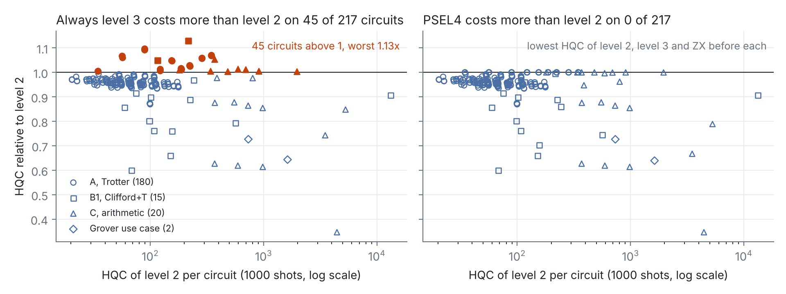

# PSEL4 compiles each H2 circuit four ways and keeps the cheapest

Team Learned ZX Rewriting: C.-F. Kam, A. Mahasinghe, D. De Silva, N. Karunarathne, F. Cadet, M. Bessafi and K. De Silva. Quantinuum Singapore Grand Challenge, submission 1, judge-facing report. The full report v5 is attached as the technical appendix `report_full.pdf` and is cited below as "Appendix" with its section numbers.

`[F]` Tags. `[F]` marks a statement that can be checked against a file in the repository or a cited source. `[O]` marks a judgement or a plan. Every number in this report appears in the full report or in the script outputs it names under `value/` and `results/`. `report/check_short_numbers.py` checks this.

| Rubric criterion | Weight | Section here | Appendix |
|---|---|---|---|
| Problem & Value | 30 % | 1 | 1, 1.1 to 1.5, 3.8, 3.9 |
| Technical Performance & Hardware Use | 30 % | 3, 6 | 2.2, 3, 3.6, 3.7, 3.7.1 to 3.7.6, 3.8, 3.8.3, 3.8.4, 3.9, 6 |
| Scientific Merit | 20 % | 2.5, 3.2, 3.7, 4 | 2.5, 3.4, 3.7.4, 3.8.5 |
| Engineering & Reproducibility | 20 % | 5 | 5 |

## Summary

`[F]` Problem, measured. pytket-quantinuum's level 3 saves 13.9 % HQC over the default level 2 on our 217 circuits but costs more than level 2 on 45 of them. Those 45 lose 372.0 HQC in total and the worst loses 12.95 % on gf2_pow_4_mult (`value/policy_compare.md`, `value/usd_psel4.md`). `[O]` A user cannot tell in advance which circuits regress.

`[F]` Solution. PSEL4 removes that risk. It compiles each circuit four ways (level 2, level 3 and PyZX teleport_reduce before each), checks each result and keeps the cheapest. On the 217 circuits it is costlier than level 2 on none. It needs 15.7 % less HQC than always level 2, 2.08 % (1,051.6 HQC) less than always level 3 and 1.35 % (679.6 HQC) less than the per-circuit cheaper of level 2 and level 3 (Table PC, Section 1.2). It is a drop-in for pytket-quantinuum's default compile on Quantinuum H2. `[O]` Workload assumption. A team spends the Standard Plan's 10,000 HQC a month on this mix. `[F]` PSEL4 then frees 1,573.3 HQC a month, worth USD 19,666 (Section 1.5).

`[F]` Product. The four candidates are level 2 (pytket's default, P0), level 3 (L3), PyZX teleport_reduce before level 2 (P2) and teleport_reduce before level 3 (P2L3). Usage is one command, `python3 pipelines/pass_select.py --psel4 <circuit.qasm>`. Level 2 and level 3 are always candidates. PSEL4 therefore never costs more HQC than level 2 or level 3 on a circuit where both pass its checks. This holds by construction and is not a measured result. Each candidate is checked against its input as a full unitary up to 8 qubits and on 64 random computational basis inputs, the all-zero input included, from 9 to 20 qubits. Above 20 qubits family C relies on PyZX miter proofs.

`[F]` Finding 1, level 3 adoption made safe. Over 217 circuits PSEL4 needs 49,580.6 HQC against 58,837.2 for always level 2 and 50,632.2 for always level 3 (Table PC, Section 1.2). Always level 3 gives 13.95 points of the 15.7 % saving. Per-circuit selection plus ZX give the other 1.79 points. `[O]` A pytket user gets the level 3 savings without its regressions. `[F]` PSEL4 takes 5.08 times the compile wall time of level 2.

`[F]` Finding 2, the HQC-cheapest compile is not the most accurate. Five pre-registered H2-2E comparisons of the PSEL4 pick against level 2 on non-zero inputs (one to four inputs each, 400 shots per program, 1000 on the single-input vbe_adder_7) give this picture (Table F5, Section 3.2). The pick was significantly less accurate on 2. On cdkm_adder_10 the level 3 pick returns the correct sum in 0.8267 of shots against 0.8692 under level 2, z = -2.90. On hwb6 the pick ZX then level 3 returns the correct output in 0.8883 against 0.9200, z = -2.64 and Holm p = 0.017. The pick was not significantly different on 2 (modadd_2n_10 z = -0.22, vbe_adder_3 z = +0.51) and not significantly better on 1 (vbe_adder_7 z = +1.30). No pick was significantly more accurate. On cdkm_adder_10 the less accurate pick has fewer two-qubit gates (118 against 141) and lower two-qubit depth (65 against 122, post hoc), so neither HQC nor gate counts order fidelity on the emulator. The HQC saving still exceeds the accuracy loss. HQC per correct answer is lower for the pick in 5 of 5 pairs (8 of 8 including three earlier pairs of the two-candidate selector), pooled 18.1 % lower (R = 0.8192, bootstrap 95 % interval 0.8132 to 0.8254), decomposed as HQC ratio 0.8170 over accuracy ratio 0.9973 (Table HPC). `[O]` So PSEL4 serves cost-bound users. Accuracy-bound users need a fidelity-aware choice, which is the finals deliverable: a learned selector trained on this ledger and these emulator labels (Section 6).

`[F]` Finding 3, mechanism. HQC charges no Rz gate and bills every PhasedX at the same rate whatever its angle, so the T-count reduction that ZX is best at has no HQC value on H2, and ZX can pay mainly through two-qubit gates, which level 3 already resynthesises (Section 3.7). Level 3 wins mainly through two-qubit resynthesis by GreedyPauliSimp. ZX phase teleportation still removes non-Clifford gates that level 3 keeps. On 14 B1 circuits 656 remain after P2 against 746 after level 3. The ZX-only gain on top of the cheaper pytket level is 0.26 % on the 17 proven family C circuits, 3.21 % on all 20, 0.49 % on B1 and nothing on the Trotter circuits (`value/psel4_zx_only.md`). It falls as T-density rises (family C Spearman rho -0.64).

`[F]` Finding 4, correctness. All 83 PSEL4 picks with 9 to 20 qubits pass the 64-basis-input check, as do 187 of 187 required candidates and 142 of 142 others. Negative controls fail as they should (Section 2.4). A PyZX miter proves the PSEL4 output equal to its input on 17 of the 20 family C circuits of 20 to 56 qubits. MQT QCEC proved none of the other three and returned no counterexample on any pair. Its verdicts are inconclusive and its alternating run on hrs_mult_5 was killed after 630 s. A conservative variant keeps the cheapest verified candidate and falls back to level 2 flagged "default, unverified" on one circuit. It saves 12.25 % against level 2 and is costlier than level 2 on 0 circuits (`value/psel4_conservative.md`).

`[F]` Guard. Blind ZX rewriting raises HQC. Run on every circuit before level 2, the ZX stage costs 6.27 % more HQC on the 180 Trotter circuits. pytket's ZXGraphlikeOptimisation followed by level 2 costs 59.22 % more than level 2 on 14 B1 circuits. PSEL4 pays none of these losses on the 217 circuits of its ledger.

`[O]` Finals. The finals goal is a fidelity-aware learned selector. Submission 1 provides its training data, the ledger of 217 circuits times 4 checked candidates and the emulator labels of the 5 pre-registered PSEL4-pick pairs from 48 H2-2E jobs (Section 6).

`[F]` Limitations (Section 7). The PSEL4 pick was significantly less accurate on 2 of 5 pre-registered pairs. No user interview supports the need. The ZX-only gain is small. Two family C level 3 outputs and three PSEL4 outputs have no proof. No exactness check runs above 20 qubits apart from the miter proofs. HQC is the formula estimate. All platform runs are emulator runs and nothing has run on H2 hardware. The per-answer intervals pool inputs and ignore between-run variation. Three of the eight per-answer pairs use P2, the earlier selector's pick. The T-count floor is the known bound of Gosset et al. on 24 circuits of at most 5 qubits. `[O]` The selector is the PassSelector pattern of pytket and not a new selection mechanism.

## 1. Problem and value

`[F]` pytket-quantinuum's level 3 saves 13.9 % HQC over the default level 2 on the 217 circuits of our ledger but costs more than level 2 on 45 of them, 372.0 HQC in total and 12.95 % at worst on gf2_pow_4_mult (`value/policy_compare.md`). `[O]` A user cannot tell in advance which circuits regress. `[F]` PSEL4 compiles each circuit four ways, checks each result and keeps the cheapest. It is costlier than level 2 on none of the 217. It needs 15.7 % less HQC than always level 2, 2.08 % (1,051.6 HQC) less than always level 3 and 1.35 % (679.6 HQC) less than the per-circuit cheaper of level 2 and level 3 (Table PC and Figure PC, Section 1.2, `value/usd_psel4.md`).

### 1.1 User, decision and tool

- `[O]` User. A team that runs Clifford+T subroutines on Quantinuum H2 from a fixed HQC budget and will later price the same subroutines on a fault-tolerant machine.
- `[O]` Decision. Should this circuit go through ZX rewriting before pytket's Quantinuum pass, and at level 2 or level 3?
- `[F]` Tool. PSEL4 takes this decision per circuit. It compiles the circuit with all four candidates and keeps the result with the lowest HQC (`pipelines/pass_select.py --psel4`, `value/psel4_ledger.md`). The drop-in call is `python3 pipelines/pass_select.py --psel4 <circuit.qasm>`. An HQC tie goes to the lower two-qubit count n_2q. A remaining tie goes to the first of P0, L3, P2 and P2L3. A candidate that fails the exactness check is dropped.
- `[F]` Guarantee. Level 2 (P0) and level 3 (L3) are always candidates of PSEL4. PSEL4 therefore costs no more HQC than level 2 or level 3 whenever both pass its checks. This holds by construction and is not a measured result.
- `[F]` Correctness. The selector checks each candidate against its input as a full unitary up to 8 qubits and on 64 random computational basis inputs, the all-zero input included, from 9 to 20 qubits. In the PSEL4 ledger runs the check of the level 3 candidates stopped at 12 qubits. A separate run checked every candidate of the 83 ledger circuits with 9 to 20 qubits on the 64 basis inputs. All 83 PSEL4 picks pass (Section 2.4, `value/psel4_basis_check.md`). Above 20 qubits family C relies on PyZX miter proofs. These prove the PSEL4 output equal to its input on 17 of the 20 family C circuits (Appendix Section 3.8). MQT QCEC 3.10.2 proved none of the other three and returned no counterexample (Section 2.4).
- `[F]` Need for a selector. Running P2 on every circuit is not safe. On the 180 Trotter circuits of family A P2 alone would cost 1,030.4 HQC or 6.27 % more than P0. On the 60 XXZ circuits it would raise the total by 12.33 %. PSEL4 picks no ZX candidate on any of the 180 Trotter circuits. On the 60 XXZ circuits it keeps P0 on 35 and picks L3 on 25 (`value/psel4_ledger.csv`).
- `[F]` User validation. No user interview or survey is part of this submission. `[O]` The need rests on the H2 cost formula and on the algorithm literature cited in Appendix 1.4.

### 1.2 Level 3's savings without its regressions

`[F]` PSEL4 keeps every level 3 saving, avoids every level 3 regression and adds ZX where it pays. Table PC compares it with the two fixed policies a pytket user can choose today.

`[F]` Table PC. Total HQC at 1000 shots of always level 2, always level 3 and PSEL4 over the 217 circuits of the PSEL4 ledger (`value/policy_compare.md`, `value/psel4_ledger.md`, Appendix Section 3.8.4). Saved % is against always level 2. The costlier columns count the circuits where the policy costs more HQC than level 2, or than level 2 or level 3 for PSEL4.

| Family | Circuits | Always L2 | Always L3 | Saved % | L3 costlier than L2 | PSEL4 | Saved % | PSEL4 costlier than L2 or L3 |
|---|---|---|---|---|---|---|---|---|
| A | 180 | 16,422.6 | 16,231.2 | 1.2 | 35 | 15,949.0 | 2.9 | 0 |
| B1 | 15 | 15,516.0 | 13,965.8 | 10.0 | 2 | 13,863.4 | 10.7 | 0 |
| C | 20 | 24,535.0 | 18,853.2 | 23.2 | 8 | 18,193.2 | 25.8 | 0 |
| Use case | 2 | 2,363.6 | 1,582.0 | 33.1 | 0 | 1,575.0 | 33.4 | 0 |
| Pooled | 217 | 58,837.2 | 50,632.2 | 13.9 | 45 | 49,580.6 | 15.7 | 0 |

`[F]` Figure PC. HQC per circuit relative to level 2 at 1000 shots over the 217 ledger circuits. Left, always level 3 against level 2 with the 45 circuits where level 3 costs more in orange. Right, PSEL4 against level 2 with no circuit above 1. Source `value/fig_policy.py`, data `value/psel4_ledger.csv`.

- `[F]` Always L3 costs more than L2 on 45 of the 217 circuits and loses 372.0 HQC on them in total. Its largest loss on one circuit is 28.0 HQC or 12.95 % on gf2_pow_4_mult.
- `[F]` PSEL4 costs more than L2 on 0 circuits. Against always L3 it saves a further 1,051.6 HQC, which is 2.08 % of the always-L3 total.
- `[F]` Split of the saving. Of the 15.73 % saved against always L2, always L3 gives 13.95 points and per-circuit selection plus ZX give 1.79 points. Against the per-circuit cheaper of L2 and L3 (50260.2 HQC) PSEL4 saves 679.6 HQC, or 1.35 % (`value/usd_psel4.md`). `[O]` The main value is level 3 adoption made safe. The ZX share is small.
- `[F]` Conservative variant. Keeping the cheapest verified candidate saves 12.25 % against L2. It is costlier than L2 on 0 circuits and costlier than L3 on 2 whose L3 output is itself unverified (Section 2.4, `value/psel4_conservative.md`).
- `[F]` Always P2L3, the fourth policy of Appendix Table PC, saves 12.5 % in total and also costs more than L2 on 45 circuits.
- `[F]` Compile time. PSEL4 runs its four candidates in sequence. On the 215 timed circuits of families A, B1 and C always L3 takes 0.72 times the L2 wall time in total and PSEL4 takes 5.08 times. That gives 3.03 HQC saved per extra second. The median PSEL4 wall time per circuit is 2.444 s against 0.689 s for L2.
- `[O]` The L2 and L3 wall times of family A come from separate runs and the use-case L2 compile has no timing. The time ratios are therefore indicative for A and absent for the use case.
- `[O]` For a cost-bound H2 user PSEL4 is a drop-in that cuts HQC by 15.7 % on this benchmark at 5.08 times the compile wall time of level 2.

`[F]` The PSEL4 savings per family against level 2 and level 3 are in Table P4 (Section 3.4). PSEL4 saves 11.52 % against level 2 on the 15 family C circuits without continuous angles and 18.29 % on the 14 B1 circuits without hwb8.

- `[F]` Multipliers. PSEL4 picks L3 on rgqft_mult_6 at 1540.4 HQC against 4445.6 under level 2. It picks P2 on hrs_mult_5 at 4174.4 against 5291.4 (`value/psel4_ledger.md`, `results/family_C_equivalence_psel4.md`). Both outputs are unproven (Section 2.4).
- `[F]` Adders. PSEL4 picks L3 on 7 of the 9 adders and P2L3 on 2.
- `[F]` Where ZX does not pay. PSEL4 keeps P0 on draper_adder_10 and draper_adder_16. On draper_adder_28 it picks P2L3, whose output is unproven (Section 2.4). On the 180 Trotter circuits it picks no ZX candidate. `[O]` These rows show the selector at work.
- `[F]` hwb8 serves no sourced quantum algorithm. Without it PSEL4 saves 18.29 % against level 2 on B1 (Table P4).

`[F]` The earlier two-candidate selector PSEL against level 2 per application and per family is in Appendix Tables 1.1b and 1.1a of `report_full.pdf`, with its shot gains per circuit in Appendix Section 3.8.

`[F]` P2 against P0 by application area is in Appendix Table 1.1 of `report_full.pdf`.

### 1.3 Use case: Grover search within the 10,000 HQC budget

`[F]` Two complete Grover searches with one marked item were built from Grover 1996 and the multi-controlled gate of Barenco et al. 1995 (`value/usecase.md`, Appendix 3.9). They are small enough for an exact check. Both pass it under P0 and P2 with a deviation of at most 2.7e-14 in magnitude. PSEL4 picks P2L3 on both (Table P4, `value/psel4_ledger.md`).

| Instance | Qubits | Ideal success | HQC P0 | HQC L3 | HQC PSEL4 | PSEL4 pick |
|---|---|---|---|---|---|---|
| grover_d5 | 7 | 0.999182 | 734.2 | 533.6 | 533.4 | P2L3 |
| grover_d6 | 9 | 0.996586 | 1629.4 | 1048.4 | 1041.6 | P2L3 |

- `[F]` Over the two instances PSEL4 saves 33.36 % against level 2 and 0.44 % against level 3 (Table P4).
- `[F]` The shots and expected marked-item hits within the 10,000 HQC budget are given for the earlier selector PSEL in Appendix Table U1 of `report_full.pdf`.

### 1.4 Magic states on a fault-tolerant machine

- `[F]` Each T gate of a surface-code machine consumes one magic state (Litinski 2019). On H2 a T gate is a free Rz and changes no HQC.
- `[F]` On B1 the ZX stage removes 2,862 of 7,048 T gates of the written circuits, or 40.6 %. On family C the ZX stage removes 1110 T gates from the 9 adders and 30 from the 3 MCX oracles on which P2 costs less HQC than P0. The two multipliers lose 1,408 more but keep 600 and 507 rotations outside the pi/4 grid, so T-count is not their non-Clifford cost. On the Grover instances the T-count falls from 448 to 210 and from 1008 to 436. `[O]` This T-count drop comes from Toffolis that the Barenco construction repeats on the same qubits. It is not a general ZX gain.

`[F]` Table 1c. T-count as written and after the ZX stage of P2 by application area (Appendix Table 1.2). Each saved T gate is one magic state.

| Area | Family | T written | T after ZX | Saved % |
|---|---|---|---|---|
| Integer factoring (Shor) | B1 | 307 | 199 | 35.2 |
| Elliptic-curve discrete log | B1 | 112 | 68 | 39.3 |
| Unstructured search (Grover) | B1 | 637 | 327 | 48.7 |
| Reversible logic, no sourced algorithm | B1 | 5,992 | 3,592 | 40.1 |
| All areas | B1 | 7,048 | 4,186 | 40.6 |
| All B1x circuits, count-only | B1x | 1,652 | 854 | 48.3 |

- `[F]` These savings are against the written circuits. Against six published optimisers our T-count after ZX equals the best ancilla-free value on 14 of 22 comparable circuits (Section 4).
- `[F]` Scope of the certificate. The certified floor covers only the 24 circuits of `results/certificates.csv`, all with n at most 5. It covers no circuit of family C and no Grover instance.
- `[F]` No conversion of magic states into Helios time or cost is made. Quantinuum has not published the factory and logical-cycle figures in any source we found.

### 1.5 Value in USD, finance use, guard and fault-tolerant effort map

- `[F]` Plan prices. Azure Quantum lists the Quantinuum H2 Standard Plan at USD 125,000 per month with 10,000 HQC and the Premium Plan at USD 175,000 per month with 17,000 HQC (Reference 10). The page was last updated on 2025-12-23. The implied plan-average price is USD 12.50 per HQC on Standard and USD 10.29 on Premium.
- `[F]` PSEL4 value. At these averages the PSEL4 saving of 9,256.6 HQC against always level 2 on the 217 ledger circuits is worth USD 95,289 to 115,707 (`value/usd_psel4.md`, Appendix Tables 1.5a and 1.5b). Its saving of 1,051.6 HQC against always level 3 is worth USD 10,825 to 13,145. The 372.0 HQC that always level 3 loses on its 45 costlier circuits are worth USD 3,829 to 4,650. Family C gives 6,341.8 of the 9,256.6 HQC saved against level 2.
- `[O]` Workload assumption. A team spends the Standard Plan's 10,000 HQC a month on circuits with the ledger's mix. `[F]` Under that assumption PSEL4 / L2 = 0.8427 and PSEL4 frees 1,573.3 HQC a month. That is worth USD 19,666 at the Standard average and USD 16,195 at the Premium average.
- `[O]` All USD figures count 1000 shots of each circuit once. They use the plan average and not a marginal price. They ignore the bundled eHQCs and the Azure infrastructure costs. The total depends on the family mix of the ledger.
- `[F]` Finance users. In the derivative-pricing methods of Chakrabarti et al. both path-loading schemes and the payoff calculation need quantum arithmetic. Chakrabarti et al. state this in Appendix C and write that "the T-count dominates the computational requirements" (Reference 12). PSEL4 saves 11.52 % HQC against level 2 on the 15 family C circuits without continuous angles, which are the 9 adders and the 6 MCX oracles (Table P4). It picks level 3 or P2L3 on all 9 adders. `[O]` These adders are the kind of arithmetic such circuits call. A claim that arithmetic dominates the cost of derivative pricing is Unverifiable.
- `[O]` Do-no-harm guard for pytket users. A pytket user can add a ZX stage in front of the Quantinuum pass without knowing whether it pays. `[F]` pytket 2.18.4 ships one such pass, `ZXGraphlikeOptimisation`. Its documentation warns that it "may increase the cost of the circuit" (Reference 9, pytket 2.18.5 documentation, same docstring in the installed 2.18.4). We measured the PyZX stage of P2 and not that pass. Added blindly, the P2 stage costs 6.27 % more HQC than P0 on the 180 Trotter circuits of family A and 22.1 % more on the three QFT adders of family C. On draper_adder_16 it costs 1,385.0 HQC against 906.8 or 52.7 % more. A PyZX miter proves its P0 and P2 outputs equal to its input (Appendix Section 3.8).
- `[F]` PSEL4 costs no more HQC than level 2 or level 3 where its checks pass. It saves 10.65 % against level 2 on B1 and 11.52 % on family C without continuous angles (Table P4). `[O]` A pytket user can try ZX rewriting and level 3 on every circuit for the price of three extra compilations.
- `[O]` Where not to spend fault-tolerant compiler effort. `[F]` On the 20 B2 circuits with gridsynth-synthesised rotations the ZX stage removes 2.0 % of the T gates. The certified floor shows that every Clifford+T circuit with the same unitary on the same qubits keeps at least 99.7 % of the pooled remaining T-count and on the worst single circuit, haar_n3_eps1e-03_s5, at least 2478 of its 2496 T gates. Further exact T optimisation can gain at most 0.3 % of the pooled count and 0.72 % on the worst instance. The floor bounds the T-count of every Clifford+T circuit that realises the same unitary up to global phase on the same n qubits with no ancilla and no measurement. It covers 24 circuits with n at most 5. T gates compile to Rz on H2 and the HQC formula charges no Rz gate. The certificate therefore addresses the fault-tolerant layer only.
- `[F]` Reiher et al. write of the rotations in their FeMoco simulation that "These rotations dominate the cost of the quantum simulation". Beverland et al. call non-Clifford rotations "among the most resource intensive operations". Ross and Selinger approximate a z-rotation with T-count 3 log2(1/eps) plus lower-order terms in the typical case (Reference 11). `[O]` The certificate tells a team that plans fault-tolerant chemistry or phase-estimation workloads per instance how much exact T optimisation of these rotations can still gain.

## 2. Method

### 2.1 Pipelines and selector

`[F]` All pipelines are in `pipelines/compile.py` and target the H2 gate set of Rz, PhasedX, ZZPhase, ZZMax, Measure and Reset with all-to-all connectivity (Appendix 2.2).

| Name | Stages |
|---|---|
| P0ref | Rebase to the native set with no optimisation. Reference for the exactness check. |
| P0 | pytket-quantinuum 0.59.3 default pass at optimisation level 2. The baseline. |
| P2 | PyZX teleport_reduce, then P0. |
| P1, P3, P4 | ZX extraction variants, then P0. Kept as controls. |
| L3 | pytket-quantinuum pass at optimisation level 3. |
| P2L3 | PyZX teleport_reduce, then L3. |
| PSEL4 | Delivered selector over P0, L3, P2 and P2L3. Adds no compilation stage. |
| PSEL | Earlier two-candidate selector over P0 and P2. |

`[F]` Figure 1. Family A. ZZPhase count of each pipeline divided by the P0 count on the same circuit, mean over the 36 circuits at each n with the min-max band shaded. Data: Appendix Table A2 and `results/family_A_counts.csv`.

`[F]` P1, P3 and P4 are above P0 in ZZPhase count on all 180 family A circuits. On B1 they are above P0 on 14, 14 and 15 of the 15 circuits. `[O]` Only teleport reduction keeps the circuit skeleton and helps on H2. The ZX candidates of PSEL4 and PSEL therefore use teleport_reduce only.

`[F]` pytket documents `PassSelector`, which returns "the best circuit as selected by a given metric" from a list of passes (Reference 9). `pipelines/pass_select.py` does not call it. `[O]` PSEL4 is this PassSelector pattern applied to P0, L3, P2 and P2L3 with HQC as the metric. The contribution is the measured ledger and the guard result and not a new selection mechanism.

### 2.2 Official baseline check

`[F]` Our P0 reproduces the pass from the pytket-quantinuum source. `results/official_baseline.md` compares it with `QuantinuumBackend("H2-1").get_compiled_circuit(circ, optimisation_level=2)` built offline from the device list in the package. The two passes have the same stages in the same order. The one parameter difference is a set of classical op types that no benchmark input contains. On all 445 compiled rows of families A, B1, B1x and B2 the official pass gives the same n_2q, n_1q, two-qubit depth and HQC as our P0 and P2. The savings of the earlier selector PSEL against the official P0 are therefore identical to ours. This holds on families A, B1, B1x and B2. Family C was not compiled with the official P0 pass. The L3 and P2L3 candidates of PSEL4 call the official pass at level 3 (Section 3.4).

| Family | Official P0 rows identical | Official P2 rows identical | Exactness of official output |
|---|---|---|---|
| A | 180 of 180 | 180 of 180 | 180 and 180 checked, all ok |
| B1 | 15 of 15 | 14 of 14 | 15 and 14 checked, all ok |
| B1x | 8 of 8 | 8 of 8 | unchecked |
| B2 | 20 of 20 | 20 of 20 | 20 and 20 checked, all ok |
 The one missing row is hwb8 under the official P2, which timed out at 565 s.

### 2.3 HQC formula

`[F]` The organisers' sample code prices an H2 program as HQC = 5 + N_shots (N_1q + 10 N_2q + 5 N_SPAM) / 5000. N_1q counts PhasedX gates. N_2q counts ZZPhase and ZZMax gates. N_SPAM counts initialisations, measurements and resets. `estimate_cost` starts N_SPAM at the number of qubits and adds one per measurement and reset. A circuit with every qubit measured once has N_SPAM = 2n. Rz gates are free. `pipelines/compile.py:hqc` reproduces the function `estimate_cost` of `Quantinuum/sg_grand_challenge` (Appendix 1.2). All HQC figures are at 1000 shots unless a row states otherwise.

### 2.4 Exactness checks

- `[F]` Families A, B1 and B2. Every compiled circuit is checked against P0ref. The check is the unitary deviation for n <= 8 and the statevector infidelity beyond, with tolerance 1e-8. All 1260 family A rows, all 105 B1 rows and all 100 B2 rows pass (Appendix 2.4).
- `[F]` Selector check. PSEL4 compares each candidate with its input as a full unitary up to 8 qubits. From 9 to 20 qubits it compares the output states on 64 computational basis inputs, the all-zero input and 63 distinct nonzero inputs drawn with seed 20261010. Per input x it forms the overlap o_x of the two output states. The candidate passes only if every o_x matches one common global phase to within 1e-8 (`pipelines/pass_select.py`, `value/psel4_basis_check.md`).
- `[F]` Basis-input results. A separate run recompiled every candidate of the 83 ledger circuits with 9 to 20 qubits and checked it on the 64 inputs. All 83 PSEL4 picks pass. 187 of 187 required candidates pass and 142 of 142 other candidates pass, with 0 failures. The recompiled HQC matches the ledger with 0 mismatches. Three hwb8 candidates were not checked. P0 and P2 were skipped for the time budget and P2L3 has no output because its ledger compile timed out.
- `[F]` Negative controls. `value/test_psel4_basis_check.py` gives mod_mult_55 a reversed CX, an extra X and an extra Z on an input qubit. All three fail the basis-input check. The extra Z leaves the all-zero output unchanged, so the all-zero check alone passes it.
- `[F]` Family C. A PyZX miter reduction proves the PSEL4 output of every one of the 15 circuits without continuous angles equal to its input as a full unitary up to global phase (Appendix 2.4 and 3.8, `results/family_C_equivalence_psel4.md`). The miter joins the compiled circuit to the adjoint of the input. After `full_reduce` only wires from input i to output i may remain as in the `verify_equality` test of PyZX. No ancilla is assumed to start in |0>. Compiled angles are snapped to a dyadic grid with a largest snap of 5.27e-12 half-turns. Over all 20 circuits the PSEL4 output is proven on 17. The compiled angles of the P2 pick of hrs_mult_5 lie off the dyadic grid. It keeps only a check on 64 random basis inputs. The miters of the L3 pick of rgqft_mult_6 and the P2L3 pick of draper_adder_28 timed out after 300 s. The output of the earlier selector PSEL is proven on 18 of the 20. PSEL4 itself runs no exactness check above 20 qubits. The proof is a separate offline run.
- `[F]` Continuous angles. The Draper adders and the two multipliers carry rotation angles off the pi/4 grid (`bench/family_C/manifest.csv`). PyZX rounds angles to fractions. On draper_adder_28 this changes the input of the ZX candidates by at most 1.50e-06 rad per angle (`value/family_C_selector.md`). The earlier selector PSEL keeps P0 on that circuit. PSEL4 picks P2L3 at 2336.2 HQC against 3501.2 for P0 and 2601.2 for L3. Its output therefore equals the input circuit only up to that rounding. Its miter timed out after 300 s, so the PSEL4 output of draper_adder_28 is unproven.
- `[F]` Family B1x has 8 circuits with 14 to 19 qubits and is count-only. Its rows carry no exactness check and are never merged with B1.

`[F]` QCEC. MQT QCEC 3.10.2 proved none of the three unproven PSEL4 outputs (hrs_mult_5, rgqft_mult_6 and draper_adder_28). Its ZX checker returned "probably_not_equivalent" and its alternating checker "no_information", except on hrs_mult_5, where the alternating run was killed after 630 s with no verdict. Both verdicts are inconclusive. QCEC returned no counterexample ("not_equivalent") on any pair. The ZX checker also returned "probably_not_equivalent" on cdkm_adder_10, whose output PyZX proved, so this verdict does not indicate an error (`results/family_C_equivalence_qcec.md`).

`[F]` Conservative variant. It keeps the verified candidate with the lowest HQC. A candidate counts as verified if it passed the full unitary check or the state check of its ledger run, or if a PyZX miter proved it. With no verified candidate the variant keeps the level 2 output and flags it "default, unverified". This happens on one circuit, hrs_mult_5 (`value/psel4_conservative.md`). `[O]` The variant accepts numerical checks, so it is not a proof-only selection. It is reported next to the main result and not as the headline.

`[F]` Table CV. Total HQC at 1000 shots over the 217 ledger circuits (`value/psel4_conservative.md`). The costlier columns count circuits.

| Policy | Total HQC | Saved vs L2 % | Costlier than L2 | Costlier than L3 |
|---|---|---|---|---|
| Always L3 | 50,632.2 | 13.95 | 45 | - |
| PSEL4 | 49,580.6 | 15.73 | 0 | 0 |
| Conservative PSEL4 | 51,628.8 | 12.25 | 0 | 2 |

- `[F]` The 2 circuits where the conservative pick costs more than L3 are hrs_mult_5 and rgqft_mult_6. Their L3 outputs are themselves unverified.

### 2.5 The certificate

`[F]` The per-instance floor is the channel-representation bound of Gosset, Kliuchnikov, Mosca and Russo (Reference 13). Corollary cert and Theorem C(c) of the exactness-barrier manuscript of Kam et al. restate it for n qubits and as a bound on the removable fraction (arXiv:2608.22801, Corollary 2 and Theorem 6(c) in the PDF). Let C be a Clifford+T circuit. Its exact Pauli channel is a 4^n x 4^n matrix over Z[sqrt 2]. The least denominator exponent of that matrix bounds from below the T-count of every rewrite that preserves C exactly. `[F]` Gosset et al. call this exponent the smallest denominator exponent and prove that it equals the T-count for one qubit (Reference 13, Theorem 1). For n qubits the bound follows in one step from their Proposition 1. It is not tight on every gate. The Toffoli gate has exponent 2 and T-count 7 (their Section 6). `barrier/certificate.py` computes it in exact integer arithmetic. `barrier/test_certificate.py` reproduces the finite checks of the manuscript with 69 of 69 checks passed (Appendix 2.5).

## 3. Results on Quantinuum platforms

`[F]` The Quantinuum tools used are Nexus through `aqora` on the H2-Emulator (3 jobs, 22 rows) and on H2-2E (48 jobs, 9971.8 HQC, every job ID in `EVIDENCE.md`), the free H2-2SC syntax checker (3 completed jobs), Selene with circuits loaded by guppy `load_pytket` (468 noiseless, 68 depolarising and 468 full depolarising runs) and the official pytket-quantinuum pass (445 compiled rows, Appendix 2.2).

### 3.1 Count results by family

`[F]` The PSEL4 totals per family are in Table PC (Section 1.2) and Table P4 (Section 3.4).

`[F]` The earlier two-candidate selector PSEL against P0 and P2 per family is in Appendix Table 1.1a of `report_full.pdf`.

`[F]` Its family C rows per circuit with the miter verdicts are in Appendix Table C3 of `report_full.pdf`. The PSEL4 pick and miter verdict of each family C circuit are in `results/family_C_equivalence_psel4.md`.

`[F]` Figure 2. Family B1. ZZPhase count per circuit for P0ref, P0 and P2 on a log scale, ordered by qubit number and then by T-count. hwb8 is omitted. Data: Appendix Table B1.

- `[F]` The best single B1 circuit for P2 is vbe_adder_3. P2 cuts its ZZPhase count from 56 to 41, a reduction of 26.8 %. PSEL4 picks L3 on it at 100.0 HQC against 151.6 under P0 (`value/psel4_ledger.csv`).
- `[F]` Scalability. Family C reaches 56 qubits. Its largest circuit under P0 has 2335 two-qubit gates. The largest B1 circuit hwb8 took 815.7 s under P2 in the stored run. `[O]` The compile time of PSEL4 is in Section 1.2. It runs once per circuit before any shot is paid.

### 3.2 H2-Emulator and H2-2E

`[F]` Access. The team reached the platforms on 8 October 2026 through `aqora` 0.35.1 as team `learned_zx_rewriting`. Every job is a row of `results/emulator_jobs.csv` with its job id (Appendix 3.7).

- `[F]` H2-Emulator. Three jobs with 22 circuit rows completed at 1000 shots with noise. At this shot count no P2 against P0 difference is resolved on a single circuit. A fourth job was rejected by the platform quota.
- `[F]` H2-2E. 18 jobs completed on 8 and 9 October for Tables 3a and 3b. Six ran vbe_adder_3, hwb6 and grover_5 under P0 and P2 at 1000 shots. Twelve repeated vbe_adder_3 and grover_5 three more times. Their HQC estimates sum to 5933.2 of the 10,000 HQC team quota, or 59.3 %. Two more jobs ran the 22-qubit family C adder vbe_adder_7 for Table 3c. Two more ran it on a non-zero input for Table 3d. Twelve more ran cdkm_adder_10 and modadd_2n_10 on three inputs each for Table 3e. Fourteen more ran vbe_adder_3 on four non-zero inputs and hwb6 on three for Table B1. All 48 jobs total 9971.8 HQC, which leaves 28.2 of the quota. Every job ID is in `EVIDENCE.md`.

`[F]` Table 3a. Single H2-2E runs at 1000 shots, one job per row (Appendix Table E2). The HQC estimate is the formula value stored with each job.

| Circuit | Pipeline | n_2q | HQC estimate | F_H | sd F_H |
|---|---|---|---|---|---|
| vbe_adder_3 | P0 | 56 | 151.6 | 0.9540 | 0.0066 |
| vbe_adder_3 | P2 | 41 | 119.0 | 0.9590 | 0.0063 |
| hwb6 | P0 | 99 | 243.0 | 0.9240 | 0.0084 |
| hwb6 | P2 | 94 | 232.6 | 0.9090 | 0.0091 |
| grover_5 | P0 | 240 | 565.6 | 0.8652 | 0.0114 |
| grover_5 | P2 | 218 | 528.2 | 0.8728 | 0.0112 |

`[F]` All three single-run differences lie within two sd of zero. Their z values are +0.55, -1.21 and +0.48 in the row order above.

`[F]` Table 3b. Pooled H2-2E runs at 4000 shots per pipeline (Appendix Table E3). F_H is the Hellinger fidelity of the summed counts to the ideal distribution.

| Circuit | Pipeline | n_2q | Pooled F_H | sd | Per-run F_H range |
|---|---|---|---|---|---|
| vbe_adder_3 | P0 | 56 | 0.9520 | 0.0034 | 0.9470 to 0.9560 |
| vbe_adder_3 | P2 | 41 | 0.9628 | 0.0030 | 0.9590 to 0.9680 |
| grover_5 | P0 | 240 | 0.8704 | 0.0053 | 0.8482 to 0.8652 |
| grover_5 | P2 | 218 | 0.8711 | 0.0053 | 0.8400 to 0.8728 |

- `[F]` vbe_adder_3. F_H(P2) minus F_H(P0) is +0.0108 with sd 0.0045. The z is +2.38 and the two-sided p is 0.017.
- `[F]` Multiplicity. The two repeated circuits were chosen after the single runs. The pooled Holm-adjusted p is 0.035 over the two repeated circuits and 0.052 over all three H2-2E circuits. `[O]` The gain is significant before correction and after correction over two circuits. It is not significant at 0.05 after correction over all three.
- `[F]` grover_5. The difference is +0.0007 with sd 0.0075 and z = +0.10 and is not resolved. It lies 2.94 sd below the gain of 0.0229 predicted by the slope model.
- `[F]` No cell rejects homogeneity of its four runs at the 0.05 level.
- `[F]` Confirmatory test. The repeats r2 to r4 were submitted after the two circuits were chosen, so a test on them alone carries no selection on its own data. At 3000 shots per pipeline the vbe_adder_3 difference is +0.0127 with sd 0.0052, z = +2.44 and two-sided p = 0.015. The repeats-only Holm-adjusted p over the two repeated circuits is 0.030. grover_5 gives +0.0004 with z = +0.04. Every circuit ran on the all-zero input. The choice to report the repeats alone was made after the pooled result was known. `[O]` The vbe_adder_3 gain holds on data that did not select it.

`[F]` Table 3c. One family C circuit on H2-2E at 1000 shots per job, all-zero input (Appendix Section 3.7.2, Table E4). The ideal output is one basis state, so the sd of F_H is binomial.

| Circuit | Qubits | Pipeline | n_2q | HQC estimate | F_H | sd F_H |
|---|---|---|---|---|---|---|
| vbe_adder_7 | 22 | P0 | 142 | 370.4 | 0.886 | 0.0101 |
| vbe_adder_7 | 22 | P2 | 107 | 294.4 | 0.897 | 0.0096 |

- `[F]` The difference F_H(P2) minus F_H(P0) is +0.0110 with sd 0.0139 and z = 0.79. It is not resolved at 1000 shots. `[O]` The run shows that a 22-qubit P2 output executes on a Quantinuum emulator.

`[F]` Table 3d. The same adder on the non-zero input a = 28, b = 111, fixed and committed before submission (Appendix Section 3.7.3, Table E5). Success probability is the share of shots that return the correct sum 139.

| Circuit | Qubits | Pipeline | n_2q | HQC estimate | Success probability | sd |
|---|---|---|---|---|---|---|
| vbe_adder_7 | 22 | P0 | 142 | 372.2 | 0.883 | 0.0102 |
| vbe_adder_7 | 22 | L3 | 79 | 232.2 | 0.901 | 0.0094 |

- `[F]` L3 is the PSEL4 pick. Its success probability is higher by 0.0180 with sd 0.0139 and z = 1.30, not resolved at 1000 shots. `[O]` The 22-qubit adder computes a non-zero sum correctly in most shots on a Quantinuum emulator.

`[F]` Table 3e. Pre-registered H2-2E run of the PSEL4 pick against level 2 on two family C adders with three non-zero inputs each and 400 shots per job (Appendix Section 3.7.4, Table E6, `results/h22e_multi.md`). The circuits, the inputs, the primary metric and the analysis were fixed in `results/h22e_multi_prereg.md` and committed before the first job was submitted. The primary metric is the probability of the exact correct output pooled over the 3 inputs of each circuit. The per-input rows are secondary. The sd is binomial.

| Circuit | Input | PSEL4 pick | n_2q P0 | n_2q pick | p(P0) | p(pick) | Difference | sd | z |
|---|---|---|---|---|---|---|---|---|---|
| cdkm_adder_10 | pooled, 1200 shots per arm | L3 | 141 | 118 | 0.8692 | 0.8267 | -0.0425 | 0.0146 | -2.90 |
| cdkm_adder_10 | i1 | L3 | 141 | 118 | 0.8425 | 0.8325 | -0.0100 | 0.0261 | -0.38 |
| cdkm_adder_10 | i2 | L3 | 141 | 118 | 0.8525 | 0.8000 | -0.0525 | 0.0267 | -1.96 |
| cdkm_adder_10 | i3 | L3 | 141 | 118 | 0.9125 | 0.8475 | -0.0650 | 0.0229 | -2.84 |
| modadd_2n_10 | pooled, 1200 shots per arm | P2L3 | 147 | 142 | 0.8417 | 0.8383 | -0.0033 | 0.0150 | -0.22 |
| modadd_2n_10 | i1 | P2L3 | 147 | 142 | 0.8325 | 0.8600 | +0.0275 | 0.0255 | 1.08 |
| modadd_2n_10 | i2 | P2L3 | 147 | 142 | 0.8575 | 0.8025 | -0.0550 | 0.0265 | -2.08 |
| modadd_2n_10 | i3 | P2L3 | 147 | 142 | 0.8350 | 0.8525 | +0.0175 | 0.0257 | 0.68 |

- `[F]` cdkm_adder_10. The PSEL4 pick L3 has 118 two-qubit gates against 141 under P0. Post hoc, and not part of the pre-registration, its two-qubit depth on the submitted compiled programs is 65 against 122 (`results/h22e_multi_depth.md`). It returns the correct sum less often. The pooled difference is -0.0425 with z = -2.90 and is negative on all three inputs.
- `[F]` modadd_2n_10. The pooled difference of the pick P2L3 is -0.0033 with z = -0.22. The per-input differences change sign.
- `[F]` Secondary. Pooled over both circuits the pick reaches 0.8325 against 0.8554 for P0 at 2400 shots per arm, with z = -2.19.
- `[F]` The 12 jobs used 1781.04 HQC by the formula.
- `[F]` Per correct sum the PSEL4 pick of cdkm_adder_10 costs 8.0 % fewer HQC than level 2 (R = 0.9203, Table HPC). `[O]` The cheaper compile stays cheaper per correct answer even where it is less accurate. Fewer two-qubit gates did not give a higher success probability on cdkm_adder_10. A selector for accuracy-bound work has to be checked against emulator fidelity as well as cost.
`[F]` Table B1. Pre-registered H2-2E run of the PSEL4 pick against level 2 on two B1 circuits with non-zero inputs and 400 shots per job (Appendix Section 3.7.6, Table E8a, `results/h22e_b1.md`). The circuits, the inputs (4 for vbe_adder_3, 3 for hwb6, drawn with seed 20261012), the primary metric and the analysis were fixed in `results/h22e_b1_prereg.md` and committed before the first job was submitted. The primary metric is the probability of the exact correct output pooled over the inputs of each circuit, with a two-proportion z and Holm correction over the two circuits. The per-input rows are secondary. The sd is binomial. The 14 jobs used 988.32 HQC by the formula.

| Circuit | Input | PSEL4 pick | n_2q P0 | n_2q pick | p(P0) | p(pick) | Difference | sd | z | Holm p |
|---|---|---|---|---|---|---|---|---|---|---|
| vbe_adder_3 | pooled, 1600 shots per arm | L3 | 56 | 33 | 0.9531 | 0.9569 | +0.0038 | 0.0073 | +0.51 | 0.6089 |
| vbe_adder_3 | i1 | L3 | 56 | 33 | 0.9525 | 0.9475 | -0.0050 | 0.0154 | -0.32 | |
| vbe_adder_3 | i2 | L3 | 56 | 33 | 0.9375 | 0.9550 | +0.0175 | 0.0159 | 1.10 | |
| vbe_adder_3 | i3 | L3 | 56 | 33 | 0.9650 | 0.9600 | -0.0050 | 0.0134 | -0.37 | |
| vbe_adder_3 | i4 | L3 | 56 | 33 | 0.9575 | 0.9650 | +0.0075 | 0.0136 | 0.55 | |
| hwb6 | pooled, 1200 shots per arm | P2L3 | 99 | 83 | 0.9200 | 0.8883 | -0.0317 | 0.0120 | -2.64 | 0.0168 |
| hwb6 | i1 | P2L3 | 99 | 83 | 0.9175 | 0.8725 | -0.0450 | 0.0216 | -2.08 | |
| hwb6 | i2 | P2L3 | 99 | 83 | 0.9300 | 0.9050 | -0.0250 | 0.0194 | -1.29 | |
| hwb6 | i3 | P2L3 | 99 | 83 | 0.9125 | 0.8875 | -0.0250 | 0.0212 | -1.18 | |

- `[F]` vbe_adder_3. The pick L3 has 33 two-qubit gates against 56 under P0. Its pooled difference is +0.0038 with z = +0.51 and is not resolved. The per-input differences change sign.
- `[F]` hwb6. The pick P2L3 has 83 two-qubit gates against 99 under P0. It returns the correct output less often. The pooled difference is -0.0317 with z = -2.64, two-sided p 0.0084 and Holm p 0.0168, and is negative on all three inputs.
- `[F]` Secondary. Pooled over both circuits the pick reaches 0.9275 against 0.9389 for P0 at 2800 shots per arm, with z = -1.71.
- `[F]` Per correct output the pick costs fewer HQC than P0 on both circuits, R = 0.6713 on vbe_adder_3 and 0.8909 on hwb6 (Table HPC).

`[F]` Table F5. The five pre-registered H2-2E comparisons of the PSEL4 pick against level 2 (P0) on non-zero inputs. Each row pools the inputs of its circuit as one binomial per arm. Holm p is given where the pre-registration corrected over two circuits. Only the Table B1 run registered a Holm step. The Table 3e run registered the two pooled z values with no correction and the vbe_adder_7 run has one circuit. R is the HQC per correct answer of the pick relative to P0 (Table HPC). Sources: `results/h22e_famC_nz.md`, `results/h22e_multi.md`, `results/h22e_b1.md`, `value/hqc_per_correct.md`.

| Circuit | Pick | Inputs | Shots per arm | p P0 | p pick | z | Holm p | R |
|---|---|---|---|---|---|---|---|---|
| vbe_adder_7 | L3 | 1 | 1000 | 0.8830 | 0.9010 | +1.30 | | 0.6114 |
| cdkm_adder_10 | L3 | 3 | 1200 | 0.8692 | 0.8267 | -2.90 | | 0.9203 |
| modadd_2n_10 | P2L3 | 3 | 1200 | 0.8417 | 0.8383 | -0.22 | | 0.9526 |
| vbe_adder_3 | L3 | 4 | 1600 | 0.9531 | 0.9569 | +0.51 | 0.6089 | 0.6713 |
| hwb6 | P2L3 | 3 | 1200 | 0.9200 | 0.8883 | -2.64 | 0.0168 | 0.8909 |

- `[F]` The pick was significantly less accurate on 2 of the 5 pairs (cdkm_adder_10 and hwb6), not significantly different on 2 (modadd_2n_10 and vbe_adder_3) and not significantly better on 1 (vbe_adder_7). No pick was significantly more accurate. On cdkm_adder_10 the less accurate pick has fewer two-qubit gates (118 against 141) and lower two-qubit depth (65 against 122, post hoc, `results/h22e_multi_depth.md`). `[O]` Neither HQC nor gate counts order fidelity on the emulator.
- `[O]` The H2-2E runs confirm execution and HQC accounting on a Quantinuum emulator. They give one fidelity gain of P2 on vbe_adder_3, one unmet prediction on grover_5 and two fidelity losses of the PSEL4 pick, on cdkm_adder_10 and hwb6. This report states all four.

`[F]` HQC per correct answer. On the H2-2E emulator the HQC saving carried over to cost per correct answer in 8 of 8 pairs and in 5 of 5 pairs whose compile is the PSEL4 pick. The pooled HQC ratio 0.8170 divided by the accuracy ratio 0.9973 gives R = 0.8192 (Appendix Section 3.7.5, `value/hqc_per_correct.md`). The two significant accuracy losses stay in the table, on cdkm_adder_10 (0.8267 against 0.8692, z = -2.90) and hwb6 (0.8883 against 0.9200, z = -2.64). Three of the eight pairs compare P2, the earlier selector's pick. The success probability p is the share of shots that return the ideal bitstring. On every used payload p equals the stored F_H. The cost per correct answer is C = sum HQC / sum correct and R = C_compile / C_P0. The interval is the delta method on log R.

`[F]` Table HPC. HQC per correct answer on H2-2E against level 2 (P0). Compile is the lower-HQC compile of each pair. It is the PSEL4 pick in the five pre-registered pairs and P2, the pick of the earlier two-candidate selector PSEL, in the three earlier pairs. Each row pools the repeats or inputs of its circuit as one binomial per arm. HQC is the formula estimate.

| Circuit | Input | Compile | Shots per arm | p P0 | p compile | z | HQC per 1000 correct, P0 | HQC per 1000 correct, compile | R | 95 % interval of R |
|---|---|---|---|---|---|---|---|---|---|---|
| vbe_adder_3 | all-zero | P2 (PSEL) | 4000 | 0.9520 | 0.9627 | +2.38 | 159.2 | 123.6 | 0.7762 | 0.7690 to 0.7834 |
| hwb6 | all-zero | P2 (PSEL) | 1000 | 0.9240 | 0.9090 | -1.21 | 263.0 | 255.9 | 0.9730 | 0.9476 to 0.9991 |
| vbe_adder_7 | all-zero | P2 (PSEL) | 1000 | 0.8860 | 0.8970 | +0.79 | 418.1 | 328.2 | 0.7851 | 0.7614 to 0.8095 |
| vbe_adder_7 | non-zero | L3 (PSEL4) | 1000 | 0.8830 | 0.9010 | +1.30 | 421.5 | 257.7 | 0.6114 | 0.5930 to 0.6303 |
| cdkm_adder_10 | 3 non-zero | L3 (PSEL4) | 1200 | 0.8692 | 0.8267 | -2.90 | 437.5 | 402.6 | 0.9203 | 0.8896 to 0.9521 |
| modadd_2n_10 | 3 non-zero | P2L3 (PSEL4) | 1200 | 0.8417 | 0.8383 | -0.22 | 470.1 | 447.8 | 0.9526 | 0.9199 to 0.9864 |
| vbe_adder_3 | 4 non-zero | L3 (PSEL4) | 1600 | 0.9531 | 0.9569 | +0.51 | 167.8 | 112.7 | 0.6713 | 0.6613 to 0.6815 |
| hwb6 | 3 non-zero | P2L3 (PSEL4) | 1200 | 0.9200 | 0.8883 | -2.64 | 272.6 | 242.9 | 0.8909 | 0.8679 to 0.9144 |

- `[F]` The lower-HQC compile costs fewer HQC per correct answer than level 2 (R < 1) in 8 of 8 pairs. The 95 % upper bound of R is below 1 in 8 of 8 pairs by the delta method and in 8 of 8 by the parametric bootstrap (10,000 resamples, seed 20261010). Restricted to the 5 PSEL4-pick pairs, R < 1 in 5 and the upper bound is below 1 in 5 by both methods.
- `[F]` Pooled over the 8 pairs R = (2516.52 / 11153) / (3080.04 / 11183) = 0.8192 with bootstrap interval 0.8132 to 0.8254. The lower-HQC compile needs 18.1 % fewer HQC per correct answer. The HQC ratio is 2516.52 / 3080.04 = 0.8170 and the accuracy ratio is (11153 / 12200) / (11183 / 12200) = 0.9973.
- `[F]` cdkm_adder_10. The level 3 pick returns the correct sum less often than level 2 (0.8267 against 0.8692, z = -2.90). It still costs 8.0 % fewer HQC per correct sum (R = 0.9203, 95 % interval 0.8896 to 0.9521).
- `[F]` grover_5 is excluded. Its ideal distribution has 64 outcomes with largest probability 0.015625, so it has no single correct answer.
- `[O]` For cost-bound users the cost saving survives the accuracy losses. Accuracy-bound users need a fidelity-aware choice, which is the finals goal (Section 6). The intervals ignore variation between inputs and between emulator runs (Section 7).

### 3.3 Selene

`[F]` Quantinuum's local emulator Selene ran every compiled circuit of families A and B1 with n <= 10 under P0, P1 and P2 (Appendix 3.6). In 468 noiseless runs no shot landed outside the exact support and no run was flagged. In 468 depolarising runs at the H2-2E rates the mean F_H over 156 circuits is 0.9716 for P0, 0.9459 for P1 and 0.9702 for P2. `[O]` The compiled files run on Quantinuum's own toolchain and reproduce the distributions the local checks computed. `[F]` Selene does not contain the full H2-2E noise model.

### 3.4 Stronger baselines

`[F]` Table SB with the totals of L2, L3, ZXGraphlikeOptimisation followed by L2 (ZXG), Qiskit level 3 (QK3) and the earlier selector PSEL is in Appendix Section 3.8.1 of `report_full.pdf` (`results/strong_baselines.md`).

`[F]` The official pytket-quantinuum compilation at optimisation level 3 (L3) is a stronger baseline than level 2 (L2), the default level and our P0. Its total HQC is 13.71 % below L2 on B1 and 23.16 % below L2 on family C. ZXG and QK3 both cost more than L2 in total on both families. Applying teleport_reduce before L3 and keeping the cheaper of the two saves 3.49 % against L3 on B1 and 2.34 % against L3 on family C. hwb8 is left out of these B1 totals because its ZXG and P2L3 runs timed out at 180 s. `[O]` The ZX stage pays on top of L3. This is why the delivered PSEL4 has L3 and P2L3 among its candidates.

`[F]` Table P4. HQC at 1000 shots of the level-3-aware selector PSEL4 (`value/psel4_ledger.md`). Totals are over the circuits where L2 and L3 both passed.

| Family | Circuits | HQC L2 | HQC L3 | HQC PSEL4 | PSEL4 saved vs L2 (%) | PSEL4 saved vs L3 (%) | Picks P0 / L3 / P2 / P2L3 |
|---|---|---|---|---|---|---|---|
| A, Trotter | 180 | 16422.6 | 16231.2 | 15949.0 | 2.88 | 1.74 | 35 / 145 / 0 / 0 |
| B1 | 15 | 15516.0 | 13965.8 | 13863.4 | 10.65 | 0.73 | 0 / 10 / 2 / 3 |
| B1 without hwb8 | 14 | 2235.0 | 1928.6 | 1826.2 | 18.29 | 5.31 | 0 / 9 / 2 / 3 |
| C | 20 | 24535.0 | 18853.2 | 18193.2 | 25.85 | 3.50 | 5 / 8 / 4 / 3 |
| C without continuous angles | 15 | 10019.6 | 8922.4 | 8865.0 | 11.52 | 0.64 | 3 / 7 / 3 / 2 |
| Grover use case | 2 | 2363.6 | 1582.0 | 1575.0 | 33.36 | 0.44 | 0 / 0 / 0 / 2 |

`[F]` PSEL4 adds L3 and P2L3 (teleport_reduce followed by L3) to the candidates of PSEL and keeps the lowest HQC of P0, P2, L3 and P2L3 (`pipelines/pass_select.py --psel4`, `value/psel4_ledger.md`). By construction it costs no more than the cheaper of level 2 and level 3. The ledger confirms this on all 217 circuits where both compiled within the time limit. In these ledger runs exactness is checked up to 12 qubits. The selector itself checks up to 20 qubits. A separate run checked every candidate with 9 to 20 qubits on 64 basis inputs (Section 2.4). Family C outputs rest on the separate miter proofs. Against level 3 it saves 3.50 % on family C, 0.73 % on B1, 1.74 % on the Trotter circuits of family A and 0.44 % on the two Grover instances. Against the default level 2 it saves 25.85 %, 10.65 %, 2.88 % and 33.36 %. On family A PSEL4 never picks a ZX candidate, so its gain there comes from the choice between the two levels. A PyZX miter proves the PSEL4 output equal to its input on 17 of the 20 family C circuits (`results/family_C_equivalence_psel4.md`). hrs_mult_5 has off-grid angles and the miters of rgqft_mult_6 and draper_adder_28 timed out. On the 17 proven circuits PSEL4 saves 10.22 % against level 2 and 0.80 % against level 3. Of the 660.0 HQC saved against level 3 on all 20 circuits, 87.6 % comes from 2 unproven picks, hrs_mult_5 and draper_adder_28 (`value/psel4_proven.md`). `[O]` Most of the saving against level 2 comes from level 3 itself. On B1, family C and the use case the ZX stage supplies the part against level 3. On family A it supplies none.

### 3.5 Policy comparison: should a user leave level 2?

`[F]` Table PC in Section 1.2 answers this question. Always level 3 costs more than level 2 on 45 of the 217 circuits. PSEL4 costs more than level 2 or level 3 on 0 and saves 15.7 % against level 2. Compile times are in Section 1.2. `[O]` For accuracy-bound work Tables 3e and B1 say to check fidelity first.

### 3.6 Equivalence proofs of the level 3 output

`[F]` `pipelines/equiv_L3_C.py` recompiled every family C circuit at level 3 and ran the PyZX miter of Section 2.4 with 900 s per circuit (`results/family_C_equivalence_L3.md`, Appendix Section 3.8.3). The recomputed HQC equals the stored L3 value on every circuit. The miter proves the L3 output equal to its input as a full unitary up to global phase on 18 of the 20 circuits. The two multipliers hrs_mult_5 and rgqft_mult_6 timed out on a 2-core machine shared with other jobs.

- `[F]` On the 18 proven circuits level 3 costs 12825.4 HQC against 14798.0 for level 2, a saving of 13.33 %. Over all 20 circuits the saving is 23.16 %. The two unproven multipliers carry the difference.
- `[F]` The PSEL4 output is proven on 17 of the 20 circuits (Section 3.4). `[O]` The level 3 saving on family C rests on proven outputs for 18 of the 20 circuits.

### 3.7 Mechanism: why teleport_reduce adds little on top of level 3

`[F]` `value/mechanism_zx_l3.py` counts two-qubit gates and non-Clifford rotations of each circuit under L2, P2, L3 and P2L3 (`value/mechanism_zx_l3.md`, Appendix Section 3.8.5). A non-Clifford rotation is an Rz or ZZPhase angle that is not a multiple of pi/2, or a non-Clifford PhasedX.

`[F]` Table Z1. Totals over the circuits with all pipelines, HQC at 1000 shots.

| Set | Circuits | Pipeline | n_2q | Non-Clifford rotations | HQC |
|---|---|---|---|---|---|
| B1 | 14 | L2 | 862 | 877 | 2235.0 |
| B1 | 14 | P2 | 799 | 656 | 2120.4 |
| B1 | 14 | L3 | 723 | 746 | 1928.6 |
| B1 | 14 | P2L3 | 700 | 701 | 1882.8 |
| C | 15 | L2 | 3208 | 3323 | 8431.8 |
| C | 15 | P2 | 2944 | 2930 | 7864.2 |
| C | 15 | L3 | 2718 | 2540 | 7346.2 |
| C | 15 | P2L3 | 2708 | 2535 | 7323.0 |

- `[F]` pytket-quantinuum level 3 runs GreedyPauliSimp, which rebuilds the circuit as Pauli gadgets with phase folding and keeps the result only when it lowers the two-qubit count. It was kept on 180 of 180 A, 13 of 14 B1 and 9 of 15 family C circuits.
- `[F]` PyZX teleport_reduce cuts the input T-count by 42.38 % on B1 and 36.20 % on family C and leaves the Trotter circuits of family A unchanged.
- `[F]` On B1 level 3 leaves 746 non-Clifford gates against 656 after P2, so GreedyPauliSimp does not reproduce the phase merging of teleport_reduce there.
- `[F]` Level 3 still beats P2 because it removes two-qubit gates. 196.0 of the 234.2 HQC that L3 saves over P2 on 11 B1 circuits and 486.0 of 554.8 on 8 family C circuits come from n_2q.
- `[F]` Where P2L3 beats L3, the gap is 67.4 HQC on 4 B1 circuits and 23.6 on 3 family C circuits, again with most of it from n_2q (60.0 and 20.0).
- `[F]` The ZX-only gain falls with T-density across 29 B1 and C circuits (Spearman rho -0.44, p 0.016). For family C alone rho is -0.64 with p 0.010. Circuits at or above the median T-density gain 0.20 % and those below it 2.72 %.
- `[O]` The hypothesis that level 3 already does what teleport_reduce does partly holds. It holds for the two-qubit count and fails for the non-Clifford count on B1, so the two passes merge different phases.
- `[F]` Coverage. Six circuits lack a complete row set because their level 3 or P2L3 compile did not fit the 60-minute budget under CPU contention. These are B1 hwb8 and family C draper_adder_16, draper_adder_28, hrs_mult_5, rgqft_mult_6 and mcx_b95_54. The table covers 14 B1 and 15 C circuits. The ZX-only gain figures use the ledger and cover every circuit.

## 4. Scientific contribution

### 4.1 The certificate on real circuits

`[F]` The certificate ran on 24 circuits. These are the 20 synthesised Haar circuits of B2 at n = 2 and 3 and the four B1 circuits at n = 5. The floor is at or below the T-count after ZX on all 24 rows. `[F]` The bound is that of Gosset et al. (Reference 13). `[O]` The contribution here is its exact evaluation on synthesised circuits with up to 4248 T gates and the measured gap to the PyZX output. The bound itself is not new.

- `[F]` Synthesised circuits. On B2 the floor is 99.28 % of the T-count after ZX on the worst circuit (2478 of 2496, rounded to two decimals). The pooled certified fraction is 0.997. Further exact T optimisation of these instances can gain at most 0.3 % of the pooled remaining T-count and at most 0.72 % on any one circuit. All four configuration means lie inside the range of 99.4 to 99.9 % stated in the manuscript.

`[F]` Table 4a. Certificate on family B2 by configuration, 5 circuits each (Appendix Table C1).

| n | eps | Mean T written | Mean floor / T after ZX % | Min floor / T after ZX % | Mean achieved by ZX % |
|---|---|---|---|---|---|
| 2 | 1e-03 | 638.4 | 99.84 | 99.67 | 2.19 |
| 2 | 1e-05 | 1048.4 | 99.79 | 99.42 | 2.29 |
| 3 | 1e-03 | 2571.6 | 99.57 | 99.28 | 3.14 |
| 3 | 1e-05 | 4220.8 | 99.76 | 99.59 | 1.27 |

- `[F]` Hand-written circuits. On barenco_tof_3, mod5_4, qft_4 and tof_3 the floor is 47 against 106 T gates after ZX, a fraction of 0.443.
- `[O]` For a user the certificate turns the question whether a better optimiser can help into a number. The answer is no on synthesised words and open on Toffoli networks.

### 4.2 Comparison with six published optimisers

`[F]` Table 4b. Excerpt of Appendix Table C2 for the four certified circuits. "Best ancilla-free" is the smallest T-count on the same qubits in six papers fetched from arXiv on 8 October 2026. These are Amy, Maslov and Mosca 2014, Amy and Mosca 2016, Nam et al. 2018, TODD 2018, Kissinger and van de Wetering 2020 and AlphaTensor-Quantum 2024.

| Circuit | T written | T after ZX | Best ancilla-free | Best with ancillas | Certified floor |
|---|---|---|---|---|---|
| barenco_tof_3 | 28 | 16 | 16 | 13 | 4 |
| mod5_4 | 28 | 8 | 7 | 16 | 2 |
| qft_4 | 69 | 67 | 67 | 53 | 37 |
| tof_3 | 21 | 15 | 15 | 13 | 4 |

- `[F]` On the 22 comparable circuits of B1 and B1x our T-count after ZX equals the best published ancilla-free value on 14. On four of the other eight TODD after PyZX is better. On the three Galois-field multipliers the best ancilla-free values in Table C2 come from AlphaTensor-Quantum. On hwb6 a T-par entry is better.
- `[F]` On the four certified circuits the published optimisers close 1 of the 59 gates between our count and the floor. The other 58 gates lie between the best published count and the floor.
- `[O]` What it shows. The floor is tight on synthesised circuits and loose on Toffoli networks. Published optimisers add one gate beyond PyZX on the certified circuits. What it does not show. The certificate cannot tell whether the 58 open gates are headroom for a better rewrite or slack in the bound. It covers no circuit with more than 5 qubits.
- `[F]` Novelty. None of the six papers of Appendix Section 3.4 compares ZX rewriting against pytket's Quantinuum pass on the native H2 gate set. `[O]` This submission pairs that comparison in HQC with the known per-instance lower bound of Gosset et al. on the T-count, evaluated on 24 circuits.

### 4.3 Related work

`[F]` ZX-calculus optimisation rests on the graph-theoretic simplification of Duncan et al. (Reference 14) and on the phase teleportation of Kissinger and van de Wetering (Reference 3), which our P2 stage runs as PyZX teleport_reduce. `[F]` Staudacher et al. (Reference 15) and Chen et al. (Reference 16) change the ZX simplification to lower the two-qubit gate count. `[F]` Nägele and Marquardt train a graph-neural-network agent whose reward is the drop in the number of ZX-diagram nodes (Reference 17). `[F]` Riu et al. train an agent on the total or the two-qubit gate count of Clifford+T circuits and compare it with ZX heuristics (Reference 18). `[F]` Quarl learns rewrite sequences that cut the total and CNOT gate counts on the Nam and IBM gate sets (Reference 19), and Kremer et al. apply reinforcement learning to Clifford synthesis and routing (Reference 20). `[F]` AlphaTensor-Quantum minimises the T-count and can use gadgets (Reference 4). `[O]` In the parts of these works that we read, none prices its output with the H2 HQC formula or runs the pytket-quantinuum pass as a baseline. `[O]` This submission adds no new rewriting method. It adds a measured HQC ledger on H2 against the official pytket-quantinuum pass at optimisation levels 2 and 3. `[F]` Every compiled output of families A, B1 and B2 checked in Section 2.4 passes an exactness check. Every PSEL4 pick with 9 to 20 qubits passes the 64-basis-input check (`value/psel4_basis_check.md`). A PyZX miter proves 17 of the 20 family C PSEL4 picks equal to their inputs (`results/family_C_equivalence_psel4.md`).

### 4.4 A learned gate for the selector

`[F]` `value/zx_classifier.py` trains logistic regression and boosted trees on features of the input circuit only (qubit, gate, CX, T and continuous-rotation counts, depth and densities, the PyZX spider count) to predict whether P2 is cheaper than P0 in HQC. The data are 245 circuits of families A, B1, B1x, B2, C and the use case. The family label is not a feature. Evaluation holds out a whole family or uses grouped 5-fold cross-validation over 38 construction groups (`value/zx_classifier.md`).

| split (pooled, held out) | policy | balanced accuracy | regret (HQC) | gated regret (HQC) | P2 compilations skipped |
|---|---|---|---|---|---|
| leave one family out | always P0 | 0.500 | 5162.4 | 5162.4 | 245 |
| leave one family out | always P2 | 0.500 | 2135.6 | 0.0 | 0 |
| leave one family out | training majority | 0.396 | 6192.8 | 5116.4 | 65 |
| leave one family out | logistic regression | 0.433 | 2139.6 | 46.6 | 123 |
| leave one family out | boosted trees | 0.398 | 5420.2 | 3517.0 | 157 |
| grouped 5-fold | logistic regression | 0.749 | 3345.8 | 2244.8 | 109 |
| grouped 5-fold | boosted trees | 0.686 | 1237.8 | 139.0 | 137 |

`[F]` With a whole family held out, neither model beats the constant choices: pooled balanced accuracy is 0.433 for logistic regression and 0.398 for boosted trees against 0.500 for always P0 and always P2, and no model has lower regret than the better constant choice on any held-out family. `[F]` Under grouped 5-fold cross-validation over 38 construction groups, boosted trees reach a pooled regret of 1237.8 HQC against 2135.6 for always P2 and 5162.4 for always P0, but within each family their regret is never below the better constant choice. `[O]` The pooled gain therefore comes from telling family types apart from gate statistics, not from predicting which circuit inside a family benefits from ZX. `[F]` As a gate, the leave-one-family-out logistic regression skips 123 of 245 second compilations at a cost of 46.6 HQC (0.081 % of the oracle total). A random gate with the same number of skips in each family is the fair comparator. On family A the model is worse than that comparator. `[F]` On family A alone that gate costs 37.0 HQC against 27.6 HQC expected for a random gate with the same 108 skips. `[O]` The gate saves compile time cheaply because it skips circuits where the possible saving is small, and the two models disagree strongly, so this is a small honest learned component and not evidence that the benefit of ZX can be predicted.

## 5. Engineering and reproducibility

`[F]` Repository layout (Appendix 5 and `README.md`).

| Path | Content |
|---|---|
| `bench/` | Generators and builders of families A, B1, B1x, B2, C and the use case, with manifests |
| `pipelines/` | Pipelines, metrics, exactness checks, PSEL4, PSEL and the official baseline comparison |
| `barrier/` | Exact certificate with a line map to the manuscript in `barrier/NOTES.md` |
| `noise/`, `selene/`, `submit/` | Density-matrix proxy, Selene runs, platform jobs and their statistics |
| `value/` | Ledgers behind Sections 1, 3 and 6, each script with a test file |
| `results/` | Every CSV, log, compiled QASM file, job payload and verification report |

- `[F]` Tests. `run_tests.sh` runs 39 test files, 8 as scripts and 31 under pytest. The logged run of 10 October 2026 covers 37 of them, all with return code 0 (`submission/build_logs/tests_summary.txt`). `submit/test_h22e_b1.py` and `value/test_fig_policy.py` were added after that run and passed on their own on 10 October 2026, with 14 of 14 and 2 of 2. `value/fig_policy.py` draws Figure PC from `value/psel4_ledger.csv` and its test checks the 45 and 0 regression counts against the ledger. The Table B1 run has its own scripts, `submit/h22e_b1_run.py` (prepare, compile, check, submit, fetch) and `submit/h22e_b1.py` (the pre-registered statistics), each tested by `submit/test_h22e_b1.py`. `value/test_psel4_basis_check.py` tests the 64-basis-input check and its negative controls, a reversed CX, an extra X and an extra Z that the all-zero check alone misses. Examples are `pipelines/test_psel4.py` with 4 of 4 passed, `pipelines/test_equiv_psel4_C.py` with 3 of 3 passed and `pipelines/test_pass_select.py` with 3 of 3 passed. Family C and the use case have their own test files `value/test_family_C_selector.py` and `value/test_usecase.py`.
- `[F]` Generated numbers. Every results table of the full report is produced by `report/make_tables.py` from `results/*.csv`. The value tables are produced by the scripts under `value/` and carry no number typed by hand.
- `[F]` Clean-clone run. On 8 October the repository was cloned into a scratch directory and the pipeline was rerun with reduced variants of the long compilation steps (`results/repro_2026-10-08/repro_log.md`). The log reports no change in any count, T-count, HQC, fidelity or table cell. The run found two gaps. A fits log was ignored by git and the pyzx fork had no fetch command. `README.md` now gives the fetch command with the commit hash.
- `[F]` Independent verification. 26 verification reports from 7 to 10 October by agents that did not produce the results are in `results/verification_2026-10-*.md`. Each recomputes claims from the raw files and lists mismatches.
- `[F]` Notebook. The notebook `report/notebook_skeleton.py` demonstrates PSEL4. Its submission cell was executed against the free H2-2SC syntax checker on 10 October 2026. It compiled tof_3 with PSEL4, which picked L3, and returned job `AFByb3ZpZGVySm9iAaElTNS7cyOY831oDA3xZg` with status COMPLETED. The executed export is `report/notebook_executed.html`. The cell refuses any platform whose name does not end in SC.
- `[F]` Seeds and versions. The circuit generators use seed 20261006. The environment table of Appendix 5 pins pytket 2.18.4, pytket-quantinuum 0.59.3 and pyzx 0.10.7.

## 6. Plan for the finals

`[O]` Finals goal. A fidelity-aware learned selector that keeps the per-answer saving of Table HPC and protects accuracy where users need it. It predicts the success of each candidate on the emulator or on hardware and picks on HQC and accuracy together. `[F]` Submission 1 provides its training data. The ledger holds 217 circuits times 4 candidates, each checked (`value/psel4_ledger.csv`). The emulator labels are the 5 pre-registered PSEL4-pick pairs of Table F5 from 48 H2-2E jobs. On the H2-2E emulator the lower-HQC compile was cheaper per correct answer in 8 of 8 comparisons (Table HPC). On cdkm_adder_10 and hwb6 the PSEL4 pick returned the correct output less often than level 2, with z = -2.90 and z = -2.64 (Tables 3e and B1). `[O]` A cost-bound user keeps the HQC pick. An accuracy-bound user needs the selector to protect the success probability on circuits like cdkm_adder_10 and hwb6. `[F]` A first classifier on input-circuit features does not beat a constant choice on held-out families, with balanced accuracy 0.433 against 0.500 (Section 4.4). `[O]` The finals model therefore needs structural features of the compiled candidates and the emulator labels.

`[O]` Secondary item. A hardware test of the earlier P2 against P0 result on vbe_adder_3 is sized below. `[F]` `value/finals_plan.py` sizes the runs from the measured H2-2E gain and not from the model prediction (`value/finals_plan.md`, Appendix 6).

| Test | Circuit | Shots per pipeline | Power | HQC |
|---|---|---|---|---|
| Primary, recommended | vbe_adder_3, P0 and P2 | 4364 | 0.80 | 1147.3 |
| Primary, minimum | vbe_adder_3, P0 and P2 | 2900 | 0.65 | 765.7 |
| Secondary | grover_5, P0 and P2 | 1900 | 0.65 | 2069.2 |
| Total, recommended | four jobs | | | 3216.5 |
| Total, minimum | four jobs | | | 2835.0 |

- `[O]` Primary rule, fixed before any hardware data. The test is one-sided at alpha 0.05. A z of 1.645 or more confirms that P2 raises F_H over P0 on H2 hardware. A z of -1.645 or less refutes it. Any other z gives no hardware claim.
- `[O]` Secondary rule. grover_5 tests whether the shortfall against the slope model recurs on hardware. It does not enter the primary decision.
- `[O]` Recommended design. The primary test runs at 4364 shots per pipeline for power 0.80 at the measured gain. 2900 shots per pipeline is the minimum design with power 0.65.
- `[O]` If the finals budget is below 3216.5 HQC the primary test runs alone at 4364 shots for 1147.3 HQC. Below 1147.3 HQC it runs at the minimum of 2900 shots for 765.7 HQC.

## 7. Limitations

- `[F]` PSEL4 saving split. Most of the PSEL4 saving against level 2 comes from choosing level 3. The ZX candidates add 0.26 % on the 17 proven family C circuits and 3.21 % on all 20 (`value/psel4_zx_only.md`). Three family C picks have no proof, and 87.6 % of the family C saving against level 3 comes from two of them, hrs_mult_5 and draper_adder_28. The level 3 outputs of hrs_mult_5 and rgqft_mult_6 have no proof (Section 3.6).
- `[F]` Exactness coverage. No exactness check runs above 20 qubits apart from the miter proofs. MQT QCEC proved none of the three unproven PSEL4 outputs. The hwb8 P0 and P2 candidates were not basis-checked within the time budget (`value/psel4_basis_check.md`).
- `[F]` Selection on cost. PSEL4 selects on HQC. The PSEL4 pick was significantly less accurate on 2 of 5 pre-registered pairs. On cdkm_adder_10 its pick L3 returns the correct sum less often than level 2 on H2-2E, with z = -2.90 over three pre-registered inputs (Table 3e). On hwb6 its pick P2L3 returns the correct output less often, with z = -2.64 and Holm p 0.0168 over three inputs (Table B1). On modadd_2n_10 the difference has z = -0.22 and on vbe_adder_3 z = +0.51. The non-zero-input vbe_adder_7 difference has z = 1.30 and is not resolved. `[O]` Five circuits cannot settle which compile is more accurate on other circuits.
- `[F]` Per-correct-answer pairs. Table HPC pools the repeats or inputs of each circuit as one binomial per arm. The per-answer intervals pool inputs and ignore between-run variation. 3 of 8 per-answer pairs use P2, the earlier selector's pick (vbe_adder_3, hwb6 and vbe_adder_7 on the all-zero input), and not the PSEL4 pick. grover_5 is excluded.
- `[F]` The mechanism analysis of Section 3.7 lacks 6 circuits, B1 hwb8 and family C draper_adder_16, draper_adder_28, hrs_mult_5, rgqft_mult_6 and mcx_b95_54. Their level 3 or P2L3 compile did not fit the CPU budget.
- `[F]` Nothing in this report has run on H2 hardware. All platform results are emulator runs.
- `[F]` Most HQC savings are stated against pytket-quantinuum at optimisation level 2, the default. Against level 3 the earlier selector PSEL costs 9.92 % more on B1 and 8.37 % more on family C. The ZX stage on top of level 3 (PSEL3) saves 3.49 % and 2.34 % (Appendix Table SB). PSEL4 saves 3.50 % against level 3 on family C and 0.73 % on B1 (Table P4).
- `[F]` The vbe_adder_3 fidelity gain is not significant at 0.05 after Holm correction over all three H2-2E circuits. grover_5 shows no gain at 4000 shots.
- `[F]` Family C is count-only apart from the H2-2E runs of vbe_adder_7, cdkm_adder_10 and modadd_2n_10 (Tables 3c to 3e). The PSEL4 output is proven on 17 of its 20 circuits. The P2 pick of hrs_mult_5 is only spot-checked on 64 random basis inputs. The miter of the L3 pick of rgqft_mult_6 timed out. Family B1x has no check.
- `[F]` draper_adder_28. PSEL4 picks P2L3 at 2336.2 HQC. Its input was rounded by PyZX by at most 1.50e-06 rad per angle, so its output equals the input only up to that rounding. Its miter timed out after 300 s and the output is unproven. The earlier selector PSEL kept P0 on this circuit.
- `[F]` The 16.7 % family C saving of the earlier selector PSEL rests on two multipliers with continuous rotation angles. Without continuous-angle circuits that saving is 7.47 %. PSEL4 saves 25.85 % on family C and 11.52 % without continuous angles (Table P4).
- `[F]` hwb8 carries 84.5 % of the B1 saving of the earlier selector PSEL and has no sourced algorithm role.
- `[F]` The certificate covers 24 circuits with n at most 5. On the four B1 circuits it leaves most of the remaining T-count unaccounted for.
- `[F]` No user interview or survey supports the need. `[O]` The USD values of Section 1.5 rest on plan-average prices and not on a quoted marginal price.
- `[F]` The learned component of this submission is a cost model fitted on proxy fidelities (Appendix 4). This submission contains no learned rewriting.

## References

1. C.-F. Kam et al., An Exactness Barrier for ZX-Calculus Optimization of Synthesized Clifford+T Circuits, arXiv:2608.22801.
2. D. De Silva et al., Numerical Evaluation of ZX Calculus Optimization for Solovay Kitaev Quantum Circuit Synthesis, arXiv:2608.22810.
3. A. Kissinger and J. van de Wetering, Reducing the number of non-Clifford gates in quantum circuits, Phys. Rev. A 102, 022406 (2020), arXiv:1903.10477.
4. M. Amy, D. Maslov and M. Mosca, arXiv:1303.2042. M. Amy and M. Mosca, arXiv:1601.07363. Y. Nam et al., arXiv:1710.07345. L. Heyfron and E. Campbell, arXiv:1712.01557. AlphaTensor-Quantum, arXiv:2402.14396.
5. L. K. Grover, arXiv:quant-ph/9605043. A. Barenco et al., arXiv:quant-ph/9503016. D. Litinski, Quantum 3, 128 (2019), arXiv:1808.02892.
6. Quantinuum, Helios costing (HQC formula), https://docs.quantinuum.com/systems/trainings/helios/getting_started/costing.html, and Singapore Grand Challenge code samples, https://github.com/Quantinuum/sg_grand_challenge.
7. Quantinuum, H2 emulators and noise model, https://docs.quantinuum.com/systems/user_guide/emulator_user_guide/emulators/h2_emulators.html. Selene, https://github.com/quantinuum/selene.
8. pytket-quantinuum 0.59.3 and PyZX 0.10.7.
9. Quantinuum, pytket 2.18.5 documentation, `PassSelector` and `ZXGraphlikeOptimisation`, https://docs.quantinuum.com/tket/api-docs/passes.html.
10. Microsoft, Azure Quantum pricing, Quantinuum subscriptions, https://learn.microsoft.com/en-us/azure/quantum/pricing.
11. M. Reiher et al., arXiv:1605.03590. M. E. Beverland et al., arXiv:2211.07629. N. J. Ross and P. Selinger, arXiv:1403.2975.
12. S. Chakrabarti et al., A Threshold for Quantum Advantage in Derivative Pricing, arXiv:2012.03819.
13. D. Gosset, V. Kliuchnikov, M. Mosca and V. Russo, An algorithm for the T-count, Quantum Inf. Comput. 14 (2014), arXiv:1308.4134.
14. R. Duncan, A. Kissinger, S. Perdrix and J. van de Wetering, Graph-theoretic Simplification of Quantum Circuits with the ZX-calculus, Quantum 4, 279 (2020), arXiv:1902.03178.
15. K. Staudacher, T. Guggemos, S. Grundner-Culemann and W. Gehrke, Reducing 2-QuBit Gate Count for ZX-Calculus based Quantum Circuit Optimization, EPTCS 394, 29 (2023), arXiv:2311.08881.
16. K. Chen et al., Quantum Circuit Optimization Based on Dynamic Grouping and ZX-Calculus for Reducing 2-Qubit Gate Count, arXiv:2507.14434.
17. M. Nägele and F. Marquardt, Optimizing ZX-diagrams with deep reinforcement learning, Mach. Learn.: Sci. Technol. 5, 035077 (2024), arXiv:2311.18588.
18. J. Riu, J. Nogué, G. Vilaplana, A. Garcia-Saez and M. P. Estarellas, Reinforcement Learning Based Quantum Circuit Optimization via ZX-Calculus, Quantum 9, 1758 (2025), arXiv:2312.11597.
19. Z. Li et al., Quarl: A Learning-Based Quantum Circuit Optimizer, Proc. ACM Program. Lang. 8, OOPSLA1 (2024), arXiv:2307.10120.
20. D. Kremer et al., Practical and efficient quantum circuit synthesis and transpiling with Reinforcement Learning, arXiv:2405.13196.
