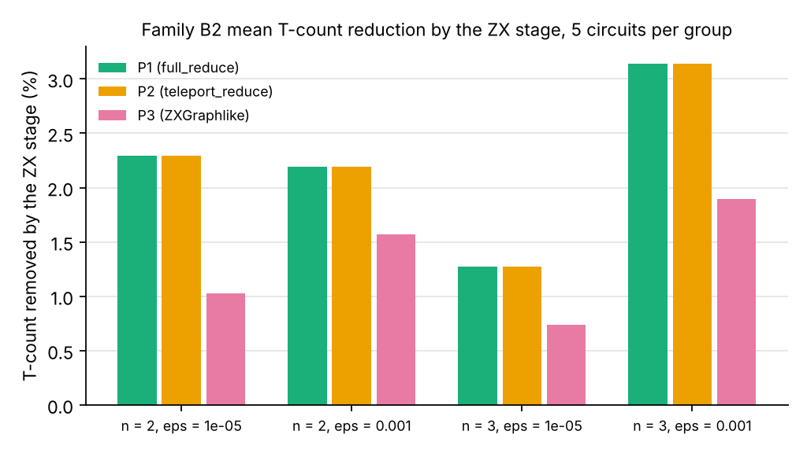
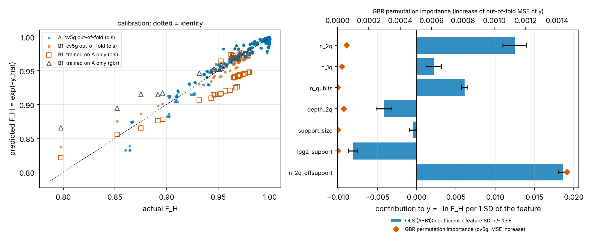

# PSEL4 compiles each H2 circuit four ways and keeps the cheapest

Team Learned ZX Rewriting. Quantinuum Singapore Grand Challenge, submission 1, report version 5 (10 October 2026).

`[F]` PSEL4 is a drop-in replacement for pytket-quantinuum's default compile on Quantinuum H2. It compiles each circuit four ways and keeps the result with the lowest HQC. The candidates are level 2 (pytket's default, P0), level 3 (L3) and PyZX teleport_reduce before each (P2, P2L3). PSEL4 never costs more HQC than level 2 or level 3 on a circuit where both pass its checks. This holds by construction. The report has four findings. First, PSEL4 gives the savings of level 3 without its regressions. Over 217 circuits PSEL4 needs 15.7 % less HQC than always using level 2 and 2.08 % less than always using level 3. It costs more than level 2 or level 3 on 0 circuits. Always using level 3 costs more than level 2 on 45 of the 217 circuits and loses 372.0 HQC there, with its largest loss of 12.95 % on gf2_pow_4_mult (Section 3.8.4). Second, on the H2-2E emulator the lower-HQC compile of each pair delivered each correct answer for fewer HQC in 6 of 6 comparisons. In each the upper 95 % bound of the cost ratio is below 1. Pooled over the 6 pairs it needs 17.4 % fewer HQC per correct answer (R = 0.8262, bootstrap 95 % interval 0.8189 to 0.8335, Section 3.7.5). On cdkm_adder_10 the PSEL4 pick returns the correct sum less often than level 2 (0.8267 against 0.8692, z = -2.90, Section 3.7.4). It still costs 8.0 % fewer HQC per correct sum (R = 0.9203, 95 % interval 0.8896 to 0.9521). Third, level 3 wins mainly through two-qubit resynthesis by GreedyPauliSimp. On top of the cheaper pytket level the ZX candidates add 0.26 % on the 17 proven family C circuits and 3.21 % on all 20 (Section 3.8.5). Fourth, a PyZX miter proves the PSEL4 output equal to its input on 17 of the 20 family C circuits of 20 to 56 qubits (Section 3.8). Blind ZX rewriting before level 2 costs 6.27 % more HQC on the 180 Trotter circuits of family A and PSEL4 never pays that loss. At the Azure plan averages of USD 10.29 to 12.50 per HQC the PSEL4 saving of 9,256.6 HQC against level 2 is worth USD 95,289 to 115,707 (Section 1.5). `[O]` Accuracy-bound users need a fidelity-aware choice, which is the finals goal (Section 6). `[F]` Section 7 gives the limitations. Figures for the earlier two-candidate selector PSEL are against level 2.

Tags: `[F]` marks a statement verifiable from an artifact in the repository or from the cited source. `[O]` marks a judgement or a plan. Every number in a results table of Section 3 is produced by `report/make_tables.py` from `results/*.csv`. The emulator runs are reported in Sections 3.7 to 3.7.5.

## Scoring map

`[F]` The four criteria and their weights are those of the track rubric, read from the Aqora GraphQL API on 8 October 2026 and stored in `docs/rubric.md`. `[O]` The table assigns the evidence for each criterion to a section of this report.

| Criterion | Weight | Where the evidence is |
|---|---|---|
| Problem & Value | 30 % | Section 1 with Table 1.1b and the worked use case, Section 1.5 with Tables 1.5a and 1.5b for the USD value of PSEL4 from `value/usd_psel4.md`, Section 3.7.5 for the HQC per correct answer from `value/hqc_per_correct.md`, Section 3.9, Section 7 |
| Technical Performance & Hardware Use | 30 % | Table P4 and Sections 3.8.1 and 3.8.4 for the delivered selector PSEL4 from `value/psel4_ledger.md` and `value/policy_compare.md`, Section 1.2 and Table 1.1a for the earlier two-candidate selector PSEL from `value/selector_ledger.md`, Table 1.1b and Section 3.8 for family C from `value/family_C_selector.md`, Section 3.9 for the Grover use case from `value/usecase.md`, Section 2.2 and `results/official_baseline.md` for the comparison with the official pytket-quantinuum pass, Section 3 (count tables A1 to B2, the count-only tables B1x and C3, the use-case table U1, proxy tables A4 and A5, Selene tables S1 and S2, H2-Emulator table E1, H2-2E tables E2 to E7), Section 2.6 and `results/selene.md` for the Selene runs, Sections 3.7 to 3.7.5 and `results/emulator_jobs.csv` for the platform jobs, Sections 3.8.3 to 3.8.5 for the level 3 proofs, the policy comparison and the mechanism, Section 6 for the H2 hardware plan of the finals, notebook `report/notebook_skeleton.py` |
| Scientific Merit | 20 % | Section 2.5 (certificate), Section 3.4 and `results/certificates.md`, arXiv:2608.22801 and arXiv:2608.22810 |
| Engineering & Reproducibility | 20 % | Section 5 (environment, seeds, script table, test table, verification reports), `pipelines/pass_select.py` with `pipelines/test_pass_select.py` and `pipelines/test_psel4.py`, `value/selector_ledger.py` with `value/test_selector_ledger.py`, `pipelines/official_baseline.py` with `pipelines/test_official_baseline.py`, `value/family_C_selector.py` with `value/test_family_C_selector.py`, `value/usecase.py` with `value/test_usecase.py`, `README.md`, the tests under `bench/`, `noise/`, `barrier/`, `pipelines/`, `selene/`, `model/`, `submit/` and `value/`, Section 4.7 for the refit command |

## 1. Problem and value

`[F]` The HQC, shot and T-count numbers below come from the script outputs `value/selector_ledger.md`, `value/value_ledger.md`, `value/value_by_application.md`, `value/policy_compare.md`, `value/hqc_per_correct.md` and `value/usd_psel4.md`. The noise parameters come from `docs/platform_notes.md` section 3.3. Manuscript statements are cited by their labels in arXiv:2608.22801. P0 is pytket's Quantinuum pass at level 2. P2 runs PyZX teleport_reduce before that pass. The earlier two-candidate selector PSEL compiles each circuit with P0 and with P2 and keeps the result with the lower HQC. HQC figures are for 1000 shots.

- `[F]` Tool. The delivered tool is PSEL4 in `pipelines/pass_select.py --psel4`. It is a drop-in replacement for pytket-quantinuum's default compile on H2. It compiles each circuit as P0, P2, L3 (level 3) and P2L3 (teleport_reduce before level 3) and keeps the result with the lowest HQC. Level 2 and level 3 are always candidates. PSEL4 therefore costs no more HQC than level 2 or level 3 on a circuit where both pass its checks. This holds by construction and is not a measured result.
- `[F]` Finding 1, cost. PSEL4 gives the savings of level 3 without its regressions. Over 217 circuits PSEL4 needs 49,580.6 HQC against 58,837.2 for always using level 2, a saving of 15.7 % (Section 3.8.4, `value/policy_compare.md`). It needs 1,051.6 HQC or 2.08 % less than always using level 3 (`value/usd_psel4.md`). It costs more than level 2 or level 3 on 0 circuits (Table P4). Always using level 3 saves 13.9 % against level 2 but costs more than level 2 on 45 of the 217 circuits and loses 372.0 HQC there. Its largest loss is 12.95 % on gf2_pow_4_mult. Against level 2 it saves 25.8 % on family C, 10.7 % on B1, 2.9 % on family A and 33.4 % on the Grover use case. On the 17 family C circuits whose PSEL4 output a PyZX miter proves equal to the input it saves 10.22 % (Section 3.8.1, Table P4). On the 215 timed circuits PSEL4 takes 5.08 times the wall time of level 2, which gives 3.03 HQC saved per extra second.
- `[F]` Finding 2, cheaper per correct answer. On the H2-2E emulator the lower-HQC compile of each pair delivered each correct answer for fewer HQC in 6 of 6 comparisons (Section 3.7.5, `value/hqc_per_correct.md`). In each the upper 95 % bound of the cost ratio R is below 1. Pooled over the 6 pairs R = 0.8262 with bootstrap 95 % interval 0.8189 to 0.8335, so the lower-HQC compile needs 17.4 % fewer HQC per correct answer. In the three newest pairs (vbe_adder_7 on a non-zero input, cdkm_adder_10, modadd_2n_10) the lower-HQC compile is the PSEL4 pick. In the three earlier pairs (vbe_adder_3, hwb6, vbe_adder_7 on the all-zero input) it is P2, the pick of the earlier two-candidate selector PSEL. grover_5 is excluded because its ideal output has no single correct answer. These are emulator results and HQC is the formula estimate. On cdkm_adder_10 the PSEL4 pick is level 3 with 118 two-qubit gates against 141. It returns the correct sum less often than level 2, 0.8267 against 0.8692 at 1200 shots per arm, with z = -2.90 (Section 3.7.4, `results/h22e_multi.md`). It still costs 8.0 % fewer HQC per correct sum (R = 0.9203, 95 % interval 0.8896 to 0.9521). On modadd_2n_10 the pick P2L3 shows no resolved accuracy difference (z = -0.22). On vbe_adder_7 level 3 is ahead with 0.901 against 0.883. That difference has z = 1.30 and is not resolved (Section 3.7.3). `[O]` For a cost-bound user the cost saving survives the accuracy loss. An accuracy-bound user needs a fidelity-aware choice, which is the finals goal. `[F]` A first classifier on input-circuit features does not beat constant choices on held-out families (Section 3.8.2). `[O]` The finals model needs structural features and emulator labels.
- `[F]` Finding 3, mechanism. Level 3 wins mainly through two-qubit resynthesis by GreedyPauliSimp (Section 3.8.5, `value/mechanism_zx_l3.md`). Where level 3 beats P2, 196.0 of the 234.2 HQC gap on 11 B1 circuits and 486.0 of 554.8 on 8 family C circuits come from two-qubit gates. ZX phase teleportation still removes non-Clifford gates that level 3 keeps. On 14 B1 circuits 656 remain after P2 against 746 after level 3. On top of the per-circuit cheaper pytket level the ZX candidates add 0.26 % on the 17 proven family C circuits, 3.21 % on all 20, 0.49 % on B1, nothing on family A and 0.44 % on the use case (`value/psel4_zx_only.md`). This ZX-only gain falls as T-density rises (family C Spearman rho -0.64, p 0.010). `[O]` The hypothesis that level 3 already does what teleport_reduce does partly holds. It holds for the two-qubit count and fails for phase merging on B1.
- `[F]` Guard. Run on every circuit before level 2, the ZX stage of P2 costs 1,030.4 HQC or 6.27 % more than P0 on family A. It costs 22.1 % more on the 3 QFT adders of family C. pytket's ZXGraphlikeOptimisation followed by level 2 costs 59.22 % more than level 2 on 14 B1 circuits (`results/strong_baselines.md`). Qiskit level 3 rebased to H2 also costs more than level 2 on B1 and on family C (Section 3.8.1). PSEL4 never pays these losses.
- `[F]` Finding 4, correctness. A separate PyZX miter proves the PSEL4 output equal to its input on 17 of the 20 family C circuits of 20 to 56 qubits (Section 3.8) and the level 3 output on 18 of them (Section 3.8.3). P0 and P2 give the same counts as the official pytket-quantinuum pass on all 445 compiled rows of families A, B1, B1x and B2 (Section 2.2). PSEL4 runs no exactness check above 20 qubits. In the PSEL4 ledger runs the check of the level 3 candidates stopped at 12 qubits.
- `[F]` Earlier two-candidate selector against level 2. PSEL keeps the lower HQC of P0 and P2. It costs no more HQC than P0 whenever P0 passes PSEL's checks. A separate PyZX miter check proves the family C pick of PSEL equal to its input on 18 of the 20 circuits (Section 3.8). On the 15 checked B1 circuits PSEL saves 743.6 HQC or 4.79 % against P0. On family A it picks P2 on 57 of the 180 circuits and saves 46.0 HQC or 0.28 %. It thus avoids 1,076.4 HQC against always running P2. It never raises n_2q against P0 on any of the 223 circuits of the four families. Against level 3 PSEL costs 9.92 % more on 14 B1 circuits and 8.37 % more on family C.
- `[F]` Arithmetic and oracle circuits, earlier two-candidate selector against level 2. Family C has 20 arithmetic and oracle circuits of 20 to 56 qubits. On its 15 circuits without continuous rotation angles PSEL saves 748.4 of 10,019.6 HQC or 7.47 % against P0. These are 9 adders and 6 multi-controlled X oracles. PSEL saves 12.9 % on the adders and 0.1 % on the oracles. As a secondary figure over all 20 circuits it saves 4,104.4 HQC or 16.7 %. Two multipliers with continuous rotation angles save 34.5 % and carry 81.8 % of that saving. On the three QFT adders PSEL keeps P0 and saves nothing. Family C is count-only apart from the H2-2E runs of vbe_adder_7, cdkm_adder_10 and modadd_2n_10 (Sections 3.7.2 to 3.7.4). A PyZX miter reduction proves the PSEL output of every one of the 15 circuits without continuous angles equal to its input as a full unitary up to global phase. Over all 20 circuits it proves 18. hrs_mult_5 is only spot-checked on 64 random basis inputs and the miter of the P0 pick of draper_adder_28 timed out. PSEL4 picks P2L3 on draper_adder_28 (2336.2 HQC). PyZX rounds the input of that pick by at most 1.50e-06 rad per angle, so its output equals the input only up to that rounding. Its miter timed out after 300 s and the PSEL4 output of draper_adder_28 is unproven.
- `[F]` Use case. Two Grover search instances of 7 and 9 qubits pass the exactness check under P0 and P2. The earlier two-candidate selector PSEL picks P2 on both and saves 5.42 % and 4.96 % HQC. PSEL4 picks P2L3 on both (Table P4). Within the 10,000 HQC budget this buys 791 and 322 more shots. `[O]` The large T-count drop of these instances comes from Toffolis that the Barenco construction repeats on the same qubits. It is not a general ZX gain.
- `[O]` User. A team that runs Clifford+T subroutines on Quantinuum H2 under a fixed HQC budget and will later price them on a fault-tolerant Helios.
- `[O]` Decision. Should this circuit go through ZX rewriting before pytket's Quantinuum pass? `[F]` PSEL4 takes this decision per circuit from the HQC of its four candidates.
- `[F]` Fault-tolerant cost. Against the written input circuits ZX removes 2,862 of 7,048 T gates on B1. Each T gate is one magic state, so the saving against the written circuits is 40.6 %. Our T-count after ZX equals the best ancilla-free value in the six papers of Section 3.4 on 14 of 22 comparable B1 and B1x circuits and is above it on the other 8 (Table C2). On the four B1 circuits with a certificate the certified fraction of the remaining T-count is 0.443. The fraction 0.997 holds for the 20 synthesised B2 Haar circuits at n = 2 and 3 and not for the B1 circuits.
- `[F]` Algorithms. Every circuit except hwb6, hwb8 and the two ham15 circuits is an adder, multiplier, Fourier transform, oracle, search instance or multi-controlled Toffoli. The adders, multipliers and the Fourier transform come from factoring and discrete-log circuits. grover_5 and mod5_4 come from search (Section 1.4). `[O]` The Toffoli circuits are placed in search as oracle and diffusion parts. `[F]` Family C adds adders, multipliers and multi-controlled X oracles of 20 to 56 qubits built by qiskit from their published constructions (Section 2.1).

### 1.1 The user and the decision

`[O]` The user pays each H2 run in HQC from a fixed budget. On a fault-tolerant machine the same subroutines are priced in T gates. `[F]` The track budget is 10,000 HQC per team on H2-1E and H2-2E according to the Aqora forum topic "Emulator Cost" by Irfan Khan of Quantinuum (Section 3.7). No copy is in the repository.

`[F]` PSEL4 makes the decision per circuit among level 2, level 3 and the ZX stage followed by either level. It takes it from the HQC of the four compilations. `[O]` The ledger explains the decision in HQC and in magic states and shows where the answer is no.

`[F]` No user interview or survey is part of this submission. `[O]` The need rests on the H2 cost formula and on the algorithm literature of Section 1.4. None of the six papers of Section 3.4 compares ZX rewriting against pytket's Quantinuum pass on the native H2 gate set.

### 1.2 What the pipeline saves on H2 today

`[F]` Headline for the earlier two-candidate selector PSEL. PSEL saves HQC on two sets of circuits. On the 15 checked B1 circuits it saves 743.6 HQC or 4.79 % against P0. This saving comes from the ZX stage P2 and PSEL matches it within 0.4 HQC. On the 15 arithmetic and oracle circuits of family C with 20 to 56 qubits and no continuous rotation angles it saves 748.4 of 10,019.6 HQC or 7.47 % against P0. Over all 20 family C circuits it saves 4,104.4 HQC or 16.7 % (Table 1.1b). This secondary figure rests on two multipliers with continuous rotation angles. rgqft_mult_6 is proven equal to its input and hrs_mult_5 is only spot-checked. Per application it saves 12.9 % on the adders and 34.5 % on the multipliers. The 34.5 % comes from two multipliers with continuous rotation angles. These two circuits carry 3,356.0 HQC or 81.8 % of the family C saving. PSEL saves 0.1 % on the multi-controlled X oracles and 0 % on the QFT adders, where it keeps P0. On family C PSEL also avoids 1,057.2 HQC against always running P2, because P2 is dearer on all three QFT adders.

`[F]` Family C status. Family C is count-only apart from the H2-2E runs of vbe_adder_7, cdkm_adder_10 and modadd_2n_10 (Sections 3.7.2 to 3.7.4). A PyZX miter reduction proves the output of the earlier two-candidate selector PSEL of every one of the 15 circuits without continuous angles equal to its input as a full unitary up to global phase. It proves the PSEL output of 18 of the 20 circuits. These include 13 of the 14 P2 picks. The compiled angles of hrs_mult_5 lie off the dyadic grid. Its P2 output is therefore only spot-checked on 64 random basis inputs. The miter of the P0 pick of draper_adder_28 timed out after 300 s and that output has no check. Section 3.8 gives the method. The two multipliers and the three QFT adders carry rotation angles outside the pi/4 grid. After the ZX stage 600 such rotations remain in hrs_mult_5 and 507 in rgqft_mult_6. The T-count does not count them. PyZX rounds the P2 input of draper_adder_28 by at most 1.50e-06 rad per angle. The earlier two-candidate selector PSEL keeps P0 on that circuit. PSEL4 picks P2L3 on draper_adder_28 (2336.2 HQC). PyZX rounds the input of that pick by at most 1.50e-06 rad per angle, so its output equals the input only up to that rounding. Its miter timed out after 300 s and the PSEL4 output of draper_adder_28 is unproven.

`[F]` Table 1.1b. Family C, HQC at 1000 shots of the earlier two-candidate selector PSEL against P0 and P2 per application. Count-only. Checked counts the circuits whose P0 and P2 outputs both pass the 64-input basis check. Section 3.8 gives the proof verdict per circuit. Saved % is computed on the application sums. Source: `value/family_C_selector.md`, computed from `results/family_C_counts.csv`. Section 3.8 gives the per-circuit rows.

| Application | Circuits | Qubits | PSEL picks P2 | HQC P0 | HQC P2 | HQC PSEL | Saved vs P0 | Saved vs P0 % | Saved vs P2 | Checked |
|---|---|---|---|---|---|---|---|---|---|---|
| Adders | 9 | 20-56 | 9 | 5,777.0 | 5,031.4 | 5,031.4 | 745.6 | 12.9 | 0.0 | 7 |
| Multipliers | 2 | 21-24 | 2 | 9,737.0 | 6,381.0 | 6,381.0 | 3,356.0 | 34.5 | 0.0 | 2 |
| Multi-controlled X oracles (Grover) | 6 | 21-56 | 3 | 4,242.6 | 4,239.8 | 4,239.8 | 2.8 | 0.1 | 0.0 | 4 |
| QFT adders (Draper) | 3 | 20-56 | 0 | 4,778.4 | 5,835.6 | 4,778.4 | 0.0 | 0.0 | 1,057.2 | 1 |
| All family C | 20 | 20-56 | 14 | 24,535.0 | 21,487.8 | 20,430.6 | 4,104.4 | 16.7 | 1,057.2 | 14 |

`[F]` Worked use case. Two Grover search instances find one marked item among 2^5 and 2^6 entries on 7 and 9 qubits (Section 3.9). Both pass the exactness check under P0 and P2. The earlier two-candidate selector PSEL picks P2 on both. It saves 39.8 HQC or 5.42 % on the 7-qubit instance and 80.8 HQC or 4.96 % on the 9-qubit instance. Within the 10,000 HQC budget and a limit of 10,000 shots per job PSEL affords 791 and 322 more shots. At the ideal success probability the expected hits rise from 13687.8 to 14478.2 and from 6132.0 to 6452.9. The T-count falls from 448 to 210 and from 1008 to 436. `[O]` This T-count drop comes from Toffolis that the Barenco construction repeats on the same qubits, whose T phases partly cancel under the ZX stage. It is not a general ZX gain.

`[F]` The organisers' sample code prices an H2 program as HQC = 5 + N_shots (N_1q + 10 N_2q + 5 N_SPAM) / 5000. N_1q counts PhasedX gates. N_2q counts ZZPhase and ZZMax gates. N_SPAM counts initialisations, measurements and resets. `estimate_cost` starts N_SPAM at the number of qubits and adds one per measurement and reset. A circuit with every qubit measured once has N_SPAM = 2n. Rz gates are free. The source is `estimate_cost` in `src/python/pytket_cost_estimation.py` of `Quantinuum/sg_grand_challenge`. `pipelines/compile.py:hqc` reproduces that function. `[O]` We take this as the H2 price. `[F]` The Helios costing page gives the same form with maxima over 10 shots in its equation (1). See Reference 6 and `docs/platform_notes.md` section 3.4.

`[F]` p2 = 1.29e-3 is the largest gate fault rate of the H2-2E emulator. The H2-2E emulator parameters are p2 = 1.29e-3 and p1 = 7.3e-5 per gate, readout flips 9e-4 and 1.8e-3 for states 0 and 1 and p_init = 4e-5 (`docs/platform_notes.md` section 3.3).

`[F]` The earlier two-candidate selector PSEL is the default of `pipelines/pass_select.py` without `--psel4`. The delivered tool is PSEL4 (Section 3.8.1). PSEL compiles each circuit with P0 and with P2 and keeps the compiled circuit with the lower HQC. An HQC tie goes to the lower n_2q and a further tie goes to P0. A candidate that fails the exactness check of `pipelines/compile.py:check` is dropped. Section 2.2 defines PSEL next to the other pipelines.

`[F]` Table 1.1a. HQC at 1000 shots of the earlier two-candidate selector PSEL against P0 and P2, per family. B1x is count-only and is never merged with B1. Saved % is computed on the family sums. The median is over per-circuit percentages against P0. Source: `value/selector_ledger.md`, computed from the P0 and P2 rows of `value/value_ledger.csv` and `results/family_B2_counts.csv`.

| Family | Circuits | PSEL picks P2 | HQC P0 | HQC P2 | HQC PSEL | Saved vs P0 | Saved vs P0 % | Saved vs P2 | Median per-circuit % vs P0 |
|---|---|---|---|---|---|---|---|---|---|
| A, Trotter | 180 | 57 | 16,422.6 | 17,453.0 | 16,376.6 | 46.0 | 0.28 | 1,076.4 | 0.00 |
| B1, checked | 15 | 14 | 15,516.0 | 14,772.8 | 14,772.4 | 743.6 | 4.79 | 0.4 | 3.94 |
| B1x, count-only | 8 | 7 | 3,288.8 | 3,141.0 | 3,141.0 | 147.8 | 4.49 | 0.0 | 2.40 |
| B2, Haar | 20 | 0 | 730.0 | 731.6 | 730.0 | 0.0 | 0.00 | 1.6 | 0.00 |

`[F]` The earlier two-candidate selector PSEL costs more HQC than P0 only if P0 is dropped by an error or by the exactness check. No P0 row of the four families was dropped. The four families hold 223 circuits. PSEL saves 743.6 HQC or 4.79 % on B1. It saves 147.8 HQC or 4.49 % on B1x. On B1 and B1x these savings come from the ZX stage P2. P2 alone saves 743.2 HQC on B1 and 147.8 HQC on B1x. On family A it saves 46.0 HQC or 0.28 %. On B2 it saves nothing because P2 is never cheaper than P0 there.

`[F]` The earlier two-candidate selector PSEL never raises the ZZ gate count against P0 on any of the 223 circuits. It lowers n_2q on 13 of the 15 B1 circuits and on 5 of the 8 B1x circuits. The choice that minimises n_2q, with an n_2q tie broken by HQC, agrees with the choice of PSEL on all 223 circuits (`value/selector_ledger.md`).

`[F]` Table 1.1. HQC at 1000 shots of P2 against P0 by application area. B1 is checked. B1x is count-only and is never merged with B1. Saved % is computed on the area sums. Source: `value/value_by_application.md`.

| Area | Family | Circuits | HQC P0 | HQC P2 | HQC saved | Saved % | Median per-circuit % |
|---|---|---|---|---|---|---|---|
| Integer factoring (Shor) | B1 | 4 | 592.2 | 545.6 | 46.6 | 7.9 | 4.2 |
| Elliptic-curve discrete log, GF(2^m) | B1 | 1 | 216.2 | 215.2 | 1.0 | 0.5 | 0.5 |
| Unstructured search (Grover) | B1 | 8 | 1,183.6 | 1,127.0 | 56.6 | 4.8 | 3.0 |
| Reversible logic, no sourced algorithm | B1 | 2 | 13,524.0 | 12,885.0 | 639.0 | 4.7 | 4.5 |
| All areas | B1 | 15 | 15,516.0 | 14,772.8 | 743.2 | 4.8 | 3.9 |
| Integer factoring (Shor) | B1x | 2 | 386.2 | 380.2 | 6.0 | 1.6 | 1.4 |
| Elliptic-curve discrete log, GF(2^m) | B1x | 2 | 783.0 | 776.4 | 6.6 | 0.8 | 0.9 |
| Unstructured search (Grover) | B1x | 2 | 632.0 | 610.0 | 22.0 | 3.5 | 3.7 |
| Reversible logic, no sourced algorithm | B1x | 2 | 1,487.6 | 1,374.4 | 113.2 | 7.6 | 6.2 |
| All areas | B1x | 8 | 3,288.8 | 3,141.0 | 147.8 | 4.5 | 2.4 |

`[F]` P2 is cheaper than P0 in HQC on 14 of the 15 B1 circuits. The exception is qft_4 in the integer factoring row. There P2 costs 0.4 HQC more and the earlier two-candidate selector PSEL keeps P0. This is the only HQC difference between PSEL and P2 on B1 and B1x.

`[F]` hwb8 alone accounts for 84.5 % of the saving of the earlier two-candidate selector PSEL on B1 but serves no sourced quantum algorithm. Without hwb8 the PSEL saving on B1 is 115.0 HQC. `[O]` The median of 3.94 % is the better guide for a single circuit.

`[F]` Saved HQC buys shots. The following figures assume one job that pays the 5 HQC job fee once. The earlier two-candidate selector PSEL picks P2 for vbe_adder_3. At the 10,000 HQC team budget P0 affords 68,178 shots of vbe_adder_3 and PSEL affords 87,675. That is 19,497 extra shots or 28.6 % more. vbe_adder_3 has the largest per-circuit percentage saving of the 15 B1 circuits. The median extra-shot gain of P2 over the 15 circuits is 4.3 % (`value/value_by_application.md`). On the Grover oracle mod5_4 PSEL also picks P2 and the gain is 11,757 shots or 7.5 %.

`[F]` The H2 hardware guide limits a job to 10,000 shots (`docs/platform_notes.md` section 3.4). With that limit and one fee per job P0 affords 67,974 shots of vbe_adder_3 and the earlier two-candidate selector PSEL affords 87,324. That is 19,350 extra shots or 28.5 % more. On mod5_4 the gain is 11,584 shots or 7.4 % (`value/value_by_application.md`). Whether the per-job limit applies on H2-2E is Unverifiable from the repository.

`[F]` The earlier two-candidate selector PSEL keeps P0 on 123 of the 180 family A circuits. P2 is dearer on 108 of them and ties P0 in HQC on 15. Run on every family A circuit P2 would cost 17,453.0 HQC against 16,422.6 for P0. That is 1,030.4 HQC or 6.27 % more. PSEL costs 16,376.6 HQC on family A. It saves 46.0 HQC against P0 and 1,076.4 HQC against always running P2. On family A this avoided loss is what PSEL adds over P2. On the 60 XXZ circuits P2 is dearer on every circuit and would raise the total by 12.33 %. PSEL keeps P0 on all 60 of them. On the 60 TFIM circuits PSEL picks P2 on 32 and saves 0.62 % against P0. On the 60 ladder circuits it picks P2 on 25 and saves 0.52 %. `[O]` A user with a Trotter circuit runs PSEL4 and does not need to decide in advance whether the ZX stage lowers the HQC.

### 1.3 What it saves on the fault-tolerant layer

`[F]` In a surface-code machine each T gate consumes one magic state (Litinski, Quantum 3, 128 (2019), arXiv:1808.02892). Magic-state counts below therefore equal T-counts. On H2 a T gate is a free Rz and changes no H2 cost.

`[F]` Table 1.2. T-count written and after the ZX stage of P2, by application area. Source: `value/value_by_application.md`.

| Area | Family | T written | T after ZX | Magic states saved | Saved % |
|---|---|---|---|---|---|
| Integer factoring (Shor) | B1 | 307 | 199 | 108 | 35.2 |
| Elliptic-curve discrete log, GF(2^m) | B1 | 112 | 68 | 44 | 39.3 |
| Unstructured search (Grover) | B1 | 637 | 327 | 310 | 48.7 |
| Reversible logic, no sourced algorithm | B1 | 5,992 | 3,592 | 2,400 | 40.1 |
| All areas | B1 | 7,048 | 4,186 | 2,862 | 40.6 |
| Integer factoring (Shor) | B1x | 147 | 109 | 38 | 25.9 |
| Elliptic-curve discrete log, GF(2^m) | B1x | 427 | 265 | 162 | 37.9 |
| Unstructured search (Grover) | B1x | 343 | 171 | 172 | 50.1 |
| Reversible logic, no sourced algorithm | B1x | 735 | 309 | 426 | 58.0 |
| All areas | B1x | 1,652 | 854 | 798 | 48.3 |

`[F]` The 40.6 % saving on B1 in Table 1.2 is measured against the written input circuits and not against published optimisers. Our T-count after ZX equals the best ancilla-free value in the six papers of Section 3.4 on 14 of 22 comparable B1 and B1x circuits and is above it on the other 8 (Table C2).

`[F]` The per-instance floor is the channel bound of Gosset et al. (Reference 17), restated for n qubits in the exactness-barrier manuscript (Kam et al., arXiv:2608.22801). The least denominator exponent of the exact Pauli channel of a Clifford+T circuit over Z[sqrt 2] is a lower bound on the T-count of every semantics-exact rewrite. The statements are Theorem B, Corollary cert and Theorem C of arXiv:2608.22801.

`[F]` On the 20 synthesised Haar circuits of family B2 the ZX stage removes 862 of 42,396 T gates or 2.0 %. The certified floor is 41,414 against 41,534 T gates after ZX. The certified-incompressible fraction is 0.997. Further exact T optimisation of these instances can gain at most 0.3 % of the remaining T-count. On the worst single instance the bound is 0.72 %.

`[F]` On the four certified B1 circuits the floor is 47 against 106 T gates after ZX. The fraction is 0.443. `[O]` The certificate does not say whether this gap is headroom for a better rewrite or slack in the bound (Section 3.4).

`[F]` Converting magic states into Helios time or cost needs factory and logical-cycle figures that Quantinuum has not published in any source we found. No conversion is made. As context only, Dasu et al. report a logical magic state on H1-1 with infidelity 7(+3/-1) x 10^-5 (arXiv:2506.14688).

### 1.4 Where these circuits sit in real algorithms

`[F]` Table 1.3. All B1 and B1x circuit names appear in Table II of Amy and Mosca (arXiv:1601.07363). Their Grover_5 is a different circuit (Section 3.4). Each circuit is counted in the first area of the summary table of `docs/applications.md` that lists it.

| Area | Our circuits | Role | Citation | Status |
|---|---|---|---|---|
| Integer factoring (Shor) | vbe_adder_3, mod_mult_55, mod_red_21, qft_4 (B1). rc_adder_6, csla_mux_3 (B1x) | Adders and modular arithmetic of modular exponentiation. Fourier transform | arXiv:quant-ph/9511018, arXiv:1202.6614, arXiv:1710.07345, arXiv:quant-ph/0201067 | `[F]` |
| Elliptic-curve discrete log, GF(2^m) | gf2_pow_4_mult (B1). gf2_pow_5_mult, gf2_pow_6_mult (B1x) | Binary-field multiplier | arXiv:0710.1093 | `[F]` |
| Unstructured search (Grover) | grover_5, mod5_4 (B1) | Full search instance. Divisibility-by-5 oracle | arXiv:quant-ph/9605043, arXiv:1601.07363, reversiblebenchmarks.github.io/mod5.html | `[F]` |
| Unstructured search (Grover) | tof_3..5, barenco_tof_3..5 (B1). tof_10, barenco_tof_10 (B1x) | Multi-controlled Toffoli in oracle and diffusion | arXiv:1703.10535, arXiv:quant-ph/9503016 | `[O]` placement |
| Reversible logic, no sourced algorithm | hwb6, hwb8 (B1). ham15-low, ham15-med (B1x) | Reversible-logic stress tests | reversiblebenchmarks.github.io hwbs and ham15 pages | `[F]` no algorithm role found |

`[O]` The three adders also fit arithmetic oracles for chemistry and simulation (arXiv:1805.12445, arXiv:1807.03206). They are counted once under factoring.

`[F]` Unverifiable items. The function computed by mod_red_21 beyond its name is Unverifiable. Whether arXiv:0710.1093 is the exact work Amy, Maslov and Mosca cite for the field multipliers is Unverifiable.

### 1.5 Value statement and scope of claims

`[F]` The delivered tool is PSEL4 (`pipelines/pass_select.py --psel4`). It decides per circuit between level 2 and level 3 and whether to run PyZX teleport_reduce before either. The earlier two-candidate selector PSEL is the default of `pipelines/pass_select.py` without `--psel4`. The figures in the rest of this paragraph are for PSEL. It decides per circuit whether to run PyZX teleport_reduce before pytket's Quantinuum pass. It costs no more HQC than P0 whenever P0 passes PSEL's checks, because P0 is always one of its candidates. This holds by construction. PSEL runs no exactness check above 20 qubits. A separate PyZX miter check proves the family C pick equal to its input on 18 of the 20 circuits (Section 3.8). On the 15 checked B1 circuits the saving of 4.79 % against P0 comes from the ZX stage P2. PSEL picks P2 on 14 of them and matches the P2 total within 0.4 HQC. P2 saves 7.9 % on the checked factoring circuits and 4.8 % on the checked search circuits. PSEL's own contribution is on family A. There P2 alone would cost 1,030.4 HQC or 6.27 % more than P0. PSEL keeps P0 on 123 of the 180 circuits and saves 46.0 HQC or 0.28 % against P0. It thus avoids 1,076.4 HQC against always running P2 and keeps the B1 gain. On the 15 family C circuits without continuous rotation angles PSEL saves 7.47 % against P0. Over all 20 family C circuits it saves 16.7 %. It saves 12.9 % on the adders and 34.5 % on the multipliers. The 34.5 % comes from two multipliers with continuous rotation angles. Family C is count-only apart from the H2-2E runs of vbe_adder_7, cdkm_adder_10 and modadd_2n_10 (Sections 3.7.2 to 3.7.4). The PSEL output is proven equal to its input on 18 of the 20 circuits and on all 15 without continuous angles. On two exact Grover instances it saves 5.42 % and 4.96 % HQC. `[O]` A user does not need to decide in advance whether the ZX stage lowers the HQC. `[F]` The ledger gives magic-state counts for every B1, B1x and B2 circuit. The certificate covers only the 24 circuits of `results/certificates.csv`, all with n at most 5. Four of them are B1 subroutines with a pooled certified fraction of 0.443. The other 20 are the synthesised B2 Haar circuits at n = 2 and 3 with a pooled fraction of 0.997.

`[F]` The winner of the finals receives credits on the on-premise Helios machine in Singapore according to the organisers' timeline email of 25 Aug 2026. No copy is in the repository. `[O]` Quantinuum's Helios roadmap targets fault tolerance. The T-count column prices a later fault-tolerant layer. `[F]` The Helios HQC formula charges no Rz gate (`docs/platform_notes.md` section 3.4). The T-count therefore does not change the cost of the finals credits.

`[F]` Model prediction. A proxy fit of 1.18e-3 per ZZ gate predicts a relative fidelity gain of 1.79 % for P2 on vbe_adder_3 and a median relative gain of 0.24 % over B1. `[O]` These are model predictions and not measurements.

`[F]` The 18 H2-2E jobs carry HQC estimates that sum to 5933.2 HQC. Six ran vbe_adder_3, hwb6 and grover_5 under P0 and P2 at 1000 shots. Twelve repeated vbe_adder_3 and grover_5 three more times. At 1000 shots the emulator does not resolve P2 against P0 on any of the three circuits. At 4000 shots per pipeline the pooled F_H of vbe_adder_3 is 0.9520 under P0 and 0.9628 under P2. The difference of +0.0108 has z = +2.38 and a two-sided p of 0.017. The repeat circuits were chosen after Table E2. The pooled Holm-adjusted p is 0.035 over the two repeated circuits and 0.052 over all three H2-2E circuits. This measured relative gain of 1.13 % lies below the predicted 1.79 % by 1.38 sd of the difference. On grover_5 the pooled difference is +0.0007 with z = +0.10 and is not resolved at 4000 shots per pipeline. It lies 2.94 sd of the difference below the predicted gain of 0.0229 (Section 3.7.1). `[O]` The vbe_adder_3 gain is significant before correction and after correction over the two repeated circuits. It is not significant at 0.05 after correction over all three H2-2E circuits.

`[F]` Money value. The Azure Quantum pricing page lists two monthly Quantinuum subscriptions for System Model H2. The Standard Plan costs USD 125,000 per month and includes 10,000 HQC. The Premium Plan costs USD 175,000 per month and includes 17,000 HQC. Both plans add Azure infrastructure costs. The page footer reads "Last updated on 2025-12-23" and the page was read on 9 October 2026 (Reference 15, `docs/hqc_pricing.md`). The implied plan-average price is USD 12.50 per HQC on the Standard Plan and USD 10.29 per HQC on the Premium Plan (`docs/hqc_pricing_calc.py`).

`[F]` Value of PSEL4. At the plan averages the PSEL4 saving of 9,256.6 HQC (15.73 %) against always level 2 is worth USD 95,289 to 115,707. Against always level 3 PSEL4 saves 1,051.6 HQC (2.08 %), worth USD 10,825 to 13,145. Always level 3 costs more than level 2 on 45 circuits and loses 372.0 HQC there, worth USD 3,829 to 4,650. PSEL4 avoids that loss (`value/usd_psel4.md`).

`[F]` Table 1.5a. HQC at 1000 shots of each circuit once and USD value of the PSEL4 saving, from `value/psel4_ledger.csv` (217 circuits, formula estimate). Each USD range runs from the Premium to the Standard plan average. Source: `value/usd_psel4.md`, written by `value/usd_psel4.py`. Test: `value/test_usd_psel4.py`.

| Family | Circuits | HQC L2 | HQC L3 | HQC PSEL4 | Saved vs L2 (HQC) | % | USD | Saved vs L3 (HQC) | % | USD |
|---|---:|---:|---:|---:|---:|---:|---|---:|---:|---|
| A | 180 | 16422.6 | 16231.2 | 15949.0 | 473.6 | 2.88 | 4,875 to 5,920 | 282.2 | 1.74 | 2,905 to 3,528 |
| B1 | 15 | 15516.0 | 13965.8 | 13863.4 | 1652.6 | 10.65 | 17,012 to 20,657 | 102.4 | 0.73 | 1,054 to 1,280 |
| C | 20 | 24535.0 | 18853.2 | 18193.2 | 6341.8 | 25.85 | 65,283 to 79,273 | 660.0 | 3.50 | 6,794 to 8,250 |
| usecase | 2 | 2363.6 | 1582.0 | 1575.0 | 788.6 | 33.36 | 8,118 to 9,858 | 7.0 | 0.44 | 72 to 88 |
| total | 217 | 58837.2 | 50632.2 | 49580.6 | 9256.6 | 15.73 | 95,289 to 115,707 | 1051.6 | 2.08 | 10,825 to 13,145 |

`[F]` Table 1.5b. Circuits where always level 3 costs more than level 2, with the HQC lost and its USD value. Source: `value/usd_psel4.md`.

| Family | Circuits where L3 costs more | HQC lost | USD |
|---|---:|---:|---|
| A | 35 | 282.2 | 2,905 to 3,528 |
| B1 | 2 | 33.8 | 348 to 423 |
| C | 8 | 56.0 | 576 to 700 |
| usecase | 0 | 0.0 | 0 to 0 |
| total | 45 | 372.0 | 3,829 to 4,650 |

`[O]` Workload assumption. A team spends the Standard Plan's 10,000 HQC per month on circuits with the ledger's mix. `[F]` Under that assumption PSEL4 / L2 = 0.8427, and PSEL4 frees 10,000 x (1 - 0.8427) = 1573.3 HQC per month. This is worth USD 19,666 at the Standard average and USD 16,195 at the Premium average. `[O]` Plan averages are not marginal prices. The figures ignore bundled eHQCs and Azure infrastructure costs. The total depends on the ledger's family mix. `[F]` Family C gives 6341.8 of the 9256.6 HQC saved against level 2.

`[O]` Earlier two-candidate selector PSEL. At these plan averages the family C saving of 748.4 HQC on the 15 circuits without continuous angles is worth about USD 7,700 to 9,400. The family A avoided loss of 1,076.4 HQC against always running P2 is worth about USD 11,100 to 13,500. The products before rounding are USD 7,704 and 9,355 for family C and USD 11,081 and 13,455 for family A. Each figure counts 1000 shots of each circuit of its set. The estimate uses the plan average and not a marginal price. It assumes that the subscriber uses the whole monthly allotment. It gives the bundled eHQCs no value and leaves out the Azure infrastructure costs.

`[F]` Finance users. In the derivative-pricing methods of Chakrabarti et al. both path-loading schemes and the payoff calculation need quantum arithmetic (arXiv:2012.03819, Appendix C). The same paper states that in its fault-tolerant estimates "the T-count dominates the computational requirements" (Reference 14). The earlier two-candidate selector PSEL saves 12.9 % HQC on the 9 adders of family C and 7.47 % on the 15 family C circuits without continuous angles. `[O]` These adders are arithmetic blocks of the kind such pricing circuits call. The sources read do not split the T-count of derivative pricing between arithmetic and other parts. A claim that arithmetic dominates that cost is Unverifiable.

`[O]` The team name Learned ZX Rewriting names the research programme. `[F]` The learned component of this submission is the cost model of Section 4, which predicts fidelity from compile-time features. This submission contains no learned rewriting.

### 1.6 Two further uses of the selector and the certificate

Do-no-harm guard for pytket users.

- `[O]` A pytket user can add a ZX stage in front of the Quantinuum pass without knowing whether it pays. `[F]` pytket 2.18.4 ships one such pass, `ZXGraphlikeOptimisation` in `pytket.passes`. We measured the PyZX stage teleport_reduce of P2 and not that pass.
- `[F]` pytket already documents `PassSelector`. It applies a list of passes to the same circuit and returns "the best circuit as selected by a given metric". The same documentation warns that `ZXGraphlikeOptimisation` "may increase the cost of the circuit" (pytket 2.18.5 documentation, same docstring in the installed 2.18.4, Reference 16). `[O]` The earlier two-candidate selector PSEL is the PassSelector pattern applied to P0 and P2 with HQC as the metric. PSEL4 applies the same pattern to P0, P2, L3 and P2L3. Neither is a new selection mechanism. Our contribution is the measured HQC ledger and the guard result on families A and C.
- `[F]` Added blindly, the ZX stage of P2 costs 1,030.4 HQC or 6.27 % more than P0 on the 180 Trotter circuits of family A. On the 60 XXZ circuits it costs 12.33 % more (`value/selector_ledger.md`). On the three QFT adders of family C it costs 1,057.2 HQC or 22.1 % more. On draper_adder_16 it costs 1,385.0 HQC against 906.8 for P0, which is 52.7 % more (`value/family_C_selector.md`). A PyZX miter proves its P0 and P2 outputs equal to its input (Section 3.8).
- `[F]` The earlier two-candidate selector PSEL costs no more HQC than P0 whenever P0 passes PSEL's checks because P0 is always one of its candidates. It still keeps the 4.79 % saving on B1 and the 7.47 % saving on the 15 family C circuits without continuous angles.
- `[O]` PSEL4 lets a pytket user try ZX rewriting and level 3 on every circuit for the price of three more compilations. `[F]` It never raises HQC against level 2 or level 3 where its checks pass.

Where not to spend fault-tolerant compiler effort.

- `[F]` The 20 circuits of family B2 carry rotations synthesised by gridsynth at n = 2 and 3. The ZX stage removes 862 of 42,396 T gates there or 2.0 %. The certified floor is 41,414 of the 41,534 T gates left after ZX. Every semantics-exact rewrite therefore keeps at least 99.7 % of the pooled remaining T-count and on the worst single circuit, haar_n3_eps1e-03_s5, at least 2478 of its 2496 T gates. Further exact T optimisation can gain at most 0.3 % of the pooled count and at most 0.72 % on the worst single instance.
- `[F]` Scope. The certificate covers 24 circuits, all with n at most 5. On the four certified B1 circuits the fraction is 0.443 and the 99.7 % does not hold there.
- `[F]` Reiher et al. write of the single-qubit rotations in their FeMoco simulation that "These rotations dominate the cost of the quantum simulation" (arXiv:1605.03590). Beverland et al. call non-Clifford rotations "among the most resource intensive operations" (arXiv:2211.07629). Ross and Selinger approximate a z-rotation with T-count 3 log2(1/eps) plus lower-order terms in the typical case (arXiv:1403.2975). `[O]` A team that plans fault-tolerant chemistry or phase-estimation workloads learns from the certificate per instance how much exact T optimisation of its synthesised rotations can still gain. On these 20 instances further exact rewriting is not worth the compiler effort.

## 2. Method

### 2.1 Circuit families

`[F]` Family A consists of 180 Trotter spin-chain circuits generated by `bench/gen_trotter.py`. Three models: the transverse-field Ising chain with open boundary, the XXZ chain started from the Neel state, and the transverse-field Ising ladder. Sizes n in {4, 6, 8, 10, 12}. Trotter steps r in {1, 2, 4} with dt = 0.1. Couplings are uniform (one instance per group) or drawn from [0.5, 1.5] with `numpy.random.default_rng(20261006)` (three instances per group). Every two-body Pauli exponential is written as a cx-rz-cx block with basis changes. The circuit as written therefore has n_cx = 2 x (number of ZZ-type terms). Ideal output distributions for n <= 10 are stored as `.npy` references.

`[F]` Family B1, 15 standard Clifford+T benchmark circuits with n <= 12 from the Quantinuum pyzx fork at commit e695d6d7 (`third_party/pyzx-fork/circuits/qasm`), built by `bench/build_family_B1.py`. Every Toffoli is expanded into the 7-T decomposition by pyzx so that the file as written is Clifford+T. The manifest `bench/family_B1/manifest.csv` records the source file, its commit and the counts before and after expansion, for example a T-count as written of 21 for tof_3 and 28 for mod5_4.

`[F]` Family B1x consists of 8 further Clifford+T benchmark circuits from the same pyzx fork at commit e695d6d7, selected by `bench/build_family_B1x.py` with the window 13 <= n <= 20 and at most 3000 gates after Toffoli expansion. The circuits are rc_adder_6 (n = 14), csla_mux_3 (15), gf2_pow_5_mult (15), ham15-low (17), ham15-med (17), gf2_pow_6_mult (18), barenco_tof_10 (19) and tof_10 (19). The qubit numbers reached run from 14 to 19 and the largest circuit is ham15-med with 1600 gates after expansion. The conversion and the manifest columns are those of family B1 (`bench/family_B1x/manifest.csv`). These circuits are compiled count-only under P0ref, P0 and P2 with the `--no-check` flag of `pipelines/run_bench_B.py`. No unitary, statevector or distribution check was run on them at this size and only the gate-set check applies. Every row of `results/family_B1x_counts.csv` therefore carries the status `ok-unchecked` and the family is reported separately from the checked families in Section 3.2.1.

`[F]` Family B2 consists of 20 Clifford+T circuits synthesised from Haar-random unitaries by `bench/gen_haar_b2.py`. There are five targets at n = 2 and five at n = 3 drawn with the same seed. Each target is synthesised at eps = 1e-3 and at eps = 1e-5. The construction is qiskit `qs_decomposition` followed by `transpile` to the basis {rz, sx, x, cx} with `seed_transpiler=0`. Every rz angle that is not a multiple of pi/4 is then replaced by a pygridsynth (Ross-Selinger) approximation to precision eps. The operator-norm error of each written circuit against its target is stored in the manifest, with the triangle-inequality bound n_rz x eps. This family reproduces the construction of Table E6 in the barrier manuscript.

`[F]` Family C consists of 20 application-scale circuits of 20 to 56 qubits built by `bench/build_family_C.py` from qiskit constructions of published circuits. There are 9 adders, 3 QFT adders, 2 multipliers and 6 multi-controlled X gates for Grover oracles. The sources are Cuccaro et al., Vedral et al., Gidney, Draper, Häner et al., Ruiz-Perez and Garcia-Escartin, Maslov, Barenco et al. and Iten et al. as listed in `bench/family_C/manifest.csv`. The QFT adders and the two multipliers carry rotation angles outside the pi/4 grid. `pipelines/run_family_C.py` compiles family C count-only under P0 and P2. Section 2.4 describes its basis-input check.

`[F]` The use case of Section 3.9 has two Grover search instances built by `bench/usecase/build_usecase.py`. They search 2^5 and 2^6 entries for one marked item with 4 and 6 iterations on 7 and 9 qubits. Oracle and diffusion each use one multi-controlled Z. It is built from the C^mX of Barenco et al. (arXiv:quant-ph/9503016, Lemma 7.2) and the 7-T Toffoli of Nielsen and Chuang.

### 2.2 Pipelines

`[F]` All compile pipelines are in `pipelines/compile.py` and target the H2 gate set {Rz, PhasedX, ZZPhase, ZZMax, Measure, Reset} with all-to-all connectivity. Seven compile pipelines run on families A and B1. Five run on family B2 and three run on the count-only family B1x. These are P0ref, P0, P1, P2 and P3 on B2 and P0ref, P0 and P2 on B1x. The delivered selector PSEL4 chooses among P0, P2, L3 and P2L3 and the earlier two-candidate selector PSEL chooses between P0 and P2. Neither is an eighth compile pipeline. PSEL is defined after the table and PSEL4 in Section 3.8.1.

| Name | Stages |
|---|---|
| P0ref | DecomposeBoxes, AutoRebase to the native set, SquashRzPhasedX, RemoveRedundancies. The circuit as written, in native gates, with no optimisation. |
| P0 | pytket-quantinuum 0.59.3 `default_compilation_pass(optimisation_level=2)`, reproduced pass by pass from the installed source without a backend object (FullPeepholeOptimise to TK2, NormaliseTK2, DecomposeTK2 to ZZPhase, AutoRebase, squash, RemoveRedundancies). P0 is the baseline. |
| P0L1 | The same at optimisation level 1. |
| P1 | PyZX `full_reduce`, `extract_circuit`, `basic_optimization`, then P0. |
| P2 | PyZX `teleport_reduce`, `Circuit.from_graph`, `basic_optimization`, then P0. |
| P3 | pytket `ZXGraphlikeOptimisation`, then P0. |
| P4 | The ZX stage of P1, then P0 without FullPeepholeOptimise. |

`[F]` `pipelines/official_baseline.py` compares the P0 reproduction with the official pass of pytket-quantinuum 0.59.3 (`results/official_baseline.md`). The official pass comes from `QuantinuumBackend(device_name="H2-1")` with the offline API handler. No job ran and no HQC was spent. Both passes have the same eleven stages in the same order. They differ only in classical and control-flow op types allowed by AutoRebase, and no benchmark input contains these types. The official P0 and P2 equal our P0 and P2 in n_2q, n_1q, two-qubit depth and HQC on all 445 compiled rows of families A, B1, B1x and B2. hwb8 under the official P2 timed out at the 565 s job limit and is the one row not compiled.

`[F]` The earlier two-candidate selector PSEL is the default mode of `pipelines/pass_select.py`. PSEL4 is its `--psel4` mode. PSEL is a choice between pipelines and adds no compilation stage of its own. It compiles the input circuit with P0 and with P2 through `pipelines/compile.py` unchanged. It drops a candidate that raises an error, leaves the native gate set or fails the exactness check of `pipelines/compile.py:check`. Of the survivors it returns the compiled circuit with the lowest HQC at the requested shot count. An HQC tie goes to the lower n_2q and a further tie goes to P0. Above 20 qubits no exactness check is run and the candidate is marked ok-unchecked. The family totals of PSEL in Section 1.2 are computed in `value/selector_ledger.py` from the existing P0 and P2 rows of `value/value_ledger.csv` and `results/family_B2_counts.csv`. They are not a rerun of `pipelines/pass_select.py`.

`[F]` pytket documents `PassSelector`, which applies a list of passes to the same circuit and returns "the best circuit as selected by a given metric" (Reference 16). `pipelines/pass_select.py` does not call it. `[O]` The earlier two-candidate selector PSEL is this PassSelector pattern applied to P0 and P2 with HQC as the metric and an exactness check on each candidate. It is not a new selection mechanism. The contribution is the measured ledger and the guard result of Section 1.6.

`[F]` The ZX stages run on the circuit as written, in the gate set the ZX tools accept, and the pytket pass runs afterwards on the result. Angles are passed to PyZX through QASM, and the rounding introduced by PyZX's float-to-fraction conversion is recorded per circuit in the column `pyzx_angle_err` of `results/family_A_counts.csv`. Its maximum over the 1260 family A rows is 1.48e-10 rad, which is 4.7e-11 x pi.

### 2.3 Metrics

`[F]` For every compiled circuit `pipelines/compile.py:metrics` records n_2q (ZZPhase plus ZZMax count), the two-qubit depth, the PhasedX and Rz counts and the total gate count and depth. It also records the HQC at N_shots = 1000 with N_SPAM = 2 n_qubits. This counts one initialisation and one terminal measurement per qubit as in the organisers' `estimate_cost`. The T-count after the ZX stage is counted on the PyZX circuit before any pytket pass, as the number of phase gates with angle an odd multiple of pi/4. After rebasing to the H2 gate set the T-count is undefined and is not reported.

`[F]` The fidelity metrics are the Hellinger fidelity F_H = (sum_i sqrt(p_i q_i))^2 and the total variation distance TVD = 0.5 sum_i |p_i - q_i| between a noisy or measured distribution q and the ideal distribution p from the `.npy` references. Both are reported for the local density-matrix proxy and for the Selene runs of Section 2.6.

`[F]` Both metrics are reported for the H2-Emulator output in Section 3.7. F_H is reported for the H2-2E output in Section 3.7.1, and TVD is in `results/emulator_nexus_H2-2E.csv`.

### 2.4 Exactness checks

`[F]` Every compiled circuit is checked against the P0ref compilation of the same input. The check is the unitary deviation 1 - |tr(U^dagger V)| / 2^n for n <= 8 and the statevector infidelity on |0...0> beyond, with tolerance 1e-8. Where a `.npy` reference exists, the maximum difference between the compiled output distribution and that reference is recorded as well. The measured QASM written for submission is re-simulated independently (`qasm_dist_maxdiff`). All 1260 family A rows, all 100 family B2 rows and all 105 family B1 rows pass. The two hwb8 rows under P1 and P2 come from the 5400 s run of Section 5 and have `check_dev` at most 1.7e-13. The 24 rows of family B1x were compiled with `--no-check` and carry no such check (Section 3.2.1).

`[F]` Family C is checked by `pipelines/run_family_C.py --check` on 64 random basis inputs with seed 20261009. A sparse simulation runs the input circuit and the stored compiled circuit on each input. A compiled circuit passes when it acts on these inputs as the input does up to one global phase within 1e-8. A row is unchecked when the simulation exceeds 2^20 amplitudes. 14 of the 20 circuits pass under P0 and P2 and 6 are unchecked. A pass covers 64 of 2^n inputs and is not a proof of equivalence. The two use-case instances pass the check of `pipelines/compile.py:check` under P0 and P2.

`[F]` Family C is also checked as full unitaries up to global phase by `pipelines/equiv_family_C.py`. No ancilla is assumed to start in |0>. For each pair the script reduces the miter of one circuit and the adjoint of the other with `full_reduce` of PyZX 0.10.7. The pair is proven equal when the reduced graph passes the test of PyZX's `Circuit.verify_equality`. That test asks for the 2n boundary vertices alone with input i wired to output i by a simple edge. Compiled angles are snapped to the dyadic grid 2^-G. G is the largest dyadic exponent of the input angles plus 4. The largest snap over the 54 proven rows is 5.27e-12 half-turns. A failed reduction is inconclusive. The output of the earlier two-candidate selector PSEL is proven on 18 of the 20 circuits (`results/family_C_equivalence.md`). hrs_mult_5 is not run because its compiled angles lie off any dyadic grid. It keeps only the basis check. The miter of draper_adder_28 timed out after 300 s under P0 and P2. Its P0 and P2 outputs have no check. The PSEL4 output is proven on 17 of the 20 circuits (`results/family_C_equivalence_psel4.md`). PSEL4 picks P2L3 on draper_adder_28 (2336.2 HQC). PyZX rounds the input of that pick by at most 1.50e-06 rad per angle, so its output equals the input only up to that rounding. Its miter timed out after 300 s and the PSEL4 output of draper_adder_28 is unproven. The rounding bound comes from `value/family_C_selector.md`.

`[F]` Family B2 is additionally checked against the Haar target it approximates. The largest deviation 1 - |tr(U_target^dagger U_compiled)| / 2^n over all 100 rows is 7.1e-6, within the gridsynth bound.

### 2.5 The certificate

`[F]` The floor is the channel-representation bound of Gosset, Kliuchnikov, Mosca and Russo (Reference 17). The barrier manuscript (arXiv:2608.22801) restates it in Theorem B(a) for one qubit and in Corollary cert for any n (Theorem 3(a) and Corollary 2 in the arXiv PDF). Theorem C(c) gives the removable-fraction bound. Let C be an n-qubit Clifford+T circuit and let O be any optimiser that preserves its unitary exactly. Then the T-count of O(C) is at least lde(C^). Here C^ is the exact 4^n x 4^n Pauli-channel matrix of C with entries in Z[sqrt 2]. lde(C^) is the least e such that C^ = (P + Q sqrt 2) / sqrt 2^e with integer matrices P and Q. The fraction of T-count that any exact optimiser can remove is at most 1 - lde(C^) / t(C). The floor is computed from any word realising C, in one exact channel multiplication per gate, and does not depend on the word chosen.

`[F]` Gosset et al. define the same matrix C^ (Reference 17, Section 2.3) and call lde(C^) its smallest denominator exponent (Definition 1). For one qubit their Theorem 1 states that the T-count equals it. They state no numbered bound for n qubits. The bound T-count >= lde(C^) follows from their Proposition 1. That proposition writes the unitary as a Clifford times one factor R(P) per T gate. Each such factor has exponent 1, so each raises the exponent by at most one. Gosset et al. also give a gate on which the bound is not tight. The Toffoli gate has exponent 2 and T-count 7 (their Section 6). `barrier/certificate.py` returns floor 2 on a 7-T Toffoli word. `[O]` The floor is therefore a known bound and this submission does not claim it as new. The submission adds its exact evaluation on synthesised circuits with up to 4248 T gates and the measured gap to the PyZX output. Parts (a) and (b) of Theorem C come from arXiv:2608.22801 and do not change the value of the floor.

`[F]` `barrier/certificate.py` implements the floor in exact integer arithmetic, with the single-qubit linkage procedure and the residue automaton of the manuscript as cross-checks. `barrier/test_certificate.py` reproduces the manuscript's finite verifications. These are the Clifford group order 24, the residue automaton with 24 states and 1536 transitions and the 18384 Matsumoto-Amano words with t <= 8. `barrier/NOTES.md` maps every implemented quantity to the line of the manuscript it comes from. These line numbers refer to the team's local TeX source, which is not distributed.

`[F]` The certificate was computed for the 20 family B2 circuits and for the four family B1 circuits at n = 5, where the 4^n x 4^n channel is small. The output per circuit is the floor, the T-count after the ZX stage of P1 and of P2 and the ratio floor / T_zx. The 24 rows are in `results/certificates.csv` and `results/certificates.md`. The invariant floor <= T_zx holds on all 24 rows, and P1 and P2 give the same T_zx on every row. Section 3.4 reports the rows.

`[F]` The manuscript is not re-derived here, with one exception that needs stating. While implementing the per-step bookkeeping of Lemma mqval(b), the implementation found that the "reduction fires exactly once" half of that lemma fails on the word T T (`barrier/NOTES.md`, section 8). The floor of Corollary cert does not use that half, and the manuscript's own text says nothing downstream depends on it. `[O]` The correction is being made in the manuscript.

### 2.6 Hardware use

`[F]` Two emulator tiers exist (`docs/platform_notes.md`, section 3.1). `H2-Emulator` is hosted by Nexus and costed in seconds. `H2-2E` is a hardware-tier emulator costed in HQCs with the published H2-2E noise parameters. Quantinuum documents that the syntax checker `H2-2SC` returns the HQC cost of a circuit without charge. Our one H2-2SC job returned no cost value (Section 3.7).

`[F]` Quantinuum's local emulator Selene (`selene-sim` 0.3.4 with `guppylang` 1.1.2) ran 468 noiseless runs, 68 depolarising runs in a first comparison and 468 depolarising runs on the full set on the team's container. The route reads `results/compiled/<pipeline>/<file>.qasm` with `pytket.qasm.circuit_from_qasm` and loads the circuit into a guppy program with `guppylang.guppy.load_pytket`. The program is built by `selene_sim.build` and run by `run_shots` on the Quest statevector backend at 2000 shots. `load_pytket` accepted the PhasedX, Rz, ZZPhase and Measure gates of every compiled circuit without rebase. The noiseless runs cover 144 family A circuits with n <= 10 and 12 family B1 circuits with n <= 10 under P0, P1 and P2. No run was flagged by the criterion TVD > 4 x sqrt(support / (2 pi N_shots)) and no shot landed outside the exact support. Scripts are in `selene/`, data in `results/selene_noiseless.csv` and `results/selene_depolarizing.csv`, and the summary in `results/selene.md`.

`[F]` The 68 depolarising runs use Selene's `DepolarizingErrorModel` at the H2-2E rates p_1q = 7.3e-5 and p_2q = 1.29e-3 on 17 circuits under P0 and P2, in two variants of 34 runs. The variant `gates_meas_init` adds p_meas = 1.35e-3 and p_init = 4e-5, where 1.35e-3 is the mean of the two H2-2E readout rates because Selene takes one symmetric rate. In that variant 32 of 34 runs agree with the local density-matrix proxy within two sampling standard deviations. The variant `gates_only` leaves readout and initialisation noiseless and is not the like-for-like comparison.

`[F]` The full depolarising run has 468 runs on the same 156 circuits under P0, P1 and P2 with the `gates_meas_init` rates at 2000 shots. Section 3.6 and Table S2 report it.

`[F]` The local proxy `noise/dm_sim.py` is a density-matrix simulator. It applies a depolarising channel after every PhasedX and ZZPhase gate and adds an asymmetric readout flip and an initialisation flip. The parameters are the published H2-2E values p1, p2, p_meas and p_init from `noise/h2_params.py:H2_2E_EMULATOR`. The emission, crosstalk, dephasing and angle-scaling entries of the H2-2E model are not modelled. `noise/run_proxy.py` produced `results/family_A_proxy_h22e.csv` (540 rows, 108 circuits x 5 pipelines) and `results/family_B1_proxy_h22e.csv` (35 rows, 7 circuits x 5 pipelines). The two files feed Tables A4 and A5 and the cost model of Section 4.

`[F]` Platform jobs started on 8 October 2026 through `aqora` 0.35.1 as team `learned_zx_rewriting`. The scripts `submit/syntax_check.py` and `submit/run_emulator.py` submit the compiled and measured QASM files in `results/compiled/<pipeline>/` at 1000 shots with `options={"noisy_simulation": True}`. One H2-2SC syntax check and three H2-Emulator jobs with 22 circuit rows completed. Section 3.7 and Table E1 report them. Eighteen H2-2E jobs completed with an HQC estimate of 5933.2 in total. Six are the original runs of Table E2. Twelve are repeats of vbe_adder_3 and grover_5 pooled in Table E3. Section 3.7.1 reports them.

`[F]` The emulator jobs ran P0 on every circuit. P2 ran on every circuit except grover_5 and ladder_n6_r1 on the H2-Emulator, and grover_5 under P2 ran on H2-2E. P1 ran on the three barenco_tof circuits and the three ladder_n4 circuits of Table E1. `[O]` P1, P3 and P4 were otherwise left out because the count tables of Section 3 show them above P0 on ZZPhase count on every family A circuit and on 14 of 15, 14 of 15 and 15 of 15 family B1 circuits. Emulating them would spend HQCs to confirm a lower fidelity.

## 3. Results

### 3.1 Family A, Trotter spin chains

`[F]` Table A1. Mean ZZPhase count by n and pipeline, 36 circuits per n. "ZZ terms" is n_cx / 2 of the circuit as written, the number of two-body Pauli exponentials in the Trotter formula.

<!-- TABLE:A1_zz_by_n -->
| n | circuits | ZZ terms | P0ref | P0 | P0L1 | P1 | P2 | P3 | P4 |
|---|---|---|---|---|---|---|---|---|---|
| 4 | 36 | 12.4 | 24.9 | 12.4 | 24.9 | 25.9 | 12.9 | 26.1 | 31.4 |
| 6 | 36 | 21.0 | 42.0 | 21.0 | 42.0 | 62.0 | 22.7 | 58.9 | 71.0 |
| 8 | 36 | 29.6 | 59.1 | 29.6 | 59.1 | 107.6 | 32.2 | 108.2 | 119.9 |
| 10 | 36 | 38.1 | 76.2 | 38.1 | 76.2 | 173.7 | 41.7 | 157.2 | 189.8 |
| 12 | 36 | 46.7 | 93.3 | 46.7 | 93.3 | 246.1 | 50.7 | 233.4 | 262.6 |
<!-- /TABLE:A1_zz_by_n -->

`[F]` Table A2. Each pipeline against P0 on the same circuit, 180 circuits. Ratios are averaged over circuits.

<!-- TABLE:A2_vs_P0 -->
| pipeline | better than P0 | equal to P0 | worse than P0 | mean ZZ ratio | min ZZ ratio | max ZZ ratio | mean 2q-depth ratio | mean HQC ratio |
|---|---|---|---|---|---|---|---|---|
| P0ref | 0 | 0 | 180 | 2.00 | 2.00 | 2.00 | 2.00 | 1.63 |
| P0L1 | 0 | 0 | 180 | 2.00 | 2.00 | 2.00 | 2.00 | 1.63 |
| P1 | 0 | 0 | 180 | 4.43 | 1.28 | 10.32 | 10.92 | 3.03 |
| P2 | 0 | 120 | 60 | 1.04 | 1.00 | 1.19 | 1.25 | 1.03 |
| P3 | 0 | 0 | 180 | 3.79 | 1.31 | 7.91 | 10.29 | 2.76 |
| P4 | 0 | 0 | 180 | 4.90 | 1.44 | 10.36 | 11.88 | 3.33 |
<!-- /TABLE:A2_vs_P0 -->

`[F]` Table A3. P0 against the ZZ term count, by model and Trotter steps.

<!-- TABLE:A3_floor -->
| model | r | circuits | mean ZZ terms | mean n_2q P0 | circuits with n_2q = ZZ terms |
|---|---|---|---|---|---|
| ladder | 1 | 20 | 10.0 | 10.0 | 20 |
| ladder | 2 | 20 | 20.0 | 20.0 | 20 |
| ladder | 4 | 20 | 40.0 | 40.0 | 20 |
| tfim | 1 | 20 | 7.0 | 7.0 | 20 |
| tfim | 2 | 20 | 14.0 | 14.0 | 20 |
| tfim | 4 | 20 | 28.0 | 28.0 | 20 |
| xxz | 1 | 20 | 21.0 | 21.0 | 20 |
| xxz | 2 | 20 | 42.0 | 42.0 | 20 |
| xxz | 4 | 20 | 84.0 | 84.0 | 20 |
<!-- /TABLE:A3_floor -->

Figure 1. Family A. ZZPhase count of each pipeline divided by the P0 count on the same circuit, mean over the 36 circuits at each n with the min-max band shaded. The dashed line is P0 itself. Data: Table A2 and `results/family_A_counts.csv`.

`[F]` P0 compiles every one of the 180 circuits to exactly one ZZPhase per two-body term. No pipeline goes below that count on any circuit. P2 equals P0 on 120 circuits and is worse on 60, by at most a factor 1.19. P1, P3 and P4 are worse than P0 on all 180 circuits. The ratio to P0 runs from 1.28 to 10.32 for P1, from 1.31 to 7.91 for P3 and from 1.44 to 10.36 for P4. The mean ratio grows with n for each of the three, from 2.39 at n = 4 to 6.53 at n = 12 for P1, from 2.49 to 5.18 for P3 and from 2.92 to 6.92 for P4.

`[O]` One ZZPhase per two-body exponential is the natural count for this family and P0 reaches it. `[F]` No pipeline goes below the P0 count on any of the 180 circuits. `[O]` The ZX extraction pipelines add ZZPhase gates because `extract_circuit` resynthesises the graph with CNOTs that no longer follow the Trotter term structure.

### 3.2 Family B1, Clifford+T benchmarks

`[F]` Table B1. ZZPhase count per circuit and pipeline. "T after ZX" is the T-count of the PyZX circuit after the ZX stage of P1 and P2, which agree on every circuit. The hwb8 rows under P1 and P2 come from the 5400 s run described below.

<!-- TABLE:B1_per_circuit -->
| circuit | n | T written | ZZ P0ref | ZZ P0 | ZZ P0L1 | ZZ P1 | ZZ P2 | ZZ P3 | ZZ P4 | P2 vs P0 % | T after ZX | note |
|---|---|---|---|---|---|---|---|---|---|---|---|---|
| tof_3 | 5 | 21 | 18 | 15 | 18 | 22 | 14 | 25 | 25 | 6.7 | 15 |  |
| barenco_tof_3 | 5 | 28 | 24 | 20 | 24 | 23 | 19 | 27 | 27 | 5.0 | 16 |  |
| mod5_4 | 5 | 28 | 28 | 24 | 28 | 25 | 22 | 20 | 29 | 8.3 | 8 |  |
| qft_4 | 5 | 69 | 46 | 36 | 46 | 43 | 36 | 64 | 57 | 0.0 | 67 |  |
| tof_4 | 7 | 35 | 30 | 25 | 30 | 31 | 23 | 40 | 38 | 8.0 | 23 |  |
| barenco_tof_4 | 7 | 56 | 48 | 40 | 48 | 41 | 38 | 54 | 54 | 5.0 | 28 |  |
| hwb6 | 7 | 105 | 116 | 99 | 116 | 130 | 94 | 189 | 144 | 5.1 | 75 |  |
| mod_mult_55 | 9 | 49 | 48 | 41 | 48 | 71 | 39 | 85 | 90 | 4.9 | 35 |  |
| tof_5 | 9 | 49 | 42 | 35 | 42 | 48 | 32 | 56 | 66 | 8.6 | 31 |  |
| barenco_tof_5 | 9 | 84 | 72 | 60 | 72 | 70 | 57 | 90 | 87 | 5.0 | 40 |  |
| grover_5 | 9 | 336 | 288 | 240 | 288 | 256 | 218 | 322 | 278 | 9.2 | 166 |  |
| vbe_adder_3 | 10 | 70 | 66 | 56 | 66 | 55 | 41 | 61 | 67 | 26.8 | 24 |  |
| mod_red_21 | 11 | 119 | 105 | 88 | 105 | 107 | 83 | 140 | 132 | 5.7 | 73 |  |
| gf2_pow_4_mult | 12 | 112 | 99 | 83 | 99 | 260 | 83 | 277 | 290 | 0.0 | 68 |  |
| hwb8 | 12 | 5887 | 7118 | 5912 | 7118 | 8305 | 5587 | 11537 | 8461 | 5.5 | 3517 |  |
<!-- /TABLE:B1_per_circuit -->

Figure 2. Family B1. ZZPhase count per circuit for P0ref, P0 and P2 on a log scale. Circuits are ordered by qubit number and then by T-count. hwb8 (5912 under P0) is omitted. Data: Table B1.

`[F]` On the 15 circuits P2 is below P0 on 13, equal on 2 (qft_4 and gf2_pow_4_mult) and above on none. The mean reduction against P0 is 6.9 %. The largest is vbe_adder_3, 56 to 41 ZZPhase gates, 26.8 %. P1 is above P0 on 14 of 15 and below on one (vbe_adder_3). P3 is above P0 on 14 of 15 and below on one (mod5_4). P4 is above P0 on 15 of 15.

`[F]` The hwb8 rows under P1 and P2 come from a separate run with a 5400 s limit (`results/family_B1_hwb8_long_counts.csv`, run log `results/family_B1_hwb8_long_run.log`), which completed P1 in 886 s and P2 in 844 s of wall time. P1 gives 8305 ZZPhase gates against 5912 under P0 and P2 gives 5587, a reduction of 5.5 %. Both leave the T-count at 3517, the P4 value. The two rows are merged into `results/family_B1_counts.csv`, and Table B1 and the counts in the previous paragraph include them. The pre-merge file is kept as `results/family_B1_counts_before_hwb8_merge.csv`.

`[F]` The T-counts after the ZX stage equal the PyZX column of Table 1 of arXiv:1903.10477 (Reference 3). This holds for all 13 family B1 circuits that table lists. It holds for the T-count as written and after phase teleportation. The check used arXiv:1903.10477v3 on 7 October (`results/literature_tcount_check.md`). grover_5 and qft_4 are not in that table. Their values 166 and 67 equal the T-counts of the optimised circuits shipped in the PyZX repository (circuits/optimized/grover_5_pyzx.qc and qft_4_pyzx.qc, commit e695d6d7).

- tof_3: 21 to 15
- mod5_4: 28 to 8
- vbe_adder_3: 70 to 24
- grover_5: 336 to 166

`[O]` Teleport reduction keeps the circuit skeleton and only moves phases, so the pytket pass that follows sees a circuit of the same shape with fewer non-Clifford phases and can merge more. Full reduction with extraction replaces the skeleton, and the extracted CNOT structure costs more two-qubit gates on H2 than the original.

`[F]` The certified T-count floors for the four n = 5 circuits are in Table C1 of Section 3.4. The floor is at or below the T-count after the ZX stage on all four, and the ratio floor / T after ZX is 25.00 % for barenco_tof_3 and mod5_4, 26.67 % for tof_3 and 55.22 % for qft_4.

`[F]` Neither the H2-Emulator rows of Section 3.7 nor the H2-2E rows of Section 3.7.1 resolve P2 against P0 on a single circuit at 1000 shots. At 4000 shots per pipeline the pooled H2-2E difference of Table E3 on vbe_adder_3 has z = +2.38 and a two-sided p of 0.017. Its pooled Holm-adjusted p is 0.035 over the two repeated circuits and 0.052 over all three H2-2E circuits. The pooled runs do not resolve grover_5.

#### 3.2.1 Family B1x, 13 to 20 qubits, count-only

`[F]` The 8 circuits of family B1x are unchecked. No unitary, statevector or distribution check was run on them and only the gate-set check applies. Every row of `results/family_B1x_counts.csv` carries the status `ok-unchecked`. `[O]` Their counts are reported here as a separate block and are not merged into the family B1 totals above. `[F]` Table B1x. ZZPhase count and two-qubit depth per circuit under P0ref, P0 and P2, with the T-count as written and the T-count after the ZX stage of P2. Circuits are ordered by n and then by T-count as written.

<!-- TABLE:B1x_per_circuit -->
Count-only rows, status ok-unchecked on every row: no unitary, statevector or distribution check was run at this size, only the gate-set check. P2 vs P0 % = 100 (1 - ZZ P2 / ZZ P0).

| file | n | ZZ P0ref | ZZ P0 | ZZ P2 | P2 vs P0 % | depth_2q P0 | depth_2q P2 | T written | T after ZX P2 |
|---|---|---|---|---|---|---|---|---|---|
| rc_adder_6 | 14 | 88 | 76 | 73 | 3.9 | 48 | 43 | 77 | 47 |
| csla_mux_3 | 15 | 76 | 63 | 63 | 0.0 | 31 | 32 | 70 | 62 |
| gf2_pow_5_mult | 15 | 154 | 129 | 129 | 0.0 | 68 | 84 | 175 | 115 |
| ham15-low | 17 | 236 | 204 | 198 | 2.9 | 145 | 124 | 161 | 97 |
| ham15-med | 17 | 534 | 427 | 379 | 11.2 | 344 | 266 | 574 | 212 |
| gf2_pow_6_mult | 18 | 221 | 185 | 185 | 0.0 | 86 | 90 | 252 | 150 |
| tof_10 | 19 | 102 | 85 | 77 | 9.4 | 77 | 68 | 119 | 71 |
| barenco_tof_10 | 19 | 192 | 160 | 152 | 5.0 | 145 | 130 | 224 | 100 |
<!-- /TABLE:B1x_per_circuit -->

`[F]` On the 8 circuits P2 is below P0 on 5, equal on 3 (csla_mux_3, gf2_pow_5_mult and gf2_pow_6_mult) and above on none. The aggregate ZZPhase count over the 8 circuits is 1329 under P0 and 1256 under P2, a reduction of 5.5 %. The mean of the per-circuit reductions is 4.1 %. The largest reduction is ham15-med, 427 to 379 ZZPhase gates, 11.2 %. P0 is below P0ref on 8 of 8, with an aggregate of 1603 under P0ref against 1329 under P0. The two-qubit depth under P2 is below P0 on the 5 circuits where the count is below and above P0 on the 3 circuits where the count is equal. The ZX stage of P2 leaves no phase outside the pi/4 grid on any circuit and lowers the T-count from 1652 written to 854 over the 8 circuits.

`[F]` On rc_adder_6 the circuit as written has 93 CX gates and the P0ref compilation has 88 ZZPhase gates, so the rebase-only pipeline already removes 5 two-qubit gates before any optimisation. The same happens on csla_mux_3, 80 CX as written against 76 under P0ref. On the other 6 circuits the P0ref count equals the CX count as written. `[F]` pytket `RemoveRedundancies` applied alone to the written circuit leaves 91 CX on rc_adder_6 and 72 on csla_mux_3 (recomputed on 8 October), so the P0ref figures come from the whole stage sequence of P0ref and not from one cancellation rule. `[O]` The P0ref count is the right reference for the P0 and P2 reductions on these two circuits, and the CX count as written is not.

`[O]` The combined statement for the Clifford+T benchmarks is: checked family B1, 15 circuits, P2 below P0 on 13 and equal on 2. Count-only family B1x, 8 circuits, P2 below P0 on 5 and equal on 3. The two totals stay separate because the B1x rows have no exactness check.

### 3.3 Family B2, synthesised Haar unitaries

`[F]` Table B2. Means over 5 circuits per row. "T red. %" is the T-count reduction by the ZX stage against the circuit as written. "max target dev." is the largest 1 - |tr(U_target^dagger U_compiled)| / 2^n in the row.

<!-- TABLE:B2_summary -->
| n | eps | circuits | mean T written | T after ZX P1 | T red. % P1 | T after ZX P2 | T red. % P2 | T after ZX P3 | T red. % P3 | ZZ P0 | ZZ P2 | HQC P0 | max target dev. |
|---|---|---|---|---|---|---|---|---|---|---|---|---|---|
| 2 | 1e-05 | 5 | 1048.4 | 1024.4 | 2.3 | 1024.4 | 2.3 | 1037.6 | 1.0 | 3 | 3 | 16.6 | 3.2e-10 |
| 2 | 0.001 | 5 | 638.4 | 624.4 | 2.2 | 624.4 | 2.2 | 628.4 | 1.6 | 3 | 3 | 16.6 | 1.9e-06 |
| 3 | 1e-05 | 5 | 4220.8 | 4167.2 | 1.3 | 4167.2 | 1.3 | 4189.6 | 0.7 | 19 | 19 | 56.4 | 9.4e-10 |
| 3 | 0.001 | 5 | 2571.6 | 2490.8 | 3.1 | 2490.8 | 3.1 | 2522.8 | 1.9 | 19 | 19 | 56.4 | 7.1e-06 |
<!-- /TABLE:B2_summary -->

Figure 3. Family B2. Percentage of the written T-count removed by the ZX stage of P1, P2 and P3, mean over the 5 circuits in each (n, eps) group. P1 and P2 give the same T-count on every circuit. Data: Table B2.

`[F]` The mean raw T-counts match the barrier manuscript's Table E6 for the two rows it reports: n = 2 at eps = 1e-3 gives 638.4 here against 644 there, and n = 3 at eps = 1e-3 gives 2571.6 against 2570. The manuscript rows are means over 50 and 8 instances, this table over 5.

`[F]` The ZX stage removes between 1.3 % and 3.1 % of the T-count under P1 and P2, and between 0.7 % and 1.9 % under P3. The ZZPhase count after P0 is 3 at n = 2 and 19 at n = 3 for every circuit, and P2 leaves it unchanged.

`[O]` Synthesised circuits are the case where the fault-tolerant layer matters and the NISQ layer does not. The two-qubit count is fixed by the KAK or QSD skeleton. The whole cost is in the gridsynth words, which are near their floors by construction, and the certificate measures how near.

`[F]` The certified floor of every one of the 20 circuits is in Table C1 of Section 3.4. The floor divided by the T-count after the ZX stage averages 99.84, 99.79, 99.57 and 99.76 % over the four (n, eps) configurations in the row order of Table C1. The minimum over the 20 circuits is 99.28 %.

### 3.4 Certificates

`[F]` Table C1. The exactness-barrier certificate (`barrier/certificate.py`, Section 2.5) on the 20 family B2 circuits and the four family B1 circuits with n = 5, from `results/certificates.csv`. The 4^n x 4^n channel is small at these sizes. The floor is the least denominator exponent of the exact Pauli channel of the circuit as written. "T after ZX" is the T-count after PyZX teleport_reduce, which equals the full_reduce value on every row.

<!-- TABLE:C1_certificates -->
Per circuit. floor = lde of the exact Pauli channel (Corollary cert, Theorem C(c)), T after ZX = T-count after PyZX teleport_reduce (P2, equal to the full_reduce value on every row), achieved % = 100 (1 - T after ZX / T written).

| family | file | n | T written | floor | T after ZX | floor / T after ZX % | achieved % |
|---|---|---|---|---|---|---|---|
| B2 | haar_n2_eps1e-03_s1 | 2 | 662 | 651 | 652 | 99.85 | 1.51 |
| B2 | haar_n2_eps1e-03_s2 | 2 | 628 | 611 | 612 | 99.84 | 2.55 |
| B2 | haar_n2_eps1e-03_s3 | 2 | 638 | 630 | 630 | 100.00 | 1.25 |
| B2 | haar_n2_eps1e-03_s4 | 2 | 622 | 613 | 614 | 99.84 | 1.29 |
| B2 | haar_n2_eps1e-03_s5 | 2 | 642 | 612 | 614 | 99.67 | 4.36 |
| B2 | haar_n2_eps1e-05_s1 | 2 | 1046 | 1021 | 1022 | 99.90 | 2.29 |
| B2 | haar_n2_eps1e-05_s2 | 2 | 1046 | 1025 | 1026 | 99.90 | 1.91 |
| B2 | haar_n2_eps1e-05_s3 | 2 | 1038 | 1002 | 1004 | 99.80 | 3.28 |
| B2 | haar_n2_eps1e-05_s4 | 2 | 1052 | 1030 | 1036 | 99.42 | 1.52 |
| B2 | haar_n2_eps1e-05_s5 | 2 | 1060 | 1033 | 1034 | 99.90 | 2.45 |
| B2 | haar_n3_eps1e-03_s1 | 3 | 2566 | 2483 | 2496 | 99.48 | 2.73 |
| B2 | haar_n3_eps1e-03_s2 | 3 | 2544 | 2442 | 2452 | 99.59 | 3.62 |
| B2 | haar_n3_eps1e-03_s3 | 3 | 2570 | 2486 | 2490 | 99.84 | 3.11 |
| B2 | haar_n3_eps1e-03_s4 | 3 | 2588 | 2511 | 2520 | 99.64 | 2.63 |
| B2 | haar_n3_eps1e-03_s5 | 3 | 2590 | 2478 | 2496 | 99.28 | 3.63 |
| B2 | haar_n3_eps1e-05_s1 | 3 | 4208 | 4132 | 4144 | 99.71 | 1.52 |
| B2 | haar_n3_eps1e-05_s2 | 3 | 4218 | 4158 | 4162 | 99.90 | 1.33 |
| B2 | haar_n3_eps1e-05_s3 | 3 | 4224 | 4179 | 4188 | 99.79 | 0.85 |
| B2 | haar_n3_eps1e-05_s4 | 3 | 4248 | 4184 | 4192 | 99.81 | 1.32 |
| B2 | haar_n3_eps1e-05_s5 | 3 | 4206 | 4133 | 4150 | 99.59 | 1.33 |
| B1 | barenco_tof_3 | 5 | 28 | 4 | 16 | 25.00 | 42.86 |
| B1 | mod5_4 | 5 | 28 | 2 | 8 | 25.00 | 71.43 |
| B1 | qft_4 | 5 | 69 | 37 | 67 | 55.22 | 2.90 |
| B1 | tof_3 | 5 | 21 | 4 | 15 | 26.67 | 28.57 |

Family B2 by configuration, 5 circuits each.

| n | eps | circuits | mean T written | mean floor / T after ZX % | min floor / T after ZX % | mean achieved % | mean collapse rate % |
|---|---|---|---|---|---|---|---|
| 2 | 1e-03 | 5 | 638.4 | 99.84 | 99.67 | 2.19 | 1.25 |
| 2 | 1e-05 | 5 | 1048.4 | 99.79 | 99.42 | 2.29 | 1.34 |
| 3 | 1e-03 | 5 | 2571.6 | 99.57 | 99.28 | 3.14 | 1.86 |
| 3 | 1e-05 | 5 | 4220.8 | 99.76 | 99.59 | 1.27 | 0.80 |
<!-- /TABLE:C1_certificates -->

`[F]` The invariant floor <= T after ZX holds on 24 of 24 rows, for the full_reduce and the teleport_reduce T-counts alike, and the two T-counts are equal on 24 of 24 rows. The certificate ran in at most 0.4 s per circuit at n = 2, at most 36.4 s at n = 3 and at most 38.5 s on the n = 5 family B1 circuits (`wall_s` in the CSV).

`[F]` On family B2 the configuration means of the floor divided by the T-count after the ZX stage are 99.84, 99.79, 99.57 and 99.76 % in the row order of Table C1. The minimum over the 20 circuits is 99.28 % (haar_n3_eps1e-03_s5, floor 2478 against 2496 after ZX) and the maximum is 100.00 % (haar_n2_eps1e-03_s3). The barrier manuscript calls this quantity lde / T_tel (caption of Table tab:e6 of arXiv:2608.22801). Its Table tab:e6 reports 99.79 +/- 0.30 with minimum 98.6 at (2, 1e-3) over 50 instances and 99.55 +/- 0.20 with minimum 99.3 at (3, 1e-3) over 8 instances. Its subsection on multi-qubit rigidity in the section on numerical methods and results states that the quantity averages 99.4 to 99.9 % and never falls below 96.9 % on any instance. All four configuration means here lie inside 99.4 to 99.9 % and every instance is above 96.9 %. The (n, eps) = (2, 1e-5) and (3, 1e-5) configurations have no counterpart in that table. The same subsection gives the collapse rate as 1.0 to 2.3 %. The collapse rate here is 1.25, 1.34, 1.86 and 0.80 % in the same row order. The last configuration sits below that range.

`[O]` The number a user reads from Table C1 is the gap between the two percentages. On family B2 the ZX stage removes 1.3 to 3.1 % of the written T-count. The certificate shows that at most 0.16 to 0.43 % of the remaining count is removable by any semantics-exact rewrite on the configuration means and at most 0.72 % on any single instance. The gridsynth words are within a fraction of a percent of their floor and no further exact optimiser effort on them is worth paying for.

`[F]` On the four family B1 circuits the floor is loose. For mod5_4 the floor is 2 while the ZX stage leaves 8 T gates, so the floor is 25.00 % of the achieved count, and the denominator exponent collapses at 19 of the 28 T gates in the certificate's step record (`collapse_count` in the CSV). The ratios on barenco_tof_3 and tof_3 are 25.00 % and 26.67 % and on qft_4 it is 55.22 %.

`[O]` The B1 floors are loose because these circuits are hand-written Toffoli networks, not synthesised ring elements. `[F]` The channel bound of Gosset et al. (Reference 17), restated as Corollary cert of arXiv:2608.22801, bounds the T-count of every exact rewrite from below by the denominator exponent of the channel. On a gridsynth word of family B2 the exponent grows by one at all but 0.5 to 2.5 % of the T gates (`collapse_rate` in `results/certificates.csv`). `[O]` The bound is therefore tight there. In a Toffoli network most T gates cancel in the channel and the exponent stays small, so the bound stays well below what any known rewrite reaches. The gap between 2 and 8 on mod5_4 is either headroom for a better rewrite or slack in the bound, and the certificate does not say which. The manuscript's percentages are stated for synthesised circuits only and the B1 rows are not covered by them.

`[F]` Gosset et al. report the same looseness on the Toffoli gate, with exponent 2 against T-count 7 (Reference 17, Section 6). `barrier/certificate.py` gives floor 2 on a 7-T Toffoli word.

`[F]` Table C2 places the smallest T-count reported in the six papers for each B1 and B1x circuit beside our T-count after the ZX stage and the certified floor of Table C1. The values were copied from the tables of six papers fetched from arXiv on 8 October 2026 and are listed per source in `results/literature_tcounts.csv`. A published value enters the ancilla-free column only if the paper's circuit has our qubit count and our written T-count. AQ2024 lists no original T-count and takes its circuits from Amy's benchmark set (arXiv:2402.14396, "We take the circuits from Amy [36]", text before Table 2). Nam2018 lists no qubit count. For these two sources the match rests on the circuit name. Values from methods that add Hadamard ancillas sit in a separate column because the floor bounds circuits on the n circuit qubits only. grover_5 has no entry because the published Grover5 starts from 140 T gates and ours from 336.

<!-- TABLE:C2_literature -->
`[F]` Per circuit of families B1 and B1x. T after ZX is the P2 T-count. best ancilla-free is the smallest T-count reported in the six papers on the same n qubits, taken over the columns of `results/literature_tcounts.csv` with ancilla_free = yes, same_circuit = yes and reported_error = no. best with ancillas is the smallest published T-count of a method that adds Hadamard ancillas. These methods are TODD and AlphaTensor-Quantum when its compiled qubit count exceeds n. The floor is the certified lde floor of Table C1 and exists for the four n = 5 circuits only. T after ZX - best is the part of the ZX output that a published ancilla-free method is known to remove. best - floor is the part that neither a published method nor the certificate has closed. Source keys: AMM2014 arXiv:1303.2042 Table 1, AM2016 arXiv:1601.07363 Table II, Nam2018 arXiv:1710.07345 Table 4, TODD2018 and TODDpart2018 arXiv:1712.01557 Tables I and II, KvdW2020 arXiv:1903.10477 Table 1, AQ2024 arXiv:2402.14396 Table 2. grover_5 has no same-circuit published value.

| family | circuit | n | T written | T after ZX | best ancilla-free | source | best with ancillas | source (ancillas) | floor | T after ZX - best | best - floor |
|---|---|---|---|---|---|---|---|---|---|---|---|
| B1 | barenco_tof_3 | 5 | 28 | 16 | 16 | AM2016_RMmaj, AM2016_RMrec, AM2016_Tpar, AMM2014_Tpar, KvdW2020_PyZX, KvdW2020_PyZXTODD, Nam2018_H, Nam2018_L | 13 | AQ2024 | 4 | 0 | 12 |
| B1 | mod5_4 | 5 | 28 | 8 | 7 | AQ2024, KvdW2020_PyZXTODD | 16 | TODD2018 | 2 | 1 | 5 |
| B1 | qft_4 | 5 | 69 | 67 | 67 | AM2016_RMmaj, AM2016_RMrec, AM2016_Tpar, TODDpart2018 | 53 | AQ2024 | 37 | 0 | 30 |
| B1 | tof_3 | 5 | 21 | 15 | 15 | AM2016_RMmaj, AM2016_RMrec, AM2016_Tpar, AMM2014_Tpar, KvdW2020_PyZX, KvdW2020_PyZXTODD, Nam2018_L, TODDpart2018 | 13 | AQ2024, TODD2018 | 4 | 0 | 11 |
| B1 | barenco_tof_4 | 7 | 56 | 28 | 28 | AM2016_RMmaj, AM2016_RMrec, AM2016_Tpar, AMM2014_Tpar, KvdW2020_PyZX, KvdW2020_PyZXTODD, Nam2018_H, Nam2018_L | 23 | AQ2024 |  | 0 |  |
| B1 | hwb6 | 7 | 105 | 75 | 71 | AM2016_Tpar | 51 | AQ2024, TODD2018 |  | 4 |  |
| B1 | tof_4 | 7 | 35 | 23 | 23 | AM2016_RMmaj, AM2016_RMrec, AM2016_Tpar, AMM2014_Tpar, KvdW2020_PyZX, KvdW2020_PyZXTODD, Nam2018_L, TODDpart2018 | 19 | AQ2024, TODD2018 |  | 0 |  |
| B1 | barenco_tof_5 | 9 | 84 | 40 | 40 | AM2016_RMmaj, AM2016_RMrec, AM2016_Tpar, AMM2014_Tpar, KvdW2020_PyZX, KvdW2020_PyZXTODD, Nam2018_H, Nam2018_L | 33 | AQ2024 |  | 0 |  |
| B1 | grover_5 | 9 | 336 | 166 |  |  |  |  |  |  |  |
| B1 | mod_mult_55 | 9 | 49 | 35 | 20 | KvdW2020_PyZXTODD | 17 | AQ2024, TODD2018 |  | 15 |  |
| B1 | tof_5 | 9 | 49 | 31 | 31 | AM2016_RMmaj, AM2016_RMrec, AM2016_Tpar, AMM2014_Tpar, KvdW2020_PyZX, KvdW2020_PyZXTODD, Nam2018_L, TODDpart2018 | 25 | AQ2024, TODD2018 |  | 0 |  |
| B1 | vbe_adder_3 | 10 | 70 | 24 | 24 | AM2016_RMmaj, AM2016_RMrec, AM2016_Tpar, AMM2014_Tpar, KvdW2020_PyZX, KvdW2020_PyZXTODD, Nam2018_L | 19 | AQ2024 |  | 0 |  |
| B1 | mod_red_21 | 11 | 119 | 73 | 73 | AM2016_RMmaj, AM2016_RMrec, AM2016_Tpar, AMM2014_Tpar, KvdW2020_PyZX, KvdW2020_PyZXTODD, Nam2018_H, Nam2018_L | 51 | AQ2024 |  | 0 |  |
| B1 | gf2_pow_4_mult | 12 | 112 | 68 | 39 | AQ2024 | 54 | TODD2018 |  | 29 |  |
| B1 | hwb8 | 12 | 5887 | 3517 | 3501 | KvdW2020_PyZXTODD |  |  |  | 16 |  |
| B1x | rc_adder_6 | 14 | 77 | 47 | 47 | AM2016_RMmaj, AM2016_RMrec, KvdW2020_PyZX, KvdW2020_PyZXTODD, Nam2018_H, Nam2018_L | 37 | AQ2024, TODD2018 |  | 0 |  |
| B1x | csla_mux_3 | 15 | 70 | 62 | 45 | KvdW2020_PyZXTODD | 39 | AQ2024 |  | 17 |  |
| B1x | gf2_pow_5_mult | 15 | 175 | 115 | 59 | AQ2024 | 87 | TODD2018 |  | 56 |  |
| B1x | ham15-low | 17 | 161 | 97 | 97 | AM2016_RMmaj, AM2016_RMrec, AM2016_Tpar, KvdW2020_PyZX, KvdW2020_PyZXTODD | 73 | AQ2024 |  | 0 |  |
| B1x | ham15-med | 17 | 574 | 212 | 212 | KvdW2020_PyZX, KvdW2020_PyZXTODD | 162 | TODD2018 |  | 0 |  |
| B1x | gf2_pow_6_mult | 18 | 252 | 150 | 77 | AQ2024 | 126 | TODD2018 |  | 73 |  |
| B1x | barenco_tof_10 | 19 | 224 | 100 | 100 | AM2016_RMmaj, AM2016_RMrec, AM2016_Tpar, AMM2014_Tpar, KvdW2020_PyZX, KvdW2020_PyZXTODD, Nam2018_H, Nam2018_L | 83 | AQ2024 |  | 0 |  |
| B1x | tof_10 | 19 | 119 | 71 | 71 | AM2016_RMmaj, AM2016_RMrec, AM2016_Tpar, AMM2014_Tpar, KvdW2020_PyZX, KvdW2020_PyZXTODD, Nam2018_L, TODDpart2018 | 55 | AQ2024, TODD2018 |  | 0 |  |

`[F]` On the 4 circuits with a floor: T after ZX 106, best ancilla-free 105, floor 47. T after ZX - best = 1, best - floor = 58, sum 59. Best with ancillas on the same circuits: 95.
<!-- /TABLE:C2_literature -->

`[F]` On the four certified circuits the ZX stage leaves 106 T gates and the floor is 47. The best published ancilla-free T-counts sum to 105. Optimisers reported in the six papers therefore close 1 of the 59 gates between our count and the floor. That gate is on mod5_4, where PyZX with TODD and AlphaTensor-Quantum both reach 7 against our 8. On barenco_tof_3, tof_3 and qft_4 no ancilla-free method reported in the six papers goes below our count. The remaining 58 gates lie between the best published count and the floor and are closed by neither side.

`[F]` Our ZX stage matches the best published ancilla-free count on 14 of the 22 comparable circuits. On four of the other eight the better value comes from TODD applied after PyZX. On the three Galois-field multipliers it comes from AlphaTensor-Quantum. The hwb6 value of 71 is the T-par entry of arXiv:1601.07363 Table II, repeated as the input of arXiv:1712.01557 Table I. It conflicts with the text of arXiv:1601.07363 and with the 75 listed for T-par in arXiv:1903.10477. On the four certified circuits the best ancilla-free values of the six papers sum to 105 against 146 written T gates, a move of 41 gates. Beyond our ZX output the six papers lower the four certified circuits by one gate in total.

`[O]` The certificate cannot tell whether the 58 open gates are headroom or slack in the bound.

### 3.4.1 Related work

`[F]` ZX-calculus circuit optimisation rests on two results. Duncan et al. simplify a ZX-diagram by local complementation and pivoting and extract a circuit from the reduced graph (Reference 18). Kissinger and van de Wetering move phases between spiders of a circuit without changing its two-qubit skeleton and so reduce the T-count (Reference 3). Our P2 stage runs this method as PyZX teleport_reduce. QuiZX is a Rust port of PyZX with Python bindings (Reference 26). We did not run it. pytket ships the pass ZXGraphlikeOptimisation (Reference 16), which Section 3.8.1 measures as ZXG.

`[F]` Two lines of work target the two-qubit gate count. Staudacher et al. add heuristics to ZX simplification that lower the two-qubit count of Clifford+T circuits and keep the T-count reduction (Reference 19). Chen et al. pursue the same count with dynamic grouping (Reference 20).

`[F]` Learned rewriting followed. Nägele and Marquardt encode the policy of a reinforcement-learning agent in a graph neural network. Its reward is the change in the number of ZX-diagram nodes. Their baselines are a greedy strategy, simulated annealing and PyZX full_reduce. Circuit extraction is not part of their training or evaluation (Reference 21). Riu et al. reward the total or the two-qubit gate count of Clifford+T circuits. They compare with ZX heuristics that include the one of Staudacher et al. and report circuits of up to 80 qubits and 2100 gates (Reference 22). Quarl is a learned optimiser on the Nam and IBM gate sets with total gate count as its cost. On the Nam gate set it reports geometric-mean reductions of 35.8 % in total gate count and 33.9 % in CNOT count (Reference 23). Kremer et al. use reinforcement learning to synthesise linear-function, Clifford and permutation circuits and to route circuits against SABRE (Reference 24). AlphaTensor-Quantum minimises the T-count through tensor decomposition and can use gadgets (Reference 25). Table C2 takes its values for the three Galois-field multipliers from that work.

`[O]` In the parts of these works that we read, the cost is a node count, a gate count or a T-count. None of them prices its output with the H2 HQC formula or runs the pytket-quantinuum pass as a baseline. `[O]` This submission adds no new rewriting method and no new selection mechanism. It adds a measured HQC ledger on H2. The baselines are the official pytket-quantinuum pass at optimisation levels 2 and 3, ZXGraphlikeOptimisation and Qiskit at level 3 (Section 3.8.1). `[F]` Every output of families A, B1 and B2 passes an exactness check against P0ref. A PyZX miter proves 18 of the 20 family C picks equal to their inputs (Section 3.8).

`[F]` Scope of the certificate. The floor is the least denominator exponent of the exact Pauli channel of the circuit (Reference 17). The channel of a unitary does not see its global phase. The floor therefore bounds from below the T-count of every Clifford+T circuit that realises the same unitary up to global phase on the same n qubits with no ancilla and no measurement. It says nothing about circuits that use ancillas, measurement or classical feedback. The "best with ancillas" column of Table C2 lies outside its scope. It was computed for 24 circuits with n at most 5. These are the 20 family B2 circuits at n = 2 and 3 and four family B1 circuits at n = 5. `[F]` T gates compile to Rz gates on H2 and the HQC formula of Section 1.2 charges no Rz gate. `[O]` The certificate therefore addresses the fault-tolerant layer only. It makes no statement about HQC cost.

### 3.5 Noise proxy with H2-2E parameters

`[F]` Table A4. Local density-matrix proxy on family A at n <= 8 with 36 circuits per (n, pipeline) cell and 540 rows in `results/family_A_proxy_h22e.csv`. The simulator is `noise/dm_sim.py` with the published H2-2E emulator parameters from `noise/h2_params.py` (p1 = 7.3e-5, p2 = 1.29e-3, readout flips 9e-4 and 1.8e-3, p_init = 4e-5). The ideal distribution is the family reference `bench/family_A/<stem>.npy`.

<!-- TABLE:A4_proxy -->
Provisional local proxy. Density-matrix simulation with the published H2-2E emulator parameters (p1 = 7.3e-5, p2 = 1.29e-3, readout 9e-4 and 1.8e-3, p_init = 4e-5) and no leakage, crosstalk or dephasing, to be replaced by emulator runs. Mean Hellinger fidelity F_H of the noisy output distribution against the ideal one.

| n | circuits per pipeline | F_H P0ref | F_H P0 | F_H P1 | F_H P2 | F_H P3 |
|---|---|---|---|---|---|---|
| 4 | 36 | 0.9867 | 0.9922 | 0.9893 | 0.9919 | 0.9893 |
| 6 | 36 | 0.9785 | 0.9874 | 0.9735 | 0.9862 | 0.9743 |
| 8 | 36 | 0.9704 | 0.9826 | 0.9504 | 0.9807 | 0.9514 |

| pipeline | mean F_H | mean TVD | mean n_2q | mean n_1q |
|---|---|---|---|---|
| P0ref | 0.9785 | 0.0352 | 42.0 | 57.7 |
| P0 | 0.9874 | 0.0210 | 21.0 | 40.1 |
| P1 | 0.9710 | 0.0494 | 65.1 | 62.8 |
| P2 | 0.9863 | 0.0221 | 22.6 | 42.0 |
| P3 | 0.9717 | 0.0482 | 64.4 | 72.9 |
<!-- /TABLE:A4_proxy -->

`[F]` The caption above is generated by `report/make_tables.py` for drafts v1 to v5 alike. `[O]` Its phrase "to be replaced by emulator runs" states the plan of the earlier drafts. `[F]` Table E1 of Section 3.7 holds 10 family A rows on four ladder circuits and Table E2 holds none. `[O]` The emulator runs therefore do not replace this proxy, which stays the primary noise data for family A.

`[F]` P0 and P2 have the highest fidelity in every one of the nine (model, n) cells of family A and P0 is above P0ref on 108 of 108 circuits. P0 and P2 differ by at most 0.0056 in any cell (xxz at n = 8), and per circuit P2 is above P0 on 43 and below on 65. P1 and P3 are below P0 and below P2 in every cell. The position of P0ref depends on the model. On ladder and tfim P0ref is above P1 and P3 in all six cells and on 36 of 36 circuits each. On xxz P0ref is below P1 in all three cells and below P3 at n = 4 and n = 6, because on xxz the extraction pipelines leave a ZZPhase count close to the P0ref count (30.3 against 42.0 at n = 4 under P1) while on ladder and tfim they leave 1.4 to 3.2 times the P0ref count. Over the 36 circuits at each n the ordering is P0 ~ P2 > P0ref > P1 ~ P3 at n = 6 and n = 8, and at n = 4 P1 and P3 (both 0.9893) sit above P0ref (0.9867).

`[F]` Table A5. The same proxy on the seven family B1 circuits with n <= 7, 35 rows in `results/family_B1_proxy_h22e.csv`. The ideal distribution is the noise-free output of the P0ref circuit. "support" is the number of outcomes with probability above 1e-12.

<!-- TABLE:A5_proxy_b1 -->
| circuit | n | support | F_H P0ref | F_H P0 | F_H P1 | F_H P2 | F_H P3 | ZZ P0 | ZZ P2 |
|---|---|---|---|---|---|---|---|---|---|
| barenco_tof_3 | 5 | 1 | 0.9696 | 0.9739 | 0.9692 | 0.9747 | 0.9644 | 20 | 19 |
| mod5_4 | 5 | 1 | 0.9647 | 0.9689 | 0.9661 | 0.9710 | 0.9705 | 24 | 22 |
| qft_4 | 5 | 16 | 0.9641 | 0.9704 | 0.9623 | 0.9706 | 0.9527 | 36 | 36 |
| tof_3 | 5 | 1 | 0.9759 | 0.9791 | 0.9691 | 0.9800 | 0.9655 | 15 | 14 |
| barenco_tof_4 | 7 | 1 | 0.9430 | 0.9513 | 0.9451 | 0.9528 | 0.9316 | 40 | 38 |
| hwb6 | 7 | 1 | 0.8751 | 0.8915 | 0.8521 | 0.8962 | 0.7977 | 99 | 94 |
| tof_4 | 7 | 1 | 0.9614 | 0.9667 | 0.9567 | 0.9684 | 0.9464 | 25 | 23 |
<!-- /TABLE:A5_proxy_b1 -->

`[F]` On family B1 P2 is above P0 on 7 of 7 circuits and P0 is above P0ref on 7 of 7. P1 is below P0 on 7 of 7 and P3 on 6 of 7. The exception is mod5_4, where P3 has the fewest ZZPhase gates of any pipeline (20 against 24 under P0). The largest fidelity gain of P2 over P0 is hwb6, 0.8915 to 0.8962 with 99 to 94 ZZPhase gates.

`[F]` A fit of -ln F_H = a n_2q with no intercept gives a = 1.18e-3 +/- 2.3e-5 on the 35 family B1 rows, with centred R^2 0.968, against the two-qubit error rate p2 = 1.29e-3 of the noise model. On the 540 family A rows the same fit gives a = 5.14e-4 +/- 1.3e-5 with centred R^2 0.612. Per model the slope is 2.28e-4 on ladder, 2.26e-4 on tfim and 7.58e-4 on xxz. The standard errors are from the residual variance and the R^2 is centred, 1 - SS_res / SS_tot about the mean of -ln F_H (`results/proxy_h22e_fits.log`, Section 4).

`[F]` The family B1 circuits have a single-outcome ideal distribution on 6 of 7 circuits (support 16 on qft_4), the xxz circuits have mean support 29.8 and the ladder and tfim circuits have mean support 107.8 out of 2^n. Adding the term u support to the family A fit -ln F_H = a n_2q + b n_1q gives u = -7.9e-5 per outcome. It raises the centred R^2 of that fit from 0.714 to 0.784.

`[O]` The slope follows the support of the ideal distribution. A depolarising error after a two-qubit gate moves probability off the ideal outcomes, and the Hellinger fidelity pays for it in full when the ideal distribution is a single outcome and only in part when the ideal distribution already covers most strings. The B1 slope close to p2 is the first case and the ladder and tfim slopes near 0.18 p2 are the second. A cost model that predicts F_H from gate counts therefore needs the support as a feature, which is the reason it enters Section 4.

`[O]` The proxy contains no leakage, crosstalk, idle dephasing or the RZZ angle scaling of the published H2-2E model, so it ranks pipelines by their ZZPhase count under the H2-2E gate rates and does not predict the emulator's absolute fidelity. The four family A circuits of Table E1 are too few to replace it.

### 3.6 Selene runs

`[F]` Tables S1 and S2. Runs of the compiled circuits on Quantinuum's local emulator Selene (`selene-sim` 0.3.4, route in Section 2.6), from `results/selene_noiseless.csv` (468 rows), `results/selene_depolarizing.csv` (68 rows) and `results/selene_depolarizing_full.csv` (468 rows). The noiseless runs cover the 144 family A circuits with n <= 10 and the 12 family B1 circuits with n <= 10 under P0, P1 and P2 at 2000 shots. The full depolarising run covers the same 156 circuits under P0, P1 and P2 at 2000 shots with `DepolarizingErrorModel` at the H2-2E rates p_1q = 7.3e-5, p_2q = 1.29e-3, p_meas = 1.35e-3 and p_init = 4e-5.

<!-- TABLE:S1_selene -->
Noiseless runs (IdealErrorModel, Quest backend). TVD is against the exact output distribution of the compiled QASM, TVD_scale = sqrt(support / (2 pi shots)).

| family | circuits | pipelines | runs | shots per run | max TVD | max TVD / TVD_scale | flagged (TVD > 4 TVD_scale) | shots outside support |
|---|---|---|---|---|---|---|---|---|
| A | 144 | P0, P1, P2 | 432 | 2000 | 0.117 | 1.111 | 0 | 0 |
| B1 | 12 | P0, P1, P2 | 36 | 2000 | 0.080 | 1.121 | 0 | 0 |

Depolarising runs (DepolarizingErrorModel, p_1q = 7.3e-5, p_2q = 1.29e-3) against the density-matrix proxy, pipelines P0 and P2. z = (F_H Selene - mean F_H of 400 2000-shot samples of the proxy distribution) / their sd. gates_meas_init adds p_meas = 1.35e-3 and p_init = 4e-5, gates_only sets both to 0.

| family | variant | runs | abs z <= 2 | mean z | sd z | max abs z | mean F_H Selene - proxy exact | mean F_H Selene - proxy sampled |
|---|---|---|---|---|---|---|---|---|
| A | gates_meas_init | 20 | 20 | -0.13 | 0.82 | 1.73 | -0.0075 | -0.0007 |
| A | gates_only | 20 | 17 | 0.83 | 1.17 | 3.52 | -0.0035 | 0.0033 |
| B1 | gates_meas_init | 14 | 12 | -0.50 | 1.18 | 2.81 | -0.0029 | -0.0027 |
| B1 | gates_only | 14 | 10 | 1.24 | 1.11 | 2.43 | 0.0045 | 0.0046 |
<!-- /TABLE:S1_selene -->

`[F]` In the 468 noiseless runs the largest TVD between the sampled and the exact distribution is 0.117 and the largest ratio of TVD to its sampling scale sqrt(support / (2 pi N_shots)) is 1.121, so no run reaches the flag threshold of 4. No shot landed outside the exact support in any of the 468 runs. The support is smaller than 2^n on 276 runs, so a shot could have landed outside it there. The exact distribution of each compiled QASM file agrees with the family reference to 5.7e-11. The TVD divided by its asymptotic expectation for the actual distribution has median 0.93 and maximum 2.26 over the 468 runs. A pooled chi-square test against the exact multinomial on the 234 runs with support between 2 and 64 gives p < 0.01 on 4 runs and p < 0.05 on 13, against 2.3 and 11.7 expected under the null. The 4 runs were resampled with fresh seeds at 20000 shots (`results/selene_recheck.txt`) and none of the deviations persists.

`[O]` A wrong measure map or a wrong gate in the compiled QASM would put shots on zero-probability strings or push the TVD above its sampling scale. Neither happened on any of the 156 circuits under any of the three pipelines, so the compiled files run on Quantinuum's own toolchain and reproduce the distributions the local checks computed.

<!-- TABLE:S2_selene_depol -->
Depolarising runs on the full set (DepolarizingErrorModel, p_1q = 7.3e-5, p_2q = 1.29e-3, p_meas = 1.35e-3, p_init = 4e-5, 2000 shots). F_H is the Hellinger fidelity of the Selene samples to the ideal distribution. P0 > P1 and P2 > P1 count circuits with a strictly higher F_H.

| family | n | circuits | mean F_H P0 | mean F_H P1 | mean F_H P2 | P0 > P1 | P2 > P1 |
|---|---|---|---|---|---|---|---|
| A | 4 | 36 | 0.9914 | 0.9880 | 0.9902 | 33 | 29 |
| A | 6 | 36 | 0.9832 | 0.9706 | 0.9820 | 35 | 32 |
| A | 8 | 36 | 0.9705 | 0.9410 | 0.9691 | 36 | 34 |
| A | 10 | 36 | 0.9517 | 0.8918 | 0.9501 | 36 | 36 |
| B1 | 5 | 4 | 0.9722 | 0.9638 | 0.9739 | 4 | 3 |
| B1 | 7 | 3 | 0.9328 | 0.9210 | 0.9308 | 2 | 2 |
| B1 | 9 | 4 | 0.9121 | 0.8816 | 0.9109 | 4 | 4 |
| B1 | 10 | 1 | 0.9410 | 0.9260 | 0.9350 | 1 | 1 |
| all |  | 156 | 0.9716 | 0.9459 | 0.9702 | 151 | 141 |
<!-- /TABLE:S2_selene_depol -->

`[F]` Table S2. The full depolarising run has 468 runs on 156 circuits. The mean F_H over the 156 circuits is 0.9716 for P0, 0.9459 for P1 and 0.9702 for P2. P0 is strictly above P1 on 151 circuits and P2 is strictly above P1 on 141. Both P0 and P2 are strictly above P1 on 140 of the 156 circuits. The 16 exceptions are 14 family A circuits with n <= 8 and the B1 circuits barenco_tof_3 and barenco_tof_4.

`[F]` The mean of F_H(P2) minus F_H(P0) over the 156 circuits is -0.0013 and P2 is strictly above P0 on 67 circuits. The single-run sampling sd of F_H at 2000 shots has mean 0.0028 over the 345 runs with a proxy row. The mean difference is therefore 0.47 single-run sampling sd. The standard error of the mean difference over the 156 circuits is 0.0004.

`[O]` A single circuit's ordering of P2 against P0 is not resolved at 2000 shots. The ensemble mean favours P0 by 0.0013 in F_H, which is small next to the P1 deficit of 0.0256 against P0.

`[F]` 345 of the 468 runs have a density-matrix proxy row. The 123 runs without one are the family A circuits with n = 10 and the family B1 circuits with n = 9 and n = 10. On the 345 runs |z| <= 2 holds for 335, which is 97.1 %. The mean z is -0.001 and the population sd of z is 0.957 with largest |z| 2.82. Independent draws from the proxy's sampling distribution give mean 0, sd 1 and 95.4 % within two sd. The mean of F_H under Selene minus the exact proxy F_H is -0.0051 and falls to +0.0002 against the proxy's F_H evaluated on 2000-shot samples.

`[F]` An earlier 68-run comparison on 17 circuits under P0 and P2 agreed within two sd on 32 of 34 runs in `gates_meas_init` and on 27 of 34 runs in `gates_only`, which leaves readout and initialisation noiseless.

`[F]` Selene's `DepolarizingErrorModel` was probed at p = 0.3 with 20000 shots per probe (`selene/calibrate_error_model.py`, `results/selene_calibration.txt`). Rz gates receive no noise. A single-qubit gate flips with probability 0.2051 +/- 0.0029 against 2p / 3 = 0.200 for a uniformly random non-identity Pauli. A ZZPhase leaves the 00 state with probability 0.2442 +/- 0.0030 against 12p / 15 = 0.240. Readout flips symmetrically at 0.306 and 0.304 and initialisation flips at 0.298. The conventions match `noise/dm_sim.py`, except that the proxy's readout flip is asymmetric and Selene's is one rate.

`[O]` Selene's `DepolarizingErrorModel` and the proxy share one gate-level convention, so their agreement checks the proxy's implementation and its handling of the measure map. The agreement does not test fidelity to H2-2E. Neither model contains the emission and leakage branch, the crosstalk or the duration-based dephasing of the published H2-2E model. The Selene runs are the first execution of the compiled circuits on a Quantinuum emulator in this submission and the emulator runs of Section 3.7 are the second.

`[F]` Wall time on the 2-core container was 465 s for the 468 noiseless runs and 68 s for the 68-run comparison, both with two processes. The per-run wall times of the 468 full depolarising runs sum to 1437 s. Every TVD and F_H value of the noiseless runs and the 68-run comparison was bit-identical between two complete runs of the driver. `results/selene.md` records one execution of the full depolarising run.

### 3.7 Emulator runs

`[F]` Access. The team reached the Quantinuum platforms on 8 October 2026 through `aqora` 0.35.1 as team `learned_zx_rewriting`.

`[F]` Quotas. The Aqora forum topic "Emulator Cost" by Irfan Khan of Quantinuum sets 2 hours of H2-Emulator time per team and 10,000 HQC per team on H2-1E and H2-2E. The syntax checkers are free. The same topic states that teams have no usage tracking. No copy is in the repository.

`[F]` Syntax check. The H2-2SC syntax check of tof_3 under P0 completed as job `AFByb3ZpZGVySm9iAaEcdqFKfvGiVyt1pWCaEQ`. All 1000 shots returned the all-zero string and the job returned no cost. The raw payload is `results/emulator/nexus_H2-2SC/P0/tof_3.json`.

`[F]` Table E1. Nexus H2-Emulator runs with noise at 1000 shots, from `results/emulator_nexus_H2-Emulator.csv` (22 rows) and the counts in `results/emulator/nexus_H2-Emulator/`. Three jobs completed. The first ran tof_3 under P0 and P2 with a reported duration of 167 s. The second ran barenco_tof_3, barenco_tof_4 and barenco_tof_5 under P0, P1 and P2 and grover_5 under P0 in 953 s. The third ran ladder_n4_r1, ladder_n4_r2 and ladder_n4_r4 under P0, P1 and P2 and ladder_n6_r1 under P0 in 309 s. The job ledger is `results/emulator_jobs.csv`. `report/make_tables.py` recomputes every F_H from the stored counts and asserts agreement with the CSV to 1e-9.

<!-- TABLE:E1_h2emulator -->
Nexus H2-Emulator, noisy_simulation = True, 1000 shots per row. F_H is the Hellinger fidelity of the returned counts to the ideal distribution. sd F_H emulator is the sd of F_H over 4000 multinomial bootstrap resamples of the counts (seed 20261008). F_H proxy is the exact density-matrix proxy value of Section 3.5 and is empty where the proxy has no row. F_H Selene depol is the 2000-shot Selene DepolarizingErrorModel value of Section 3.6.

| file | n | pipeline | n_2q | F_H emulator | sd F_H emulator | F_H proxy | F_H Selene depol |
|---|---|---|---|---|---|---|---|
| tof_3 | 5 | P0 | 15 | 0.9860 | 0.0037 | 0.9791 | 0.9785 |
| tof_3 | 5 | P2 | 14 | 0.9810 | 0.0044 | 0.9800 | 0.9810 |
| barenco_tof_3 | 5 | P0 | 20 | 0.9770 | 0.0048 | 0.9739 | 0.9740 |
| barenco_tof_3 | 5 | P1 | 23 | 0.9760 | 0.0049 | 0.9692 | 0.9700 |
| barenco_tof_3 | 5 | P2 | 19 | 0.9660 | 0.0057 | 0.9747 | 0.9655 |
| barenco_tof_4 | 7 | P0 | 40 | 0.9500 | 0.0068 | 0.9513 | 0.9470 |
| barenco_tof_4 | 7 | P1 | 41 | 0.9420 | 0.0073 | 0.9451 | 0.9490 |
| barenco_tof_4 | 7 | P2 | 38 | 0.9660 | 0.0057 | 0.9528 | 0.9450 |
| barenco_tof_5 | 9 | P0 | 60 | 0.9280 | 0.0080 |  | 0.9305 |
| barenco_tof_5 | 9 | P1 | 70 | 0.9160 | 0.0088 |  | 0.9120 |
| barenco_tof_5 | 9 | P2 | 57 | 0.9130 | 0.0088 |  | 0.9255 |
| grover_5 | 9 | P0 | 240 | 0.7898 | 0.0131 |  | 0.8245 |
| ladder_n4_r1_uniform_s1 | 4 | P0 | 4 | 0.9993 | 0.0009 | 0.9992 | 0.9984 |
| ladder_n4_r1_uniform_s1 | 4 | P1 | 11 | 0.9927 | 0.0027 | 0.9954 | 0.9948 |
| ladder_n4_r1_uniform_s1 | 4 | P2 | 4 | 0.9981 | 0.0014 | 0.9992 | 0.9978 |
| ladder_n4_r2_uniform_s1 | 4 | P0 | 8 | 0.9993 | 0.0017 | 0.9995 | 0.9975 |
| ladder_n4_r2_uniform_s1 | 4 | P1 | 25 | 0.9901 | 0.0033 | 0.9933 | 0.9899 |
| ladder_n4_r2_uniform_s1 | 4 | P2 | 8 | 0.9947 | 0.0018 | 0.9995 | 0.9970 |
| ladder_n4_r4_uniform_s1 | 4 | P0 | 16 | 0.9957 | 0.0026 | 0.9998 | 0.9987 |
| ladder_n4_r4_uniform_s1 | 4 | P1 | 42 | 0.9912 | 0.0032 | 0.9970 | 0.9950 |
| ladder_n4_r4_uniform_s1 | 4 | P2 | 16 | 0.9924 | 0.0029 | 0.9998 | 0.9975 |
| ladder_n6_r1_uniform_s1 | 6 | P0 | 7 | 0.9963 | 0.0018 | 0.9986 | 0.9962 |
<!-- /TABLE:E1_h2emulator -->

`[F]` Quota event. A fourth job of 10 family B1 circuits was rejected with `QuotaExceedException: Quota 'simulation' would be exceeded`. It held grover_5 under P1 and P2, hwb6 and mod5_4 under P0, P1 and P2 and mod_mult_55 under P0 and P1. The three completed jobs had reported 1429 s, which is 19.8 % of the 7200 s quota. The ledger records a duration of 823 s for the rejected job. `[O]` The cause of the gap between 1429 s and 7200 s is not known. One hypothesis is that the platform charges each circuit of a batch separately. The other is that it rejects a job on a duration pre-estimate before running it.

`[F]` Sampling error. The bootstrap sd of F_H at 1000 shots is 0.0037 to 0.0088 on the 11 B1 rows with a single ideal outcome and agrees with the binomial value sqrt(F_H (1 - F_H) / 1000) to 2.2 %. It is 0.0009 to 0.0033 on the 10 family A rows and 0.0131 on grover_5. The no-intercept fit of -ln F_H on n_2q over the B1 proxy rows gives 1.18e-3 per ZZ gate. P2 removes 1 to 3 ZZ gates against P0 on tof_3, barenco_tof_3, barenco_tof_4 and barenco_tof_5. The F_H gain expected from that slope is 0.0012 to 0.0033 on those four circuits. The sd of the measured P2 minus P0 difference is 0.0057 to 0.0119 on the same circuits. The expected gain is therefore 0.15 to 0.28 of one sd. The measured differences are -0.005, -0.011, +0.016 and -0.015 with z = -0.87, -1.48, +1.81 and -1.26 in the order above. All four lie within two sd of zero. At F_H = 0.955, the mean over the 11 single-outcome B1 rows, a one-gate gain reaches two sd of the difference only at 2.7e5 shots per pipeline.

`[O]` At 1000 shots the sampling error of F_H exceeds the fidelity difference expected from 1 to 3 fewer ZZ gates. The emulator data establish that the compiled circuits run correctly on the Quantinuum platform and that the team has used it. They do not resolve P2 against P0 on any single circuit. `[F]` In the Selene data of Table S2 F_H(P2) minus F_H(P0) has mean -0.0013 with standard error 0.0004 over the 156 circuits. Over the 12 B1 circuits the mean is -0.0009 with standard error 0.0016 and P2 is above P0 on 4. `[F]` On the B1 circuits Tables S2, E1 and E2 therefore do not resolve P2 against P0 in fidelity. Table E3 of Section 3.7.1 pools 4000 shots per pipeline. It resolves P2 above P0 on vbe_adder_3 with z = +2.38 and does not resolve grover_5. `[O]` The P2 against P0 comparison on H2 rests on the ZZ counts of Section 3.2 and the HQC counts of Section 1.2.

`[F]` Comparison with the proxy. On the 18 rows with a proxy value the mean of F_H emulator minus F_H proxy is -0.0007 and the mean absolute difference is 0.0042. The mean is -0.0031 on the 10 family A rows and +0.0022 on the 8 B1 rows. 15 of the 18 rows lie within two emulator sd of the proxy. The three rows outside are barenco_tof_4, ladder_n4_r2 and ladder_n4_r4, all under P2.

`[F]` Comparison with Selene. On all 22 rows the mean of F_H emulator minus F_H Selene is -0.0011 and the mean absolute difference is 0.0055. The sd of the difference combines the emulator sd with a Selene sd taken as the emulator sd times sqrt(1000 / 2000). 20 of the 22 rows lie within two sd. The two rows outside are barenco_tof_4 under P2 and grover_5 under P0.

`[F]` On ladder_n4_r1, ladder_n4_r2 and ladder_n4_r4 the P2 circuit has the same ZZ count and two-qubit depth as P0 and no more PhasedX gates. The emulator F_H of P2 is below P0 on all three with z = -0.68, -1.88 and -0.83. `[O]` The proxy predicts equal F_H for these pairs. The published H2-2E noise model has angle-dependent two-qubit errors and dephasing that the proxy lacks. This report does not establish whether the H2-Emulator uses that model, and the difference is not resolved at 1000 shots.

#### 3.7.1 H2-2E

`[F]` Runs. vbe_adder_3, hwb6 and grover_5 ran on the Nexus H2-2E emulator under P0 and P2 with `noisy_simulation = True` at 1000 shots. Each of the six circuits went in its own job. Every circuit ran on the all-zero input, on which the ideal output of vbe_adder_3 and hwb6 is the all-zero bit string and the ideal output of grover_5 is uniform over 64 of its 512 basis states. All six jobs completed on 8 October 2026 and are the `nexus:H2-2E` rows of `results/emulator_jobs.csv`. The job ids in the order P0 then P2 are the following.

- `[F]` vbe_adder_3: `AFByb3ZpZGVySm9iAaEcwoXVdfGm_ordi_7h5w`, `AFByb3ZpZGVySm9iAaEcyAXPe_KMnSd2cLrgKg`
- `[F]` hwb6: `AFByb3ZpZGVySm9iAaEczGiEcIO6R60fhgRfMw`, `AFByb3ZpZGVySm9iAaEc2Kp3dxCmIno2DMeWtA`
- `[F]` grover_5: `AFByb3ZpZGVySm9iAaEc31OVdBG5qZ8C3KUGnQ`, `AFByb3ZpZGVySm9iAaEc47DrcSKGODVcQ3R9uw`

`[F]` Cost. The HQC estimates stored with the six jobs sum to 1840.0 HQC. With the twelve repeat jobs described below the 18 H2-2E jobs sum to 5933.2 HQC. That is 59.3 % of the 10,000 HQC quota per team on H2-1E and H2-2E. The cost fields returned by the platform hold a duration and no HQC value. The charged amount is therefore not recorded in the repository.

`[F]` Table E2. The six rows of `results/emulator_nexus_H2-2E.csv` with the counts in `results/emulator/nexus_H2-2E/`. `submit/h22e_stats.py` recomputes every F_H from the counts. `report/make_tables.py` asserts agreement with the CSV and with the JSON payloads to 1e-9.

<!-- TABLE:E2_h22e -->
`[F]` Nexus H2-2E, noisy_simulation = True, 1000 shots per row, one job per row. F_H is the Hellinger fidelity of the returned counts to the ideal distribution. sd F_H is the binomial value sqrt(F_H (1 - F_H) / 1000) on vbe_adder_3 and hwb6, whose ideal output is a single bit string. On grover_5 it is the sd over 4000 multinomial bootstrap resamples of the counts (seed 20261008). HQC estimate is the formula value stored with each job. F_H proxy is the exact density-matrix proxy value of Section 3.5 and is empty where the proxy has no row (n > 7). F_H Selene depol is the 2000-shot Selene DepolarizingErrorModel value of Section 3.6.

| file | n | pipeline | n_2q | HQC estimate | F_H | sd F_H | F_H proxy | F_H Selene depol |
|---|---|---|---|---|---|---|---|---|
| vbe_adder_3 | 10 | P0 | 56 | 151.6 | 0.9540 | 0.0066 |  | 0.9410 |
| vbe_adder_3 | 10 | P2 | 41 | 119.0 | 0.9590 | 0.0063 |  | 0.9350 |
| hwb6 | 7 | P0 | 99 | 243.0 | 0.9240 | 0.0084 | 0.8915 | 0.8845 |
| hwb6 | 7 | P2 | 94 | 232.6 | 0.9090 | 0.0091 | 0.8962 | 0.8805 |
| grover_5 | 9 | P0 | 240 | 565.6 | 0.8652 | 0.0114 |  | 0.8245 |
| grover_5 | 9 | P2 | 218 | 528.2 | 0.8728 | 0.0112 |  | 0.8315 |
<!-- /TABLE:E2_h22e -->

`[F]` Paired differences. F_H(P2) minus F_H(P0) is +0.0050 with sd 0.0091 and z = +0.55 on vbe_adder_3. It is -0.0150 with sd 0.0124 and z = -1.21 on hwb6. It is +0.0076 with sd 0.0160 and z = +0.48 on grover_5. All three lie within two sd of zero.

`[F]` Predicted gain. The no-intercept fit of -ln F_H on n_2q over the 35 family B1 proxy rows gives a = 1.1801e-3 per ZZ gate. `submit/h22e_stats.py` refits it and checks it against the value 1.1801e-3 printed at line 77 of `results/proxy_h22e_fits.log`. P2 removes 15, 5 and 22 ZZ gates against P0 on vbe_adder_3, hwb6 and grover_5. The predicted F ratio exp(a dN_2q) is 1.0179, 1.0059 and 1.0263 on the three circuits. Applied to the measured P0 value it gives predicted gains of 0.0170, 0.0055 and 0.0228. These are 1.87, 0.44 and 1.42 sd of the measured difference. The measured differences lie below the predicted gains by 1.32, 1.66 and 0.95 sd.

`[F]` Shots for a 2-sd resolution. The sd of the difference scales as one over the square root of the shot count. The predicted gain equals two sd of the difference at 1147 shots per pipeline on vbe_adder_3, 20462 on hwb6 and 1974 on grover_5.

`[F]` Comparison with the proxy. Only hwb6 has a proxy row because the proxy stops at n = 7. The emulator F_H of hwb6 lies 3.88 sd above the proxy under P0 and 1.41 sd above it under P2. The proxy predicts a P2 gain of +0.0047 on hwb6.

`[F]` Comparison with Selene. The emulator F_H exceeds the 2000-shot Selene depolarising value on all six rows. The excess runs from 0.0130 to 0.0413 with z from 1.60 to 3.85. Five of the six rows lie more than two sd above Selene. The sd combines the emulator sd with a Selene sd taken as the emulator sd times sqrt(1000 / 2000) as in Section 3.7.

`[F]` Comparison with the H2-Emulator. grover_5 under P0 also ran on the H2-Emulator in Table E1 with F_H 0.7898. Its H2-2E value 0.8652 is 4.33 sd higher. The sd combines the Table E1 sd 0.0131 with the Table E2 sd 0.0114. `submit/h22e_stats.py` prints this z.

`[F]` Repeat runs. vbe_adder_3 and grover_5 were submitted three more times to H2-2E under P0 and P2. The repeats used the compiled circuits, options and shot count of Table E2. Each repeat went in its own job. The 12 completed repeat jobs are the `nexus:H2-2E` rows of `results/emulator_jobs.csv` whose result paths lie under `results/emulator/nexus_H2-2E_r2/`, `_r3/` and `_r4/`. Their stored HQC estimates sum to 4093.2 HQC. With the six jobs of Table E2 the 18 H2-2E jobs sum to 5933.2 HQC. That is 59.3 % of the team quota of 10000 HQC. Each of the four cells now holds 4000 shots from four runs of 1000. hwb6 has the original run only and is not pooled.

<!-- TABLE:E3_h22e_pooled -->
`[F]` Nexus H2-2E, noisy_simulation = True, 1000 shots per run, one job per run. runs counts the original run of Table E2 and the completed repeats. pooled F_H is the Hellinger fidelity of the summed counts to the ideal distribution. sd is binomial on vbe_adder_3 and the sd over 4000 multinomial bootstrap resamples of the pooled counts on grover_5 (seed 20261008). The per-run F_H range is the smallest and largest F_H of single runs.

| file | pipeline | runs | shots | n_2q | pooled F_H | sd | per-run F_H range |
|---|---|---|---|---|---|---|---|
| vbe_adder_3 | P0 | 4 | 4000 | 56 | 0.9520 | 0.0034 | 0.9470 to 0.9560 |
| vbe_adder_3 | P2 | 4 | 4000 | 41 | 0.9628 | 0.0030 | 0.9590 to 0.9680 |
| grover_5 | P0 | 4 | 4000 | 240 | 0.8704 | 0.0053 | 0.8482 to 0.8652 |
| grover_5 | P2 | 4 | 4000 | 218 | 0.8711 | 0.0053 | 0.8400 to 0.8728 |

`[F]` vbe_adder_3 F_H(P2) - F_H(P0) +0.0108, sd 0.0045, z +2.38, p 0.017, predicted 0.0170, measured - predicted -1.38 sd. grover_5 F_H(P2) - F_H(P0) +0.0007, sd 0.0075, z +0.10, p 0.92, predicted 0.0229, measured - predicted -2.94 sd. Homogeneity p: vbe_adder_3 P0 0.80, vbe_adder_3 P2 0.70, grover_5 P0 0.91, grover_5 P2 0.68. H2-2E HQC estimate of the 18 completed jobs 5933.2, 59.3 % of 10000.
<!-- /TABLE:E3_h22e_pooled -->

`[F]` Pooled numbers. `submit/h22e_pooled.py` computes F_H of each run and of the summed counts. On vbe_adder_3 the per-run F_H lies between 0.9470 and 0.9560 under P0 and between 0.9590 and 0.9680 under P2. A chi-square test on the per-run success and failure counts gives p = 0.80 under P0 and p = 0.70 under P2. The pooled F_H is 0.9520 with sd 0.0034 under P0 and 0.9628 with sd 0.0030 under P2. On grover_5 the per-run F_H lies between 0.8482 and 0.8652 under P0 and between 0.8400 and 0.8728 under P2. The homogeneity test there is a chi-square test on the per-run counts of the 64 support outcomes plus one bin for all other outcomes. It gives p = 0.91 under P0 and p = 0.68 under P2. The pooled F_H is 0.8704 with sd 0.0053 under P0 and 0.8711 with sd 0.0053 under P2. No cell rejects homogeneity at the 0.05 level. The pooled F_H of grover_5 under P0 exceeds every single-run value. Finite sampling lowers the measured F_H of a spread distribution and the summed counts sample it more finely. F_H(P2) minus F_H(P0) is +0.0108 with sd 0.0045 on vbe_adder_3. Its z is +2.38 and its two-sided p is 0.017. On grover_5 the difference is +0.0007 with sd 0.0075. Its z is +0.10 and its two-sided p is 0.92. The two repeated circuits were chosen after Table E2. The pooled Holm adjustment over these two circuits gives 0.035 on vbe_adder_3 and 0.92 on grover_5. The Holm adjustment over all three H2-2E circuits uses the single-run p of 0.23 for hwb6. It gives 0.052 on vbe_adder_3, 0.92 on grover_5 and 0.45 on hwb6. Applied to the pooled P0 value the slope a = 1.1801e-3 used above predicts a gain of 0.0170 on vbe_adder_3 from 15 fewer ZZ gates. It predicts 0.0229 on grover_5 from 22 fewer. The measured difference lies 1.38 sd below the prediction on vbe_adder_3 and 2.94 sd below it on grover_5.

`[F]` Confirmatory test on the repeats alone. The two repeated circuits were chosen after the single runs of Table E2 were seen. The 12 repeat jobs of r2, r3 and r4 were submitted between 21:13 and 21:19 UTC on 8 October 2026 after that choice. The predicted gains of this section entered the repository in commit `eb0465f` at 19:19 UTC on the same day, before the first repeat was submitted. A test on r2 to r4 alone therefore uses no data that informed the choice of circuits. `submit/h22e_confirmatory.py` computes F_H of the summed r2 to r4 counts at 3000 shots per pipeline with the F_H and sd rules of Table E3. It writes `results/h22e_confirmatory.md`.

| file | pipeline | runs | shots | n_2q | F_H | sd |
|---|---|---|---|---|---|---|
| vbe_adder_3 | P0 | r2, r3, r4 | 3000 | 56 | 0.9513 | 0.0039 |
| vbe_adder_3 | P2 | r2, r3, r4 | 3000 | 41 | 0.9640 | 0.0034 |
| grover_5 | P0 | r2, r3, r4 | 3000 | 240 | 0.8663 | 0.0062 |
| grover_5 | P2 | r2, r3, r4 | 3000 | 218 | 0.8667 | 0.0062 |

`[F]` On vbe_adder_3 F_H(P2) minus F_H(P0) is +0.0127 with sd 0.0052. Its z is +2.44 and its two-sided p is 0.015. On grover_5 the difference is +0.0004 with sd 0.0088. Its z is +0.04 and its two-sided p is 0.96. The repeats-only Holm adjustment over the two confirmatory circuits gives 0.030 on vbe_adder_3 and 0.96 on grover_5. The slope model predicts P2 above P0 on both circuits. The one-sided p for that direction is 0.0074 on vbe_adder_3 and 0.48 on grover_5. After Holm adjustment they are 0.015 and 0.48. The measured difference lies 0.83 sd below the predicted gain of 0.0170 on vbe_adder_3. It lies 2.54 sd below the predicted gain of 0.0228 on grover_5.

`[O]` The pooled test of Table E3 stays the primary test. The repeats-only test is a sensitivity check that was chosen after the pooled result was known. It resolves the vbe_adder_3 gain at 0.05 after Holm adjustment over the two repeated circuits. The choice to report r2 to r4 alone was made after the pooled result of Table E3 was known. The confirmatory and pooled tests agree in sign and size on both circuits. hwb6 has no data outside r1 and does not enter the confirmatory family. On the all-zero input the vbe_adder_3 test measures how often the circuit returns the all-zero string. It does not test the adder on other inputs.

`[O]` On vbe_adder_3 at 4000 shots per pipeline P2 is above P0 by 0.0108 with z = +2.38. The difference is significant at 0.05 before correction. The measured difference lies within 2 sd of the gain predicted by the slope. On grover_5 the difference is not resolved at 4000 shots per pipeline. Its z is +0.10. The measured difference lies more than 2 sd below the gain predicted by the slope. After Holm adjustment over the two repeated circuits the difference on vbe_adder_3 stays below p = 0.05. After Holm adjustment over all three H2-2E circuits the difference on vbe_adder_3 is not below p = 0.05.

`[F]` The single H2-2E runs do not resolve P2 against P0 at 1000 shots on any of the three circuits. At 4000 shots per pipeline the pooled vbe_adder_3 difference has z = +2.38 and a two-sided p of 0.017. The repeat circuits were chosen after Table E2. The pooled Holm-adjusted p is 0.035 over the two repeated circuits and 0.052 over all three H2-2E circuits. The pooled runs do not resolve grover_5, where z is +0.10. They agree with the proxy within sampling error on hwb6 under P2 and not under P0. The emulator F_H lies above the proxy and above Selene on every row where either exists. At the predicted gains a 2-sd resolution needs 1147 shots per pipeline on vbe_adder_3 and 1974 on grover_5. On hwb6 it needs 20462. At 4000 shots the grover_5 difference lies 2.94 sd below its predicted gain.

`[O]` The H2-2E runs confirm execution and HQC accounting on the Quantinuum H2-2E emulator. One reading is that H2-2E applies less error to these B1 circuits than the depolarising model at the published rates. This report does not test that reading. vbe_adder_3 is the one circuit on which the emulator measures a fidelity gain of P2 over P0. The gain is significant before correction and after correction over the two repeated circuits. It is not significant at 0.05 after correction over all three H2-2E circuits. On grover_5 the 22 fewer ZZ gates show no fidelity gain at 4000 shots and the slope prediction is not met.

#### 3.7.2 One family C circuit on H2-2E

`[F]` On 9 October 2026 the 22-qubit adder vbe_adder_7 of family C ran on H2-2E under P0 and P2 at 1000 shots each, one job per pipeline, with noisy simulation and the all-zero input. The compiled circuits have the n_2q and HQC of Table C3. Their ideal output probabilities differ from those of the circuit as written by at most 1.02e-14, and the circuit as written maps the all-zero input to a single basis state. `submit/h22e_famC.py` computes the table below from the stored payloads and writes `results/h22e_famC.md`.

`[F]` Table E4. Nexus H2-2E, noisy_simulation = True, 1000 shots per job. The sd of F_H is binomial because the ideal output is one basis state.

| Circuit | Qubits | Pipeline | n_2q | HQC estimate | F_H | sd | Job ID |
|---|---|---|---|---|---|---|---|
| vbe_adder_7 | 22 | P0 | 142 | 370.4 | 0.886 | 0.0101 | `AFByb3ZpZGVySm9iAaEhmeKbc_OjVQOEHS-ddA` |
| vbe_adder_7 | 22 | P2 | 107 | 294.4 | 0.897 | 0.0096 | `AFByb3ZpZGVySm9iAaEho9Ofd-OloWOVOFZbIw` |

`[F]` F_H(P2) minus F_H(P0) is +0.0110 with sd 0.0139 and z = 0.79. P2 has 35 fewer two-qubit gates and costs 76.0 HQC less at 1000 shots. The two jobs used 664.8 HQC by the formula. After these two jobs the H2-2E jobs with valid counts totalled 20 jobs and 6598.0 HQC, which left 3402.0 of the 10,000 HQC quota. Section 3.7.3 gives the current total.

`[O]` The run shows that a 22-qubit output of the earlier two-candidate selector PSEL of family C executes on a Quantinuum emulator. At 1000 shots it does not resolve P2 against P0. The all-zero input executes every gate of the circuit but tests the adder on one input only.

#### 3.7.3 The same adder on a non-zero input

`[F]` On 10 October 2026 vbe_adder_7 ran on H2-2E on the input a = 28, b = 111 under P0 and under L3, the PSEL4 pick for this circuit. The input was drawn with seed 20261010 and committed in `results/h22e_nonzero_prereg.md` before the two jobs were submitted. The primary metric fixed there is the probability of the exact correct output, a + b = 139. X gates in front of the circuit as written prepare the input. The ideal output of both compiled circuits is the single expected bitstring. `submit/h22e_famC_nz.py` computes the table below from the stored payloads and writes `results/h22e_famC_nz.md`.

`[F]` Table E5. Nexus H2-2E, noisy_simulation = True, 1000 shots per job. The sd is binomial.

| Circuit | Qubits | Pipeline | n_2q | HQC estimate | Successes / shots | Success probability | sd | Job ID |
|---|---|---|---|---|---|---|---|---|
| vbe_adder_7 | 22 | P0 | 142 | 372.2 | 883 / 1000 | 0.883 | 0.0102 | `AFByb3ZpZGVySm9iAaEjP3JmdzCCVYjcuwRCWQ` |
| vbe_adder_7 | 22 | L3 | 79 | 232.2 | 901 / 1000 | 0.901 | 0.0094 | `AFByb3ZpZGVySm9iAaEjP3vMemG-YGxBHOUGTw` |

`[F]` The success probability of L3 minus that of P0 is +0.0180 with sd 0.0139 and z = 1.30. The two jobs used 604.4 HQC by the formula. After these two jobs the H2-2E jobs with valid counts totalled 22 jobs and 7202.4 HQC, which left 2797.6 of the 10,000 HQC quota. Section 3.7.4 gives the current total.

`[O]` The 22-qubit adder returns the correct sum in 88 % to 90 % of the shots on a non-zero input. At 1000 shots the difference between the two pipelines is not resolved.

#### 3.7.4 Two family C adders on three non-zero inputs each

`[F]` Pre-registration. The circuits, the pipelines, the inputs, the primary metric and the analysis of this run were written in `results/h22e_multi_prereg.md` and committed alone in commit `3e587bf` at 02:20 UTC on 10 October 2026. The first of the 12 jobs was submitted at 02:30 UTC on the same day (`results/emulator_jobs.csv`). The file states that nothing in it is changed after the jobs run.

`[F]` Design. cdkm_adder_10 (22 qubits) and modadd_2n_10 (20 qubits) of family C ran under P0 and under the PSEL4 pick of `value/psel4_ledger.csv`. The pick is L3 for cdkm_adder_10 and P2L3 for modadd_2n_10. It is fixed from the ledger and not re-selected on the input-prepared circuits. The inputs a and b were drawn uniformly from 1 to 1023 with `numpy.random.default_rng(20261011)`, three pairs per circuit. X gates in front of the circuit as written prepare each input. Each (circuit, input, pipeline) ran in its own job on nexus:H2-2E with noisy simulation at 400 shots. The primary metric is the probability of the exact correct output pooled over the 3 inputs of each circuit. It uses 1200 shots per arm. `submit/h22e_multi.py` computes the tables below from the stored payloads and writes `results/h22e_multi.md`. `submit/h22e_multi_run.py` prepared and submitted the jobs.

`[F]` Table E6. Nexus H2-2E, noisy_simulation = True, 400 shots per job. p is the success probability. The sd is binomial. d = p(pick) - p(P0). The pooled rows are the pre-registered primary metric. The per-input rows are secondary.

| Circuit | Input (a, b) | PSEL4 pick | n_2q P0 | n_2q pick | p(P0) | p(pick) | d | sd | z |
|---|---|---|---|---|---|---|---|---|---|
| cdkm_adder_10 | pooled, 1200 shots per arm | L3 | 141 | 118 | 0.8692 | 0.8267 | -0.0425 | 0.0146 | -2.90 |
| cdkm_adder_10 | i1 (692, 435) | L3 | 141 | 118 | 0.8425 | 0.8325 | -0.0100 | 0.0261 | -0.38 |
| cdkm_adder_10 | i2 (502, 24) | L3 | 141 | 118 | 0.8525 | 0.8000 | -0.0525 | 0.0267 | -1.96 |
| cdkm_adder_10 | i3 (710, 328) | L3 | 141 | 118 | 0.9125 | 0.8475 | -0.0650 | 0.0229 | -2.84 |
| modadd_2n_10 | pooled, 1200 shots per arm | P2L3 | 147 | 142 | 0.8417 | 0.8383 | -0.0033 | 0.0150 | -0.22 |
| modadd_2n_10 | i1 (396, 743) | P2L3 | 147 | 142 | 0.8325 | 0.8600 | +0.0275 | 0.0255 | 1.08 |
| modadd_2n_10 | i2 (460, 452) | P2L3 | 147 | 142 | 0.8575 | 0.8025 | -0.0550 | 0.0265 | -2.08 |
| modadd_2n_10 | i3 (335, 130) | P2L3 | 147 | 142 | 0.8350 | 0.8525 | +0.0175 | 0.0257 | 0.68 |

`[F]` cdkm_adder_10. The PSEL4 pick L3 has 118 two-qubit gates against 141 under P0. On the submitted compiled programs its two-qubit depth is 65 against 122 under P0 (`results/h22e_multi_depth.md`). This depth comparison is post hoc and is not part of the pre-registration. It returns the correct sum less often. The pooled difference is -0.0425 with sd 0.0146 and z = -2.90. The difference is negative on all three inputs.

`[F]` modadd_2n_10. The pooled difference of the pick P2L3 is -0.0033 with sd 0.0150 and z = -0.22. The per-input differences change sign, with z from -2.08 to 1.08.

`[F]` Secondary. Pooled over both circuits the pick reaches 0.8325 against 0.8554 for P0 at 2400 shots per arm. The difference is -0.0229 with sd 0.0105 and z = -2.19.

`[F]` Cost. The 12 jobs used 1781.04 HQC by the formula. All H2-2E jobs with valid counts now total 34 jobs and 8983.4 HQC, which leaves 1016.6 of the 10,000 HQC quota (`results/EVIDENCE.md`).

`[F]` Per correct sum the PSEL4 pick of cdkm_adder_10 costs 8.0 % fewer HQC than level 2 (R = 0.9203, 95 % interval 0.8896 to 0.9521, Section 3.7.5). `[O]` On cdkm_adder_10 the cheaper compile is less accurate on the H2-2E emulator and still cheaper per correct sum. Fewer two-qubit gates and a smaller two-qubit depth (post hoc) did not give a higher success probability. PSEL4 selects on HQC and checks exactness but not fidelity. A selector for accuracy-bound work has to be checked against emulator fidelity as well as cost. Together with Section 3.7.3 the emulator now gives one unresolved gain of L3 on vbe_adder_7, no difference on modadd_2n_10 and one loss of L3 on cdkm_adder_10.

#### 3.7.5 HQC per correct answer

`[F]` On the H2-2E emulator the lower-HQC compile of each pair delivered each correct answer for fewer HQC in 6 of 6 comparisons. In each the upper 95 % bound of the cost ratio R is below 1. Pooled over the 6 pairs the lower-HQC compile needs 17.4 % fewer HQC per correct answer (R = 0.8262). `[O]` For a cost-bound user the cost saving survives the accuracy loss on cdkm_adder_10. The pooled intervals ignore variation between inputs and between emulator runs (Section 7).

`[F]` Source: every H2-2E payload under `results/emulator/nexus_H2-2E*/` (34 payloads, 26 used). Script: `value/hqc_per_correct.py`, which writes `value/hqc_per_correct.md`. Test: `value/test_hqc_per_correct.py`. HQC is the formula estimate `hqc_estimate` stored with each job, not a billed amount. All runs are on the H2-2E emulator, not hardware.

`[F]` Success probability p = count of the ideal bitstring / shots. The ideal bitstring comes from the repository code (`common.reference_probs`, `h22e_famC_nz.expected_bits`, `h22e_multi_run.expected_bits`). On every used payload p equals the stored F_H (max |p - F_H| = 9.0e-15).

`[F]` Pooled per circuit and pipeline over repeats or inputs. Cost per correct output C = sum HQC / sum correct. R = C_alt / C_P0. The interval is the delta method on log R. The bootstrap column is a parametric bootstrap (10,000 resamples, seed 20261010). z is the pooled two-proportion statistic of p_alt - p_P0.

`[F]` Table E7. HQC per correct output on H2-2E. Alt is the lower-HQC compile of each pair. In the three newest pairs (vbe_adder_7_nz, cdkm_adder_10, modadd_2n_10) it is the PSEL4 pick. In the three earlier pairs (vbe_adder_3, hwb6, vbe_adder_7 on the all-zero input) it is P2, the pick of the earlier two-candidate selector PSEL. Source: `value/hqc_per_correct.md`.

| Circuit | Runs | Alt | Shots per arm | p_P0 | p_alt | z | HQC per 1000 correct, P0 | HQC per 1000 correct, alt | R | 95 % interval (delta) | 95 % interval (bootstrap) |
|---|---|---|---:|---:|---:|---:|---:|---:|---:|---|---|
| vbe_adder_3 | H2-2E+H2-2E_r2+H2-2E_r3+H2-2E_r4 | P2 | 4000 | 0.9520 | 0.9627 | +2.38 | 159.2 | 123.6 | 0.7762 | [0.7690, 0.7834] | [0.7689, 0.7835] |
| hwb6 | H2-2E | P2 | 1000 | 0.9240 | 0.9090 | -1.21 | 263.0 | 255.9 | 0.9730 | [0.9476, 0.9991] | [0.9488, 0.9992] |
| vbe_adder_7 | H2-2E_famC | P2 | 1000 | 0.8860 | 0.8970 | +0.79 | 418.1 | 328.2 | 0.7851 | [0.7614, 0.8095] | [0.7612, 0.8093] |
| vbe_adder_7_nz | H2-2E_famC_nz | L3 | 1000 | 0.8830 | 0.9010 | +1.30 | 421.5 | 257.7 | 0.6114 | [0.5930, 0.6303] | [0.5930, 0.6302] |
| cdkm_adder_10 | H2-2E_famC_multi | L3 | 1200 | 0.8692 | 0.8267 | -2.90 | 437.5 | 402.6 | 0.9203 | [0.8896, 0.9521] | [0.8892, 0.9522] |
| modadd_2n_10 | H2-2E_famC_multi | P2L3 | 1200 | 0.8417 | 0.8383 | -0.22 | 470.1 | 447.8 | 0.9526 | [0.9199, 0.9864] | [0.9199, 0.9857] |

- `[F]` The alternative costs fewer HQC per correct output than P0 (R < 1) in 6 of 6 pairs.
- `[F]` The upper 95 % bound of R is below 1 in 6 of 6 pairs by the delta method and in 6 of 6 by the bootstrap.
- `[F]` cdkm_adder_10 (L3, three inputs pooled): R = 0.9203, delta interval [0.8896, 0.9521]. The PSEL4 pick costs 8.0 % fewer HQC per correct sum although it returns the correct sum less often (0.8267 against 0.8692, z = -2.90, Section 3.7.4).
- `[F]` Pooled over the 6 pairs: R = (2085.12 / 8556) / (2523.12 / 8554) = 0.8262, bootstrap interval [0.8189, 0.8335]. This is 17.4 % fewer HQC per correct output.
- `[F]` grover_5 is excluded. Its ideal distribution (`common.reference_probs`) has 64 outcomes with largest probability 0.015625, so it has no unique marked item. Its HQC ratio alt / P0 over 4 runs is 0.9339.
- `[O]` Pooling the three inputs of cdkm_adder_10 and modadd_2n_10 treats them as one binomial. The intervals ignore variation between inputs and between emulator runs.

### 3.8 Family C, arithmetic and oracle circuits of 20 to 56 qubits

`[F]` Table C3. Family C per application and per circuit under P0, P2 and the earlier two-candidate selector PSEL. Count-only.

<!-- TABLE:C3_familyC -->
`[F]` Family C, count-only. HQC at 1000 shots with every qubit measured (`compile.hqc`). PSEL keeps the lower HQC of P0 and P2, an HQC tie goes to the lower n_2q and a further tie to P0. saved % is computed on the sums against P0. T saved is the T-count removed by the ZX stage on the circuits where PSEL picks P2. checked counts circuits whose P0 and P2 outputs both agree with the input on 64 random basis inputs up to a global phase (`pipelines/run_family_C.py --check`). unchecked means the sparse simulation exceeded 2^20 amplitudes. A pass covers 64 of 2^n inputs and is not a proof of equivalence. proof PSEL is the PyZX miter verdict for the PSEL output against the input as a full unitary up to global phase (`pipelines/equiv_family_C.py`, `results/family_C_equivalence.md`). continuous angles marks inputs with rotations outside the pi/4 grid (`bench/family_C/manifest.csv`). Source: `value/family_C_selector.csv`.

| application | circuits | qubits | PSEL picks P2 | HQC P0 | HQC P2 | HQC PSEL | saved vs P0 | saved % | saved vs P2 | n_2q P0 | n_2q PSEL | T written | T saved | checked |
|---|---|---|---|---|---|---|---|---|---|---|---|---|---|---|
| Grover oracle (MCX) | 6 | 21-56 | 3 | 4,242.6 | 4,239.8 | 4,239.8 | 2.8 | 0.1 | 0.0 | 1677 | 1676 | 1827 | 30 | 4 |
| QFT adder | 3 | 20-56 | 0 | 4,778.4 | 5,835.6 | 4,778.4 | 0.0 | 0.0 | 1,057.2 | 2004 | 2004 | 459 | 0 | 1 |
| adder | 9 | 20-56 | 9 | 5,777.0 | 5,031.4 | 5,031.4 | 745.6 | 12.9 | 0.0 | 2222 | 1871 | 2198 | 1110 | 7 |
| multiplier | 2 | 21-24 | 2 | 9,737.0 | 6,381.0 | 6,381.0 | 3,356.0 | 34.5 | 0.0 | 4329 | 2797 | 3353 | 1408 | 2 |
| all | 20 | 20-56 | 14 | 24,535.0 | 21,487.8 | 20,430.6 | 4,104.4 | 16.7 | 1,057.2 | 10232 | 8348 | 7837 | 2548 | 14 |

| file | n | application | pick | HQC P0 | HQC P2 | HQC PSEL | saved % | n_2q P0 | n_2q PSEL | T written | T after ZX P2 | continuous angles | check | proof PSEL |
|---|---|---|---|---|---|---|---|---|---|---|---|---|---|---|
| mcx_clean_11 | 21 | Grover oracle (MCX) | P0 | 180.8 | 180.8 | 180.8 | 0.0 | 59 | 59 | 79 | 79 | no | pass | proven |
| mcx_b95_20 | 22 | Grover oracle (MCX) | P2 | 693.4 | 693.0 | 693.0 | 0.1 | 292 | 292 | 308 | 296 | no | pass | proven |
| mcx_clean_20 | 39 | Grover oracle (MCX) | P0 | 339.2 | 339.2 | 339.2 | 0.0 | 113 | 113 | 151 | 151 | no | pass | proven |
| mcx_clean_28 | 55 | Grover oracle (MCX) | P0 | 480.0 | 480.0 | 480.0 | 0.0 | 161 | 161 | 215 | 215 | no | pass | proven |
| mcx_dirty_28 | 55 | Grover oracle (MCX) | P2 | 591.0 | 589.0 | 589.0 | 0.3 | 216 | 215 | 222 | 216 | no | unchecked | proven |
| mcx_b95_54 | 56 | Grover oracle (MCX) | P2 | 1,958.2 | 1,957.8 | 1,957.8 | 0.0 | 836 | 836 | 852 | 840 | no | unchecked | proven |
| draper_adder_10 | 20 | QFT adder | P0 | 370.4 | 550.8 | 370.4 | 0.0 | 145 | 145 | 81 | 31 | yes | pass | proven |
| draper_adder_16 | 32 | QFT adder | P0 | 906.8 | 1,385.0 | 906.8 | 0.0 | 376 | 376 | 135 | 49 | yes | unchecked | proven |
| draper_adder_28 | 56 | QFT adder | P0 | 3,501.2 | 3,899.8 | 3,501.2 | 0.0 | 1483 | 1483 | 243 | 85 | yes | unchecked | timeout |
| modadd_2n_10 | 20 | adder | P2 | 388.2 | 371.6 | 371.6 | 4.3 | 147 | 142 | 72 | 72 | no | unchecked | proven |
| cdkm_adder_10 | 22 | adder | P2 | 371.6 | 333.8 | 333.8 | 10.2 | 141 | 121 | 140 | 80 | no | pass | proven |
| vbe_adder_7 | 22 | adder | P2 | 370.4 | 294.4 | 294.4 | 20.5 | 142 | 107 | 182 | 56 | no | pass | proven |
| cdkm_adder_15 | 32 | adder | P2 | 551.6 | 494.4 | 494.4 | 10.4 | 211 | 181 | 210 | 120 | no | pass | proven |
| vbe_adder_11 | 34 | adder | P2 | 593.6 | 469.4 | 469.4 | 20.9 | 230 | 173 | 294 | 88 | no | pass | proven |
| modadd_2n_20 | 40 | adder | P2 | 802.2 | 779.6 | 779.6 | 2.8 | 307 | 302 | 152 | 152 | no | unchecked | proven |
| cdkm_adder_20 | 42 | adder | P2 | 731.6 | 655.8 | 655.8 | 10.4 | 281 | 241 | 280 | 160 | no | pass | proven |
| vbe_adder_18 | 55 | adder | P2 | 984.2 | 751.6 | 751.6 | 23.6 | 384 | 279 | 490 | 144 | no | pass | proven |
| cdkm_adder_27 | 56 | adder | P2 | 983.6 | 880.8 | 880.8 | 10.5 | 379 | 325 | 378 | 216 | no | pass | proven |
| hrs_mult_5 | 21 | multiplier | P2 | 5,291.4 | 4,174.4 | 4,174.4 | 21.1 | 2335 | 1807 | 3035 | 1872 | yes | pass | inconclusive |
| rgqft_mult_6 | 24 | multiplier | P2 | 4,445.6 | 2,206.6 | 2,206.6 | 50.4 | 1994 | 990 | 318 | 73 | yes | pass | proven |

`[F]` 20 circuits. 14 pass the basis check and 6 are not basis-checked. PSEL saves 4,104.4 HQC or 16.7 % against P0 and 1,057.2 HQC against P2. Saving on the basis-checked circuits 4,062.8 HQC and on the others 41.6 HQC.

`[F]` On the 15 circuits without continuous angles PSEL saves 748.4 of 10,019.6 HQC (7.47 %). The 5 continuous-angle circuits save 3,356.0 of 14,515.4 HQC, all of it from the two multipliers.

`[F]` The PSEL output is proven equal to its input on 18 of 20 circuits and on 15 of 15 circuits without continuous angles. The verdict for draper_adder_28 under P0 is timeout. The verdict for hrs_mult_5 under P2 is inconclusive.
<!-- /TABLE:C3_familyC -->

`[F]` The earlier two-candidate selector PSEL picks P2 on 14 of the 20 circuits. These are all 9 adders, both multipliers and 3 of the 6 multi-controlled X oracles. It saves 745.6 HQC or 12.9 % on the adders and 3,356.0 HQC or 34.5 % on the multipliers. On the oracles it saves 2.8 HQC or 0.1 %. P2 ties P0 on the other three oracles and PSEL keeps P0. On the three QFT adders P2 costs 1,057.2 HQC or 22.1 % more than P0 and PSEL keeps P0 on all three. The largest excess is on draper_adder_16, where P2 costs 1,385.0 HQC against 906.8 for P0 or 52.7 % more. On the 15 circuits without continuous angles PSEL saves 748.4 of 10,019.6 HQC or 7.47 % against P0. Over the 20 circuits PSEL saves 4,104.4 HQC or 16.7 % against P0 and 1,057.2 HQC against always running P2. The 34.5 % on the multipliers comes from two continuous-angle circuits.

`[F]` The earlier two-candidate selector PSEL never raises n_2q against P0 on the 20 circuits and lowers it on 12. rgqft_mult_6 has the largest saving. Its n_2q falls from 1994 to 990 and its HQC by 50.4 %. The three VBE adders save between 20.5 % and 23.6 %. The four CDKM adders save between 10.2 % and 10.5 % and the two modular adders save 4.3 % and 2.8 %. With one 10,000 HQC budget per circuit PSEL affords between 0 and 7,159 more shots per circuit. The budget allows at most 10,000 shots per job and charges 5 HQC per job. vbe_adder_7 gains the most. Shot gains belong to single circuits and are not summed (`value/family_C_selector.md`).

`[F]` The ZX stage removes 2,548 T gates on the 14 circuits where the earlier two-candidate selector PSEL picks P2. Family C holds 7,837 T gates as written. The two multipliers account for 1,408 of the 2,548. They are not Clifford+T circuits and keep 600 and 507 rotations outside the pi/4 grid after the ZX stage. T-count does not enter the H2 HQC. On the QFT adders the ZX stage also lowers the T-count but PSEL keeps P0 there.

`[F]` A PyZX miter reduction proves the output of the earlier two-candidate selector PSEL equal to its input as a full unitary up to global phase on 18 of the 20 circuits (Section 2.4, `results/family_C_equivalence.md`). This covers all 15 circuits without continuous angles and 13 of the 14 P2 picks. The P0 and P2 outputs are each proven on 18 circuits. P2 is proven equal to P0 on 18. hrs_mult_5 is only spot-checked on 64 random basis inputs because its compiled angles lie off the dyadic grid. The P0 pick of draper_adder_28 timed out after 300 s and has no check. The 64-input basis check passes on 14 circuits under P0 and P2. The three QFT adders and the two multipliers carry continuous rotation angles. After the ZX stage 600 rotations outside the pi/4 grid remain in hrs_mult_5 and 507 in rgqft_mult_6. The T-count does not count them. PyZX rounds the P2 input of draper_adder_28 by at most 1.50e-06 rad per angle. The earlier two-candidate selector PSEL keeps P0 on that circuit. PSEL4 picks P2L3 on draper_adder_28 (2336.2 HQC). PyZX rounds the input of that pick by at most 1.50e-06 rad per angle, so its output equals the input only up to that rounding. Its miter timed out after 300 s and the PSEL4 output of draper_adder_28 is unproven.

`[O]` The multipliers carry 81.8 % of the family C saving and are two circuits with continuous angles. The 7.47 % on the 15 circuits without continuous angles is the figure to quote first. The adder figure rests on 9 circuits. `[F]` All 9 outputs of the earlier two-candidate selector PSEL on the adders are proven.

### 3.8.1 Stronger baselines

`[F]` `pipelines/strong_baselines.py` compiles the 15 B1 and 20 family C circuits with four further compilers and writes `results/strong_baselines.md`. L3 is the official pass at optimisation level 3. ZXG is pytket's ZXGraphlikeOptimisation followed by L2. QK3 is Qiskit 2.5.2 at optimization level 3, rebased to H2 natives by the official pass at level 0. HQC is at 1000 shots. Saved % is (baseline - compiler) / baseline, so a negative value means the compiler costs more. L2 equals our P0 on all 35 circuits.

`[F]` Table SB. Totals of HQC at 1000 shots.

| family (circuits) | L2 | L3 | ZXG | QK3 | PSEL | PSEL saved vs L2 (%) | PSEL saved vs L3 (%) | BEST = min(L2, L3, ZXG, QK3) | PSEL saved vs BEST (%) | PSEL3 saved vs L3 (%) |
|---|---|---|---|---|---|---|---|---|---|---|
| B1 (14, hwb8 excluded) | 2235.0 | 1928.6 | 3558.6 | 2799.2 | 2120.0 | 5.15 | -9.92 | 1894.8 | -11.89 | 3.49 |
| C (20) | 24535.0 | 18853.2 | 53115.6 | 30707.2 | 20430.6 | 16.73 | -8.37 | 18797.2 | -8.69 | 2.34 |

`[F]` The official pytket-quantinuum compilation at optimisation level 3 (L3) is a stronger baseline than level 2 (L2), the default level and our P0. Its total HQC is 13.71 % below L2 on B1 and 23.16 % below L2 on family C. The earlier two-candidate selector PSEL beats L2 but loses to L3 in total, with saved -9.92 % on B1 and -8.37 % on family C. Among L2, L3, ZXG, QK3 and PSEL, PSEL alone gives the lowest HQC on 3 of 14 B1 circuits and 6 of 20 family C circuits. ZXGraphlikeOptimisation followed by L2 (ZXG) and Qiskit optimization level 3 rebased to H2 natives (QK3) both cost more than L2 in total on both families. Applying teleport_reduce before L3 and keeping the cheaper of the two (PSEL3) saves 3.49 % against L3 on B1 and 2.34 % against L3 on family C. hwb8 is left out of the B1 totals because its ZXG and P2L3 runs timed out at 180 s. Family C outputs are above 12 qubits and are not checked for exactness here. All B1 outputs pass the unitary or statevector check.

`[O]` The HQC savings stated elsewhere in this report are against L2. Against L3 the saving of the earlier two-candidate selector PSEL does not hold. The ZX stage still pays on top of L3, by 3.49 % and 2.34 %.

`[F]` Table P4. HQC at 1000 shots of the level-3-aware selector PSEL4 (`value/psel4_ledger.md`). Totals are over the circuits where L2 and L3 both passed.

| Family | Circuits | HQC L2 | HQC L3 | HQC PSEL4 | PSEL4 saved vs L2 (%) | PSEL4 saved vs L3 (%) | Picks P0 / L3 / P2 / P2L3 |
|---|---|---|---|---|---|---|---|
| A, Trotter | 180 | 16422.6 | 16231.2 | 15949.0 | 2.88 | 1.74 | 35 / 145 / 0 / 0 |
| B1 | 15 | 15516.0 | 13965.8 | 13863.4 | 10.65 | 0.73 | 0 / 10 / 2 / 3 |
| B1 without hwb8 | 14 | 2235.0 | 1928.6 | 1826.2 | 18.29 | 5.31 | 0 / 9 / 2 / 3 |
| C | 20 | 24535.0 | 18853.2 | 18193.2 | 25.85 | 3.50 | 5 / 8 / 4 / 3 |
| C without continuous angles | 15 | 10019.6 | 8922.4 | 8865.0 | 11.52 | 0.64 | 3 / 7 / 3 / 2 |
| Grover use case | 2 | 2363.6 | 1582.0 | 1575.0 | 33.36 | 0.44 | 0 / 0 / 0 / 2 |

`[F]` PSEL4 adds L3 and P2L3 (teleport_reduce followed by L3) to the candidates of the earlier two-candidate selector PSEL and keeps the lowest HQC of P0, P2, L3 and P2L3 (`pipelines/pass_select.py --psel4`, `value/psel4_ledger.md`). By construction it costs no more than the cheaper of level 2 and level 3 on a circuit where both pass its checks. The ledger confirms this on all 217 circuits where both compiled within the time limit. In these ledger runs exactness is checked up to 12 qubits. The selector itself checks up to 20 qubits. Family C outputs rest on the separate miter proofs. Against level 3 it saves 3.50 % on family C, 0.73 % on B1, 1.74 % on the Trotter circuits of family A and 0.44 % on the two Grover instances. Against the default level 2 it saves 25.85 %, 10.65 %, 2.88 % and 33.36 %. On family A PSEL4 never picks a ZX candidate, so its gain there comes from the choice between the two levels. A PyZX miter proves the PSEL4 output equal to its input on 17 of the 20 family C circuits (`results/family_C_equivalence_psel4.md`). hrs_mult_5 has off-grid angles and the miters of rgqft_mult_6 and draper_adder_28 timed out. On the 17 proven circuits PSEL4 saves 10.22 % against level 2 and 0.80 % against level 3. Of the 660.0 HQC saved against level 3 on all 20 circuits, 87.6 % comes from 2 unproven picks, hrs_mult_5 and draper_adder_28 (`value/psel4_proven.md`). `[O]` Most of the saving against level 2 comes from level 3 itself. On B1, family C and the use case the ZX stage supplies the part against level 3. On family A it supplies none.

`[F]` MQT QCEC 3.10.2 was run on the three PSEL4 outputs that the PyZX miter did not prove, with the ZX checker and the alternating decision-diagram checker run separately with a 600 s timeout each (`pipelines/equiv_qcec_C.py`, `results/family_C_equivalence_qcec.md`). It proved none of the three and refuted none. The ZX checker returned `probably_not_equivalent`, a verdict it also returns on pairs that the PyZX miter proves. The alternating checker returned `no_information` or was stopped at its time limit. The PSEL4 output stays proven on 17 of 20 family C circuits.

### 3.8.2 A learned gate for the selector

`[F]` `value/zx_classifier.py` trains logistic regression and boosted trees on features of the input circuit only (qubit, gate, CX, T and continuous-rotation counts, depth and densities, the PyZX spider count) to predict whether P2 is cheaper than P0 in HQC. The data are 245 circuits of families A, B1, B1x, B2, C and the use case. The family label is not a feature. Evaluation holds out a whole family or uses grouped 5-fold cross-validation over 38 construction groups (`value/zx_classifier.md`).

| split (pooled, held out) | policy | balanced accuracy | regret (HQC) | gated regret (HQC) | P2 compilations skipped |
|---|---|---|---|---|---|
| leave one family out | always P0 | 0.500 | 5162.4 | 5162.4 | 245 |
| leave one family out | always P2 | 0.500 | 2135.6 | 0.0 | 0 |
| leave one family out | training majority | 0.396 | 6192.8 | 5116.4 | 65 |
| leave one family out | logistic regression | 0.433 | 2139.6 | 46.6 | 123 |
| leave one family out | boosted trees | 0.398 | 5420.2 | 3517.0 | 157 |
| grouped 5-fold | logistic regression | 0.749 | 3345.8 | 2244.8 | 109 |
| grouped 5-fold | boosted trees | 0.686 | 1237.8 | 139.0 | 137 |

`[F]` With a whole family held out, neither model beats the constant choices: pooled balanced accuracy is 0.433 for logistic regression and 0.398 for boosted trees against 0.500 for always P0 and always P2, and no model has lower regret than the better constant choice on any held-out family. `[F]` Under grouped 5-fold cross-validation over 38 construction groups, boosted trees reach a pooled regret of 1237.8 HQC against 2135.6 for always P2 and 5162.4 for always P0, but within each family their regret is never below the better constant choice. `[O]` The pooled gain therefore comes from telling family types apart from gate statistics, not from predicting which circuit inside a family benefits from ZX. `[F]` As a gate, the leave-one-family-out logistic regression skips 123 of 245 second compilations at a cost of 46.6 HQC (0.081 % of the oracle total). A random gate with the same number of skips in each family is the fair comparator. On family A the model is worse than that comparator. `[F]` On family A alone that gate costs 37.0 HQC against 27.6 HQC expected for a random gate with the same 108 skips. `[O]` The gate saves compile time cheaply because it skips circuits where the possible saving is small, and the two models disagree strongly, so this is a small honest learned component and not evidence that the benefit of ZX can be predicted.

### 3.8.3 Equivalence proofs of the level 3 output on family C

`[F]` `pipelines/equiv_L3_C.py` recompiled every family C circuit with the official pass at optimisation level 3 and wrote `results/family_C_equivalence_L3.md`. The recomputed HQC equals the stored L3 value of `results/strong_baselines.csv` on every circuit. The check is the PyZX miter of Section 2.4 through `equiv_psel4_C.miter_check`. It proves equality of the full 2^n x 2^n unitary up to global phase with no ancilla fixed. Each circuit had 900 s on 2 workers. The timeouts are wall-clock on a 2-core machine shared with other jobs. Test: `pipelines/test_equiv_L3_C.py`.

`[F]` The miter proves the L3 output equal to its input on 18 of the 20 circuits. None is proven only up to angle rounding. hrs_mult_5 and rgqft_mult_6 timed out. These are the two multipliers. The longest proof took 522 s on draper_adder_28. Over the 18 proven circuits L2 costs 14798.0 HQC and L3 12825.4 HQC, a saving of L3 against L2 of 13.33 %. Over all 20 circuits the saving is 23.16 %. The two unproven multipliers carry the difference.

`[O]` The level 3 saving on family C rests on proven outputs for 18 of the 20 circuits. The PSEL4 output is proven on 17 (Section 3.8.1).

### 3.8.4 Policy comparison: always level 2, always level 3, always P2L3 and PSEL4

`[F]` `value/policy_compare.py` compares four policies on the 217 circuits of `value/psel4_ledger.csv` and writes `value/policy_compare.md`. These are 180 A, 15 B1, 20 C and 2 use-case circuits. Saving is HQC(always L2) - HQC(policy). B1 hwb8 has no P2L3 result (timeout) and falls back to L2 under always P2L3. Test: `value/test_policy_compare.py`.

`[F]` Table PC. Total HQC at 1000 shots per policy. Saved % is against always L2.

| Family | Circuits | Always L2 | Always L3 | Saved % | Always P2L3 | Saved % | PSEL4 | Saved % |
|---|---|---|---|---|---|---|---|---|
| A | 180 | 16,422.6 | 16,231.2 | 1.2 | 16,244.0 | 1.1 | 15,949.0 | 2.9 |
| B1 | 15 | 15,516.0 | 13,965.8 | 10.0 | 15,163.8 | 2.3 | 13,863.4 | 10.7 |
| C | 20 | 24,535.0 | 18,853.2 | 23.2 | 18,506.8 | 24.6 | 18,193.2 | 25.8 |
| Use case | 2 | 2,363.6 | 1,582.0 | 33.1 | 1,575.0 | 33.4 | 1,575.0 | 33.4 |
| Pooled | 217 | 58,837.2 | 50,632.2 | 13.9 | 51,489.6 | 12.5 | 49,580.6 | 15.7 |

`[F]` Always L3 costs more than L2 on 45 of the 217 circuits and loses 372.0 HQC on them in total. These are 35 of 180 A circuits, 2 of 15 B1 circuits and 8 of 20 family C circuits. Its largest loss on one circuit is 28.0 HQC or 12.95 % on gf2_pow_4_mult. On family C the largest is 20.2 HQC or 5.45 % on draper_adder_10. Always P2L3 costs more than L2 on 45 circuits as well, with a largest loss of 16.00 % on gf2_pow_4_mult. PSEL4 costs more than L2 on 0 circuits and ties it on 40. Against always L3 PSEL4 saves a further 1,051.6 HQC, which is 1.79 % of the always-L2 total.

`[F]` Compile time. PSEL4 runs its four candidates in sequence, so its time is the sum of the P0, P2, L3 and P2L3 times. On the 215 timed circuits of families A, B1 and C always L3 takes 0.72 times the L2 wall time in total and PSEL4 takes 5.08 times. That gives 3.03 HQC saved per extra second of wall time. The median PSEL4 wall time per circuit is 2.444 s against 0.689 s for L2. `[O]` The L2 and L3 wall times of family A come from separate runs and the use-case L2 compile has no timing, so the time ratios are indicative for A and absent for the use case.

`[O]` For a cost-bound H2 user PSEL4 is a drop-in that cuts HQC by 15.7 % on this benchmark at 5.08 times the compile wall time of level 2. Always using level 3 gets most of that saving at lower compile time but loses on 45 circuits. For accuracy-bound work Section 3.7.4 says to check fidelity first.

### 3.8.5 Mechanism: why teleport_reduce adds little on top of level 3

`[F]` `value/mechanism_zx_l3.py` counts two-qubit gates, PhasedX gates and non-Clifford rotations of every circuit under L2, P2, L3 and P2L3 and writes `value/mechanism_zx_l3.md`. A non-Clifford rotation is an Rz or ZZPhase angle that is not a multiple of pi/2, or a non-Clifford PhasedX. Its HQC equals the ledger on all 209 circuits with complete rows. Test: `value/test_mechanism_zx_l3.py`.

`[F]` Table Z1. Totals per family over the circuits with all pipelines (14 B1, 15 C). HQC at 1000 shots.

| Set | Circuits | Pipeline | n_2q | Non-Clifford rotations | HQC |
|---|---|---|---|---|---|
| B1 | 14 | L2 | 862 | 877 | 2235.0 |
| B1 | 14 | P2 | 799 | 656 | 2120.4 |
| B1 | 14 | L3 | 723 | 746 | 1928.6 |
| B1 | 14 | P2L3 | 700 | 701 | 1882.8 |
| C | 15 | L2 | 3208 | 3323 | 8431.8 |
| C | 15 | P2 | 2944 | 2930 | 7864.2 |
| C | 15 | L3 | 2718 | 2540 | 7346.2 |
| C | 15 | P2L3 | 2708 | 2535 | 7323.0 |

1. `[F]` pytket-quantinuum level 3 runs GreedyPauliSimp, which rebuilds the circuit as Pauli gadgets with phase folding and keeps the result only when it lowers the two-qubit count. It was kept on 180 of 180 A, 13 of 14 B1 and 9 of 15 family C circuits.
2. `[F]` PyZX teleport_reduce cuts the input T-count by 42.38 % on B1 and 36.20 % on family C and leaves the Trotter circuits of family A unchanged.
3. `[F]` On B1 level 3 leaves 746 non-Clifford gates against 656 after P2, so GreedyPauliSimp does not reproduce the phase merging of teleport_reduce there. P2L3 leaves 701.
4. `[F]` Level 3 still beats P2 because it removes two-qubit gates. 196.0 of the 234.2 HQC that L3 saves over P2 on 11 B1 circuits and 486.0 of 554.8 on 8 family C circuits come from n_2q.
5. `[F]` Where P2L3 beats L3, the gap is 67.4 HQC on 4 B1 circuits and 23.6 on 3 family C circuits, again with most of it from n_2q (60.0 and 20.0).
6. `[F]` The ZX-only gain per circuit is min(L2, L3) - PSEL4. It is 0.26 % on the 17 proven family C circuits, 3.21 % on all 20, 0.49 % on B1 and 0.00 % on family A. It falls with T-density across 29 B1 and C circuits (Spearman rho -0.44, p 0.016). For family C alone rho is -0.64 with p 0.010 and for B1 alone -0.24 with p 0.412. Circuits at or above the median T-density 0.384 gain 0.20 % and those below it 2.72 %.
7. `[O]` Verdict: the hypothesis that level 3 already does what teleport_reduce does partly holds. It holds for the two-qubit count, which is where L3 beats P2 on every family. It fails for phase merging on B1, where L3 leaves more non-Clifford gates than teleport_reduce. The ZX stage rarely lowers HQC on top of L3 because HQC is dominated by two-qubit gates.
8. `[O]` Caveat. A non-Clifford gate count is not a T-count. One PhasedX or ZZPhase after squashing can carry the product of several rotations.

`[F]` Not run. Six circuits have no complete row set because their level 3 or P2L3 compilation did not fit the 60-minute budget under CPU contention on 2 cores. These are B1 hwb8 and family C draper_adder_16, draper_adder_28, hrs_mult_5, rgqft_mult_6 and mcx_b95_54. Table Z1 and items 1 to 5 cover 180 A, 14 B1 and 15 C circuits. The gain figures of item 6 use the ledger and cover all 215 circuits of A, B1 and C. Its Spearman tests use the 29 B1 and C circuits with complete rows.

### 3.9 Use case, Grover search

`[F]` Table U1. The two Grover instances of `value/usecase.md` under P0 and the earlier two-candidate selector PSEL. PSEL4 picks P2L3 on both (Table P4).

<!-- TABLE:U1_usecase -->
`[F]` Grover use case. k is the number of Grover iterations. P_succ ideal is the noise-free success probability from the statevector. check is the exactness check of `pipelines/compile.py:check` on P0 and P2. HQC at 1000 shots with every qubit measured. Shots are those affordable within 10,000 HQC with at most 10,000 shots per job and 5 HQC per job. Hits are the expected marked-item hits within that budget at the ideal success probability. Source: `value/usecase.csv`.

| file | qubits | k | P_succ ideal | check | T written | T after ZX | n_2q P0 | n_2q PSEL | pick | HQC P0 | HQC PSEL | saved % | shots P0 | shots PSEL | hits P0 | hits PSEL |
|---|---|---|---|---|---|---|---|---|---|---|---|---|---|---|---|---|
| grover_d5 | 7 | 4 | 0.999182 | unitary | 448 | 210 | 320 | 296 | P2 | 734.2 | 694.4 | 5.42 | 13699 | 14490 | 13687.8 | 14478.2 |
| grover_d6 | 9 | 6 | 0.996586 | statevector | 1008 | 436 | 720 | 672 | P2 | 1629.4 | 1548.6 | 4.96 | 6153 | 6475 | 6132.0 | 6452.9 |
<!-- /TABLE:U1_usecase -->

`[F]` Both instances pass the exactness check of `pipelines/compile.py:check` under P0 and P2. The check is unitary on the 7-qubit instance and statevector on the 9-qubit instance. The ideal success probabilities from the statevector are 0.999182 and 0.996586. They equal the closed form sin^2((2k+1) theta). The earlier two-candidate selector PSEL picks P2 on both. At 1000 shots it saves 39.8 HQC or 5.42 % and 80.8 HQC or 4.96 %. n_2q falls from 320 to 296 and from 720 to 672.

`[F]` Within 10,000 HQC and at most 10,000 shots per job the earlier two-candidate selector PSEL affords 14490 shots of the 7-qubit instance against 13699 under P0. That is 791 more or 5.77 %. On the 9-qubit instance it affords 6475 against 6153. That is 322 more or 5.23 %. At the ideal success probability the expected hits are 14478.2 against 13687.8 and 6452.9 against 6132.0. `[O]` On hardware each hit count is multiplied by the device success probability. That probability is lower and is not modelled here.

`[F]` The ZX stage lowers the T-count from 448 to 210 and from 1008 to 436. A single Toffoli of the instances keeps its 7 T gates under the same stage. One multi-controlled Z of the 7-qubit instance falls from 56 to 28 T gates and one of the 9-qubit instance from 84 to 40. These three figures were recomputed on 9 October 2026 with `compile.zx_teleport_reduce_pz` on the gate lists of `bench/usecase/build_usecase.py`. The Barenco construction applies each Toffoli of a multi-controlled Z two or four times on the same three qubits. `[O]` The T-count drop comes from these repeated Toffolis, whose T phases partly cancel under the ZX stage. It is not a general ZX gain. Relative-phase Toffolis would lower the written T-count before any ZX stage.

`[F]` For the earlier two-candidate selector PSEL the cost model of Section 4 predicts F(PSEL)/F(P0) = 1.0287 and 1.0583 from the slope a = 1.1801e-3 fitted on family B1 proxy data. `[O]` These are model predictions and not measurements. `[F]` No platform job ran for these instances.

## 4. Learned cost model

`[F]` Version 1 of this section was a protocol with no trained model. Version 2 trains the model on the local proxy fidelities of Section 3 and reports its validation. Every number in Tables M1 and M2 is produced by `report/make_tables.py` from `results/cost_model_metrics.csv` and `results/cost_model_coefficients.csv`, which are written by `model/cost_model.py`.

`[F]` Data. The training set is the proxy output of `noise/run_proxy.py` with the published H2-2E emulator defaults p1 = 7.3e-5, p2 = 1.29e-3, readout flip rates 9e-4 and 1.8e-3 and p_init = 4e-5. Family A contributes 540 rows, the 108 Trotter circuits with n in {4, 6, 8} under the five pipelines P0ref, P0, P1, P2 and P3. Family B1 contributes 35 rows, the 7 benchmark circuits with n in {5, 7} under the same five pipelines. F_H is the Hellinger fidelity of the exact noisy output distribution against the ideal one, with no shot sampling. `[O]` These are proxy numbers from a density-matrix model that omits leakage, crosstalk and duration-based dephasing. The script reruns unchanged on emulator CSVs with the same columns. `[F]` The model was not refit on the 22 H2-Emulator rows or the six H2-2E rows of Sections 3.7 and 3.7.1.

### 4.1 Target and features

`[F]` The target is y = -ln F_H. For a product of independent small error channels F_H is close to exp(-sum_k p_k N_k), so y is linear in the gate counts to first order. The seven features are read from the compiled circuit.

- `[F]` n_2q is the ZZPhase and ZZMax count. It carries the two-qubit fault probability p2.
- `[F]` n_1q is the PhasedX count. It carries p1. Rz is virtual and noiseless and is not counted.
- `[F]` n_qubits is the number of measured qubits. Each carries one readout and one initialisation fault.
- `[F]` depth_2q is the two-qubit depth. It stands in for idle error because the proxy has no duration model.
- `[F]` support_size is the number of bitstrings with ideal probability above 1e-12.
- `[F]` log2_support is the base-2 logarithm of support_size.
- `[F]` n_2q_offsupport = n_2q (1 - support_size / 2^n) is the interaction term.

`[O]` The interaction is justified by the metric. A Pauli fault after a gate moves a fraction of the output mass to other bitstrings. When the ideal distribution covers most of the 2^n strings the displaced mass lands on strings that already carry ideal weight and the Hellinger overlap barely changes. When the ideal output is one string every fault removes its mass from the support and the full per-gate error appears in y. The factor (1 - support_size / 2^n) is the fraction of the output space outside the support and is the first-order estimate of the lost mass. `[F]` The two families sit at opposite ends of this factor. The mean support fraction support_size / 2^n is 0.758 in family A and 280 of its 540 rows have full support. In family B1 the mean support fraction is 0.088 and the three values that occur are 0.0078, 0.031 and 0.5.

### 4.2 Models

`[F]` Four models are fitted to y on the same feature matrix. The physics baseline y = p2 n_2q + p1 n_1q + (p_meas_avg + p_init) n_qubits has no fitted parameter, with p_meas_avg + p_init = 1.39e-3 the mean of the two readout flip rates plus the initialisation fault. The OLS model is least squares on the seven features without intercept, since an empty circuit has y = 0 and the n_qubits column carries the SPAM floor. The ridge model scales each column to unit RMS on the training set and applies penalty lambda = 1 to the scaled coefficients, again without intercept. The gradient-boosted model is sklearn `GradientBoostingRegressor` with 300 trees of depth 3, learning rate 0.05, subsample 0.8 and `random_state=0`. `[O]` The three fitted models are ordered by capacity. OLS tests whether a linear correction of the physics baseline is enough. Ridge tests whether the OLS coefficients are stable under shrinkage. The boosted model is the learned component and tests whether a nonlinear fit buys anything beyond the linear one.

### 4.3 Validation splits

`[F]` Three kinds of split are reported. Leave-one-family-out trains on A and tests on B1 and the reverse. Leave-one-model-out trains on two of the three Trotter models of A and tests on the third. Five-fold cross-validation on the pooled 575 rows is run twice. In the plain split cv5 the rows are shuffled into folds with seed 0. In the grouped split cv5g the folds are drawn over circuit classes, where a class is the file name with the disorder-seed suffix removed, so that all pipelines and all seeds of a class are in the same fold.

`[F]` The grouped split exists because the seeds of one circuit class are near-duplicate rows. 27 of the 54 classes of A have three disorder seeds. Within one class and one pipeline the three seeds have identical n_2q, identical depth_2q and identical support_size in 130 of the 135 three-seed class-pipeline groups, and their F_H values lie within 0.0056 of each other. In these 130 groups a random fold puts a near-copy of a test row in the training set unless all three seeds fall in the same fold. Its score therefore measures interpolation between pipelines and seeds of a circuit already seen. `[F]` The effect is visible in Table M1. The boosted model scores R^2 0.990 on cv5 and 0.971 on cv5g on the pooled rows, and 0.923 against 0.830 on the B1 rows. `[O]` The grouped split is the one that answers the question a user asks, which is the fidelity of a circuit the model has not seen, and it is the split used for the calibration figure and the permutation importance.

### 4.4 Results

`[F]` Table M1. R^2 of y and mean absolute error of F_H on the test set of each split, one cell per model. R^2 is taken about the mean of the test y and is negative for a model worse than that mean. n is the number of test rows.

<!-- TABLE:M1_cost_metrics -->
| split | train | test | n | physics | ols | ridge | gbr |
|---|---|---|---|---|---|---|---|
| lofo | A | B1 | 35 | 0.785 / 0.0151 | 0.560 / 0.0252 | 0.840 / 0.0150 | 0.805 / 0.0083 |
| lofo | B1 | A | 540 | -3.513 / 0.0430 | -261.894 / 0.1971 | -0.605 / 0.0259 | 0.326 / 0.0184 |
| lomo | A minus ladder | A ladder | 180 | -34.797 / 0.0489 | 0.399 / 0.0058 | 0.410 / 0.0060 | 0.751 / 0.0030 |
| lomo | A minus tfim | A tfim | 180 | -33.455 / 0.0424 | 0.637 / 0.0044 | 0.522 / 0.0047 | 0.843 / 0.0023 |
| lomo | A minus xxz | A xxz | 180 | -2.061 / 0.0376 | -1.272 / 0.0350 | 0.541 / 0.0159 | -1.035 / 0.0353 |
| cv5 | A+B1 (4/5) | A+B1 (1/5) | 575 | -2.739 / 0.0413 | 0.944 / 0.0050 | 0.944 / 0.0050 | 0.990 / 0.0009 |
| cv5g | A+B1 (4/5) | A+B1 (1/5) | 575 | -2.739 / 0.0413 | 0.938 / 0.0051 | 0.938 / 0.0052 | 0.971 / 0.0017 |
| cv5g | A+B1 (4/5) | A rows of fold | 540 | -3.513 / 0.0430 | 0.937 / 0.0049 | 0.935 / 0.0050 | 0.990 / 0.0014 |
| cv5g | A+B1 (4/5) | B1 rows of fold | 35 | 0.785 / 0.0151 | 0.918 / 0.0090 | 0.926 / 0.0079 | 0.830 / 0.0074 |
<!-- /TABLE:M1_cost_metrics -->

`[F]` Table M2. Coefficients of y per unit of each feature. The physics column is fixed by the emulator parameters. The OLS columns give the coefficient and its t statistic for the three training sets. The ridge column is the shrunk coefficient on the pooled set. The last column is the permutation importance of the boosted model, the mean increase of out-of-fold mean squared error of y when that feature is shuffled in the test fold of cv5g, with the standard deviation over 5 folds times 10 shuffles. `[O]` The OLS standard errors assume independent homoscedastic residuals. The five pipeline rows of one circuit are not independent, so the t statistics are optimistic and only their ranking is used below.

<!-- TABLE:M2_cost_coefficients -->
| feature | physics | OLS A (t) | OLS B1 (t) | OLS A+B1 (t) | ridge A+B1 | GBR importance (sd) |
|---|---|---|---|---|---|---|
| n_2q | 1.29e-03 | 3.73e-04 (11.8) | -4.77e-05 (-0.2) | 2.89e-04 (8.2) | 2.56e-04 | 5.95e-05 (1.2e-05) |
| n_1q | 7.30e-05 | 7.38e-06 (0.4) | 8.08e-05 (0.9) | 4.65e-05 (2.2) | 5.86e-05 | 2.91e-05 (4.0e-05) |
| n_qubits | 1.39e-03 | 8.69e-03 (17.0) | -5.57e-05 (-0.1) | 3.81e-03 (15.0) | 3.49e-03 | 2.89e-06 (1.6e-06) |
| depth_2q |  | -1.90e-04 (-6.2) | 1.68e-04 (1.0) | -1.40e-04 (-4.2) | -1.10e-04 | 4.13e-05 (2.2e-05) |
| support_size |  | 2.85e-06 (0.6) | 4.57e-03 (1.4) | -5.03e-06 (-0.9) | -4.99e-06 | 2.70e-06 (2.3e-06) |
| log2_support |  | -9.12e-03 (-16.2) | -1.71e-02 (-1.4) | -3.91e-03 (-13.6) | -3.57e-03 | 1.91e-06 (2.1e-06) |
| n_2q_offsupport |  | 4.97e-04 (24.7) | 9.81e-04 (4.1) | 6.19e-04 (30.3) | 6.27e-04 | 1.47e-03 (7.0e-04) |
<!-- /TABLE:M2_cost_coefficients -->

Figure 4. Learned cost model on the proxy data. Left, predicted F_H = exp(-y_hat) against actual F_H. Filled points are the out-of-fold cv5g predictions of the OLS model for family A in blue and family B1 in orange. Hollow squares are the B1 predictions of the OLS model trained on A only and hollow triangles those of the boosted model trained on A only. The dotted line is the identity. Right, the OLS coefficients on the pooled set multiplied by the standard deviation of each feature with 1 SE bars on the lower axis, and the permutation importance of the boosted model as diamonds on the upper axis. Data: Tables M1 and M2, `results/fig_cost_model.png`.

`[F]` In the left panel 24 of the 29 hollow squares for the B1 rows with actual F_H between 0.94 and 0.98 lie below the identity line. The A-trained OLS model under-predicts the fidelity of those 24 rows. The hollow triangles of the A-trained boosted model lie closer to the line on the same circuits. The filled B1 points of the grouped cross-validation lie on or near the line over the full range from 0.80 to 0.98.

### 4.5 What the data support

`[F]` Across families the transfer is one-directional. Trained on A, the boosted model predicts B1 with R^2 0.805 and MAE(F_H) 0.0083. The unfitted physics baseline gives R^2 0.785 and MAE(F_H) 0.0151 on the same 35 rows. Ridge reaches R^2 0.840 with MAE(F_H) 0.0150 and OLS reaches 0.560 with 0.0252. Fitting on A lowers the B1 error of the best model by 0.0067 in MAE(F_H), a factor 1.81 below the baseline. Trained on B1, no model predicts A. The best R^2 in that direction is 0.326 for the boosted model and the other three are negative. `[O]` Seven circuits under five pipelines are 35 rows spanning three support fractions and cannot pin down seven coefficients, which the OLS B1 column of Table M2 shows directly. The only coefficient with |t| above 2 on B1 is n_2q_offsupport at 4.1. `[O]` The one direction that works rests on 7 test circuits and does not establish generalisation.

`[F]` Within family A the models interpolate across circuit classes. On the grouped split the A rows score R^2 0.937 for OLS and 0.990 for the boosted model. Holding out a whole Trotter model is harder. The boosted model reaches R^2 0.751 on ladder and 0.843 on tfim and fails on xxz at -1.035, where ridge is the only model above zero at 0.541. `[F]` The xxz circuits have the largest mean n_2q of the three models, 60.7 against 37.3 for ladder and 31.0 for tfim, and 4 of the 180 xxz rows exceed the largest n_2q of the other two. `[O]` The cause of the failure on xxz is not identified.

`[F]` The physics baseline fails on A in every split. Its R^2 on the 540 A rows is -3.513 with MAE(F_H) 0.0430, against 0.785 and 0.0151 on B1. `[O]` The baseline charges the full p2 per two-qubit gate. On A, where 280 of 540 rows have full support, a fault displaces mass onto strings that already carry ideal weight and the Hellinger fidelity loses far less than p2 per gate. On B1 the ideal output is one string on 6 of 7 circuits. There every fault that changes the output string leaves the support and the baseline is close to right.

`[F]` The dominant term in every fitted model is n_2q_offsupport. On the pooled set its OLS t statistic is 30.3, the largest in Table M2, and the next are n_qubits at 15.0 and log2_support at -13.6. Its permutation importance for the boosted model is 1.47e-3, and the second largest is n_2q at 5.95e-5, a factor 24.6 lower. In the right panel of Figure 4 its bar is the longest and its diamond is the only one away from zero. `[F]` The pooled OLS coefficients give a per-gate cost of n_2q that moves from 2.89e-4 at full support to 2.89e-4 + 6.19e-4 = 9.08e-4 at a one-string output, against the emulator value p2 = 1.29e-3.

`[O]` Verdict. What the data support across families is the physics baseline plus a support correction, not a learned model. The one quantity that transfers is the per-two-qubit-gate cost scaled by the fraction of the output space outside the ideal support. `[F]` The boosted model trained on A cuts the B1 error of the baseline by a factor 1.8 and OLS on the same features does worse than the baseline. `[O]` On these 35 rows the gain comes from the nonlinear fit and not from the feature set alone. `[F]` The gain does not survive the reverse direction. The grouped cross-validation ranks ridge above the boosted model on the B1 rows at 0.926 against 0.830 and the leave-one-model-out split on xxz ranks ridge first as well. The form these data support is y = a n_2q (1 - support_size / 2^n) + b n_2q + SPAM with two fitted parameters. The refit on emulator data will score that form beside the boosted model on held-out circuits, and the boosted model stays in the submission as the learned component only if it wins there.

### 4.6 Status and use

`[F]` All numbers in this section come from the local proxy with the published H2-2E parameters. The proxy has no shot noise, no leakage, no crosstalk and no duration-based dephasing. The emulator F_H of Sections 3.7 and 3.7.1 was measured at 1000 shots and does not enter this section. `[O]` Shot noise adds a floor to y that none of the seven features carries, so the refit on emulator data will need either an intercept or a shot-count term, and the coefficients of Table M2 will change.

`[O]` The model has two uses in this submission. Before HQCs are spent it ranks the five pipelines of a circuit by predicted F_H from their compiled counts, so that only the pipeline the model prefers is run. The rank correlation between predicted and measured F_H across the pipelines of a circuit is the metric that matters for that use. `[F]` That rank correlation was not computed on the emulator rows of Sections 3.7 and 3.7.1. `[O]` After the run it predicts the fidelity of any further circuit from its compiled counts and support size, which is what a user who has not yet run the circuit can supply. The support size is computed from the ideal distribution and is available for every circuit in this benchmark because the ideal outputs are stored, and it is not available for a circuit too large to simulate. A cost signal for a rewriting search is future work and is not claimed here.

### 4.7 Refit on Selene depolarising data

[F] The cost model of Sections 4.1 to 4.3 was refitted without code changes on the Selene depolarising runs of Section 3.6. [F] The Selene layer has 432 family A rows with n = 4, 6, 8 and 10 and 36 B1 rows from 12 circuits. [F] The proxy fit used 540 A rows with n up to 8 and 35 B1 rows from 7 circuits. [F] The target is the depolarised sampled F_H divided by the noiseless sampled F_H at the same seed. [F] On the 345 rows with a proxy value this ratio differs from the exact proxy F_H by 0.0022 in mean absolute value, and the raw sampled F_H differs by 0.0058. [O] The ratio is the closest available match to the exact fidelity that the proxy fit used.

[F] Under circuit-grouped cross-validation the refit matches the proxy fit, with pooled R^2 = 0.935 for OLS and 0.974 for GBR. [F] Training on A and testing on B1 gives R^2 = 0.859 for ridge and 0.848 for GBR. [F] The unfitted physics baseline drops on B1 from R^2 = 0.785 on the proxy to 0.216 on Selene. [F] Training on B1 and testing on A still fails, with R^2 = 0.327 for GBR and negative R^2 for all other models. [F] The largest OLS terms on A remain n_qubits, log2_support and n_2q_offsupport with t = 14.7, -14.9 and 15.9. [O] The Selene layer confirms the two proxy conclusions. Transfer runs from A to B1 only, and within a family the fitted models interpolate.

| model | split | R^2 proxy | R^2 Selene | MAE(F_H) proxy | MAE(F_H) Selene |
|---|---|---|---|---|---|
| physics | A to B1 | 0.785 | 0.216 | 0.0151 | 0.0201 |
| ols | A to B1 | 0.560 | 0.356 | 0.0252 | 0.0333 |
| ridge | A to B1 | 0.840 | 0.859 | 0.0150 | 0.0154 |
| gbr | A to B1 | 0.805 | 0.848 | 0.0083 | 0.0140 |
| physics | B1 to A | -3.513 | -3.760 | 0.0430 | 0.0464 |
| ols | B1 to A | -261.894 | -313.944 | 0.1971 | 0.6838 |
| ridge | B1 to A | -0.605 | -98.831 | 0.0259 | 0.2673 |
| gbr | B1 to A | 0.326 | 0.327 | 0.0184 | 0.0234 |
| physics | cv5g pooled | -2.739 | -2.773 | 0.0413 | 0.0444 |
| ols | cv5g pooled | 0.938 | 0.935 | 0.0051 | 0.0065 |
| ridge | cv5g pooled | 0.938 | 0.936 | 0.0052 | 0.0065 |
| gbr | cv5g pooled | 0.971 | 0.974 | 0.0017 | 0.0035 |

[F] Test rows: A to B1 35 proxy and 36 Selene, B1 to A 540 and 432, cv5g pooled 575 and 468. Source: `results/cost_model_selene.md`.

[F] The refit is reproduced by the three Selene cost-model rows of the script table in Section 5. `model/cost_model.py --prefix selene_` writes `results/cost_model_selene_metrics.csv` and `results/cost_model_selene_coefficients.csv` directly. A rerun on 8 October 2026 reproduced both files byte for byte.

## 5. Reproducibility

`[F]` Environment, confirmed with `pip show` on 7 October 2026 in the development container:

| Package | Version |
|---|---|
| Python | 3.13.16 |
| pytket | 2.18.4 |
| pytket-quantinuum | 0.59.3 |
| pyzx (PyPI) | 0.10.7 |
| Quantinuum pyzx fork (family B1 sources only, `third_party/pyzx-fork/`) | commit e695d6d7 |
| qiskit | 2.5.2 |
| pygridsynth | 2.0.0 |
| selene-sim | 0.3.4 |
| guppylang | 1.1.2 |
| hugr | 0.18.8 |
| numpy | 2.5.3 |
| pandas | 2.3.3 |
| scipy | 1.18.1 |
| scikit-learn | 1.9.1 |
| matplotlib | 3.11.2 |
| aqora | 0.35.1 |
| qnexus | 0.51.1 |
| marimo | 0.25.1 |

`[F]` Seeds. `numpy.random.default_rng(20261006)` generates the family A couplings (`bench/gen_trotter.py`, `SEED`) and the family B2 Haar targets (`bench/gen_haar_b2.py`, `SEED`), with `seed_transpiler=0` in the qiskit transpile call of B2. Each generator draws from one stream in a fixed order, so the instance set does not depend on the order of writing. `noise/run_proxy.py` uses `default_rng(0)` only to pick the circuits of its parser self-check. `selene/run_selene.py` seeds every Selene run with `sha256("<pipeline>/<file>/<tag>")[:4]` and stores the value in the column `seed`. `model/cost_model.py` uses seed 0 for the fold assignment and `random_state=0` for the gradient-boosting model.

`[F]` Scripts, all run from the repository root. Inputs and outputs are the paths each script reads and writes.

| Step | Command | Inputs | Outputs |
|---|---|---|---|
| Family A circuits | `python bench/gen_trotter.py` | none (seed 20261006) | `bench/family_A/*.qasm`, `*_meas.qasm`, `*.npy`, `manifest.csv` |
| Family B1 circuits | `python bench/build_family_B1.py` | `third_party/pyzx-fork/circuits/` | `bench/family_B1/*.qasm`, `manifest.csv` |
| Family B1x circuits | `python bench/build_family_B1x.py` (defaults `--min-qubits 13 --max-qubits 20 --max-gates 3000`) | `third_party/pyzx-fork/circuits/` | `bench/family_B1x/*.qasm`, `manifest.csv` |
| Family B2 circuits | `python bench/gen_haar_b2.py` | none (seed 20261006) | `bench/family_B2/*.qasm`, `*_target.npy`, `manifest.csv` |
| Family A compilation | `python pipelines/run_bench.py --workers 2` | `bench/family_A/` | `results/family_A_counts.csv`, `results/family_A_summary.csv`, `results/compiled/<pipeline>/*.qasm` |
| Family B1 compilation | `python pipelines/run_bench_B.py --manifest bench/family_B1/manifest.csv --prefix family_B1 --workers 2 --timeout 900` | `bench/family_B1/` | `results/family_B1_counts.csv`, `results/family_B1_summary.csv`, `results/compiled/<pipeline>/*.qasm` |
| hwb8 long run | `python pipelines/run_bench_B.py --manifest bench/family_B1/manifest.csv --files hwb8 --pipelines P1,P2 --prefix family_B1_hwb8_long --timeout 5400 --workers 2` | `bench/family_B1/hwb8.qasm` | `results/family_B1_hwb8_long_counts.csv`, `results/family_B1_hwb8_long_summary.csv`, `results/family_B1_hwb8_long_run.log` |
| Family B1x compilation, count-only | `python pipelines/run_bench_B.py --manifest bench/family_B1x/manifest.csv --prefix family_B1x --pipelines P0ref,P0,P2 --no-check` | `bench/family_B1x/` | `results/family_B1x_counts.csv`, `results/family_B1x_summary.csv`, `results/family_B1x_run.log`, `results/compiled/{P0ref,P0,P2}/<file>.qasm` |
| Family B2 compilation | `python pipelines/run_b2.py --workers 2` | `bench/family_B2/` | `results/family_B2_counts.csv` |
| Noise proxy, family A | `python noise/run_proxy.py --noise h22e --family A --workers 2` | `results/compiled/{P0ref,P0,P1,P2,P3}/`, `bench/family_A/*.npy` | `results/family_A_proxy_h22e.csv` |
| Noise proxy, family B1 | `python noise/run_proxy.py --noise h22e --family B1 --workers 2` | `results/compiled/{P0ref,P0,P1,P2,P3}/`, `bench/family_B1/manifest.csv` | `results/family_B1_proxy_h22e.csv` |
| Proxy figure | `python noise/run_proxy.py --figure-h22e` | the two proxy CSVs | `results/fig_proxy_h22e.{pdf,png}`, `results/proxy_h22e_fits.log` |
| Certificates | `python barrier/run_certificates.py` | `bench/family_B2/*.qasm`, `bench/family_B1/{barenco_tof_3,mod5_4,qft_4,tof_3}.qasm`, `results/family_B2_counts.csv`, `results/family_B1_counts.csv` | `results/certificates.csv`, `results/certificates.md` |
| Selene runs | `HTTPS_PROXY= https_proxy= HTTP_PROXY= http_proxy= NO_PROXY= no_proxy= python selene/run_selene.py --mode both --procs 2 --shots 2000` | `results/compiled/{P0,P1,P2}/`, `bench/family_A/*.npy`, `bench/family_B1/manifest.csv`, the two proxy CSVs | `results/selene_noiseless.csv`, `results/selene_depolarizing.csv`, `results/selene_run.log` |
| Selene summary | `python selene/make_summary.py` | the two Selene CSVs, `results/selene_calibration.txt`, `results/selene_recheck.txt` | `results/selene.md` |
| Cost model | `python model/cost_model.py` | `results/family_A_proxy_h22e.csv`, `results/family_B1_proxy_h22e.csv` | `results/cost_model_metrics.csv`, `results/cost_model_coefficients.csv`, `results/cost_model.md`, `results/fig_cost_model.{pdf,png}` |
| Selene cost-model inputs | `python model/build_selene_cost_inputs.py` | `results/selene_depolarizing_full.csv`, `results/family_A_counts.csv`, `results/family_B1_counts.csv` | `results/cost_model_selene_input_A.csv`, `results/cost_model_selene_input_B1.csv` |
| Selene cost-model refit | `python model/cost_model.py --family-a results/cost_model_selene_input_A.csv --family-b results/cost_model_selene_input_B1.csv --prefix selene_` | the two Selene input CSVs | `results/cost_model_selene_metrics.csv`, `results/cost_model_selene_coefficients.csv`, `results/cost_model_selene_fig.{pdf,png}`, `results/cost_model_selene_autoreport.md` |
| Selene cost-model summary | `python model/report_selene_cost.py` | the Selene and proxy metric and coefficient CSVs, the two Selene input CSVs, `results/selene_depolarizing_full.csv` | `results/cost_model_selene.md` |
| Published T-counts of Table C2 | `python report/build_literature_tcounts.py results/literature_tcounts.csv` | `results/family_B1_counts.csv`, `results/family_B1x_counts.csv`, values copied from the six papers of Section 3.4 | `results/literature_tcounts.csv` |
| Official baseline | `python pipelines/official_baseline.py run` then `python pipelines/official_baseline.py report` | `bench/family_{A,B1,B1x,B2}/`, `results/family_{A,B1,B1x,B2}_counts.csv` | `results/official_baseline.csv`, `results/official_baseline.md` |
| Family C circuits | `python3 bench/build_family_C.py` | qiskit circuit library | `bench/family_C/*.qasm`, `manifest.csv` |
| Family C compilation, count-only | `python3 pipelines/run_family_C.py --workers 2` | `bench/family_C/` | `results/family_C_counts.csv`, `results/compiled/{P0,P2}/<file>.qasm` |
| Family C basis check | `python3 pipelines/run_family_C.py --check` | `bench/family_C/`, `results/compiled/{P0,P2}/` | check columns of `results/family_C_counts.csv` |
| Family C equivalence proof | `python3 pipelines/equiv_family_C.py --methods pyzx`, then `--summary` | `bench/family_C/`, `results/compiled/{P0,P2}/`, `value/family_C_selector.csv` | `results/family_C_equivalence.csv`, `results/family_C_equivalence.md` |
| Family C selector, Tables 1.1b and C3 | `python3 value/family_C_selector.py` | `results/family_C_counts.csv`, `bench/family_C/manifest.csv` | `value/family_C_selector.csv`, `value/family_C_selector_apps.csv`, `value/family_C_selector.md` |
| Use-case circuits | `python3 bench/usecase/build_usecase.py` | none | `bench/usecase/grover_d5.qasm`, `grover_d6.qasm`, `manifest.csv` |
| Use case, Table U1 | `python3 value/usecase.py` | `bench/usecase/` | `value/usecase.csv`, `value/usecase.md` |
| Pass selector | `python pipelines/pass_select.py [--shots N] [--candidates P0,P2] <qasm files>` | QASM files of the input circuits | one row per file with the chosen pipeline and the HQC and n_2q of each candidate, printed |
| Selector ledger, Table 1.1a | `python value/selector_ledger.py` | `value/value_ledger.csv`, `results/family_B2_counts.csv` | `value/selector_ledger.md`, `value/selector_ledger.csv`, `value/selector_ledger_circuits.csv` |
| Finals hardware plan, Section 6 | `python value/finals_plan.py` | the H2-2E counts of Tables E2 and E3, `results/compiled/P0/` and `results/compiled/P2/` | `value/finals_plan.md` |
| Tables and figures | `python report/make_tables.py` | `results/*.csv` | `report/tables/*.md`, `report/figures/*.png`, injected into the report |
| Emulator jobs | `python3 submit/syntax_check.py` and `python3 submit/run_emulator.py`, with platform, shots and options of each job recorded in `results/emulator_jobs.csv` | `results/compiled/<pipeline>/` | `results/emulator_jobs.csv`, `results/emulator_nexus_H2-Emulator.csv`, `results/emulator/<platform>/<pipeline>/<file>.json` |

`[F]` The Selene command clears every proxy variable because Selene streams its results over a local TCP socket that the container proxy intercepts (`results/selene.md`, section 1).

`[F]` Tests. Each file was run once with the versions above, on 7 October 2026 unless the table gives 8 or 9 October. There are 35 test files, all listed in `run_tests.sh`. Eight files run as scripts. Twenty-seven files run under pytest. The logged run of 10 October 2026 covered 33 of them and all returned rc=0 (`submission/build_logs/tests_summary.txt`). `value/test_hqc_per_correct.py` and `value/test_usd_psel4.py` were added after that run. The files `report/test_notebook_submit.py`, `submit/test_evidence_index.py`, `submit/test_famC_h22e.py`, `submit/test_h22e_confirmatory.py`, `pipelines/test_strong_baselines.py`, `pipelines/test_psel4.py`, `pipelines/test_equiv_psel4_C.py`, `value/test_zx_classifier.py`, `submit/test_h22e_famC_nz.py`, `pipelines/test_equiv_L3_C.py`, `value/test_policy_compare.py`, `value/test_mechanism_zx_l3.py`, `submit/test_h22e_multi.py` and `submit/test_h22e_multi_depth.py` are recorded in `submission/REPRODUCE.md`. The pytest files in the table below are `selene/test_selene.py`, `submit/test_submit.py`, `submit/test_h22e_stats.py`, `submit/test_h22e_pooled.py`, `value/test_value_ledger.py`, `value/test_value_by_application.py`, `value/test_selector_ledger.py`, `value/test_finals_plan.py`, `pipelines/test_official_baseline.py`, `value/test_family_C_selector.py`, `value/test_usecase.py` and `pipelines/test_equiv_family_C.py`.

| File | Command | Result | Wall time |
|---|---|---|---|
| `bench/test_gen_trotter.py` | `python bench/test_gen_trotter.py` | 12 of 12 passed | 58 s |
| `noise/test_dm_sim.py` | `python noise/test_dm_sim.py` | 17 of 17 passed | 3 s |
| `barrier/test_certificate.py` | `python barrier/test_certificate.py` | 69 of 69 checks passed | 29 s (44 s in `results/verification_2026-10-07.md`) |
| `pipelines/test_compile.py` | `python pipelines/test_compile.py` | 6 of 6 passed | 2 s |
| `pipelines/test_pass_select.py` | `python pipelines/test_pass_select.py` | 3 of 3 passed, 9 October | 5.9 s |
| `selene/test_selene.py` | proxy variables cleared, `python -m pytest selene/test_selene.py -q` | 6 of 6 passed (5 functions, one parametrised twice) | 7 s |
| `model/test_cost_model.py` | `python model/test_cost_model.py` | 7 of 7 passed, rerun 8 October after the `--prefix` change | under 1 s |
| `submit/test_submit.py` | `python -m pytest submit/test_submit.py -q` | 11 of 11 passed, 8 October, offline with no credentials | 4 s |
| `submit/test_h22e_stats.py` | `python -m pytest submit/test_h22e_stats.py -q` | 7 of 7 passed, 8 October | 4.2 s |
| `submit/test_h22e_pooled.py` | `python -m pytest submit/test_h22e_pooled.py -q` | 10 of 10 passed, 9 October | 6.2 s |
| `value/test_value_ledger.py` | `python -m pytest value/test_value_ledger.py -q` | 5 of 5 passed, 8 October | 2.9 s |
| `value/test_value_by_application.py` | `python -m pytest value/test_value_by_application.py -q` | 5 of 5 passed, 8 October | 1.1 s |
| `value/test_selector_ledger.py` | `python -m pytest value/test_selector_ledger.py -q` | 4 of 4 passed, 9 October | 1.6 s |
| `value/test_finals_plan.py` | `python -m pytest value/test_finals_plan.py -q` | 5 of 5 passed, 9 October | 7.0 s |
| `pipelines/test_official_baseline.py` | `python -m pytest pipelines/test_official_baseline.py -q` | 10 of 10 passed (4 functions, two parametrised), 9 October | 14.4 s |
| `value/test_family_C_selector.py` | `python -m pytest value/test_family_C_selector.py -q` | 5 of 5 passed, 9 October | 1.4 s |
| `value/test_usecase.py` | `python -m pytest value/test_usecase.py -q` | 7 of 7 passed (5 functions, one parametrised three times), 9 October | 41.2 s |
| `pipelines/test_equiv_family_C.py` | `python -m pytest pipelines/test_equiv_family_C.py -q` | 2 of 2 passed, 9 October | 1.0 s |
| `report/test_c2_literature.py` | `python report/test_c2_literature.py` | all checks passed (12 assert statements), 8 October | 0.6 s |

`[F]` The compile tests check every pipeline against the unitary of the input and check that the measured QASM encodes the implicit qubit permutation left by `allow_swaps=True`. The certificate tests reproduce the finite verifications of the barrier manuscript (the counts 24, 1536 and 18384). The Selene tests check the bit order of the returned array with a permuted measure map and check that a seed reproduces the counts. The cost-model tests check that OLS recovers a known law without noise and that the physics baseline is exact on its own law. The pass selector tests rerun the earlier two-candidate selector PSEL on six circuits of families A and B1 and compare its choice and HQC with the stored P0 and P2 rows. They also check that PSEL never costs more than P0 and test the tie-break rule. The selector ledger tests check the same two properties on all 223 circuits and check the family totals. The official-baseline tests check that the backend is the offline H2-1 and that both pass sequences match. They recompile four circuits of families A, B1 and B2 with the official pass and compare them with our P0 and P2 and with the stored rows. The family C selector tests check that PSEL takes the lower HQC and recompute every row and application sum from `results/family_C_counts.csv`. The use-case tests check the Toffoli and the Barenco C^mX for m = 3, 4 and 5 against their ideal unitaries. They also check that the QASM files, the derived columns and `value/usecase.csv` are reproduced. The submit tests run offline. They check the native gate set, the HQC formula, the bit order of returned counts, F_H and TVD, the job ledger, the job plans, the credential detection and the rubric rendering.

`[F]` Checks recorded per row in every counts CSV: `check_kind` and `check_dev`, `dist_maxdiff` and `qasm_dist_maxdiff`, `check_ok` and `status`, `pyzx_angle_err`, and the timings `t_zx`, `t_tket` and `t_total`. `[F]` The flag `--no-check` of `pipelines/run_bench_B.py` skips the unitary, statevector and distribution checks and keeps the gate-set check. Under it `check_kind` is `none`, the check columns are NaN and `status` is `ok-unchecked` for a native circuit and `FLAGGED-unchecked` otherwise. Family B1x is the only family compiled under it, and all 24 of its rows are `ok-unchecked` with a total wall time of 36.8 s.

`[F]` Timeouts. `pipelines/run_bench.py` and `pipelines/run_bench_B.py` default to 600 s per (circuit, pipeline) and `pipelines/run_b2.py` to 900 s. The family B1 run used 900 s, under which hwb8 timed out under P1 and P2, so the first `results/family_B1_counts.csv` carried `status = timeout` on those two rows (103 of 105 rows `ok`). A rerun with `--timeout 5400` on P1 and P2 only started on 7 October at 21:37 and completed both. P1 finished in 885.6 s wall with 8305 ZZPhase gates and P2 in 843.8 s wall with 5587 ZZPhase gates. Both rows have `status = ok` with `check_dev` at most 1.7e-13 and a T-count after the ZX stage of 3517 (`results/family_B1_hwb8_long_run.log`, `results/family_B1_hwb8_long_counts.csv`). `[F]` The two rows replaced the timeout rows in `results/family_B1_counts.csv`, `results/family_B1_summary.csv` was regenerated with `summarise` from `pipelines/run_bench_B.py` and `python report/make_tables.py` was rerun, so every table built from the main CSV shows hwb8 under all seven pipelines and all 105 rows are `ok`. The file before the merge is kept as `results/family_B1_counts_before_hwb8_merge.csv`. `[O]` Both wall times lie under the earlier 900 s limit, so the earlier timeouts came from two workers sharing the two cores with the other 13 circuits, not from the circuit itself.

`[F]` Official baseline. `pipelines/official_baseline.py` compiles every circuit of families A, B1, B1x and B2 with the pytket-quantinuum 0.59.3 backend pass offline. All 445 compiled rows equal the stored P0 and P2 rows in n_2q, n_1q, two-qubit depth and HQC (`results/official_baseline.md`). hwb8 under the official P2 timed out at 565 s. The savings of the earlier two-candidate selector PSEL against the official P0 equal those against our P0 on the same circuits of every family.

`[F]` Verification. Twenty-four verification reports by agents that did not produce the results are in `results/verification_2026-10-*.md`, dated 7 to 10 October 2026. `results/verification_2026-10-07.md` recomputed the seven claims of `claude/status-2026-10-06.md` from the raw CSVs and QASM files. Six were confirmed and one mismatched: the status document said P2 beats P0 on 13 of 14 completed B1 circuits and the recomputation gives 12 of 14 with two ties. One figure was unverifiable, a 1064-gate SK word length that depends on an unstated approximation depth. `results/verification_2026-10-07b.md` recomputed six further claims (family A files and manifest, `family_A_counts.csv`, the H2-2E proxy CSVs and their no-intercept fits, four proxy rows rerun, `certificates.csv` against a direct recomputation, ten report table cells): all confirmed, none mismatched. That report also diagnosed the crash of the first hwb8 rerun, in which `--files hwb8` matched against `hwb8.qasm` selected zero jobs, and fixed `pipelines/run_bench_B.py` before the 5400 s run above was started.

- `[F]` `results/verification_2026-10-07c.md` rechecked report v2 item by item, from Sections 1 and 2 to the prose rules.
- `[F]` `results/verification_2026-10-08a.md` rechecked the family B1x numbers of report v3 and recompiled tof_10 and rc_adder_6.
- `[F]` `results/verification_2026-10-08b.md` checked Section 1, Section 3.7.1, the hardware sentence of the Limitations section (now Section 7), the scoring map and the v5 changelog.
- `[F]` `results/verification_2026-10-08c.md` checked Table C2 and the overclaim fixes.
- `[F]` `results/verification_2026-10-08d.md` checked the report from the title to the References. Its fixes F2 to F31 are applied in this draft. F32 is not applied because the generated captions it names are shared with drafts v1 to v4.
- `[F]` `results/verification_2026-10-09a.md` checked the pooled H2-2E results of Section 3.7.1.
- `[F]` `results/verification_2026-10-09b.md` checked the pass selector PSEL, Table 1.1a and the PSEL statements of Sections 1, 2.2, 5 and 7 (then numbered 6) and of `submission/SUMMARY.md`.
- `[F]` `results/verification_2026-10-09c.md` checked the H2 hardware plan of Section 6 and the notebook execution stated in Section 7 and `README.md`.
- `[F]` `results/verification_2026-10-09d.md` checked the official baseline of Section 2.2, family C of Section 3.8 and the Grover use case of Section 3.9.
- `[F]` `results/verification_2026-10-09e.md` checked the short report `report/report_short.md` and its cross-references to this report and to `submission/SUMMARY.md`.
- `[F]` `results/verification_2026-10-09f.md` checked the value additions of Sections 1.5, 1.6 and 2.2 and of the short report.
- `[F]` `results/verification_2026-10-09g.md` checked the family C equivalence proofs.
- `[F]` `results/verification_2026-10-09h.md` checked the submission package against the organisers' checklist.
- `[F]` `results/verification_2026-10-09i.md` checked the fixes of `results/verification_2026-10-09h.md`.
- `[F]` `results/verification_2026-10-09j.md` checked the H2-2E run of vbe_adder_7 of Section 3.7.2 and the submission package.
- `[F]` `results/verification_2026-10-09k.md` checked the stronger baselines, the confirmatory H2-2E test and the Gosset attribution.
- `[F]` `results/verification_2026-10-09l.md` checked PSEL4.
- `[F]` `results/verification_2026-10-09m.md` checked the content commit after PSEL4 and its package.
- `[F]` `results/verification_2026-10-10a.md` checked the PSEL4-first framing.
- `[F]` `results/verification_2026-10-10b.md` checked the non-zero-input H2-2E run of vbe_adder_7 of Section 3.7.3.
- `[F]` `results/verification_2026-10-10c.md` recomputed the PSEL4 headline numbers.
- `[F]` `results/verification_2026-10-10e.md` checked the PSEL4 reframe.

## 6. Plan for H2 hardware in the finals

`[F]` The team plan records hardware access at the Grand Finale on 21 October 2026. The shortlist is announced on 20 October. Submission 2 is due on 14 November and the finals are on 19 November. These dates come from the organisers' timeline email of 25 August 2026 as recorded in the team plan. No copy of the email is in the repository.

`[O]` Finals goal. The main goal for the finals is a fidelity-aware learned selector that keeps the per-answer saving and protects accuracy where users need it. `[F]` On the H2-2E emulator the lower-HQC compile of each pair delivered each correct answer for fewer HQC in 6 of 6 comparisons (Section 3.7.5). On cdkm_adder_10 the PSEL4 pick L3 has fewer two-qubit gates than level 2 and returns the correct sum less often, with z = -2.90 (Section 3.7.4). PSEL4 selects on HQC alone. The classifier of Section 3.8.2 uses input-circuit features and does not beat constant choices on held-out families. `[O]` The finals selector predicts the success probability of each candidate on the emulator or on hardware. It picks on HQC and on that predicted accuracy.

`[O]` Secondary item. The hardware test of P2 against P0 below is kept from the plan of 9 October 2026 with its numbers unchanged. Its primary and secondary tests are internal to this item.

`[F]` No HQC budget for finalists on H2 hardware is published in the sources the team holds. The quota of Section 3.7 covers the H2-1E and H2-2E emulators only. The H2 hardware user guide limits a job to 10,000 shots and a shot to 50 HQC (`docs/platform_notes.md`, section 3.4). `[O]` The plan is priced with the HQC formula of Reference 6 applied to the compiled circuits. That H2 hardware charges by this formula is inferred from the Helios costing page.

`[F]` `value/finals_plan.py` computes the numbers below from Table E3 and the compiled QASM files in `results/compiled/`. It writes `value/finals_plan.md`. `value/test_finals_plan.py` checks the inputs against Tables E2 and E3 and the shot counts by brute force. It also recomputes each HQC value from the gate counts of the QASM file. The sd of F_H(P2) - F_H(P0) is scaled from its pooled value at 4000 shots per pipeline as one over the square root of the shot count.

`[O]` Primary test. vbe_adder_3 runs under P0 and P2 on H2 hardware. `[F]` The earlier two-candidate selector PSEL picks P2 on this circuit (`value/selector_ledger_circuits.csv`). PSEL4 picks L3 on it (`value/psel4_ledger.csv`). `[O]` The alternative hypothesis is F_H(P2) > F_H(P0) because P2 has 15 fewer ZZPhase gates. The test is one-sided at alpha 0.05 with critical z 1.645. It is the only confirmatory test of the plan and needs no multiplicity correction.

`[F]` The shot count uses the measured H2-2E gain of Table E3 and not the slope prediction. The measured gain is +0.0108 with sd 0.0045 at 4000 shots per pipeline. It equals 2 sd of the difference at 2823 shots per pipeline. `[O]` The plan rounds this up to 2900. `[F]` At 2900 shots the sd of the difference is 0.0053 and the expected z at the measured gain is 2.03. The power at the measured gain is 0.65. The smallest difference that reaches z = 1.645 is 0.0087. A power of 0.80 needs 4364 shots per pipeline. `[O]` The recommended design runs the primary test at 4364 shots per pipeline for power 0.80. The 2900 shots are the minimum design.

`[O]` Primary decision rule, stated before any hardware data. A z of 1.645 or more confirms that P2 raises F_H over P0 on vbe_adder_3 on H2 hardware. A z of -1.645 or less refutes it. Any other z leaves the comparison unresolved. The report then makes no hardware claim for P2. The z is the hardware difference F_H(P2) - F_H(P0) divided by its binomial sd, the square root of F_0 (1 - F_0) / N + F_2 (1 - F_2) / N at N shots per pipeline.

`[O]` Secondary test. grover_5 runs under P0 and P2. It tests whether the shortfall of Section 3.7.1 recurs on hardware. `[F]` On H2-2E the measured gain lies 2.94 sd below the slope prediction. `[O]` The secondary test does not enter the primary decision.

`[F]` The measured H2-2E shortfall is 0.02289 - 0.00075 = 0.02214 with sd 0.0075 at 4000 shots per pipeline. It equals 2 sd of the difference at 1854 shots per pipeline. `[O]` The plan rounds this up to 1900. `[F]` There the sd of the difference is 0.0109 and the power at the measured shortfall is 0.65. Section 3.7.1 gives 1974 shots for a 2-sd resolution of the predicted gain from the single runs of Table E2.

`[O]` Secondary decision rule, stated before any hardware data. The hardware prediction is F_H(P0) (exp(22 a) - 1) with a = 1.1801e-3 and F_H(P0) measured on hardware. The statistic is z_short = (prediction - measured difference) / sd. A z_short of 1.645 or more refutes the slope model on grover_5. A z_short below 1.645 together with a gain z of 1.645 or more is consistent with the model. Any other outcome is unresolved. The sd is that of the hardware difference from 4000 multinomial bootstrap resamples of the counts of each pipeline with seed 20261008. The sampling error of the prediction is neglected.

`[O]` The plan has four jobs, one per circuit and pipeline. `[F]` In the recommended design vbe_adder_3 costs 644.8 HQC under P0 and 502.5 HQC under P2 at 4364 shots. The primary test then costs 1147.3 HQC. With the secondary test the total is 3216.5 HQC (`value/finals_plan.md`). In the minimum design vbe_adder_3 costs 430.1 HQC under P0 and 335.6 HQC under P2 at 2900 shots. grover_5 costs 1070.1 HQC under P0 and 999.1 HQC under P2 at 1900 shots. The primary test costs 765.7 HQC and the secondary test 2069.2 HQC. The minimum total is 2835.0 HQC. Every job stays within the H2 limits per job and per shot. The remaining H2-2E emulator quota was 4066.8 HQC by the same formula, 10,000 minus the 5933.2 of Section 3.7.1. After the family C runs of Sections 3.7.2 to 3.7.4 it is 1016.6 HQC (34 jobs, 8983.4 HQC used).

`[O]` If the finals budget is below 3216.5 HQC the primary test runs alone at 4364 shots per pipeline for 1147.3 HQC. Below 1147.3 HQC it runs at the minimum of 2900 shots per pipeline for 765.7 HQC.

## 7. Limitations

- `[F]` PSEL4 saving split. Most of the PSEL4 saving against level 2 comes from choosing level 3. The ZX candidates add 0.26 % on the 17 proven family C circuits and 3.21 % on all 20 (`value/psel4_zx_only.md`). Three family C picks have no proof, and 87.6 % of the family C saving against level 3 comes from two of them, hrs_mult_5 and draper_adder_28. Two family C level 3 outputs, hrs_mult_5 and rgqft_mult_6, have no proof (Section 3.8.3). The selector's exactness check uses full unitaries up to 8 qubits and the all-zero input state from 9 to 20 qubits.
- `[F]` Accuracy of the cheaper pick. PSEL4 selects on HQC. On cdkm_adder_10 its pick L3 returns the correct sum less often than level 2 on H2-2E, 0.8267 against 0.8692 pooled over three pre-registered inputs, with z = -2.90 (Section 3.7.4). On modadd_2n_10 the difference has z = -0.22. The non-zero-input vbe_adder_7 difference has z = 1.30 and is not resolved. Three circuits cannot settle which compile is more accurate on other circuits.
- `[O]` Per-correct-answer pooling. The per-correct-answer pairs pool inputs as one binomial and ignore between-run variation. `[F]` Three of the six pairs compare P2, not the PSEL4 pick (Section 3.7.5).
- `[F]` Mechanism coverage. The mechanism analysis of Section 3.8.5 lacks 6 circuits, B1 hwb8 and family C draper_adder_16, draper_adder_28, hrs_mult_5, rgqft_mult_6 and mcx_b95_54. Their level 3 or P2L3 compilation did not fit the CPU budget.
`[F]` The HQC savings of this report are against pytket-quantinuum at optimisation level 2, the default. Against level 3 the earlier two-candidate selector PSEL costs 9.92 % more on B1 and 8.37 % more on family C. The ZX stage on top of level 3 (PSEL3) saves 3.49 % and 2.34 % (Section 3.8.1). PSEL4 costs no more than either level on all 217 circuits where both passed (Table P4).

`[F]` ZX extraction worsens the ZZPhase count. On family A the pipelines P1, P3 and P4 are above P0 on 180 of 180 circuits, with ZZ ratios from 1.28 to 10.32 (P1), 1.31 to 7.91 (P3) and 1.44 to 10.36 (P4). On family B1 (`results/family_B1_counts.csv`) P1 is above P0 on 14 of 15, P3 on 14 of 15 and P4 on 15 of 15. Only teleport reduction, which does not extract, helps on H2.

`[F]` On the Trotter family no pipeline goes below P0 in ZZPhase count. Under P0 alone the ZZPhase count equals one gate per two-body term on 180 of 180 circuits, where `n_2q` equals `n_cx / 2` of the manifest. No pipeline has fewer ZZPhase gates than P0 on any family A circuit, 0 of 180 for each of P0ref, P0L1, P1, P2, P3 and P4. The family measures the cost of a rewrite instead of its benefit. `[O]` The Trotter family is the right control, because a Trotter circuit is what an H2 user runs most, and a method that damages it has to be caught. `[F]` The earlier two-candidate selector PSEL keeps P0 on all 60 XXZ circuits and on 123 of the 180 family A circuits (`value/selector_ledger.md`).

`[F]` The earlier two-candidate selector PSEL compiles every circuit twice. Its family totals in Section 1.2 come from the stored P0 and P2 rows and not from a rerun of `pipelines/pass_select.py`. `pipelines/test_pass_select.py` reruns the selector on six circuits and checks that its choice and HQC equal those derived from the stored rows.

`[F]` A single-qubit T gate is an Rz on H2, which is free in HQC and absent from the gate-noise model. The T-count layer of the ledger has no effect on any H2 number in this report. Its value is for a fault-tolerant target.

`[F]` The noise proxy is a density-matrix simulation with the published H2-2E default parameters (p1 = 7.3e-5, p2 = 1.29e-3, p_meas = (9e-4, 1.8e-3), p_init = 4e-5) and depolarising gate channels only. The published H2-2E model has in addition a spontaneous-emission branch that applies leakage half of the time, measurement and initialisation crosstalk, quadratic and linear dephasing during transport and idling, and a two-qubit fault probability that scales with the RZZ angle (`docs/platform_notes.md`, section 3.2). The proxy has none of these. The Selene cross-check in `results/selene.md` compares two depolarising models that share the same per-gate convention, so the agreement of 32 of 34 runs within two standard deviations for the like-for-like variant confirms the implementation of the proxy and its measure-map handling, not its fidelity to H2-2E. `[F]` In the compiled P0 and P2 circuits of the 14 B1 circuits other than hwb8, 1421 of the 1661 ZZPhase gates have angle pi/2, where the scaling gives p2. Another 238 have angle pi/4, where it gives 0.62 p2. Two have angle 0.375 pi. `[O]` The angles of family A are small, so the published scaling lowers the two-qubit fault probability below p2 and the proxy is pessimistic there.

`[F]` Nothing in this report has run on hardware. Section 6 gives the plan for H2 hardware in the finals. The 22 H2-Emulator rows of Section 3.7 and the 34 H2-2E jobs of Sections 3.7.1 to 3.7.4 are emulator runs. vbe_adder_3 is the only circuit with an emulator comparison of P2 against P0 with z above 2, at 4000 shots per pipeline pooled and at 3000 shots per pipeline on the repeats alone. Its z is +2.38 and its two-sided p is 0.017. The repeat circuits were chosen after Table E2. The pooled Holm-adjusted p is 0.035 over the two repeated circuits and 0.052 over all three H2-2E circuits. `[O]` The vbe_adder_3 gain is significant before correction and after correction over the two repeated circuits. It is not significant at 0.05 after correction over all three H2-2E circuits. `[F]` No other emulator comparison of P2 against P0 is resolved. The 468 noiseless, the 68 depolarising and the 468 full depolarising Selene runs are local. They use the Quest statevector backend and do not contain the H2-2E noise model. The submission cell of `report/notebook_skeleton.py` was executed once on 9 October 2026 (CEST, ledger time 2026-10-08T23:15Z) against the free H2-2SC syntax checker. It compiled tof_3 with the earlier two-candidate selector PSEL and returned job `AFByb3ZpZGVySm9iAaEdzTywfrOWhGbnlXxd-w` with status COMPLETED and no cost field. The executed export is `report/notebook_executed.html`. The cell refuses any platform whose name does not end in SC (`report/test_notebook_submit.py`). The emulator jobs of Sections 3.7 to 3.7.2 were submitted by `submit/syntax_check.py` and `submit/run_emulator.py`. The P0 job of Section 3.7.2 was fetched and scored with `submit/fetch_job.py` (`results/emu_h22e_famC.log`).

`[F]` The cost model is fitted on proxy fidelities, not on emulator output. Under gradient boosting with the grouped split `cv5g` held-out whole circuit classes give R^2 = 0.990 on family A rows and 0.830 on family B1 rows. This measures interpolation within the families. Across families the evidence runs in one direction. Trained on family A the boosted model predicts the 7 family B1 circuits with R^2 = 0.805 and MAE(F_H) 0.0083. Ridge reaches R^2 = 0.840 and the unfitted physics baseline 0.785. Trained on the 35 family B1 rows no model predicts family A and the best R^2 is 0.326. `[O]` Seven B1 circuits do not establish generalisation, and learned rewriting itself is not attempted in this submission.

`[F]` The certificate bounds the T-count of exact rewrites and is computed on the channel of size 4^n x 4^n. It is applied to family B2 at n = 2 and n = 3 and to four family B1 circuits at n = 5. On family B2 the floor is at least 2478 of 2496 post-ZX T gates on the worst instance (99.28 % rounded to two decimals). On the four B1 circuits the floor is 25.0 % (barenco_tof_3), 25.0 % (mod5_4), 55.2 % (qft_4) and 26.7 % (tof_3) of the post-ZX T-count, so there the certificate leaves most of the remaining T-count unaccounted for. `[O]` The B1 floors are loose because those circuits are hand-written with many Clifford collapses, not synthesised words, and the manuscript's near-rigidity result covers synthesised words only. An approximate resynthesis to a new precision is outside the scope of the certificate. `[F]` The floor is the known channel bound of Gosset et al. (Reference 17). The certificate adds its evaluation on these 24 circuits and no new bound.

`[F]` hwb8 under P1 and P2 completed only in the 5400 s run of Section 5 (P1 8305, P2 5587 ZZPhase gates), and those two rows are the ones in `results/family_B1_counts.csv` and Table B1. P2 is below P0 on hwb8 by 5.50 % (5912 to 5587) and P2 is below P0 on 13 of 15 family B1 circuits with two ties. `[F]` The 8 circuits of family B1x (Section 3.2.1) were compiled with `--no-check` and have no unitary, statevector or distribution check. Their counts are not evidence of exactness and are kept apart from the family B1 totals.

`[F]` Family C is count-only apart from the H2-2E runs of vbe_adder_7, cdkm_adder_10 and modadd_2n_10 (Sections 3.7.2 to 3.7.4). The output of the earlier two-candidate selector PSEL is proven equal to its input on 18 of the 20 circuits. hrs_mult_5 has only the 64-input basis check. That check covers 64 of 2^n inputs and is not a proof. The P0 pick of draper_adder_28 has no check because its miter timed out after 300 s. The PSEL4 output is proven on 17 of the 20 circuits. PSEL4 picks P2L3 on draper_adder_28 (2336.2 HQC). PyZX rounds the input of that pick by at most 1.50e-06 rad per angle, so its output equals the input only up to that rounding. Its miter timed out after 300 s and the PSEL4 output of draper_adder_28 is unproven. The proof applies to compiled angles snapped to a dyadic grid. The largest snap is 5.27e-12 half-turns. The two multipliers carry 3,356.0 of the 4,104.4 HQC saved on family C. On the 15 circuits without continuous angles the saving is 748.4 of 10,019.6 HQC or 7.47 %. The QFT adders and the multipliers carry continuous rotation angles. Their T-counts leave out the remaining rotations outside the pi/4 grid. The H2 HQC does not price the synthesis of these rotations on a fault-tolerant machine. No use-case circuit ran on an emulator. vbe_adder_7, cdkm_adder_10 and modadd_2n_10 are the family C circuits that did (Sections 3.7.2 to 3.7.4).

`[F]` The implementation of the per-step bookkeeping of Lemma mqval(b) of the barrier manuscript found that the "reduction fires exactly once" half of that lemma fails on the word T T (`barrier/NOTES.md`, section 8), and the floor of Corollary cert does not use that half.

`[F]` Table B2 has five circuits per row against 50 and 8 in the manuscript. The agreement of the means is a consistency check, not a statistical result.

## 8. Team and roles

`[F]` Members, affiliations and academic status follow the team registration table circulated by F. Cadet on 19 and 31 August 2026. Kam's affiliations follow his registration email of 20 August 2026. Contributions follow the arXiv author lists of References 1 and 2 and the team emails of July and August 2026. No copy of these emails is in the repository.

| Member | Affiliation | Recorded academic status | Recorded contribution |
|---|---|---|---|
| Chon-Fai Kam | Université de La Réunion and Università degli Studi di Palermo | | Team lead. Registered the team and owns the Aqora organisation `learned_zx_rewriting`. First author of arXiv:2608.22801 and co-author of arXiv:2608.22810. |
| Anuradha Mahasinghe | University of Colombo | Professor in Computational Mathematics | Co-author of arXiv:2608.22801 and arXiv:2608.22810. Supervises D. De Silva. |
| Dulari De Silva | University of Colombo | BSc (Hons) in Computational Mathematics | First author of arXiv:2608.22810. Wrote the Solovay-Kitaev and ZX implementation of that study. |
| Nethmini Karunarathne | University of Colombo | BSc student in Computer Engineering | |
| Frédéric Cadet | PEACCEL, Paris | | Proposed the entry and assembled the team. Prepared the mentor-discussion notes. Co-author of arXiv:2608.22801 and arXiv:2608.22810. |
| Miloud Bessafi | PEACCEL, Paris | | |
| Kaushika De Silva | QUISA, The University of Western Australia | | Co-author of arXiv:2608.22801 and arXiv:2608.22810. |

`[F]` An empty cell means that none of these sources records the entry.

## References

1. C.-F. Kam et al., An Exactness Barrier for ZX-Calculus Optimization of Synthesized Clifford+T Circuits, arXiv:2608.22801. The TeX source is not distributed. `[F]` arXiv:2608.22801 resolves to this title with Kam as first author (`results/verification_2026-10-08b.md`, claim 15).
2. D. De Silva et al., Numerical Evaluation of ZX Calculus Optimization for Solovay Kitaev Quantum Circuit Synthesis, arXiv:2608.22810. The TeX source is not distributed. `[F]` arXiv:2608.22810 resolves to this title with D. De Silva as first author, fetched 8 October 2026.
3. A. Kissinger and J. van de Wetering, Reducing the number of non-Clifford gates in quantum circuits, Phys. Rev. A 102, 022406 (2020), arXiv:1903.10477. Table 1 checked on 7 October 2026 (results/literature_tcount_check.md).
4. Quantinuum, H2 Product Data Sheet, version 4.00, 17 September 2025, https://docs.quantinuum.com/systems/_static/assets/data_sheets/Quantinuum%20H2%20Product%20Data%20Sheet.pdf.
5. Quantinuum, H2 emulators (H2-2E default noise parameters), https://docs.quantinuum.com/systems/user_guide/emulator_user_guide/emulators/h2_emulators.html, and the emulator noise model page, https://docs.quantinuum.com/systems/user_guide/emulator_user_guide/noise_model.html.
6. Quantinuum, Helios costing (HQC formula, equation 1), https://docs.quantinuum.com/systems/trainings/helios/getting_started/costing.html. `[O: the H2 form of the formula is inferred from this page, docs/platform_notes.md section 3.4]`
7. Quantinuum, Singapore Grand Challenge code samples, https://github.com/Quantinuum/sg_grand_challenge.
8. Quantinuum, Selene emulation framework, https://docs.quantinuum.com/selene/ and https://github.com/quantinuum/selene.
9. pytket-quantinuum 0.59.3, `QuantinuumBackend.default_compilation_pass`, reproduced in `pipelines/compile.py:quantinuum_default_pass` with line references.
10. PyZX 0.10.7 and the Quantinuum pyzx fork, commit e695d6d7, for the family B1 sources.
11. M. Reiher et al., Elucidating Reaction Mechanisms on Quantum Computers, arXiv:1605.03590.
12. M. E. Beverland et al., Assessing requirements to scale to practical quantum advantage, arXiv:2211.07629.
13. N. J. Ross and P. Selinger, Optimal ancilla-free Clifford+T approximation of z-rotations, arXiv:1403.2975.
14. S. Chakrabarti et al., A Threshold for Quantum Advantage in Derivative Pricing, arXiv:2012.03819. Quotations from Section 1 and Appendix C, `docs/applications_value.md`.
15. Microsoft, Azure Quantum pricing, section Quantinuum, tab Subscriptions, https://learn.microsoft.com/en-us/azure/quantum/pricing. Last updated on 2025-12-23, read on 9 October 2026 (`docs/hqc_pricing.md`).
16. Quantinuum, pytket 2.18.5 documentation, `PassSelector` and `ZXGraphlikeOptimisation`, https://docs.quantinuum.com/tket/api-docs/passes.html, read on 9 October 2026 (`docs/applications_value.md`).
17. D. Gosset, V. Kliuchnikov, M. Mosca and V. Russo, An algorithm for the T-count, Quantum Inf. Comput. 14 (2014), arXiv:1308.4134. Channel representation in Section 2.3, Definition 1 and Theorem 1 in Section 4, Toffoli example in Section 6.
18. R. Duncan, A. Kissinger, S. Perdrix and J. van de Wetering, Graph-theoretic Simplification of Quantum Circuits with the ZX-calculus, Quantum 4, 279 (2020), arXiv:1902.03178. Checked on arXiv and Crossref on 9 October 2026.
19. K. Staudacher, T. Guggemos, S. Grundner-Culemann and W. Gehrke, Reducing 2-QuBit Gate Count for ZX-Calculus based Quantum Circuit Optimization, EPTCS 394, 29-45 (2023), arXiv:2311.08881. Checked on arXiv and Crossref on 9 October 2026.
20. K. Chen, W. Liu, G. Xu, Y. Li, M. Li and S. He, Quantum Circuit Optimization Based on Dynamic Grouping and ZX-Calculus for Reducing 2-Qubit Gate Count, arXiv:2507.14434 (2025). No journal reference on the arXiv page on 9 October 2026.
21. M. Nägele and F. Marquardt, Optimizing ZX-diagrams with deep reinforcement learning, Mach. Learn.: Sci. Technol. 5, 035077 (2024), arXiv:2311.18588. Reward definition and baselines from the arXiv v3 HTML, read on 9 October 2026.
22. J. Riu, J. Nogué, G. Vilaplana, A. Garcia-Saez and M. P. Estarellas, Reinforcement Learning Based Quantum Circuit Optimization via ZX-Calculus, Quantum 9, 1758 (2025), arXiv:2312.11597. Rewards and baselines from the arXiv v4 HTML, read on 9 October 2026.
23. Z. Li, J. Peng, Y. Mei, S. Lin, Y. Wu, O. Padon and Z. Jia, Quarl: A Learning-Based Quantum Circuit Optimizer, Proc. ACM Program. Lang. 8, OOPSLA1, 555-582 (2024), arXiv:2307.10120. Reduction figures from the arXiv PDF, read on 9 October 2026.
24. D. Kremer, V. Villar, H. Paik, I. Duran, I. Faro and J. Cruz-Benito, Practical and efficient quantum circuit synthesis and transpiling with Reinforcement Learning, arXiv:2405.13196 (2024). No journal reference on the arXiv page on 9 October 2026.
25. F. J. R. Ruiz et al., Quantum circuit optimization with AlphaTensor, Nat. Mach. Intell. 7, 374-385 (2025), arXiv:2402.14396. Venue checked on Crossref on 9 October 2026.
26. QuiZX, Rust port of PyZX with Python bindings, https://github.com/zxcalc/quizx, read on 9 October 2026.

## Changelog from v1

### Part 1

- A1 (HQC formula source): formula kept, now cited to equation (1) of the Helios costing page and to `src/python/pytket_cost_estimation.py` (`estimate_cost`) in `Quantinuum/sg_grand_challenge`, tagged `[F]` for the sample-code form. The "maxima over ten shots" collapse and the plan to run the H2-2SC syntax checker are a separate `[O]` paragraph.
- A2 ("three circuit families and five compilation pipelines"): replaced by "Seven compilation pipelines run on families A and B1 and five on family B2" in Section 1, and the same count added to Section 2.2.
- A3 ("at most 2.2e-16 x pi on family A"): replaced by the recomputed maximum of `pyzx_angle_err` over the 1260 rows of `results/family_A_counts.csv`, 1.48e-10 rad = 4.7e-11 x pi.
- A9 (remaining 20 %): scoring-map row now reads "The fourth criterion and the exact rubric wording are in the organisers' scoring brief (`sgc_scoring_brief.pdf`), not reproduced here."
- A10, A12 (arXiv numbers): arXiv:2608.22801 kept as given by the author. Theorem B, Corollary cert and Theorem C anchored to `papers/barrier/main.tex` lines 1813, 2568 and 2662 in Section 1 and Section 2.5. arXiv:2608.22810 does not occur in Sections 1 to 2.
- A13 (symbol clash): shot count renamed N_shots in Section 1, Section 2.3 and Section 2.6, so C is only a circuit.
- A14: the fidelity-metric paragraph of Section 2.3 split into an `[F]` definition (reported now for the proxy and Selene) and an `[O]` plan for the emulator.
- A15: Section 2.5 paragraph 3 retagged `[F]` and rewritten as a description of the computation performed (24 rows, floor <= T_zx on all 24, P1 and P2 equal T_zx).
- A16: p_meas defined at first use in Section 1 (9e-4 for a 0 outcome, 1.8e-3 for a 1 outcome, mean 1.35e-3) with p_init = 4e-5.
- A4 (within Part 1): `[PENDING: certificates]` removed from Section 2.5 and from the preamble. The Lemma mqval(b) paragraph is unchanged from v1.
- A19 (minor, within Part 1): "its T-count is the literature value" replaced by the manifest's "T-count as written", which the manifest supports.
- Section 1: new `[O]` paragraph on the fault-tolerant value of the floor (incompressible magic-state cost, Helios roadmap, finals' prize in credits).
- Section 2.6 rewritten to the current state: Selene noiseless (468 runs) and depolarising (68 runs) done locally with the route and the agreement count from `results/selene.md`, the density-matrix proxy at the H2-2E parameters (540 + 35 rows), and the Nexus-tier, H2-2E and H2-2SC runs pending credentials. The budget paragraph now carries the recomputed 13 of 14, 14 of 15 and 15 of 15 counts from `results/family_B1_counts.csv` (A8).
- Scoring map rows for technical performance and scientific merit now point at `results/selene.md` and `results/certificates.md`.

### Part 2

Changelog, part 2 (Section 3), 7 October 2026.

- A4: the two `[PENDING: certificates]` markers of 3.2 and 3.3 replaced by the certificate results, and a new 3.4 written with Table C1 (`<!-- TABLE:C1_certificates -->`, generated by `certificates()` in `report/make_tables.py` from `results/certificates.csv`). B2 configuration means 99.84, 99.79, 99.57, 99.76 %, minimum 99.28 %, floor <= T_zx on 24 of 24, mod5_4 floor 2 against T_zx 8 with 19 collapses, all recomputed. Manuscript comparison anchored at `papers/barrier/main.tex` lines 3066, 3076, 3079, 3108, 3118.
- A5: the provisional proxy paragraph of 3.1 removed. New 3.5 holds Table A4 (block moved from 3.1, content unchanged, already generated from `family_A_proxy_h22e.csv`), the new Table A5 (`<!-- TABLE:A5_proxy_b1 -->`, `family_b1_proxy()` from `results/family_B1_proxy_h22e.csv`), the B1 slope 1.18e-3 +/- 2.3e-5 (centred R^2 0.968) against p2 = 1.29e-3, the family A slope 5.14e-4 +/- 1.3e-5, the per-model slopes and the support term. The ordering P0 ~ P2 > P0ref > P1 ~ P3 requested for every cell does not hold in the data: P0ref is below P1 in the three xxz cells and below P3 in two of them, and at n = 4 over all models P1 = P3 = 0.9893 is above P0ref = 0.9867. The text states what the CSV gives.
- A6: "factors between 1.19 and 10.36" replaced by the per-pipeline ranges 1.28 to 10.32 (P1), 1.31 to 7.91 (P3), 1.44 to 10.36 (P4), and the mean ratio by n added.
- A7: citation added as instructed with the `[O: to be checked against the paper's table before submission]` marker. A web fetch of arXiv:1903.10477v3 on 7 October gave tof_3 15, mod5_4 8, vbe-adder_3 24 in the PyZX column and no grover_5 row. The arXiv title is "Reducing T-count with the ZX-calculus" and the DOI on the abstract page is 10.1103/PhysRevA.102.022406.
- A8: "P1 is above P0 on 13 of 14 completed, P3 on 14 of 15, P4 on 15 of 15" recomputed and stated in 3.2. The hwb8 long run (`results/family_B1_hwb8_long_counts.csv`, P1 8305, P2 5587, both ok) is reported in a separate paragraph with the note that it is not merged into `results/family_B1_counts.csv`.
- New 3.6 with Table S1 (`<!-- TABLE:S1_selene -->`, `selene()` from `results/selene_noiseless.csv` and `results/selene_depolarizing.csv`). New 3.7 placeholder.
- `report/make_tables.py`: three functions added (`family_b1_proxy`, `certificates`, `selene`), called from `main()`, with a console summary line each. INT_COLUMNS extended. `python report/make_tables.py --no-fig` run: 11 tables written, `report/report_v1.md` byte-identical before and after injection (checked with `cmp`).
- Recomputation commands run from the repository root: `python report/recompute_part2_check.py` (family A ratios and counts, proxy means per cell and per circuit, no-intercept fits and the support fit, B1 counts and T-counts, hwb8 long rows, certificate ratios and minima, Selene noiseless and depolarising summaries) and `python report/make_tables.py --no-fig`. The script prints every number quoted in this section and is kept in the repository.

### Part 3

- 2026-10-07. Section 4 rewritten from the v1 protocol to a trained-and-validated section on the proxy data. Added `cost_model_metrics()` and `cost_model_coefficients()` to `report/make_tables.py`, writing `report/tables/M1_cost_metrics.md` and `report/tables/M2_cost_coefficients.md` from the two CSVs and copying `results/fig_cost_model.png` to `report/figures/`. Marker injection now also runs on `report/v2/part*.md`. Existing tables unchanged, checked by checksum.
- Numbers recomputed from `results/cost_model_metrics.csv`, `results/cost_model_coefficients.csv` and the two proxy CSVs, not copied from `results/cost_model.md`.
- Discrepancy flagged: the docstring of `model/cost_model.py` says the seeds of one class have "identical gate counts and F_H within 3e-3". Recomputed on `results/family_A_proxy_h22e.csv`: n_2q and depth_2q are identical in all 270 class-pipeline groups, n_1q differs in 70 of them, support_size differs in 5, and the maximum F_H spread within a group is 0.0056. The text above uses the recomputed values.
- Unresolved: the v1 protocol named a rank-correlation metric across pipelines of a circuit as the figure of merit for pipeline choice. `model/cost_model.py` does not compute it. Left as `[PENDING: emulator]` in 4.6.
- Unresolved: the v1 protocol named a size-extrapolation split (train n <= 6, test n = 8). Not run. The leave-one-model-out split on xxz is the only extrapolation reported.

### Part 4

- Section 5: every version re-confirmed with `pip show` on 7 Oct (all match the brief). hugr 0.18.8 and scikit-learn 1.9.1 added because `selene/run_selene.py` and `model/cost_model.py` import them.
- Section 5: scripts table extended with the hwb8 long run, the two `run_proxy.py --noise h22e` family runs and the figure call, `barrier/run_certificates.py`, `selene/run_selene.py`, `selene/make_summary.py` and `model/cost_model.py`, each with inputs and outputs read from the script docstrings and `add_argument` calls.
- Section 5: test table with counts from one run of each file (12, 17, 69, 6, 6, 7). `selene/test_selene.py` is a pytest file, not a script.
- Section 5: hwb8 paragraph rewritten from `results/family_B1_hwb8_long_run.log` (completed, 886 s and 844 s under the 5400 s limit, not merged into the main CSV).
- Section 5: verification paragraph added for `results/verification_2026-10-07.md` and `_2026-10-07b.md`.
- Section 6, paragraph 1: audit item A8 fixed, "13 or 14 of the 15" replaced by the recomputed per-pipeline counts with the correct denominators (P1 13 of 14, P3 14 of 15, P4 15 of 15) and the hwb8 long-run count (P1 14 of 15).
- Section 6, proxy paragraph: audit item A5 fixed, "data-sheet parameters" and "being rerun" replaced by the H2-2E parameters now in `results/family_A_proxy_h22e.csv`. The omitted noise mechanisms are listed from `docs/platform_notes.md` section 3.2.
- Section 6: new paragraphs for the Selene local runs, the cost model, the loose B1 floors (25.0, 25.0, 55.2, 26.7 %), and the Lemma mqval(b) sentence moved here from Section 2.5 of v1.
- Section 6: the certificate application range corrected from "n <= 5" to "n = 2 and 3 (B2), n = 5 (B1)".
- References: items 3 to 8 added as instructed. arXiv numbers kept as given and flagged per audit item A10.
- Open: the hwb8 rows need merging into `results/family_B1_counts.csv` and `python report/make_tables.py` rerun before Table B1 and the Section 6 counts that depend on it are final.
### Integration of the four parts (7 October 2026)

- hwb8 rows under P1 and P2 from `results/family_B1_hwb8_long_counts.csv` merged into `results/family_B1_counts.csv` (old file kept as `results/family_B1_counts_before_hwb8_merge.csv`), `results/family_B1_summary.csv` regenerated with `summarise` from `pipelines/run_bench_B.py`, `python report/make_tables.py` rerun. Recomputed on the 15 circuits: P2 below P0 on 13, equal on 2, above on 0, mean P2 reduction 6.9 %; P1 above P0 on 14 of 15, P3 on 14 of 15, P4 on 15 of 15; hwb8 P2 reduction 5.5 %. Sections 2.4, 2.6, 3.2, 5 and 6 updated to these counts and the "not merged" sentences removed. The "Open" item of the Part 4 changelog is closed.
- Cross-references fixed: scoring map "Section 3.3" to "Section 3.4" for the certificates and the proxy tables listed as A4 and A5 with S1; Section 2.5 "Section 3.3 reports the rows" to "Section 3.4"; Section 2.6 "feed Table A4" to "feed Tables A4 and A5".
- Section 1: the finals' prize retagged `[F]` with the organisers' timeline email of 25 Aug 2026 as source, the roadmap inference kept `[O]`.
- Table A4 caption in `report/make_tables.py`: the semicolon inside the parameter parenthesis removed. Three sentences in Sections 5 and 6 with more than two commas or a one-clause beat rewritten without number changes.
- `report/make_tables.py` now injects into `report/report_v2.md` as well.

## Changelog v2 to v3

- Section 3.6 rewritten with the full Selene depolarising run (468 runs, Table S2). Section 4.7 added: cost model refit on Selene data (results/cost_model_selene.md).

- 8 October 2026. `report/report_v3.md` copied from `report/report_v2.md`, which is left unchanged (md5 7fa05ebc2da26bcd084c2f9310ca52d2 before and after this edit and after the table injection). `REPORT_V3` added to the injector list of `report/make_tables.py`.
- Family B1x added. Section 2.1 gains one paragraph listing the 8 circuits with n (rc_adder_6 14, csla_mux_3 15, gf2_pow_5_mult 15, ham15-low 17, ham15-med 17, gf2_pow_6_mult 18, barenco_tof_10 19, tof_10 19) from `bench/family_B1x/manifest.csv`, the selection window of `bench/build_family_B1x.py` (13 <= n <= 20, at most 3000 gates after expansion) and the count-only status. Section 1 and Section 2.2 state the three pipelines run on B1x. Section 2.4 states that the 24 B1x rows carry no check.
- New Section 3.2.1 with Table B1x (`<!-- TABLE:B1x_per_circuit -->`, generated by `family_b1x()` in `report/make_tables.py` from `results/family_B1x_counts.csv`). Columns: file, n, ZZ P0ref, ZZ P0, ZZ P2, P2 vs P0 %, depth_2q P0, depth_2q P2, T written, T after ZX P2. The function asserts `native` and `status == ok-unchecked` on every row.
- Every B1x number in Sections 1, 2.1, 3.2.1, 5 and 6 recomputed by `python report/recompute_b1x_check.py` from `results/family_B1x_counts.csv`, `results/family_B1x_summary.csv` and `bench/family_B1x/manifest.csv`: 24 rows, 8 circuits, pipelines P0ref, P0, P2, status `ok-unchecked` on 24 of 24, check columns NaN on 24 of 24, n from 14 to 19, P2 below P0 on 5, equal on 3 (csla_mux_3, gf2_pow_5_mult, gf2_pow_6_mult), above on 0, aggregate ZZ P0ref 1603, P0 1329, P2 1256, P2 vs P0 5.5 %, P0 vs P0ref 17.1 %, mean per-circuit P2 reduction 4.1 %, largest ham15-med 427 to 379 (11.2 %), P0 below P0ref on 8 of 8, depth_2q P2 below P0 on 5 and above on 3, P0ref ZZ equal to CX as written on 6 of 8 (rc_adder_6 93 to 88, csla_mux_3 80 to 76, and `RemoveRedundancies` alone gives 91 and 72), T written 1652 against T after ZX 854, `n_non_cliffordT_zx` 0 on every row, total `t_wall` 36.8 s, summary CSV n_2q columns equal to the counts pivot.
- Section 5: scripts table gains the rows `python bench/build_family_B1x.py` and the count-only compilation command with `--no-check`, and the Checks paragraph gains the definition of `--no-check` from the docstring and `run_one` of `pipelines/run_bench_B.py`. The worker count of the B1x run is not recorded in `results/family_B1x_run.log`, so the command is given without `--workers`.
- Section 6: one sentence on B1x being unchecked, appended to the hwb8 paragraph.
- Combined statement (Section 1, Section 3.2.1): checked family B1, 15 circuits, P2 below P0 on 13 and equal on 2. Count-only family B1x, 8 circuits, below on 5 and equal on 3. The two totals are never merged.
- Scoring map: the technical-performance row now names table B1x.
- `python report/make_tables.py` run after the edits: table block injected into `report/report_v3.md`, `report/report_v2.md` byte-identical before and after (md5 above).

## Changelog v3 to v4

- 8 October 2026. `report/report_v4.md` copied from `report/report_v3.md`, which is left unchanged. Its md5 is eb2bac44de481063e694d0a82e83ea54 before and after the table injection. `REPORT_V4` added to the injector list of `report/make_tables.py`.
- Section 3.7 rewritten from the H2-2SC syntax check, the H2-Emulator jobs and the quota event. New Table E1 (`<!-- TABLE:E1_h2emulator -->`) generated by `emulator_h2e()` in `report/make_tables.py` from `results/emulator_nexus_H2-Emulator.csv`, the counts in `results/emulator/nexus_H2-Emulator/`, the two proxy CSVs and `results/selene_depolarizing_full.csv`. The function recomputes F_H from the counts and gives the bootstrap sd of F_H per row with 4000 resamples and seed 20261008. It also returns the proxy and Selene comparisons and the P2 against P0 differences quoted in the text. New Section 3.7.1 is the `[PENDING: H2-2E]` placeholder.
- Scoring map. The fourth row now reads Engineering & Reproducibility with weight 20 % from `docs/rubric.md`, which replaces the reference to `sgc_scoring_brief.pdf`. The criterion names follow the rubric. The weights 30, 30, 20 and 20 % were already those of the rubric. The technical row names Tables S2 and E1 and Section 3.7.
- Section 2.3 states that F_H and TVD are reported for the H2-Emulator output. Section 2.6 counts the 468 full depolarising Selene runs of Section 3.6 and Table S2 and replaces the paragraph that said no job had been submitted. Section 3.2 changes its marker to `[PENDING: H2-2E]`. The preamble no longer says the credentials are missing.
- Section 4.7 gains the refit command note. `model/cost_model.py` gains `--prefix` with the empty default, which keeps the original output names. A default run into a scratch directory reproduced `results/cost_model_metrics.csv` and `results/cost_model_coefficients.csv` byte for byte. `--prefix selene_` reproduced `results/cost_model_selene_metrics.csv`, `results/cost_model_selene_coefficients.csv` and `results/cost_model_selene_fig.png` byte for byte. The regenerated `results/cost_model_selene_fig.pdf` differed only in its CreationDate and the committed file was kept. The run also wrote `results/cost_model_selene_autoreport.md`. `model/report_selene_cost.py` now prints the three commands and an updated note into `results/cost_model_selene.md`, which was regenerated with no other change. `model/test_cost_model.py` passed 7 of 7 after the change.
- Section 5. The script table gains the three Selene cost-model rows and the emulator-job row names `submit/syntax_check.py`, `submit/run_emulator.py` and their outputs. The test table gains `submit/test_submit.py` with 11 of 11 passed under pytest. The sentence on test runners now reads five script files and two pytest files.
- `README.md` points to `report/report_v4.md`, lists the five script tests and the two pytest tests and describes the injection into v1 to v4.

## Changelog v4 to v5

- [F] Section 1 rewritten from `report/sec1_v5.md`. It states the user and the decision, HQC saved per application area (`value/value_by_application.md`), magic states saved and the certified incompressible fraction, and an application map of the benchmark circuits (`docs/applications.md`). The H2-2SC paragraph and the pipeline-scope paragraph moved out of Section 1.
- [F] 8 October 2026. `report/report_v5.md` copied from `report/report_v4.md`. `REPORT_V5` added to the injector list of `report/make_tables.py`. The header now reads draft v5.
- [F] Section 3.7.1 rewritten from the six H2-2E jobs. New Table E2 (`<!-- TABLE:E2_h22e -->`) generated by `emulator_h22e()` in `report/make_tables.py` from `submit/h22e_stats.py`. The script reads `results/emulator_nexus_H2-2E.csv`, the counts in `results/emulator/nexus_H2-2E/`, the ledger, `results/family_B1_proxy_h22e.csv` and `results/selene_depolarizing_full.csv`. It recomputes F_H from the counts and gives the binomial sd on the single-outcome circuits and the bootstrap sd on grover_5 with 4000 resamples and seed 20261008. It also gives the paired differences, the predicted gains from the refitted slope a = 1.1801e-3, the shots for a 2-sd resolution and the HQC total of 1840.0. The scratch copy `results/h22e_stats.py` was removed.
- [F] `submit/test_h22e_stats.py` added. It checks the F_H recomputation, the sd rule, the HQC total and the slope.
- [F] `[PENDING: H2-2E]` markers removed from the Tags paragraph and from Sections 2.3, 2.6 and 3.2. The scoring map technical row names H2-2E table E2 and Section 3.7.1. The Section 6 sentence that said nothing had run on the H2-2E emulator now says nothing has run on hardware.
- [F] The requested conclusion that the H2-2E rows agree with the proxy within sampling error holds on hwb6 under P2 only. Under P0 the emulator lies 3.88 sd above the proxy. Section 3.7.1 states this.
- [F] `value/value_ledger.py` and `value/value_by_application.py` added with `value/test_value_ledger.py` and `value/test_value_by_application.py`. Their outputs feed Section 1. The scoring map lists `value/` among the test directories.
- [F] Fixes F1 to F12 of `results/verification_2026-10-08b.md` applied to Sections 1, 3.7.1 and 6, the scoring map and this changelog. Section 1 stays identical to `report/sec1_v5.md`.
- [F] `value/value_by_application.py` gains `shots_affordable_capped()` and a second shots table with at most 10,000 shots per job. Section 1.2 quotes both tables. `value/test_value_by_application.py` gains a brute-force test of the capped count.
- [F] `submit/h22e_stats.py` gains `h2emulator_sd()`, which reproduces the bootstrap stream of Table E1. The grover_5 cross-emulator z now uses the Table E1 sd and reads 4.33 in place of 4.29. `report/make_tables.py` asserts that this sd equals the Table E1 value and prefixes the Table E2 caption with `[F]`. `submit/test_h22e_stats.py` gains a test of the cross-emulator sd.
- [F] Reference 1 no longer carries the audit item A10 marker.
- [F] Overclaim removed from Section 1.5. "certified magic-state counts per subroutine" is replaced by the certificate scope from `results/certificates.csv`: 24 circuits with n at most 5, four of them B1 subroutines with pooled fraction 0.443 and 20 synthesised B2 Haar circuits at n = 2 and 3 with pooled fraction 0.997. "The certified T column" in Section 1.5 now reads "The T-count column".
- [F] Section 1 summary bullet "Fault-tolerant cost" puts the B1 certified fraction 0.443 next to the B1 saving and attributes 0.997 to the synthesised B2 Haar circuits only.
- [F] Section 1.2 states that vbe_adder_3 is the largest per-circuit saving of the 15 B1 circuits and gives the median per-circuit extra-shot gain of 4.3 %. `value/value_by_application.py` gains `b1_extra_shots_spread()` and prints both numbers in a new table of `value/value_by_application.md`. `value/value_by_application.csv` is byte-identical after the rerun.
- [F] Section 1.5 states that the team name names the research programme and that the learned component is the cost model of Section 4. The former sentence on learned rewriting is merged into it.
- [F] Every `[PENDING: emulator]` marker outside the changelogs is removed. The Tags paragraph points to Sections 3.7 and 3.7.1. Section 4 states that the model was not refit on the emulator rows. Section 4.6 states that the rank correlation was not computed. Section 6 states that the notebook submission cell was not executed, from its stored marimo session.
- [F] Section 7 lists the seven members without a role column. Kam's first authorship of arXiv:2608.22801 is tagged [F] and the Aqora team owner role is tagged [O] because no repository artifact records it. The open item on the other roles is stated.
- [F] Section 5 test table gains `submit/test_h22e_stats.py` with 7 of 7 passed, `value/test_value_ledger.py` with 5 of 5 and `value/test_value_by_application.py` with 5 of 5, each run once under pytest on 8 October 2026.
- [F] `README.md` points to `report/report_v5.md` and lists the `value/` scripts, the `submit/` scripts and the five pytest files. It gives the status of the certificates, the Selene runs, the H2-Emulator runs of Table E1 and the H2-2E runs of Table E2. It names `results/family_A_proxy_h22e.csv` as the source of Table A4.
- [O] The title "A certified resource ledger" is unchanged. The certificate covers 24 circuits and the title wording is left to Kam.
- [F] Section 3.4: Table C2 and two paragraphs from `report/sec34_c2_v5.md` added after Table C1. They compare the T-count after ZX with published T-counts in `results/literature_tcounts.csv` and with the certified floor.
- [F] Fixes F1 to F7 of `results/verification_2026-10-08c.md` applied. Section 3.4 and `report/sec34_c2_v5.md` state the AQ2024 and Nam2018 name match, scope the comparison to the six papers, give the hwb6 source and the move from 146 written T gates to 105, and keep `[O]` on the certificate sentence only. `literature_c2()` scopes the C2 caption to the six papers and tags the summary line `[F]`. `README.md` and the Section 5 tables list `report/build_literature_tcounts.py` and `report/test_c2_literature.py`.
- [F] Stale pending text removed. `report/notebook_skeleton.py` now points to v5 and loads Tables E1 and E2 and the jobs ledger from `results/emulator_nexus_H2-Emulator.csv`, `results/emulator_nexus_H2-2E.csv` and `results/emulator_jobs.csv` without submitting. It states that the platform jobs came from `submit/syntax_check.py` and `submit/run_emulator.py` and that its own submission cell was not executed. The Table A4 caption in `report/make_tables.py` is shared with v1 to v4 and is unchanged. Section 3.5 gains one sentence after Table A4 and its last sentence no longer says the emulator runs replace the proxy.
- [F] Clean-clone reproduction of 8 October (`results/repro_2026-10-08/repro_log.md`) found two gaps. `results/proxy_h22e_fits.log` was excluded by `.gitignore` and is now tracked. `README.md` now gives the clone command for `third_party/pyzx-fork` and states that `papers/` is not distributed. Section 2.6 states the pipelines the emulator jobs ran in place of the planned budget. Section 3.7.1 states that `submit/h22e_stats.py` checks the slope against the value printed in the fits log.
- [F] Fixes F2 and F8 to F16 of `results/verification_2026-10-08d.md` applied to Section 1. The T-count column is described as pricing a later fault-tolerant layer and the Helios formula is stated to charge no Rz gate. The literature sentence is scoped to the six papers of Section 3.4. The team budget and the finals credits name their sources and state that no copy is in the repository. The Helios equation and the p2 sentence carry the right tags. vbe_adder_3 is the largest percentage saving. Table 1.3 states that the published Grover_5 is a different circuit. The team name sentence is `[O]` and arXiv:2608.22801 is cited as Kam et al. Section 1 stays identical to `report/sec1_v5.md`.
- [F] Fix F3 applied. The report body cites arXiv:2608.22801 by Theorem B, Corollary cert, Theorem C and Table tab:e6 in place of line numbers of `papers/barrier/main.tex`. Section 2.5 states that the line numbers of `barrier/NOTES.md` refer to the team's local TeX source, which is not distributed. The scoring map names arXiv:2608.22801 and arXiv:2608.22810. `submission/REPRODUCE.md` says the same.
- [F] Fixes F17 to F19 applied to Section 2. Theorem B(a) is stated for one qubit and Corollary cert for any n. The manuscript correction sentence is `[O]`. Section 2.6 states that our one H2-2SC job returned no cost value.
- [F] Fixes F4, F5 and F20 to F26 applied to Section 3. Section 3.1 states that no pipeline goes below the P0 count. Section 3.7 quotes the Table S2 difference F_H(P2) minus F_H(P0) with its standard error over 156 and over 12 B1 circuits, recomputed from `results/selene_depolarizing_full.csv`, and rests the P2 against P0 comparison on the ZZ counts of Section 3.2 and the HQC counts of Section 1.2. The literature T-count sentence is split. The B2 remark reads exact optimiser effort. The collapse-rate range 0.54 to 2.49 % is recomputed and tagged `[F]`. The C2 caption in `literature_c2()` loses its parenthesis. Section 3.5 explains the shared A4 caption in the v5 prose and names the fit behind R^2 0.714. Section 3.6 calls the Selene runs the first execution on a Quantinuum emulator.
- [F] Fixes F27 to F31 and F6, F7 and F4 applied to Sections 4 to 6 and the References. The seven features are a bulleted list. The near-duplicate statement gives 130 of 135 groups and the B1 support sentence gives 6 of 7 single-string circuits. Figure 4 text gives 24 of 29 under-predicted rows, recomputed. Section 5 lists the seven verification reports. Section 6 states that no pipeline goes below P0 on family A, quotes the boosted, ridge and baseline values of Table M1 and gives the RZZ angles of the compiled B1 circuits other than hwb8, 1421 of 1661 at pi/2, 238 at pi/4 and two at 0.375 pi. Reference 2 is tagged `[F]` from arXiv:2608.22810 fetched on 8 October 2026.
- [F] Fix F32 not applied. Adding `[F]` to the generated captions of Tables A4, B1x, C1, S1, S2 and E1 changed `report/report_v1.md` to `report_v4.md` and `report/v2/part2.md` after `python3 report/make_tables.py --no-fig`, so the captions were restored and are untagged.
- [F] Section 3.7.1: twelve repeat H2-2E jobs of vbe_adder_3 and grover_5 under P0 and P2 (runs r2 to r4, 1000 shots each, `results/emulator/nexus_H2-2E_r2/` to `_r4/`, `results/emulator_nexus_H2-2E_r2.csv` to `_r4.csv`) pooled with the original run by the new `submit/h22e_pooled.py`. New Table E3 (`<!-- TABLE:E3_h22e_pooled -->`) generated by `emulator_h22e_pooled()` in `report/make_tables.py`. The three pooled paragraphs are filled by the script from `report/sec371_pooled_v5.md` into `report/sec371_pooled_v5.filled.md` and spliced before the closing conclusion. Pooled at 4000 shots: vbe_adder_3 P2 minus P0 +0.0108, sd 0.0045, z +2.38, p 0.017, Holm 0.035. grover_5 +0.0007, sd 0.0075, z +0.10, p 0.92. No cell rejects homogeneity. H2-2E HQC total 5933.2 (59.3 % of quota). Sections 1.5, 2.6, 3.2, 3.7, the 3.7.1 cost and closing paragraphs, Section 6 and the scoring map updated to the pooled numbers. `report/sec1_v5.md` updated identically. `submit/test_h22e_pooled.py` added with 9 of 9 passed and listed in the Section 5 test table. `submit/common.py` gains the EMU_RUN_TAG directory suffix used by the repeats.
- [F] Verification 2026-10-09a: Section 1.5 and `submission/SUMMARY.md` now state that grover_5 is not resolved at 4000 shots and lies 2.94 sd below the predicted gain. `README.md` lists the 18 H2-2E jobs and Table E3.
- [F] Judge note 2026-10-09: three circuits ran on H2-2E and the repeat circuits were chosen after Table E2. `submit/h22e_pooled.py` now also prints the Holm adjustment over all three H2-2E circuits with the single-run hwb6 p of `submit/h22e_stats.py`. vbe_adder_3 gives a pooled 0.035 over the two repeated circuits and 0.052 over all three. Sections 1.5, 3.2, 3.7.1 and 6 and `submission/SUMMARY.md` state both values. The unqualified statements that the pooled runs resolve vbe_adder_3 are removed.
- [F] 9 October 2026. Pass selector PSEL approved by Kam. Section 1.2 replaced by `report/sec12_selector_v5.md` with the new Table 1.1a from `value/selector_ledger.md`. Table 1.1 is now captioned as P2 against P0.
- [F] Section 1 summary bullets lead with PSEL. The H2 cost bullet states that PSEL never costs more HQC than P0, saves 4.79 % on B1 and 0.28 % on family A and never raises n_2q against P0 on 223 circuits. The Decision bullet, Section 1.1 and the Section 1.5 value statement name PSEL as the delivered tool. The two sentences that told a Trotter user to skip the ZX stage are replaced by the PSEL choice on family A. `report/sec1_v5.md` updated identically.
- [F] Section 2.2 states seven compile pipelines and defines PSEL as a selector over P0 and P2 from `report/sec22_selector_v5.md`. It is not an eighth compile pipeline.
- [F] Section 6 states that PSEL keeps P0 on all 60 XXZ circuits and on 123 of 180 family A circuits. It states that PSEL compiles twice and that its family totals come from the stored rows.
- [F] Scoring map rows Technical and Engineering name PSEL, `value/selector_ledger.py` and their tests. Section 5 lists `pipelines/pass_select.py` and `value/selector_ledger.py` in the script table and `pipelines/test_pass_select.py` with 3 of 3 passed and `value/test_selector_ledger.py` with 4 of 4 passed in the test table, each run once on 9 October 2026.
- [F] Section 5 test table: `submit/test_h22e_pooled.py` now passes 10 of 10 after the three-circuit Holm test was added on 9 October.
- [F] Fixes F1 to F5 of `results/verification_2026-10-09b.md` applied with the optional Section 6 deletion. Sections 1, 1.2 and 1.5 bound the PSEL cost by the 223 circuits and the exactness check. Section 1.5 states the per-circuit P0 or P2 decision. Section 1.2 states the n_2q tie rule, recomputed as 223 of 223 from `value/selector_ledger_circuits.csv`. Section 5 lists nine verification reports. `submission/SUMMARY.md` states that HQC comes from the organisers' formula. `report/sec1_v5.md` and `report/sec12_selector_v5.md` updated identically.
- [F] Title changed on Kam's instruction on 9 October 2026 from "A certified resource ledger shows where ZX rewriting pays on Quantinuum H2" to "A pass selector keeps ZX rewriting only where it lowers the cost of a circuit on Quantinuum H2". The old title overclaimed per verification 2026-10-08d F1.
- [F] Header line: "draft v5" replaced by "report version 5" for the submitted PDF.
- [F] Judge round 3, 9 October 2026. Section 1 summary bullet, Section 1.5 and `submission/SUMMARY.md` state that PSEL costing no more HQC than P0 holds by construction because P0 is always a candidate. They keep the measured P2 picks and savings. Section 1 summary bullet, Section 1.3 and `submission/SUMMARY.md` state that the 40.6 % magic-state saving is measured against the written input circuits and add the Table C2 count of 14 of 22 circuits equal to the best ancilla-free value and 8 above it, recomputed from `results/literature_tcounts.csv`. Section 2.2 states that the P0 reproduction has not been compared against `QuantinuumBackend.default_compilation_pass` on a live backend object. `report/sec1_v5.md` updated identically.
- [F] Section 7 rewritten from the team registration email of 31 August 2026: names, affiliations, recorded academic status and the contributions that a source records. The placeholder on member roles is removed.
- [F] Section 7 completed from the full team email threads of July and August 2026 and the arXiv author lists of arXiv:2608.22801 and arXiv:2608.22810, fetched 9 October 2026. Kam's affiliations corrected to Université de La Réunion and Università degli Studi di Palermo as given in his registration.
- [F] 9 October 2026. New Section 6, plan for H2 hardware in the finals, approved by Kam. Limitations and Team and roles renumbered to Sections 7 and 8. The scoring map, the Limitations hardware paragraph, the Section 5 verification list, script table and test table updated. The numbers come from the new `value/finals_plan.py`, which writes `value/finals_plan.md` from Table E3 and the compiled circuits. `value/test_finals_plan.py` passes 5 of 5. Primary test vbe_adder_3 at 2900 shots per pipeline, 765.7 HQC. Secondary test grover_5 at 1900 shots per pipeline, 2069.2 HQC. Total 2835.0 HQC.
- [F] Section 7: the notebook submission cell is reported as executed once on the free H2-2SC checker with its job id, the executed export and the platform guard test.
- [F] Fixes F1 to F7 and note N5 of `results/verification_2026-10-09c.md` applied on 9 October 2026. Section 6 gives the grover_5 shortfall as 0.02289 - 0.00075 = 0.02214 and the shots for power 0.80 as 4364, the ceiling of 4363.35. Both decision rules now define their z and sd. Plan choices carry `[O]` and facts `[F]` in Section 6. The hardware date follows the team plan. Section 7 and `README.md` give the notebook execution date with its ledger time. Section 5 lists ten verification reports. `value/finals_plan.py` takes the ceiling and `report/notebook_skeleton.py` names tables E1 to E3 and Section 6.
- [F] Judge round 4, 9 October 2026. Section 1 summary bullet, Section 1.2, Section 1.5 and `submission/SUMMARY.md` no longer credit PSEL with the B1 saving. On B1 the saving comes from the ZX stage P2 and PSEL matches it within 0.4 HQC (14,772.4 against 14,772.8). PSEL's own contribution is to avoid the P2 loss of 1,030.4 HQC on family A. Against always running P2 it saves 1,076.4 HQC there. Numbers recomputed from `value/selector_ledger_circuits.csv`. `report/sec1_v5.md` and `report/sec12_selector_v5.md` updated identically. Title unchanged.
- [F] 9 October 2026. Official baseline. Section 2.2 replaces the sentence that the P0 reproduction was never compared with the live backend pass and drops the `[O]` caveat after it. It now states the result of `pipelines/official_baseline.py`. The official P0 and P2 of pytket-quantinuum 0.59.3 equal our P0 and P2 on all 445 compiled rows and hwb8 under the official P2 timed out. Section 5 states the same result. The scoring map names `results/official_baseline.md`.
- [F] Family C. Section 1 summary bullet, Section 1.2 headline with new Table 1.1b, Section 1.4 and Section 1.5 state the family C savings per application from `value/family_C_selector.md`. They give the multipliers' share of 81.8 %, the 14 checked and 6 unchecked circuits and the continuous-angle caveat. Section 2.1 describes family C and Section 2.4 its basis-input check. New Section 3.8 with Table C3 generated by `family_c()` in `report/make_tables.py` from `value/family_C_selector.csv`, `value/family_C_selector_apps.csv` and `bench/family_C/manifest.csv`. The generator recomputes every PSEL choice and HQC from `results/family_C_counts.csv`.
- [F] Use case. Section 1 summary bullet and the Section 1.2 worked use case state the two Grover instances from `value/usecase.md`. New Section 3.9 with Table U1 generated by `usecase_table()` in `report/make_tables.py` from `value/usecase.csv`. The T-count figures for one Toffoli and one multi-controlled Z were recomputed on 9 October 2026 with `compile.zx_teleport_reduce_pz` on `toffoli()` and `mcz()` of `bench/usecase/build_usecase.py`: 7 to 7, 56 to 28 and 84 to 40.
- [F] Section 5 script table gains the official baseline, family C and use-case rows. The test table gains `pipelines/test_official_baseline.py` with 10 of 10, `value/test_family_C_selector.py` with 4 of 4 and `value/test_usecase.py` with 7 of 7 passed, each run once under pytest on 9 October 2026. Section 7 states the family C limits. The scoring map names Tables 1.1b, C3 and U1 and the three new scripts with their tests. `report/sec1_v5.md` and `report/sec12_selector_v5.md` updated identically. `submission/SUMMARY.md` leads with family C per application and the use case.
- [F] Verification 2026-10-09d applied on 9 October 2026. Item 2.3: `value/family_C_selector.py` now computes `shots_P0`, `shots_PSEL` and `extra_shots` with `shots_capped` of `value/usecase.py`. This allows at most 10,000 shots per job and charges 5 HQC per job. The per-application and "all" rows of `value/family_C_selector_apps.csv` no longer carry a summed shot column. `value/test_family_C_selector.py` checks the capped counts against a bisection and four values of the verification report and passes 5 of 5. Section 3.8 replaces the summed 27,389 extra shots by the per-circuit range of 0 to 7,159.
- [F] Overclaim fixes of verification 2026-10-09d. The Section 1 summary bullet, Sections 1.2, 1.5, 3.8 and 7, `report/report_short.md` and `submission/SUMMARY.md` lead family C with the saving on the 15 circuits without continuous angles. That saving is 748.4 of 10,019.6 HQC or 7.47 %, computed by `value/family_C_selector.py` and by `family_c()` in `report/make_tables.py`. They state that the 34.5 % multiplier figure comes from two continuous-angle circuits. The former figure of 5.06 % on the other 18 circuits is removed. Family C is described as spot-checked on 64 random basis inputs. The four unchecked P2 picks modadd_2n_10, modadd_2n_20, mcx_dirty_28 and mcx_b95_54 are named. Section 3.8 states that the two multipliers account for 1,408 of the 2,548 T gates removed. Table C3 gains the continuous-angle split.
- [F] HQC formula. Sections 1.2 and 2.3 and `report/report_short.md` write N_SPAM in place of N_M and state that `estimate_cost` gives N_SPAM = 2n for a circuit with every qubit measured. `report/sec1_v5.md` and `report/sec12_selector_v5.md` updated identically. Section 5 lists eleven verification reports.
- [F] `report/report_short.md`: appendix references rechecked against this report. The rubric table names Sections 2.2, 3.8 and 3.9. Tables 1, 2 and 2b and the use case cite Tables 1.1a, 1.1b, C3 and U1. Table 1 drops its summed extra-shots column. The Galois-field sentence under Table 4b names the best ancilla-free values in Table C2. Section 5 names 18 test files and eleven verification reports.
- [F] Fixes 1 to 18 of `results/verification_2026-10-09e.md` applied on 9 October 2026 to `report/report_short.md`, `submission/SUMMARY.md` and `submission/report.css`. Section 5 lists twelve verification reports. Table 1c of the short report gains the B1 total of 7,048 to 4,186 T gates or 40.6 %, recomputed from `results/family_B1_counts.csv`.
- [F] Value framings of 9 October 2026 from `docs/hqc_pricing.md` and `docs/applications_value.md`. Section 1.5 states the Azure Quantum H2 plan prices of USD 125,000 per month with 10,000 HQC and USD 175,000 with 17,000 HQC (page last updated 2025-12-23) and the implied plan averages of USD 12.50 and 10.29 per HQC, recomputed with `docs/hqc_pricing_calc.py`. It gives the `[O]` estimates of about USD 7,700 to 9,400 for the family C saving of 748.4 HQC and about USD 11,100 to 13,500 for the family A avoided loss of 1,076.4 HQC with their assumptions. The sentence that the ledger makes no claim in currency is removed.
- [F] Section 1.5 gains the finance pair. Chakrabarti et al. (arXiv:2012.03819) is quoted for arithmetic in path loading and payoff and for the T-count dominating. The 12.9 % adder and 7.47 % subset savings are restated. The claim that arithmetic dominates is marked Unverifiable.
- [F] Section 1.6: the `[source to be added]` placeholder is replaced by quotations from Reiher et al. (arXiv:1605.03590) and Beverland et al. (arXiv:2211.07629) and the T-count of Ross and Selinger (arXiv:1403.2975). The bullet is tagged `[F]` with an `[O]` conclusion.
- [F] Section 1.6 and Section 2.2 state that pytket documents `PassSelector` and warns that `ZXGraphlikeOptimisation` may increase cost. PSEL is described as the PassSelector pattern with the HQC metric and not as a new selection mechanism. `pipelines/pass_select.py` does not call `PassSelector` (checked with grep). References 11 to 16 added. `report/sec1_v5.md` and `report/sec22_selector_v5.md` updated identically.
- [F] Verification 2026-10-09f: the finance sentence is limited to the methods of Chakrabarti et al. and the Ross and Selinger T-count carries the qualifier "in the typical case" in the short report and SUMMARY.
- [F] Judge round 6, 9 October 2026. The PSEL guarantee in Sections 1, 1.5 and 1.6 now reads that PSEL costs no more HQC than P0 whenever P0 passes PSEL's checks. It adds that PSEL runs no exactness check above 20 qubits and that the family C picks rely on the separate equivalence check of Section 3.8. Reference 16 is the pytket 2.18.5 documentation and Section 1.6 states that the installed 2.18.4 carries the same docstring. The short report and `submission/SUMMARY.md` carry the same changes. The short report states the pooled vbe_adder_3 difference with its Holm-adjusted p values as `[F]` and the absent significance after correction as `[O]`. It names the Quantinuum tools used in Section 3. `report/sec1_v5.md` and `report/sec12_selector_v5.md` were resynchronised with Sections 1 and 1.2.
- [F] Family C equivalence proofs, 9 October 2026. `pipelines/equiv_family_C.py --summary` writes `results/family_C_equivalence.md` from the CSV after mcx_b95_54 was proven. A PyZX miter reduction proves the PSEL output equal to its input on 18 of 20 circuits. This covers all 15 circuits without continuous angles and 13 of the 14 P2 picks. hrs_mult_5 stays spot-checked only and the P0 pick of draper_adder_28 timed out. Sections 1, 1.2, 1.5, 2.4, 3.8, 5 and 7 replace the statement that four P2 picks are unchecked. The PSEL condition sentences now cite the proof count. Table C3 gains the column proof PSEL from `report/make_tables.py`. Section 5 lists `pipelines/test_equiv_family_C.py` with 2 of 2 passed. `report/sec1_v5.md` and `report/sec12_selector_v5.md` carry the same edits.
- [F] Verification 2026-10-09g: draper_adder_16 is described as proven by the PyZX miter in Section 1, the short report and SUMMARY.

### Update of 10 October 2026

- [F] Opening paragraph and the first bullets of Section 1 restate the report as three findings: cost (Section 3.8.4), mechanism (Section 3.8.5) and the cost-versus-fidelity finding (Section 3.7.4).
- [F] New Sections 3.7.4 (pre-registered H2-2E run on two family C adders, Table E6), 3.8.3 (level 3 proofs on family C), 3.8.4 (policy comparison, Table PC) and 3.8.5 (mechanism, Table Z1). Sources are `results/h22e_multi.md`, `results/family_C_equivalence_L3.md`, `value/policy_compare.md` and `value/mechanism_zx_l3.md`.
- [F] H2-2E totals now read 34 jobs and 8983.4 HQC in Sections 3.7.3, 3.7.4, 6 and 7. Section 5 lists four more pytest files. Section 7 gains the cost-versus-fidelity and mechanism-coverage items.
- [F] 10 October 2026. Consistency fixes. Header date reads 10 October 2026. Statements that described PSEL as the delivered tool now name PSEL4, and historical PSEL results are labelled the earlier two-candidate selector PSEL (scoring map, Sections 1, 1.1, 1.2, 1.5, 1.6, 2.2, 3.7.2, 3.8, 3.8.1, 3.9, 5, 6 and 7). Sections 1, 1.2, 2.4, 3.8 and 7 state that PSEL4 picks P2L3 on draper_adder_28, that PyZX rounds its input by at most 1.50e-06 rad per angle and that its PSEL4 output is unproven after a 300 s miter timeout. The guarantee of PSEL4 against level 2 and level 3 carries the condition that its checks pass. Section 3.7.4 labels the two-qubit depth of 65 against 122 post hoc. Section 5 gives 33 test files, 8 as scripts and 25 under pytest, all rc=0 on 10 October 2026, and 24 verification reports. Section 6 leads with the fidelity-aware learned selector and keeps the hardware test as a secondary item with its numbers unchanged.
- [F] 10 October 2026. Framing 3. The opening paragraph and Section 1 give four findings in the order cost (level 3 savings without its regressions, 2.08 % below always level 3), cheaper per correct answer on H2-2E (new Section 3.7.5 and Table E7 from `value/hqc_per_correct.md`), mechanism and correctness. Section 1.5 gains Tables 1.5a and 1.5b and the USD value of PSEL4 from `value/usd_psel4.md`, and labels the PSEL values as the earlier two-candidate selector. Sections 3.7.4, 6 and 7 replace the earlier cost-versus-fidelity wording and keep the cdkm_adder_10 accuracy numbers. Section 5 gives 35 test files, 8 as scripts and 27 under pytest. Section 7 gains the per-correct-answer pooling item.
